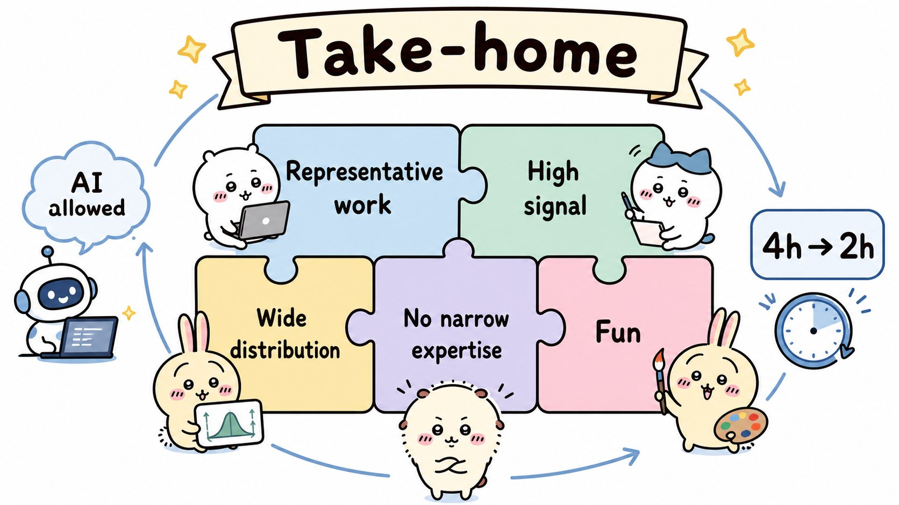
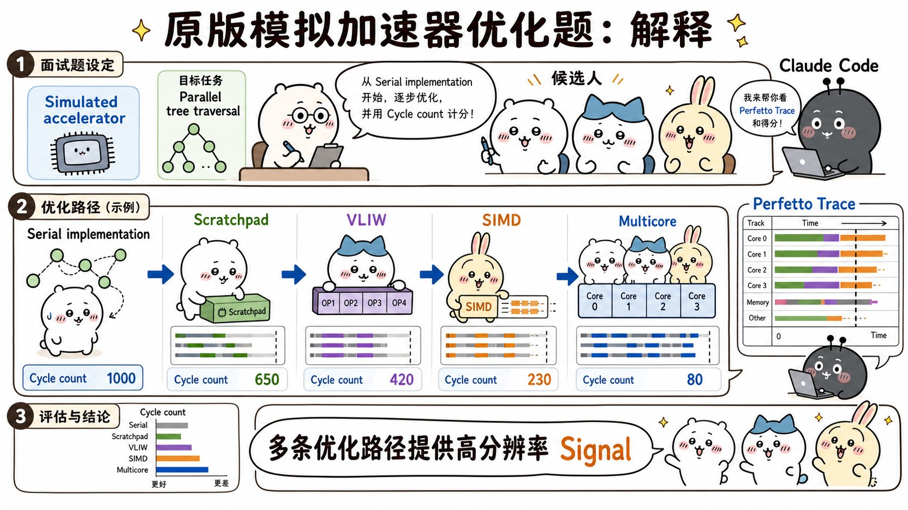
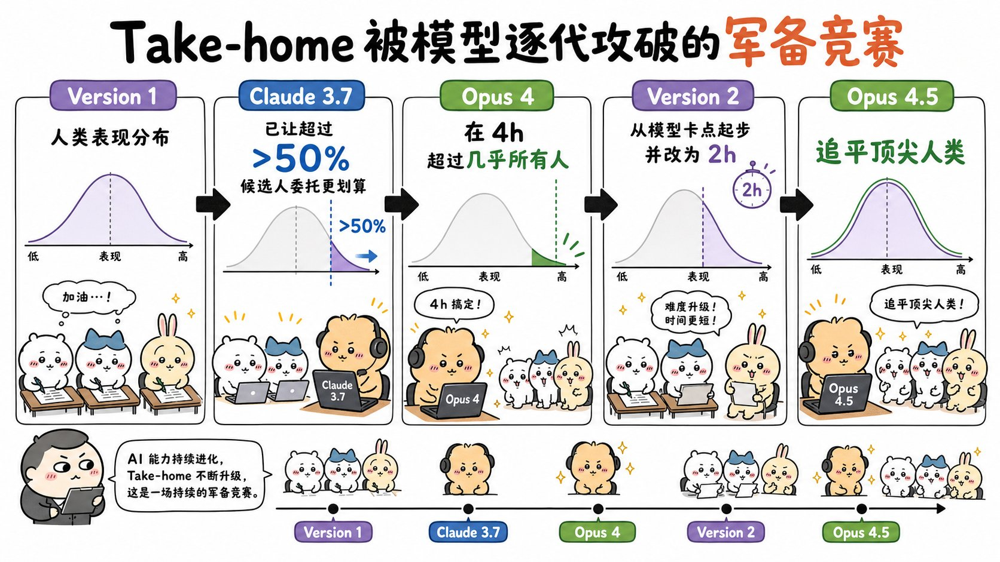
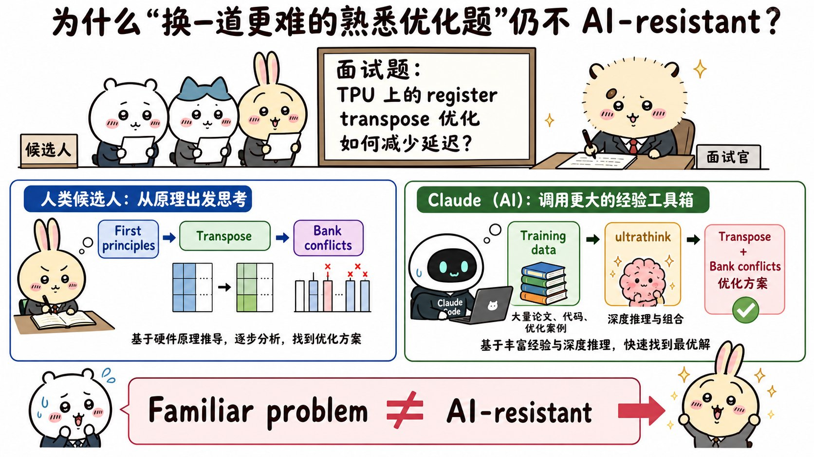
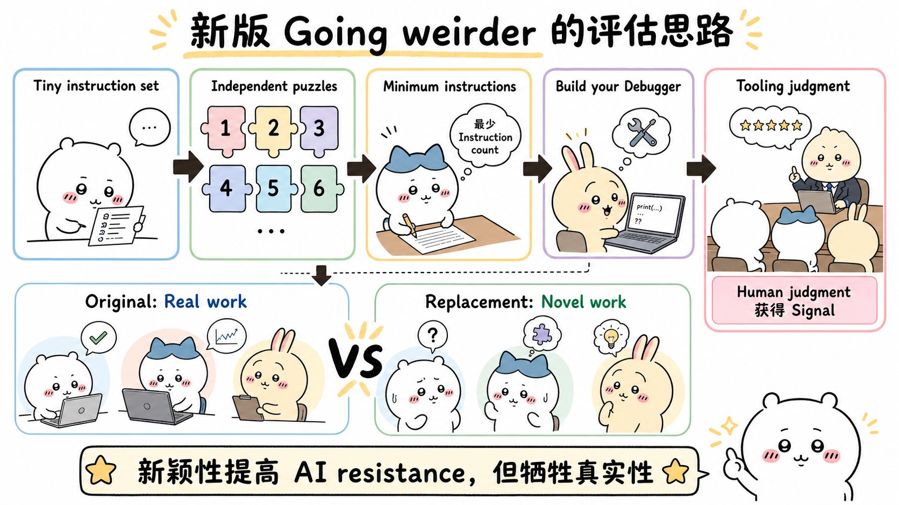

# Designing AI-resistant technical evaluations：面试速记

> Anthropic Engineering · 2026-01-21 · 作者 Tristan Hume · [官方原文](https://www.anthropic.com/engineering/AI-resistant-technical-evaluations) · [本地逐句对照](17_AI-resistant-technical-evaluations_逐句对照.md)

## 一句话讲明白

**Anthropic 性能工程团队那套用了两年、超过 1000 人做过的带回家测试（take-home test），被 Claude 一代代吃掉了：Opus 4 超过大多数人，Opus 4.5 连最强的人也追平。作者迭代了三个版本才找到答案——不是禁用 AI，而是把题目做成「足够偏离分布（out of distribution）」的受限指令集谜题，让人类的现场推理还能赢过模型庞大的训练经验；代价是题目不再像真实工作了。**

## 为什么值得读 / 能用在哪

- 这是一份罕见的、**带具体数字的能力边界实测记录**：同一道题、同一套评分标准、四代模型，能直接量化「模型这两年涨了多少」。面试聊到模型能力评估、测试时计算（test-time compute）、评估集失效，这篇是最好的弹药。
- 核心方法论可以直接迁移到**做评估集**：一道题被模型攻破，往往不是因为它简单，而是因为**训练数据里有大量类似经验**。想让评估有区分度，得往训练分布之外找。
- 招聘/面试设计的人可以直接抄：为什么允许用 AI、为什么时限从 4 小时砍到 2 小时、为什么故意不提供调试器。

## 核心要点

### 一、一套好的带回家测试，目标是什么

起因是 2023 年 11 月：Anthropic 正准备训练发布 Claude Opus 3，新的 TPU、GPU 集群到位，大型 Trainium 集群在路上，但性能工程师不够。作者在 Twitter 上发帖招人，涌来的候选人远超标准面试流程的吞吐能力，于是**花两周设计了这套测试**。

带回家测试名声不好——通常塞满工程师觉得无聊的泛泛问题，筛选效果也差。作者要的是**让人乐于参与、并且能高分辨率捕捉技术能力**的东西。相比现场面试，这种形式有四个优势：

1. **时间跨度更长**：工程师写代码时很少面对不到一小时的截止时间。4 小时（后来 2 小时）更贴近真实工作。
2. **环境真实**：没人在旁边盯着、不用边做边讲解，候选人在**自己的编辑器**里工作。
3. **留出理解系统和搭工具的时间**：性能优化要先读懂既有系统，有时还得自己造调试工具——这两件事在常规 50 分钟面试里根本测不出来。
4. **与 AI 辅助兼容**：Anthropic 的候选人通用指引默认要求不使用 AI 完成带回家测试，**而这道题明确说明「允许用」**。理由是：时间跨度长的问题 AI 难以完全解决，候选人可以像在岗位上一样用 AI 工具，同时仍要展示自己的能力。

再叠加作者设计任何面试题都用的四条原则：**代表真实工作**、**高信号**（避免成败系于单一灵光一现，得分分布要宽，深度要足够到最强的人也做不完）、**不要求特定领域知识**（基本功好的人可以入职再学，要求窄专长只会缩小候选人池）、**有趣**（开发循环快、问题有深度、有创造空间）。

### 二、那台模拟加速器：高信号是设计出来的

作者用 Python 写了一台**虚构加速器的模拟器**，特性接近 TPU：

- **便签式存储（scratchpad memory）**——和 CPU 不同，加速器通常要显式手动管理内存；
- **超长指令字（VLIW）**——每个周期多个执行单元并行，要求高效的指令打包；
- **单指令多数据（SIMD）**——一条指令对大量元素做向量运算；
- **多核**——把工作分配到多个核心。

配套工具是支持热重载的 Perfetto 追踪，**能看到每一条指令**，和 Anthropic 在 Trainium 上真实使用的工具链同构。评分标准是模拟机器跑出来的**时钟周期数**，越少越好。

题目是**并行树遍历**，刻意不做成深度学习风格（当时大多数性能工程师还没做过深度学习，领域细节可以入职再学），灵感来自无分支 SIMD 决策树推理这个经典机器学习优化问题——只有极少数候选人事先见过。候选人从**完全串行的实现**出发，热身是多核并行，之后自选去攻 SIMD 向量化还是 VLIW 指令打包。最初的版本里还**埋了一个 bug**，必须先调试出来，专门考察造工具的能力。

**为什么信号高：优化路径有很多条，不是押一个谜底。** 效果也确实好——Twitter 那批里有一个人得分远高于所有人，2 月初入职后立刻开始优化内核，并为一个阻塞发布的编译器 bug（张量索引运算溢出 32 位）找到了绕过方案。一年半里约 1000 人完成测试，帮团队招到了现有性能工程师的大部分；对**履历薄的人尤其有价值**，几位最出色的工程师是本科毕业直接入职的。许多候选人做得兴起，超过 4 小时还在继续；不限时提交的最强作品里，甚至有完整的**优化型迷你编译器**。

### 三、历代模型逐个攻破：一条可以直接背的时间线

- **2025 年 5 月：Claude 3.7 Sonnet** 已经悄悄爬到——**超过 50% 的候选人如果把题完全委托给 Claude Code，成绩反而更好**。
- **Claude Opus 4（预发布版）**：在 4 小时限制内给出的方案**超过了几乎所有人类**。（这不是作者第一道被攻破的题：他 2023 年专门设计的一道现场面试题，第一部分被 Claude 3 Opus 攻破、第二部分被 Claude 3.5 Sonnet 攻破，至今还在用——因为其他现场题同样不抗 AI。）
- **第 2 版的修补**：这道题的深度远超任何人 4 小时能探索的范围，于是作者**用 Opus 4 找出它开始吃力的位置，把那里当作新起点**。同时写了更整洁的起始代码、加了新机器特性增加深度、**移除多核**（Claude 已经解决，只拖慢开发循环不增加信号），并把时限从 4 小时砍到 2 小时——原本 4 小时是照顾候选人「卡一会儿也不至于全盘皆输」，但排期开销让招聘流程被拖延数周，2 小时容易塞进周末。第 2 版更强调**巧妙的优化洞察**，而非调试能力和代码量。它管用了几个月。
- **Claude Opus 4.5（预发布检查点）**：作者看着 Claude Code 做了 2 小时。它解掉最初的瓶颈、实现所有常见微优化，**不到一小时就过了及格线**；然后停下来，确信自己撞上无法逾越的内存带宽瓶颈——**大多数人类也会得出同样结论**。但存在利用问题结构绕过瓶颈的巧妙技巧；作者一告诉它「实际可以达到的周期数」，它想了一会儿就找到了，接着继续调试、调参、加优化。**到 2 小时截止时，它的成绩追平了该时限内人类的最好表现——而那位人类本身就重度使用 Claude 4 并全程引导（steering）。** 放进内部测试时计算框架跑更严谨的一轮，确认它既能在 2 小时内胜过人类，还能随时间继续攀升；模型发布后作者通用地改进了框架，分数还更高。

**结论：即将发布一个模型，面对它，这道题的最优策略就是把活全交给 Claude Code。**

### 四、失败的尝试：换成「更难但熟悉」的题

先看被否掉的两个选项：

- **禁用 AI**——作者不愿意。除了执行难度，他的判断是：既然人在实际工作中仍然关键，就应该能找到某种办法让人在**有 AI 的环境里**脱颖而出，就像在岗位上一样。他也不想这么早就认同「人类只在超过几小时的任务上才有优势」这种观点。
- **把标准提高到「大幅超越 Claude Code 独立完成的水平」**——顾虑是 Claude 太快：**人类通常要花掉 2 小时中的一半读题理解**，试图引导 Claude 的人会一直落在后面、只能事后才明白 Claude 干了什么，**占优策略可能变成袖手旁观**。

至于「照着今天的真实工作出题」，如今 Anthropic 性能工程师的工作更像：艰深的调试、系统设计、性能分析、想办法验证系统正确性、想办法让 Claude 写的代码更简洁优雅——**这些没有大量时间或共同上下文，很难客观考察**。

于是作者试了一道更难的题：在 2D TPU 寄存器上做高效数据**转置**、同时避免**存储体冲突（bank conflicts）**，取材于他自己在 Anthropic 做过的一次棘手内核优化。Claude 帮他在**不到一天**里实现完。结果：

1. Opus 4.5 找到一个他压根没想到的绝妙优化——**与其转置数据，不如把整个计算过程转置掉**，并据此重写了整个程序。真实场景里这条路走不通，作者打补丁堵死了它。
2. 之后 Claude 有进展但找不到最高效解，看起来新题成了。但作者不踏实，用 Claude Code 的 `ultrathink` 配更长的思考预算再查一遍——**它把题解了，甚至知道修存储体冲突的那些技巧。**

**教训（这是全文最重要的一句）：数据转置和存储体冲突是许多平台上的工程师都缠斗过的问题，Claude 有大量训练数据可借鉴。作者当年是从第一性原理（first principles）推出解法的，但模型不必从第一性原理走——它可以调用一个大得多的经验工具箱。「对单个人很难」不等于「抗 AI」。**

### 五、往更怪的方向走：类 Zachtronics 的受限指令集谜题

作者需要一道**人类推理能胜过 Claude 经验库**的题，也就是**足够偏离分布（out of distribution）**的东西——这直接与「题目要看起来像实际工作」的目标冲突。他回想自己玩得最开心的不寻常优化问题，落到了 Zachtronics 游戏上：这类编程解谜游戏用**不寻常、高度受限的指令集**，逼你以非常规方式编程。例如 Shenzhen I/O 里，程序被拆到多块相互通信的芯片上，**每块只放得下约 10 条指令和一两个状态寄存器**，巧妙的优化常常要**把状态编码进指令指针或分支标志位**。

新版带回家测试就是这个路子：**若干使用极小、高度受限指令集的谜题，优化目标是解法的指令数最少。** 作者先实现一道中等偏难的谜题拿 Opus 4.5 测——**它失败了**；再补齐更多谜题，并请同事验证「浸淫程度不如自己深的人也仍能胜过 Claude」。

**和 Zachtronics 游戏不同的一点很关键：作者刻意不提供任何可视化或调试器，起始代码只检查解法是否有效。** 因为**造调试工具本身就是考察内容**——你可以插入精心设计的 `print` 语句，也可以让编程模型花几分钟生成一个交互式调试器。**在工具上怎么投入，这个判断力本身就是信号的一部分。**

评价：新版**方差可能比原版更低**，因为它由更多相互独立的子问题组成。早期结果令人鼓舞——得分与候选人过往工作水准相关性很好，作者一位能力最强的同事拿到了迄今高于所有候选人的分数。但他仍为放弃原版的真实感和层次丰富的深度感到遗憾，并写下那句结论：

> **原版之所以有效，是因为它像真实的工作；替代版之所以有效，是因为它模拟的是全新的工作。真实感也许已经是我们不再拥有的奢侈品。**

### 六、公开挑战：一份可以直接背的周期数榜单

原版测试已作为公开挑战发布，**不限时**任何人都能试。理由是：在足够长的时间跨度上人类专家仍保有优势，**迄今提交过的最快人类解法，大幅超越了 Claude 即便在大量测试时计算加持下的成绩。** 发布版从零开始（像第 1 版），但用第 2 版的指令集和单核设计，所以周期数可与第 2 版直接比较。

| 周期数（越少越好） | 由谁、在什么条件下达成 |
| --- | --- |
| **2164** | Opus 4，在测试时计算框架里跑很多小时 |
| **1790** | Opus 4.5，一次随手开的 Claude Code 会话——**约等于人类 2 小时内的最好表现** |
| **1579** | Opus 4.5，测试时计算框架跑 2 小时 |
| **1548** | Sonnet 4.5，远超 2 小时的测试时计算 |
| **1487** | Opus 4.5，框架里跑 11.5 小时——**发布时的最好成绩，也是公开挑战的门槛线** |
| **1363** | Opus 4.5，改进后的框架跑很多小时 |

代码在 GitHub 的 `original_performance_takehome` 仓库。**优化到 1487 周期以下**（胜过 Claude 发布时的最好成绩），可以带代码和简历直接发邮件给性能工程招聘邮箱。原文结尾一句：我们也很好奇它还能撑多久。

## 面试高频问答

**Q：一道技术题被模型攻破了，你会怎么判断该修补还是该重做？**
A：先看它是**深度不够**还是**分布不对**。原版那道题深度远超 4 小时能探索的范围，所以修补就够——直接用模型找出它开始吃力的位置，把那里当新起点，再砍掉模型已经稳定解决的部分（比如多核）。但如果模型是靠**训练数据里的现成经验**解掉的（比如数据转置、存储体冲突），修补没用，堵一条路它换一条，必须换到偏离分布的新题型上。

**Q：为什么禁用 AI 不是好答案？**
A：一是执行不了，二是**它不代表真实工作环境**——工程师在岗位上本来就用 AI。作者的立场是：既然人在工作中仍然关键，就该找到让人在有 AI 的环境里脱颖而出的办法。退一步说，「把及格线抬高到大幅超越 Claude 独立完成」也不行：Claude 快，人类要花一半时间读题，引导者会一直落后，**占优策略会退化成袖手旁观**。

**Q：什么叫「偏离分布」，怎么用它设计有区分度的评估？**
A：指题目形态在模型训练数据里几乎没有对应经验。判断方法很简单——**问「有多少工程师在多少平台上解过类似问题」**。答案是「很多」的题，无论对单个人多难，模型都能调用一个巨大的经验工具箱；答案是「几乎没有」的题（如极小受限指令集、把状态编码进指令指针），人类的现场推理才有胜算。代价是它离真实岗位越来越远。

**Q：新版故意不给调试器，这不是刁难人吗？**
A：不是，这是**把「工具投入判断力」显式变成评分信号**。起始代码只验证解法是否有效，你可以插 `print`，也可以让编程模型几分钟生成一个交互式调试器——**什么时候值得停下来造工具，本身就是性能工程的核心能力**。顺带一提，新版由多个独立子问题组成，方差也比原版更低。

**Q：这篇对我们做产品/模型评估集有什么可迁移的？**
A：三条。① **评估集会被能力进步吃掉，要预设它有保质期**——这套题两年内被迭代了三次。② **难度不等于抗 AI**，判据是训练分布覆盖度。③ **保留超出当前能力上限的深度**，这样被追上时能靠「上移起点」低成本续命，而不是推倒重来。

## 必须记住的 8 句话

1. 超过 **1000** 名候选人做过这套题，帮 Anthropic 招到了现有性能工程团队的大部分成员，其中数十人在职。
2. 好评估的四条原则：**代表真实工作、信号高（得分分布宽、不押单一灵感）、不要求窄领域知识、有趣**。
3. 原题高信号的秘密是**多条优化路径**：便签式存储、VLIW、SIMD、多核，从串行实现一路往上爬，还埋了一个必须先调试的 bug。
4. **Claude 3.7 Sonnet** 时，超过 **50%** 的候选人完全委托 Claude Code 成绩反而更好。
5. **Opus 4** 在 4 小时内超过几乎所有人类 → 第 2 版把起点上移、砍掉多核、时限 4 小时改 2 小时；**Opus 4.5** 又在 2 小时内追平最强人类（那位人类还重度用了 Claude 4 引导）。
6. **熟悉的难题不抗 AI**：转置 + 存储体冲突这类问题训练数据太多，`ultrathink` 加长思考预算就解掉了。人类从第一性原理推出，不代表模型只能从第一性原理推出。
7. 最终方案是**类 Zachtronics 的极小受限指令集谜题**，比拼最少指令数，**故意不给可视化和调试器**——造工具的判断力也是信号。
8. 抗 AI 与真实感之间存在**真实的取舍**：原版有效因为像真实工作，新版有效因为模拟全新工作。公开挑战的门槛是**优化到 1487 周期以下**。

## 30 秒口述版

> Anthropic 性能工程团队从 2024 年初起用一套带回家测试：在一台类 TPU 的模拟加速器上优化并行树遍历，靠便签式存储、VLIW、SIMD、多核多条路径爬分，按时钟周期数评分，而且明确允许用 AI。超过 1000 人做过，招到了团队大部分人。但模型一代代吃掉了它：Claude 3.7 Sonnet 时超过一半候选人完全委托给 Claude Code 反而更好，Opus 4 在 4 小时内超过几乎所有人，作者于是把起点上移、砍掉多核、时限改成 2 小时；结果 Opus 4.5 又在 2 小时内追平了最强人类。作者拒绝禁用 AI，转而设计更难的题——TPU 寄存器转置加避免存储体冲突——但被 `ultrathink` 解掉了，教训是这类问题工程师们缠斗过太多次，模型有巨大的经验工具箱可调，难不等于抗 AI。最终他转向足够偏离分布的方向：一套类 Zachtronics 的极小受限指令集谜题，比谁的指令数最少，还故意不提供调试器，因为造工具的判断力本身就是信号。新版方差更低、与候选人真实水准相关性好，但不再像真实工作了。核心矛盾就是这一句：原版有效因为它像真实工作，新版有效因为它模拟全新工作。

## 自测

- [ ] 能说出这套带回家测试相比现场面试的四个形式优势，以及作者设计任何面试题都用的四条原则。
- [ ] 能解释模拟加速器题为什么信号高（四层并行能力 + 多条路径 + 埋 bug 考察造工具）。
- [ ] 能按时间顺序复述 Claude 3.7 Sonnet → Opus 4 → Opus 4.5 各自怎么攻破，以及第 2 版做了哪四处改动。
- [ ] 能说清 Opus 4.5 那次「停在内存带宽瓶颈、被告知周期数后找到技巧」的完整经过，以及为什么这个细节重要。
- [ ] 能解释「熟悉的难题为什么不抗 AI」，并说出第一性原理那句反转。
- [ ] 能解释什么是偏离分布，以及为什么它与「题目像真实工作」天然冲突。
- [ ] 能说出新版为什么故意不给调试器，以及它比原版好在哪、差在哪。
- [ ] 能报出至少三个周期数（1790 约等于人类 2 小时最好成绩、1487 是发布时最好成绩兼挑战门槛、1363 是改进框架后的成绩）。

---

> 插图为学习用途的非官方同人式教学图，角色与文章版权归各自权利人。
