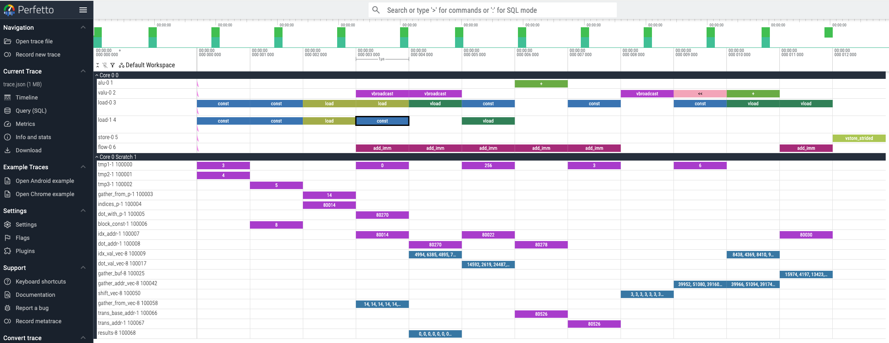
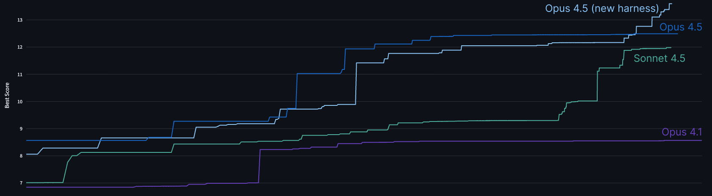

# 17_Designing AI-resistant technical evaluations_设计能抵御 AI 的技术评估

> 原文：https://www.anthropic.com/engineering/AI-resistant-technical-evaluations
> 作者：Anthropic Engineering｜发布日期：2026-01-21

## 📌 本篇速览

- 📅 2026-01-21　｜　⏱ 约 15 分钟　｜　📄 2,699 词 / 2 图
- ⭐ ★★★☆☆ **按需阅读** —— 对 Agent 工程师是有趣的能力边界案例研究（模型 vs 人类、测试时计算），但主题偏招聘评估设计而非 Agent 系统构建，非必读。
- 🏷 技术评估、AI 抵御性、招聘、性能工程、out-of-distribution
- 🗂 [返回总目录](00_目录与阅读进度.md)

Anthropic 性能优化团队负责人 Tristan Hume 讲述其设计的性能工程带回家测试如何被历代 Claude 模型（Opus 4、Opus 4.5）相继攻破，以及为保持评估信号所做的三轮迭代。文章总结了让评估抵御 AI 辅助的经验：贴近真实工作的题目会被模型庞大的训练经验覆盖，最终有效的方案是采用类 Zachtronics 的高度受限指令集谜题——足够偏离分布，让人类推理仍能胜过模型。文末将原版测试作为公开挑战发布，超过 Claude 最好成绩者可直接联系招聘。

---

*Written by Tristan Hume, a lead on Anthropic's performance optimization team. Tristan designed—and redesigned—the take-home test that's helped Anthropic hire dozens of performance engineers.*

*本文作者 Tristan Hume 是 Anthropic 性能优化团队的负责人之一。Tristan 设计——并多次重新设计——了那套帮助 Anthropic 招到数十名性能工程师的带回家测试（take-home test）。*

Evaluating technical candidates becomes harder as AI capabilities improve.

随着 AI 能力的提升，评估技术候选人变得越来越难。

A take-home that distinguishes well between human skill levels today may be trivially solved by models tomorrow—rendering it useless for evaluation.

今天还能很好区分人类技能水平的带回家测试，明天可能就会被模型轻松解掉——从而在评估上变得毫无用处。

Since early 2024, our performance engineering team has used a take-home test where candidates optimize code for a simulated accelerator.

自 2024 年初以来，我们的性能工程团队一直在使用一套带回家测试：候选人需要为一台模拟加速器（simulated accelerator）优化代码。

Over 1,000 candidates have completed it, and dozens now work here, including engineers who brought up our Trainium cluster and shipped every model since Claude 3 Opus.

已有超过 1000 名候选人完成了这套测试，其中数十人如今在这里工作，包括把我们的 Trainium 集群拉起来、并参与交付了自 Claude 3 Opus 以来每一个模型的工程师。

But each new Claude model has forced us to redesign the test.

但每个新的 Claude 模型都迫使我们重新设计这套测试。

When given the same time limit, Claude Opus 4 outperformed most human applicants.

在相同的时间限制下，Claude Opus 4 的表现超过了大多数人类申请者。

That still allowed us to distinguish the strongest candidates—but then Claude Opus 4.5 matched even those.

那时我们还能借此区分出最强的候选人——但随后 Claude Opus 4.5 连这些最强者也追平了。

Humans can still outperform models when given unlimited time, but under the constraints of the take-home test, we no longer had a way to distinguish between the output of our top candidates and our most capable model.

在时间不受限的情况下，人类仍然能胜过模型；但在带回家测试的约束条件下，我们已经无法区分顶尖候选人的产出和我们最强模型的产出。

I've now iterated through three versions of our take-home in an attempt to ensure it still carries signal.

为了确保这套测试仍然具有信号（signal），我至今已经迭代了三个版本。

Each time, I’ve learned something new about what makes evaluations robust to AI assistance and what doesn't.

每一次迭代，我都会学到一些新东西：什么样的评估能抵御 AI 辅助，什么样的不能。

This post describes the original take-home design, how each Claude model defeated it, and the increasingly unusual approaches I've had to take to ensure our test stays ahead of our top model’s capabilities.

本文将介绍最初的带回家测试设计、每一代 Claude 模型是如何攻破它的，以及为了让测试始终领先于我们最强模型的能力，我不得不采取的那些越来越不寻常的办法。

While the work we do has evolved alongside our models, we still need more strong engineers—just increasingly creative ways to find them.

尽管我们的工作内容随着模型一同演进，我们仍然需要更多优秀的工程师——只是需要越来越有创意的方式去找到他们。

To that end, we're releasing the original take-home as an open challenge, since with unlimited time the best human performance still exceeds what Claude can achieve.

为此，我们把最初版本的带回家测试作为公开挑战发布出来，因为在时间不受限的情况下，人类的最佳表现仍然超过 Claude 所能达到的水平。

If you can best Opus 4.5, we’d love to hear from you—details are at the bottom of this post.

如果你能胜过 Opus 4.5，我们非常希望收到你的消息——详情见本文末尾。

### The origin of the take-home｜带回家测试的起源

In November 2023, we were preparing to train and launch Claude Opus 3.

2023 年 11 月，我们正在准备训练并发布 Claude Opus 3。

We’d secured new TPU and GPU clusters, our large Trainium cluster was coming, and we were spending considerably more than we had in the past on accelerators, but we didn't have enough performance engineers for our new scale.

我们拿到了新的 TPU 和 GPU 集群，大型 Trainium 集群也即将到位，我们在加速器上的花费比过去多得多，但性能工程师的数量跟不上我们的新规模。

I [posted on Twitter](https://x.com/trishume/status/1730386529997238605?s=20) asking people to email us, which brought in more promising candidates than we could evaluate through our standard interview pipeline, a process that consumes significant time for staff and candidates

我[在 Twitter 上发帖](https://x.com/trishume/status/1730386529997238605?s=20)请大家给我们发邮件，结果收到的有潜力的候选人数量，超出了我们标准面试流程的评估能力——那套流程对员工和候选人来说都非常耗时。

We needed a way to evaluate candidates more efficiently.

我们需要一种更高效地评估候选人的方式。

So, I took two weeks to design a take-home test that could adequately capture the demands of the role and identify the most capable applicants.

于是，我花了两周时间设计出一套带回家测试，希望它能充分刻画这个岗位的要求，并识别出能力最强的申请者。

#### Design goals｜设计目标

Take-homes have a bad reputation.

带回家测试的名声并不好。

Usually they’re filled with generic problems which engineers find boring, and which make for poor filters.

它们通常塞满了工程师觉得无聊的泛泛问题，而这些问题也起不到好的筛选作用。

My goal was different: create something genuinely engaging that would make candidates excited to participate and allow us to capture their technical skills at a high-level of resolution.

我的目标不一样：做出一个真正引人入胜的东西，让候选人乐于参与，同时让我们能以高分辨率（high-level of resolution）捕捉他们的技术能力。

The format also offers advantages over live interviews for evaluating performance engineering skills:

在评估性能工程能力方面，这种形式相比现场面试也有一些优势：

**Longer time horizon:** Engineers rarely face deadlines of less than an hour when coding.

**更长的时间跨度：**工程师写代码时很少面对不到一小时的截止时间。

A 4-hour window (later reduced to 2 hours) better reflects the actual nature of the job.

4 小时的时间窗口（后来缩短为 2 小时）更能反映这份工作的真实性质。

It's still shorter than most real tasks, but we need to balance that with how onerous it is.

它仍然比大多数真实任务要短，但我们必须在真实性和测试负担之间取得平衡。

**Realistic environment:** No one watching or expecting narration.

**真实的环境：**没有人在旁边盯着，也不需要边做边讲解。

Candidates work in their own editor without distraction.

候选人在自己的编辑器里不受干扰地工作。

**Time for comprehension and tooling:** Performance optimization requires understanding existing systems and sometimes building debugging tools.

**留出理解系统和搭建工具的时间：**性能优化需要理解现有系统，有时还需要构建调试工具。

Both are hard to realistically evaluate in a normal 50 minute interview.

这两者在常规的 50 分钟面试里都很难得到真实的评估。

**Compatibility with AI assistance:** Anthropic's [general candidate guidance](https://www.anthropic.com/candidate-ai-guidance) asks candidates to complete take-homes without AI unless indicated otherwise.

**与 AI 辅助兼容：**Anthropic 的[候选人通用指引](https://www.anthropic.com/candidate-ai-guidance)要求候选人在没有特别说明的情况下不使用 AI 完成带回家测试。

For this take-home, we explicitly indicate otherwise.

而对这套带回家测试，我们明确说明允许使用 AI。

Longer-horizon problems are harder for AI to solve completely, so candidates can use AI tools (as they would on the job) while still needing to demonstrate their own skills.

时间跨度更长的问题对 AI 来说更难完全解决，因此候选人可以使用 AI 工具（就像他们在实际工作中那样），同时仍然需要展现自己的能力。

Beyond these format-specific goals, I applied the same principles I use when designing any interview to make the take-home:

除了这些与形式相关的目标之外，我在设计这套带回家测试时，还沿用了我设计任何面试题时都会遵循的原则：

**Representative of real work:** The problem should give candidates a taste of what the job actually involves.

**代表真实工作：**题目应该让候选人尝到这份工作实际是什么样子。

**High signal:** The take-home should avoid problems that hinge on a single insight and ensure candidates have many chances to show their full abilities — leaving as little as possible to chance.

**高信号：**带回家测试应避免那种成败系于单一灵光一现的问题，并确保候选人有很多机会展示他们的全部能力——尽可能减少运气成分。

It should also have a wide scoring distribution,and ensure enough depth that even strong candidates don't finish everything.

它还应该有足够宽的得分分布，并保证足够的深度，让即使是很强的候选人也做不完所有内容。

**No specific domain knowledge:** People with good fundamentals can learn specifics on the job.

**不要求特定领域知识：**基本功扎实的人可以在工作中学习具体领域的细节。

Requiring narrow expertise unnecessarily limits the candidate pool.

要求狭窄的专业知识会不必要地缩小候选人池。

**Fun:** Fast development loops, interesting problems with depth, and room for creativity.

**有趣：**快速的开发循环、有深度的有趣问题，以及发挥创造力的空间。

#### The simulated machine｜模拟机器

I built a Python simulator for a fake accelerator with characteristics that resemble TPUs.

我用 Python 构建了一台虚构加速器的模拟器，其特性与 TPU 类似。

Candidates optimize code running on this machine, using a hot-reloading [Perfetto](https://perfetto.dev/) trace that shows every instruction, similar to [the tooling we have on Trainium](https://awsdocs-neuron.readthedocs-hosted.com/en/latest/tools/neuron-explorer/overview-device-profiles.html).

候选人要优化在这台机器上运行的代码，借助一个支持热重载（hot-reloading）的 [Perfetto](https://perfetto.dev/) 追踪（trace）来查看每一条指令，这与[我们在 Trainium 上使用的工具链](https://awsdocs-neuron.readthedocs-hosted.com/en/latest/tools/neuron-explorer/overview-device-profiles.html)类似。

The machine includes features that make accelerator optimization interesting: manually managed scratchpad memory (unlike CPUs, accelerators often require explicit memory management), VLIW (multiple execution units running in parallel each cycle, requiring efficient instruction packing), SIMD (vector operations on many elements per instruction), and multicore (distributing work across cores).

这台机器包含了让加速器优化变得有意思的各种特性：手动管理的便签式存储（scratchpad memory，与 CPU 不同，加速器通常需要显式的内存管理）、VLIW（每个周期有多个执行单元并行运行，要求高效的指令打包）、SIMD（每条指令对大量元素做向量运算），以及多核（multicore，把工作分配到多个核心上）。

The task is a parallel tree traversal, deliberately not deep learning flavored, since most performance engineers hadn't worked on deep learning yet and could learn domain specifics on the job.

任务是一个并行树遍历（parallel tree traversal），刻意没有做成深度学习风格，因为大多数性能工程师当时还没做过深度学习，领域细节可以入职后再学。

The problem was inspired by branchless SIMD decision tree inference, a classical ML optimization challenge as a nod to the past, which only a few candidates had encountered before.

这道题的灵感来自无分支（branchless）SIMD 决策树推理——一个向过去致敬的经典机器学习优化挑战，之前只有极少数候选人接触过。

Candidates start with a fully serial implementation and progressively exploit the machine's parallelism.

候选人从一个完全串行的实现出发，逐步利用这台机器的并行能力。

The warmup is multicore parallelism, then candidates choose whether to tackle SIMD vectorization or VLIW instruction packing.

热身部分是多核并行，之后候选人可以自行选择去攻克 SIMD 向量化还是 VLIW 指令打包。

The original version also included a bug that candidates needed to debug first, exercising their ability to build tooling.

最初的版本里还埋了一个 bug，候选人需要先把它调试出来，以此考察他们构建工具的能力。

### Early results｜早期结果

The initial take-home worked well.

最初的带回家测试效果很好。

One person from the Twitter batch scored substantially higher than everyone else.

Twitter 那一批候选人中，有一个人的得分远远高于其他所有人。

He started in early February, two weeks after our first hires through the standard pipeline.

他在 2 月初入职，比我们通过标准流程招进的第一批人晚了两周。

The test proved predictive: He immediately began optimizing kernels and found a workaround for a launch-blocking compiler bug involving tensor indexing math overflowing 32 bits.

事实证明这个测试很有预测力：他一入职就开始优化内核（kernel），并为一个阻塞发布的编译器 bug 找到了绕过方案——那个 bug 涉及张量索引运算溢出 32 位。

Over the next year and a half, about 1,000 candidates completed the take-home, and it helped us hire most of our current performance engineering team.

在接下来的一年半里，大约 1000 名候选人完成了这套测试，它帮我们招到了现有性能工程团队的大部分成员。

It proved especially valuable for candidates with limited experience on paper: several of our highest-performing engineers came directly from undergrad but showed enough skill on the take-home for us to hire confidently.

它对履历上经验有限的候选人尤其有价值：我们几位表现最出色的工程师是本科毕业直接入职的，但他们在测试中展现的能力足以让我们放心录用。

Feedback was positive.

反馈是正面的。

Many candidates worked past the 4-hour limit because they were enjoying themselves.

许多候选人因为做得兴起，超过了 4 小时的时限还在继续。

The strongest unlimited-time submissions included full optimizing mini-compilers and several clever optimizations I hadn't anticipated.

不限时提交的最强作品中，有完整的优化型迷你编译器（mini-compiler），还有好几个我没有预料到的巧妙优化。

#### Then Claude Opus 4 defeated it｜然后 Claude Opus 4 攻破了它

By May 2025, Claude 3.7 Sonnet had already crept up to the point where over 50% of candidates would have been better off delegating to Claude Code entirely.

到 2025 年 5 月，Claude 3.7 Sonnet 的水平已经悄悄爬升到这样的程度：超过 50% 的候选人如果把任务完全委托给 Claude Code，成绩反而会更好。

I then tested a pre-release version of Claude Opus 4 on the take-home.

随后我用 Claude Opus 4 的预发布版本测试了这套题。

It came up with a more optimized solution than almost all humans did within the 4-hour limit.

它给出的优化方案，超过了几乎所有人类在 4 小时限制内的表现。

This wasn't my first interview defeated by a Claude model.

这不是我第一道被 Claude 模型攻破的面试题。

I'd designed a live interview question in 2023 specifically because our questions at the time were based around common tasks that early Claude models had lots of knowledge of and so could solve easily.

我在 2023 年专门设计过一道现场面试题，起因是我们当时的题目都围绕常见任务，早期的 Claude 模型对这类任务有大量知识储备，因此能轻松解决。

I tried to design a question that required more problem solving skill than knowledge, still based on a real (but niche) problem I'd solved at work.

我试着设计一道更依赖解题能力而非知识储备的题目，它仍然基于我在工作中解决过的一个真实（但小众）的问题。

Claude 3 Opus beat part 1 of that question; Claude 3.5 Sonnet beat part 2.

Claude 3 Opus 攻破了那道题的第一部分；Claude 3.5 Sonnet 攻破了第二部分。

We still use it because our other live questions aren't AI-resistant either.

我们现在仍在用这道题，因为我们其他的现场面试题同样也不抗 AI。

For the take-home, there was a straightforward fix.

对带回家测试来说，有一个直截了当的补救办法。

The problem had far more depth than anyone could explore in 4 hours, so I used Claude Opus 4 to identify where it started struggling.

这道题的深度远超任何人在 4 小时内能探索的范围，于是我用 Claude Opus 4 找出它开始吃力的位置。

That became the new starting point for version 2.

那个位置就成了第 2 版的新起点。

I wrote cleaner starter code, added new machine features for more depth, and removed multicore (which Claude had already solved, and which only slowed down development loops without adding signal).

我写了更整洁的起始代码，为增加深度加入了新的机器特性，并移除了多核部分（Claude 已经解决了它，而且它只会拖慢开发循环，并不增加信号）。

I also shortened the time limit from 4 hours to 2 hours.

我还把时限从 4 小时缩短到 2 小时。

I'd originally chosen 4 hours based on candidate feedback preferring less risk of getting sunk if they got stuck for a bit on a bug or confusion, but the scheduling overhead was causing multi-week delays in our pipeline.

我最初选择 4 小时，是基于候选人的反馈——他们希望即使在某个 bug 或困惑上卡一小会儿，也不至于全盘皆输；但这种时间安排上的开销导致我们的招聘流程被拖延了数周。

Two hours is much easier to fit into a weekend.

两个小时则容易塞进周末得多。

Version 2 emphasized clever optimization insights over debugging and code volume.

第 2 版更强调巧妙的优化洞察，而非调试能力和代码量。

It served us well—for several months.

它很好地服务了我们——维持了几个月。

#### Then Claude Opus 4.5 defeated that｜接着 Claude Opus 4.5 又攻破了新版

When I tested a pre-release Claude Opus 4.5 checkpoint, I watched Claude Code work on the problem for 2 hours, gradually improving its solution.

当我测试 Claude Opus 4.5 的一个预发布检查点（checkpoint）时，我看着 Claude Code 在这道题上工作了 2 个小时，逐步改进它的解法。

It solved the initial bottlenecks, implemented all the common micro-optimizations, and met our passing threshold in under an hour.

它解决了最初的瓶颈，实现了所有常见的微优化（micro-optimization），并在不到一小时内达到了我们的及格线。

Then it stopped, convinced it had hit an insurmountable memory bandwidth bottleneck.

然后它停了下来，确信自己撞上了一个无法逾越的内存带宽瓶颈。

Most humans reach the same conclusion.

大多数人类也会得出同样的结论。

But there are clever tricks that exploit the problem structure to work around that bottleneck.

但其实存在一些巧妙的技巧，可以利用问题结构绕过那个瓶颈。

When I told Claude the cycle count it was possible to achieve, it thought for a while and found the trick.

当我告诉 Claude 实际可以达到的周期数（cycle count）之后，它思考了一会儿，就找到了那个技巧。

It then debugged, tuned, and implemented further optimizations.

接着它开始调试、调参，并实现了更多优化。

By the 2-hour mark, its score matched the best human performance within that time limit—and that human had made heavy use of Claude 4 with steering.

到 2 小时截止时，它的成绩追平了该时限内人类的最好表现——而那位人类选手本身就重度使用了 Claude 4 并对其进行引导（steering）。

We tried it out in our internal test-time compute harness for more rigor and confirmed it could both beat humans in 2 hours and continue climbing with time.

为了更严谨，我们把它放进内部的测试时计算框架（test-time compute harness）里跑了一遍，确认它既能在 2 小时内胜过人类，还能随着时间继续攀升。

Post-launch we even improved our harness in a generic way and got a higher score.

模型发布之后，我们甚至以一种通用的方式改进了这个框架，得到了更高的分数。

I had a problem.

我遇到麻烦了。

We were about to release a model where the best strategy on our take-home would be delegating to Claude Code.

我们即将发布一个模型，而面对它，我们带回家测试的最优策略将变成把任务全权委托给 Claude Code。

### Considering the options｜权衡各种选项

Some colleagues suggested banning AI assistance.

一些同事建议禁止使用 AI 辅助。

I didn't want to do this.

我不想这么做。

Beyond the enforcement challenges, I had a sense that given people continue to play a vital role in our work, I should be able to figure out *some* way for them to distinguish themselves in a setting *with AI—*like they'd have on the job.

且不说执行上的难度，我有一种感觉：既然人在我们的工作中依然扮演着关键角色，我就应该能想出*某种*办法，让他们在一个*有 AI* 的环境里脱颖而出——就像他们在实际工作中那样。

I didn't want to give in yet to the [idea](https://metr.org/blog/2025-03-19-measuring-ai-ability-to-complete-long-tasks/) that humans only have an advantage on tasks longer than a few hours.

我还不想向那种[观点](https://metr.org/blog/2025-03-19-measuring-ai-ability-to-complete-long-tasks/)低头——即人类只在耗时超过几小时的任务上才有优势。

Others suggested raising the bar to "substantially outperform what Claude Code achieves alone."

还有人建议把标准提高到"大幅超越 Claude Code 独立完成的水平"。

The concern here was that Claude works fast.

这里的顾虑在于 Claude 干活很快。

Humans typically spend half the 2 hours reading and understanding the problem before they start optimizing.

人类通常要花掉 2 小时中的一半来阅读和理解题目，然后才开始优化。

A human trying to steer Claude would likely be constantly behind, understanding what Claude did only after the fact.

一个试图引导 Claude 的人很可能会一直落在后面，只能事后才理解 Claude 做了什么。

The dominant strategy might become sitting back and watching.

占优策略可能会变成袖手旁观。

Nowadays performance engineers at Anthropic still have lots of work to do, but it looks more like tough debugging, systems design, performance analysis, figuring out how to verify the correctness of our systems, and figuring out how to make Claude's code simpler and more elegant.

如今 Anthropic 的性能工程师依然有大量工作要做，但这些工作更多是：艰深的调试、系统设计、性能分析、琢磨如何验证我们系统的正确性，以及琢磨如何让 Claude 写的代码更简洁、更优雅。

Unfortunately these things are tough to test in an objective way without a lot of time or common context.

不幸的是，这些东西如果没有大量时间或共同的上下文，很难用客观的方式来考察。

It's always been hard to design interviews that represent the job, but now it's harder than ever.

设计能代表实际工作的面试从来都不容易，而现在比以往任何时候都更难。

But I also worried if I invested in designing a new take-home, either Claude Opus 4.5 would solve that too, or it would become so challenging that it would be impossible for humans to complete in two hours.

但我也担心：如果我投入精力设计一套新的带回家测试，要么 Claude Opus 4.5 也会把它解掉，要么它会难到人类根本无法在两小时内完成。

#### Attempt 1: A different optimization problem｜尝试一：换一个优化问题

I realized Claude could help me implement whatever I designed quickly, which motivated me to try developing a harder take-home.

我意识到无论我设计什么，Claude 都能帮我快速实现，这促使我尝试开发一套更难的带回家测试。

I chose a problem based on one of the trickier kernel optimizations I'd done at Anthropic: an efficient data [transposition](https://en.wikipedia.org/wiki/Transpose) on 2D TPU registers while avoiding [bank conflicts](https://feldmann.nyc/blog/smem-microbenchmarks).

我选了一道题，它基于我在 Anthropic 做过的一个较为棘手的内核优化：在 2D TPU 寄存器上做高效的数据[转置（transposition）](https://en.wikipedia.org/wiki/Transpose)，同时避免[存储体冲突（bank conflicts）](https://feldmann.nyc/blog/smem-microbenchmarks)。

I distilled it into a simpler problem on a simulated machine and had Claude implement the changes in under a day.

我把它提炼成模拟机器上的一个更简单的问题，并让 Claude 在不到一天的时间里实现了这些改动。

Claude Opus 4.5 found a great optimization I hadn't even thought of.

Claude Opus 4.5 找到了一个我压根没想到的绝妙优化。

Through careful analysis, it realized it could transpose the entire computation rather than figuring out how to transpose the data, and it rewrote the whole program accordingly.

通过细致的分析，它意识到与其琢磨如何转置数据，不如把整个计算过程转置掉，并据此重写了整个程序。

In my real case, this wouldn't have worked, so I patched the problem to remove that approach.

在我实际遇到的场景中，这条路是走不通的，所以我给题目打了补丁，堵死了这种做法。

Claude then made progress but couldn't find the most efficient solution.

之后 Claude 虽有进展，但找不到最高效的解法。

It seemed like I had my new problem, now I just had to hope human candidates could get it fast enough.

看起来我的新题目有了，现在只需指望人类候选人能足够快地做出来。

But I had some nagging doubt, so I double-checked using Claude Code's "ultrathink" feature with longer thinking budgets ... and it solved it.

但我心里总有些不踏实，于是用 Claude Code 的"ultrathink"功能配上更长的思考预算又核查了一遍……结果它把题解了。

It even knew the tricks for fixing bank conflicts.

它甚至知道解决存储体冲突的那些技巧。

In hindsight, this wasn't the right problem to try.

事后看来，这道题选得并不对。

Engineers across many platforms have struggled with data transposition and bank conflicts, so Claude has substantial training data to draw on.

许多平台上的工程师都曾与数据转置和存储体冲突缠斗，因此 Claude 有大量可供借鉴的训练数据。

While I'd found my solution from first principles, Claude could draw on a larger toolbox of experience.

虽然我当年是从第一性原理（first principles）推出解法的，但 Claude 可以调用一个更大的经验工具箱。

#### Attempt 2: Going weirder｜尝试二：往更怪的方向走

I needed a problem where human reasoning could win over Claude's larger experience base: something sufficiently out of distribution.

我需要一道人类推理能力可以战胜 Claude 庞大经验库的题：某种足够偏离分布（out of distribution）的东西。

Unfortunately, this conflicted with my goal of being recognizably like the job.

不幸的是，这与我"让题目看起来像实际工作"的目标相冲突。

I thought about the most unusual optimization problems I'd enjoyed and landed on [Zachtronics games](https://www.zachtronics.com/).

我回想自己玩得最开心的那些不寻常的优化问题，最终落在了 [Zachtronics 游戏](https://www.zachtronics.com/)上。

These programming puzzle games use unusual, highly constrained instruction sets that force you to program in unconventional ways.

这类编程解谜游戏使用不寻常、高度受限的指令集，迫使你以非常规的方式编程。

For example, in [Shenzhen I/O](https://www.zachtronics.com/shenzhen-io/), programs are split across multiple communicating chips that each hold only about 10 instructions with one or two state registers.

例如，在 [Shenzhen I/O](https://www.zachtronics.com/shenzhen-io/) 中，程序被拆分到多块相互通信的芯片上，每块芯片只能容纳约 10 条指令和一两个状态寄存器。

Clever optimization often involves encoding state into the instruction pointer or branch flags.

巧妙的优化常常要把状态编码进指令指针（instruction pointer）或分支标志位（branch flags）里。

I designed a new take-home consisting of puzzles using a tiny, heavily constrained instruction set, optimizing solutions for minimal instruction count.

我设计了一套新的带回家测试，由若干使用极小且高度受限指令集的谜题组成，优化目标是让解法的指令数最少。

I implemented one medium-hard puzzle and tested it on Claude Opus 4.5.

我实现了一道中等偏难的谜题，拿 Claude Opus 4.5 来测试。

It failed.

它失败了。

I filled out more puzzles and had colleagues verify that people less steeped in the problem than me could still outperform Claude.

我补齐了更多谜题，并请同事验证：即使是对这个问题浸淫不如我深的人，也仍然能胜过 Claude。

Unlike Zachtronics games, I intentionally provided no visualization or debugging tools.

与 Zachtronics 游戏不同，我刻意不提供任何可视化或调试工具。

The starter code only checks whether solutions are valid.

起始代码只检查解法是否有效。

Building debugging tools is part of what's being tested: you can either insert well-crafted print statements or ask a coding model to generate an interactive debugger in a few minutes.

构建调试工具本身就是考察内容的一部分：你可以插入精心设计的 print 语句，也可以让编程模型在几分钟内生成一个交互式调试器。

Judgment about how to invest in tooling is part of the signal.

如何在工具上投入的判断力，本身就是信号的一部分。

I'm reasonably happy with the new take-home.

我对这套新的带回家测试还算满意。

It might have lower variance than the original because it comprises more independent sub-problems.

它的方差（variance）可能比原版更低，因为它由更多相互独立的子问题组成。

Early results are promising: scores correlate well with the caliber of candidates' past work, and one of my most capable colleagues scored higher than any candidate so far.

早期结果令人鼓舞：得分与候选人过往工作的水准有很好的相关性，而且我一位能力最强的同事拿到了迄今为止高于所有候选人的分数。

I'm still sad to have given up the realism and varied depth of the original.

放弃了原版的真实感和层次丰富的深度，我仍然感到遗憾。

But realism may be a luxury we no longer have.

但真实感也许已是我们不再拥有的奢侈品。

The original worked because it resembled real work.

原版之所以有效，是因为它像真实的工作。

The replacement works because it simulates novel work.

替代版之所以有效，是因为它模拟的是全新的工作。

### An open challenge｜一项公开挑战

We're releasing the original take-home for anyone to try with unlimited time.

我们现在发布最初版本的带回家测试，任何人都可以不限时地尝试。

Human experts [retain an advantage](https://metr.org/blog/2025-03-19-measuring-ai-ability-to-complete-long-tasks/) over current models at sufficiently long time horizons.

在足够长的时间跨度上，人类专家相对当前模型[仍保有优势](https://metr.org/blog/2025-03-19-measuring-ai-ability-to-complete-long-tasks/)。

The fastest human solution ever submitted substantially exceeds what Claude has achieved even with extensive test-time compute.

迄今提交过的最快人类解法，大幅超越了 Claude 即便在大量测试时计算（test-time compute）加持下所达到的成绩。

The released version starts from scratch (like version 1) but uses version 2's instruction set and single-core design, so cycle counts are comparable to version 2.

发布的版本从零开始（和第 1 版一样），但使用第 2 版的指令集和单核设计，因此周期数可以与第 2 版直接比较。

Performance benchmarks (measured in clock cycles from the simulated machine):

性能基准（以模拟机器的时钟周期数计）：

- **2164 cycles**: Claude Opus 4 after many hours in the test-time compute harness

- **2164 周期**：Claude Opus 4 在测试时计算框架中跑了很多小时之后的成绩

- **1790 cycles**: Claude Opus 4.5 in a casual Claude Code session, approximately matching the best human performance in 2 hours

- **1790 周期**：Claude Opus 4.5 在一次随手开的 Claude Code 会话中的成绩，约等于人类在 2 小时内的最好表现

- **1579 cycles**: Claude Opus 4.5 after 2 hours in our test-time compute harness

- **1579 周期**：Claude Opus 4.5 在我们的测试时计算框架中跑 2 小时之后的成绩

- **1548 cycles**: Claude Sonnet 4.5 after many more than 2 hours of test-time compute

- **1548 周期**：Claude Sonnet 4.5 在远超 2 小时的测试时计算之后的成绩

- **1487 cycles**: Claude Opus 4.5 after 11.5 hours in the harness

- **1487 周期**：Claude Opus 4.5 在框架中跑 11.5 小时之后的成绩

- **1363 cycles**: Claude Opus 4.5 in an improved test time compute harness after many hours

- **1363 周期**：Claude Opus 4.5 在改进后的测试时计算框架中跑了很多小时之后的成绩

[Download it on GitHub](https://github.com/anthropics/original_performance_takehome).

[到 GitHub 上下载它](https://github.com/anthropics/original_performance_takehome)。

If you optimize below 1487 cycles, beating Claude's best performance at launch, email us at [performance-recruiting@anthropic.com](mailto:performance-recruiting@anthropic.com) with your code and a resume.

如果你能把周期数优化到 1487 以下，胜过 Claude 在发布时的最好成绩，请把你的代码和简历发邮件到 [performance-recruiting@anthropic.com](mailto:performance-recruiting@anthropic.com)。

Or you can [apply through our typical process](https://www.anthropic.com/careers/jobs), which uses our (now) Claude-resistant take-home.

或者你也可以[通过我们的常规流程申请](https://www.anthropic.com/careers/jobs)，那里使用的是我们（目前）还能抵御 Claude 的带回家测试。

We're curious how long it lasts.

我们也很好奇它还能撑多久。
