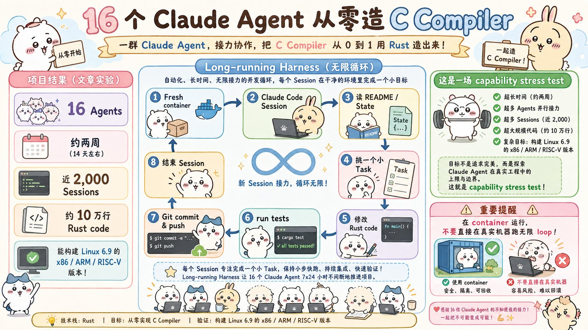
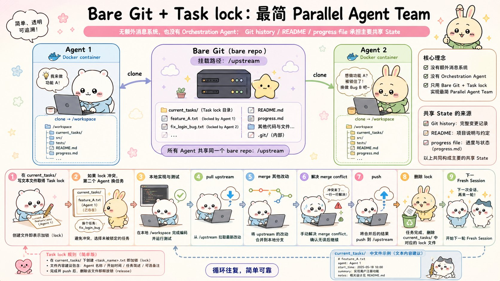
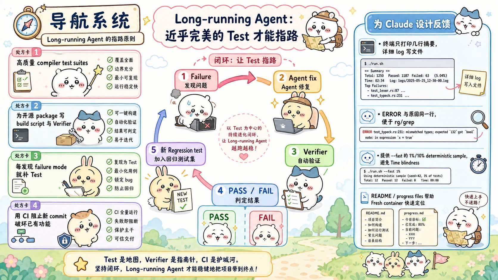
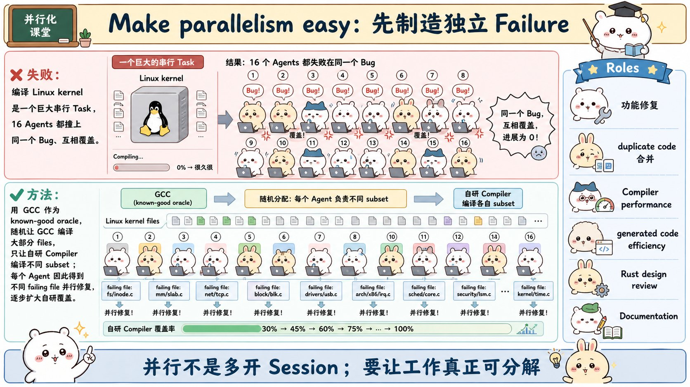
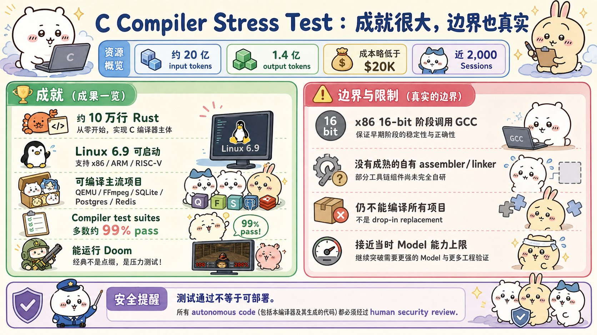

# Building a C compiler with a team of parallel Claudes：面试速记

> Nicholas Carlini · Anthropic Engineering · 2026-02-05 · [官方原文](https://www.anthropic.com/engineering/building-c-compiler) · [本地逐句对照](18_building-c-compiler_逐句对照.md)

## 一句话讲明白

**16 个智能体在没有编排者、没有消息总线的情况下，靠"无限循环 + git 抢锁 + 近乎完美的测试"跑了两周，从零写出 10 万行 Rust 的 C 编译器，能编译可启动的 Linux 6.9；真正的功夫全花在给模型设计环境（测试、日志、进度文件、任务切分）上，而不是花在调度算法上。**

## 为什么值得读 / 能用在哪

- 这是目前少见的**长时间无人值守多智能体**的一手工程报告：不是一段演示视频，是跑了近 2000 次会话、烧掉近 2 万美元的真实压力测试。
- 它把"多智能体协作"从架构问题拉回到**环境设计问题**：验证器准不准、日志好不好读、任务能不能拆开，比用什么框架重要得多。
- 可直接借鉴的四招：**高质量测试当验证器**、**基于 git 锁文件的任务分配**、**用已知正确的工具当参照基准来拆并行任务**、**为模型的固有局限做环境设计**。这四条几乎能套到任何长时运行的智能体系统上。

## 核心要点

### 1. 长时运行：让模型一直不停下来



- 痛点：Claude Code 这类**智能体脚手架（agent scaffold）**假设有人在线配合——模型做一半就会停下来提问、汇报、等澄清。
- 解法极简到只有一个 `while true` 的命令行脚本（shell）循环，每轮用 `AGENT_PROMPT.md` 里的提示词起一个新的 Claude Code 会话，跑完就再起一个（作者说和 `Ralph-loop` 很像）：

```bash
while true; do
    COMMIT=$(git rev-parse --short=6 HEAD)
    LOGFILE="agent_logs/agent_${COMMIT}.log"
    claude --dangerously-skip-permissions \
           -p "$(cat AGENT_PROMPT.md)" \
           --model claude-opus-X-Y &> "$LOGFILE"
done
```

- 注意这个循环的形态：**没有任务队列、没有状态机、没有重试逻辑**，全部智能都在提示词和环境里，脚本本身只负责"再来一次"。
- 提示词里要求模型：**把问题拆小 → 记录自己在做什么 → 想清楚下一步做什么 → 一直做到完美为止**。
- 每轮日志按当前提交哈希命名写到文件里，方便事后回溯是哪一轮干了什么。
- 循环用 `--dangerously-skip-permissions`，所以**必须跑在容器里，不要跑在真机上**。
- 有趣的翻车：有一次 Claude 误执行 `pkill -9 bash`，把自己杀了，循环也就此终止。

### 2. 并行协作：只有裸 git 仓库和一个锁目录



- 拓扑：建一个**裸 git 仓库（bare repo）**，每个智能体一个 Docker 容器，仓库挂到 `/upstream`，各自克隆到 `/workspace`，干完活推回上游。
- 抢锁三步走：
  1. 往 `current_tasks/` 写一个文本文件来给任务**加锁**（例如 `current_tasks/parse_if_statement.txt`）。两个智能体抢同一个任务时，**git 的同步机制会逼第二个换任务**——锁就是 git 本身，没有额外服务。
  2. 干完活：拉取上游 → 合并别人的改动 → 推送 → 删锁。**合并冲突很常见，但模型自己能搞定**。
  3. 无限循环在全新容器里再起一个新会话，周而复始。
- **没有编排智能体（orchestration agent），没有其他通信通道，也没有管理高层目标的流程**。每个智能体自己决定做什么，大多数时候就是挑"下一个最显而易见"的问题。
- 共享状态就三样：**git 提交历史、`README`、进度文件**。卡在某个 bug 上时，模型会自己维护一份"已试过哪些失败路径 / 还剩什么任务"的文档。
- 作者本人强调：这是**非常早期的研究原型**，别当成成熟方案。

### 3. 测试就是长任务的方向盘



- 核心判断：**智能体会自主去解决你给它的任何问题，所以验证器（verifier）必须近乎完美，否则它会高效地解错题。**
- 作者提升测试框架的具体动作：找高质量的编译器**测试套件（test suite）**、给开源软件包写验证器和构建脚本、**盯着模型正在犯的错**，识别出失败模式后再补新测试。
- 注意"补测试"的触发方式是**观察出来的**，不是设计出来的：先看模型实际犯了什么错，识别出这类失败模式，再针对性地写新测试把这条路堵死。
- 项目后期出现典型退化：**每实现一个新功能就弄坏已有功能**。对策是搭一条**持续集成（CI）流水线**并加严格约束，让新提交不能破坏已有代码。
- 这条约束的意义在于：单个智能体的会话是短的、无记忆的，**只有 CI 这种外部强制才能跨会话保住已有成果**，靠提示词提醒是没用的。
- 结论：循环只是发动机，**测试和 CI 才是方向盘**。没有它们，跑得越久偏得越远。

### 4. 设身处地为模型着想：为它的局限做设计

- 关键提醒：**这套测试框架是写给模型用的，不是写给你自己用的**。每个智能体都被扔进一个零上下文的全新容器，光是"搞清楚现在什么情况"就要耗掉大量时间。
- 兜底手段：强制要求维护**详尽的 `README` 和进度文件**，频繁更新当前状态，让新容器一进来就能快速定位。
- 针对两个模型固有局限的环境设计：

  **局限一：上下文窗口污染（context window pollution）**
  - 测试框架**最多打印几行输出**，绝不往终端刷成千上万字节的无用内容。
  - 重要信息全部落到日志文件里，模型需要时自己去查。
  - 日志要便于自动处理：出错就写 `ERROR`，并**把原因放在同一行**，这样 `grep` 一搜就命中。
  - **汇总统计预先算好**，省得模型自己重新计算——省的是 token，也是时间。

  **局限二：时间盲区（time blindness）**
  - 模型感知不到时间，放着不管会心安理得地花几个小时跑测试，而不是推进工作。
  - 对策是**低频打印增量进度**（打太勤又会污染上下文），并提供一个默认的 `--fast` 选项，只跑 1% 或 10% 的随机抽样。
  - 抽样设计很讲究：这个子样本**对每个智能体是确定性的，跨虚拟机之间是随机的**——整体上仍然覆盖所有文件，而单个智能体因为每次抽到的是同一批，又能精确识别出**回归**。

### 5. 并行必须来自真正可拆开的工作



- **失败测试互不相同时，并行毫无难度**：每个智能体挑一个不同的失败测试就行。测试套件通过率到 99% 后，每个智能体各认领一个小型开源项目（SQlite、Redis、libjpeg、MQuickJS、Lua）去搞定编译。
- **一撞上 Linux 内核就卡住**：内核编译是一个巨大的整体任务，不像有几百个独立测试的测试套件。**每个智能体都撞上同一个 bug、修同一个 bug、再互相覆盖改动**——开 16 个智能体完全没用。
- 破局手法（最值得记的一招）：把 **GCC 当作在线的、已知正确的编译器参照基准（oracle）**。新写的测试框架**随机用 GCC 编译内核大部分文件，只把剩下一小部分交给自研编译器**。
  - 内核跑得起来 → 问题不在这部分文件里；跑挂了 → 再把其中一部分换回 GCC，进一步缩小范围。
  - 效果：**一个巨大故障被切成了分布在不同文件上的一堆独立故障**，每个智能体修不同的 bug，互不阻塞。
  - 补充：这招奏效后，仍需用**增量调试（delta debugging）**找出"单独编译都正常、放一起就出错"的文件对。
- 并行还带来**专业化分工**。除了修功能的主力，作者另外派了这些角色：
  - **合并重复代码**——大模型写的代码经常重复实现已有功能，专门派一个智能体去收拢。
  - **优化编译器自身的性能**（编译得快不快）。
  - **优化编译产出代码的效率**（编出来的东西跑得快不快）——注意这和上一条是两件事。
  - **以 Rust 开发者的视角批评项目设计**，并做结构性调整来提升整体代码质量。
  - **维护文档**。
- 这几个角色的共同点：都是**非功能性质量**，人类团队里最容易被无限期推迟的那类活，交给闲置的并行槽位正好。
- **一句话记法：并行不是多开会话，而是制造互不阻塞的工作单元。**

### 6. 成绩、成本与边界



- 这个项目**在设计上就是一个能力基准测试**：作者想压测大模型今天"勉强能做到"的极限，好为未来做准备。C 编译器项目被他当作贯穿整个 Claude 4 系列的基准——**Opus 4 系列勉强能产出可用编译器；Opus 4.5 第一次跨过门槛（能过大型测试套件，但编不了任何真实大项目）；Opus 4.6 才是这轮的主角。**
- 账单：**两周、近 2000 次会话、20 亿输入 token、1.4 亿输出 token、总成本略低于 2 万美元**。比最贵的 Claude Max 订阅贵得多，但只是作者亲手做同样东西成本的零头，更别说雇一整个团队。
- 成果：**10 万行编译器**，洁净室实现（开发全程无联网），**只依赖 Rust 标准库**；能在 **x86、ARM、RISC-V** 上构建**可启动的 Linux 6.9**；能编译 QEMU、FFmpeg、SQlite、postgres、redis；在多数编译器测试套件上**通过率 99%**，其中包括 GCC 官方的高强度测试集 `torture test suite`；**能编译并运行 Doom**（开发者的终极试金石）。
- 边界（面试时一定要主动说，显得你读过原文）：
  - 缺少让 Linux 脱离**实模式（real mode）**启动所需的 16 位 x86 编译器，这段**调用 GCC 完成**（x86_32 / x86_64 是自研的；ARM 和 RISC-V 可完全独立编译）。技术原因：虽然能靠 66/67 **操作码前缀**输出正确的 16 位代码，但产物超过 60kb，**远超 Linux 强制的 32k 上限**。
  - **没有自己的汇编器和链接器**，这是最后才动手的部分，仍有不少 bug；演示视频用的是 GCC 的汇编器和链接器。
  - 能构建很多项目但不是全部，**还不能直接替换真实编译器**。
  - **生成代码效率不高**：开满优化也比关掉全部优化的 GCC 还低效。
  - Rust 代码质量尚可，但**远达不到 Rust 专家水准**。
- 安全上的余味：作者做过**渗透测试**出身，明确说自主开发有切实风险——**很容易看到测试通过就以为完事，但很少真是这样**；程序员部署自己从未亲自验证过的软件，是真实的隐忧。这个实验让他兴奋，也让他不安。

## 面试高频问答

**Q：多智能体并行，什么时候真的有用，什么时候纯属浪费钱？**
A：判据是**工作能不能拆成互不阻塞的独立故障**。有几百个各不相同的失败测试时，并行几乎零成本，一人一个测试。而编译 Linux 内核是一个整体任务，16 个智能体全撞上同一个 bug 再互相覆盖改动，开再多也没用。所以先想办法把任务拆开，再谈加并发。

**Q：他们怎么把"一个巨大故障"拆成"多个独立故障"？**
A：用 GCC 当已知正确的参照基准。测试框架随机用 GCC 编译内核的大部分文件，只留一小部分给自研编译器；内核能跑说明问题不在这部分，跑挂了就把其中一些换回 GCC 二分定位。这样每个智能体都在不同文件里修不同的 bug。这个思路可以推广：**只要有一个可信的参考实现，就能把一整块黑盒故障切成可并行的小块。**

**Q：16 个智能体怎么协调？用了什么编排框架？**
A：没有编排者，也没有消息总线。每个智能体往 `current_tasks/` 写一个文件来抢锁，git 的同步机制天然保证第二个抢锁者必须换任务；干完就拉取、合并、推送、删锁。共享状态只有 git 历史、`README` 和进度文件。**协调靠的是共享文件系统的语义，不是靠调度器。**

**Q：为什么说测试比循环更重要？**
A：因为智能体会自主去解决你给它的问题，**验证器不准，它就会高效地解错题**。作者大部分精力都花在找高质量测试套件、给开源包写验证器、观察模型犯的错再补针对性测试；后期出现"每加新功能就弄坏旧功能"，就用 CI 强制新提交不能破坏已有代码。循环是发动机，测试才是方向盘。

**Q：为模型设计环境，具体要注意哪些反直觉的点？**
A：至少三点。一是**别把日志当给人看的**——终端只打几行，细节写文件，出错时把 `ERROR` 和原因放在同一行方便搜索，汇总统计预先算好。二是**模型没有时间感**，会不知不觉跑几个小时测试，所以要提供默认的快速抽样模式（1%/10%），并且抽样对单个智能体确定性、跨机器随机，这样既能整体覆盖又能精确识别回归。三是**新会话是零上下文的**，必须靠频繁更新的 `README` 和进度文件来快速恢复状态。

**Q：近 2 万美元换一个编译器，这笔账怎么算才不算浪费？**
A：作者自己承认，和最贵的订阅方案比这都是极其昂贵的项目。但他的算法是拿它跟**替代成本**比：这个总额只是他亲手做出同样东西的一个零头，更别说雇一整个团队两周。关键是要清楚这是**能力压测**而不是日常任务的成本模板——目的是摸清今天勉强能做到什么，为模型未来能稳定做到的事情提前准备，所以贵得起。

## 必须记住的 10 句话

1. 无限循环只是发动机，**测试、验证器和 CI 才是方向盘**。
2. **验证器不准，智能体会高效地解决错误的问题**——这是长时任务的头号杀手。
3. 并行的前提是**独立的故障**，不是更多的智能体；一个整体任务开 16 个智能体等于零。
4. **用已知正确的实现当参照基准**，可以把一个巨大故障切成一堆可并行的小故障。
5. 任务分配可以简单到只用 **git 抢锁文件**——不需要编排智能体，也不需要消息总线。
6. 每个新会话都是**零上下文**的，必须靠 `README` 和进度文件在外部保存状态。
7. 输出要**为模型设计**：少打印、写日志、错误原因同行、预先算好汇总、提供快速抽样模式。
8. 并行的第二重价值是**专业化分工**：让闲置槽位去干重复代码合并、性能优化、设计评审、文档这些永远排不上队的活。
9. 大部分工程投入应该花在**设计模型周围的环境**（测试、反馈、状态文件）上，而不是花在调度和编排上。
10. **能力压测的成功不等于可以上生产**：测试通过 ≠ 可部署，自主产出的代码仍需人工安全复核。

## 30 秒口述版

> 这是 Anthropic 的 Nicholas Carlini 做的一次能力压测：16 个 Claude 在各自的 Docker 容器里跑一个永不停止的循环，每轮起一个新会话、读 `README` 定位、往 `current_tasks/` 写文件抢锁、改代码、跑测试、推回共享的裸 git 仓库。没有编排者，没有消息总线，靠 git 冲突天然完成任务分配。两周、近 2000 次会话、近 2 万美元，产出 10 万行 Rust 的 C 编译器，能在 x86、ARM、RISC-V 上构建可启动的 Linux 6.9，还能跑 Doom。最值得学的是三条工程经验：验证器必须近乎完美，否则模型会高效地解错题；日志和测试输出要为模型设计——少打印、错误原因同行、提供快速抽样以对抗模型的时间盲区；并行必须来自可拆开的工作，所以他用 GCC 当已知正确的参照基准，把"编译内核"这一个巨大故障切成分布在不同文件上的独立故障。局限也很明确：16 位 x86 那段还得调用 GCC，没有自己的汇编器和链接器，生成代码效率比关优化的 GCC 还差——而且测试通过不等于可部署，自主代码仍需人工安全复核。

## 自测

- [ ] 能画出一次会话的完整接力循环：新容器 → 读状态 → 抢锁 → 改代码 → 跑测试 → 合并推送 → 释放锁 → 下一轮。
- [ ] 能解释锁是怎么加、怎么放的，以及为什么 git 本身就够用、不需要编排智能体。
- [ ] 能说出五项"为模型设计测试输出"的具体做法（少打印 / 详情写日志 / 错误原因同行 / 预先算好汇总 / 快速抽样）。
- [ ] 能解释 GCC 参照基准是怎么把一个整体任务变成可并行任务的，以及为什么之后还需要增量调试。
- [ ] 能报出关键数字：16 个智能体、约 2000 次会话、20 亿输入 token、1.4 亿输出 token、近 2 万美元、10 万行代码、99% 通过率、Linux 6.9。
- [ ] 能说出至少三项项目局限，并说清 16 位 x86 那条的技术原因（60kb 产物超过 32k 上限）。
- [ ] 能讲清楚"测试通过 ≠ 可部署"为什么在自主开发场景下格外危险。

> 插图为学习用途的非官方同人式教学图，角色与文章版权归各自权利人。
