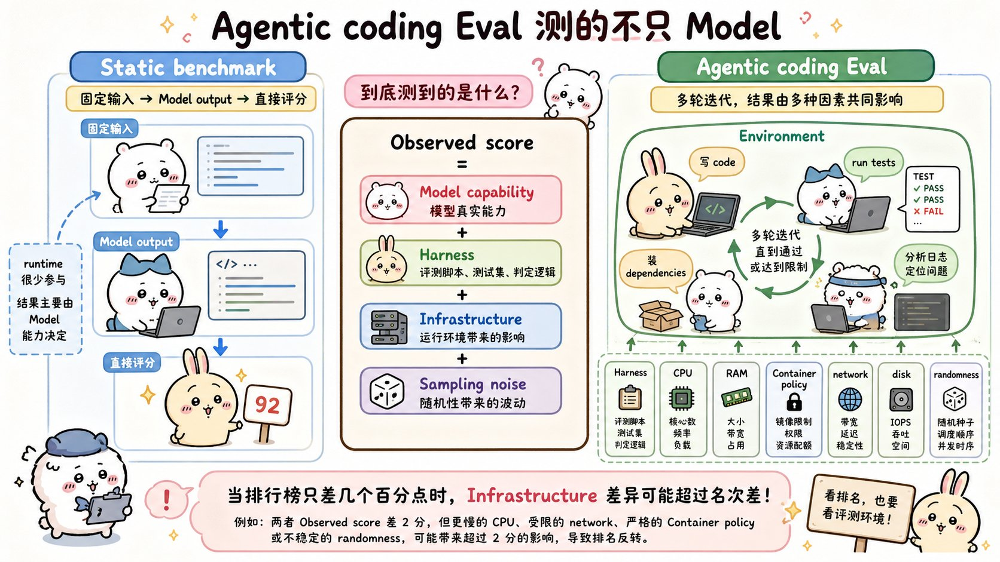

# Quantifying infrastructure noise in agentic coding evals：面试速记

> Anthropic Engineering · 2026-02-05 · 作者 Gian Segato
> [官方原文](https://www.anthropic.com/engineering/infrastructure-noise) · [本地逐句对照](19_infrastructure-noise_逐句对照.md)

## 一句话讲明白

**排行榜上比的是模型能力，但智能体编码评估里，光是"给容器多少内存、超了杀不杀"这一项配置，就能在 Terminal-Bench 2.0 上拉出 6 个百分点的分差（p < 0.01）——比头部模型之间的差距还大；所以低于 3 个百分点的排行榜领先，在评估配置公开并对齐之前都不该当真。**

## 为什么值得读 / 能用在哪

- 面试里聊"你怎么评估自己的智能体"，这篇给你一套**能说出数字的方法论**，而不是空谈"我们跑了基准测试"。
- 自己搭评估集群时，这是一份现成的踩坑清单：资源保障与硬杀阈值分开设、留 3 倍余量、跨时段重复跑、报告置信区间。
- 选型汇报时可以直接引用：拿两个模型的 2 个百分点差异去做部署决策，是在拿噪声当信号。

## 核心要点

### 1. 智能体评估测的是整条链路，不只是模型

- **静态基准**直接给模型的输出打分，运行时环境不进入结果。
- **智能体编码评估（agentic coding eval）**不同：模型拿到一个完整环境，在里面写程序、跑测试、装依赖、多轮迭代。
- 原文的关键判断：运行时**不再是被动的容器，而是解题过程中不可分割的一部分**。
- 推论一句话：**资源预算和时间限制不同的两个智能体，做的根本不是同一张考卷。**
- 所以你看到的分数可以理解成：模型能力 + 执行框架（harness）+ 基础设施 + 采样噪声。不是严格加法，但提醒你链路上每个变量都会混进测量结果。

### 2. 保障性分配 ≠ 硬限制：把两者设成同一个值是灾难

容器运行时用**两个独立参数**执行资源限制：

- **保障性分配（guaranteed allocation）**：预先预留的资源，是**下限（floor）**。
- **硬限制（hard limit）**：一旦触及就杀掉容器，是**上限（ceiling）**。

Anthropic 在 Google Kubernetes Engine 集群上跑 Terminal-Bench 2.0 时，把每任务的资源规格**既当下限又当硬上限**，结果余量为零：一次短暂的内存波动就会把本来能做对的容器 OOM 杀掉（OOM-kill），多达 **6% 的任务因容器组（Kubernetes 里的 pod）错误而失败**，和模型解题能力毫无关系，分数也对不上官方排行榜。

官方排行榜用的是另一家沙箱服务商，实现更宽松——**允许临时超额占用而不终止容器**，优先保证基础设施稳定。差异就出在这里。

结论：**"指定资源规格"不等于"以一致的方式强制执行"，而执行方式本身会改变基准实际测量的东西。**

### 3. 六档配置实验：3 倍余量是那条分界线

实验设计：Terminal-Bench 2.0 跑六种资源配置，从严格执行每任务规格（1x，规格同时当下限和上限）一直到完全不设上限（uncapped）。**其他一切不变**——同一个 Claude 模型、同一套执行框架、同一组任务集。

基础设施错误率随余量单调下降：

| 配置 | 基础设施错误率 | 显著性 |
| --- | --- | --- |
| 1x 严格执行 | 5.8% | — |
| 3x 上限 | 2.1% | 相对 1x，p < 0.001 |
| 不设上限 | 0.5% | — |

分成两段看，这是全文最该记住的结构：

- **1x → 3x**：修的是**基础设施可靠性问题**（瞬时资源尖峰）。成功率的波动落在噪声范围内（**p = 0.40**）。在 1x 下崩溃的任务，大多数就算不崩溃也会失败——智能体撞上资源墙被中途终止，但它本来就不在通往正确解的路上。**评估变稳了，但没变简单。**
- **3x → 不设上限**：趋势变了，**成功率的攀升快过错误率的下降**。基础设施错误率只再降 1.6 个百分点，成功率却跳了将近 4 个百分点。
- **总账：不设上限相对 1x 提升 +6 个百分点（p < 0.01）。**

`rstan-to-pystan`、`compile-compcert` 这类临界任务，一拿到内存余量成功率就显著提升。

### 4. 资源过宽会改变"测的是什么"——它开始奖励策略偏好

越过 3x 这条线，额外资源开始**真的帮智能体解决它此前解不了的问题**：拉大型依赖、启动开销高的子进程、跑内存密集的测试套件。

于是基准悄悄换了考题：

- **严苛限制**在无意中奖励**极为高效的策略**——写得又精简又快的智能体占优。
- **宽松限制**更包容，奖励**更善于榨取全部可用资源**的智能体——靠重量级工具暴力求解的占优。

两者都是值得测的合理能力，但**不注明资源配置就压成一个单一分数**，差异和真实世界的泛化能力就没法解读。

教科书级案例 `bn-fit-modify`（贝叶斯网络拟合）：有的模型第一步就装 `pandas`、`networkx`、`scikit-learn` 全家桶——宽松配置下这招行得通；严苛配置下容器组在装依赖阶段就内存耗尽，**智能体连一行解题代码都还没写**。另一条精简路线是只用标准库从零实现数学计算，有些模型默认走这条，有些不走。**资源配置决定了哪种默认解法恰好能成功。**

### 5. 结论有多稳：换模型、换基准都成立

- 在**多个 Anthropic 模型**上复现过：效应**方向一致**，幅度不同。
- Claude 之外的模型上趋势似乎也成立，但**尚未严格测试**（这句要照实说，别夸大）。
- **SWE-bench 交叉实验**：227 道题、每题采样 10 次，把总可用内存从基线调到 5 倍。同样单调上升，但幅度更小——**5x 比 1x 只高 1.54 个百分点**。SWE-bench 任务更省资源，效应小在意料之中，但说明**在那里资源分配也不是中性因素**。

### 6. 资源之外还有一大堆隐藏变量

- 某些配置下**时间限制**也会开始起作用。
- 原则上每个要素都可能影响分数：集群健康状况、硬件规格、并发级别，乃至**出口带宽**。
- 智能体评估**从构造上就是端到端的系统测试**，系统里任何组件都可能成为混杂因素（confounder）。
- 观察到的零星现象：**通过率会随一天中的时段波动**，很可能因为 API 延迟随流量和线上事故变化。原文明确说**没有正式量化**过这一效应。
- 更大的问题：**"模型能力"和"基础设施行为"之间的边界，比一个单一分数所暗示的模糊得多。**
- 不对称性值得记：**模型提供商可以配专用硬件屏蔽干扰，外部评测者很难做到同样的事。**

### 7. 官方建议：怎么跑、怎么报

1. 理想是**完全相同的硬件条件**（含运行评估的脚手架和推理栈），保证完美可复现——但常常不现实。
2. **每个任务分别指定两个参数**（保障性分配 + 硬性杀灭阈值），不要钉死一个单一数值。单一精确规格 = 零余量 = 评估失稳。
3. 两者之间的区间要**经验校准**，让下限和上限处的分数彼此落在噪声范围内。
4. Terminal-Bench 2.0 的样板答案：**3x 上限把基础设施错误率削掉约三分之二（5.8% → 2.1%，p < 0.001），同时分数提升不大且完全在噪声内（p = 0.40）**。这是合理权衡——混杂因素基本消除，有意义的资源压力仍然保留。
5. **具体倍数会因基准和任务分布而异，必须如实报告**；普适的是"经验校准"这个原则本身，不是 3 这个数字。
6. 打算公开发布的编码评估，**跨多个时段、多个日期重复运行**，把噪声平均掉。

## 面试高频问答

**Q：我们团队跑内部基准测试，两个模型差 2 个百分点，能据此选型吗？**
A：不能直接下结论。这篇的数据说，光资源配置一项在极端之间就能造成 6 个百分点差异，中等配置区间内的散布也接近 2 个百分点。而且朴素的二项置信区间本身就有 1–2 个百分点跨度，基础设施混杂因素是**叠加在它之上**的，不是包含在里面。我会先把资源配置对齐、跨多天重复跑，再看差异还在不在。

**Q：容器资源该怎么配才不影响评估结论？**
A：把保障性分配和硬杀阈值**分开设**，别用同一个值。用经验校准的方式找那条线：让下限和上限处的分数落在彼此的噪声范围内。Terminal-Bench 2.0 上这条线大约是 3 倍——错误率从 5.8% 降到 2.1%，分数变化 p = 0.40 不显著。但倍数要按自己的基准重新校准并公开。

**Q：给的资源越多，评估不是越准吗？为什么还要设上限？**
A：不是。3 倍以内多给资源，修的是基础设施可靠性——评估变稳但不变简单。超过 3 倍，额外资源开始真的帮智能体解题，基准就从"谁更会解决问题"偷偷变成"谁更会消耗资源"。上限的作用是**防止分数虚高，保留有意义的资源压力**。

**Q：这个结论只在 Terminal-Bench 上成立吗？**
A：不止。跨多个 Anthropic 模型复现过，方向一致、幅度不同；SWE-bench 上做过交叉实验，227 题各采样 10 次，5 倍内存比 1 倍高 1.54 个百分点——效应更小是因为 SWE-bench 任务更省资源，但说明资源分配在那里也不中性。Claude 之外的模型趋势似乎也成立，不过原文说没有严格测过。

**Q：作为模型提供方或基准维护方，具体该改什么？**
A：实验室要把**资源配置当作一等实验变量**，用和提示词格式、采样温度同等的严谨度记录和控制。基准维护方光公布推荐规格还不够（Terminal-Bench 2.0 已经做了），**还要明确执行方式**——这道缺口正是官方排行榜和 Anthropic 自建集群分数对不上的原因。

## 必须记住的 8 句话

1. 智能体评估里，运行时不是被动容器，而是解题过程的一部分；资源预算不同的两个智能体做的不是同一张考卷。
2. 容器有两个独立参数：保障性分配（下限）和硬限制（杀掉的上限）；设成同值就是零余量。
3. 零余量下，一次瞬时内存波动就能 OOM 杀掉本可成功的容器——Anthropic 实测多达 6% 的任务因容器组错误而失败。
4. 六档实验：基础设施错误率 1x 时 5.8%，3x 时 2.1%（p < 0.001），不设上限时 0.5%。
5. **3 倍是分界线**：1x→3x 修的是可靠性，分数变化在噪声内（p = 0.40）；3x→不设上限则开始改变评估测量的东西。
6. 极端之间的总差距是 **+6 个百分点（p < 0.01）**，超过排行榜头部模型之间的分差。
7. 严苛限制奖励高效策略，宽松限制奖励善用资源的策略——不注明配置就压成单一分数，没法解读。
8. **在资源方法论标准化之前，排行榜上低于 3 个百分点的差距都值得怀疑，除非评估配置被记录且做到一致。**

## 30 秒口述版

> 这篇文章量化了一件被忽视的事：智能体编码评估测的不只是模型，还有基础设施。Anthropic 在自建的 Kubernetes 集群上跑 Terminal-Bench 2.0，发现分数和官方排行榜对不上，多达 6% 的任务是因为容器组错误失败的——根因是把每任务资源规格既当保障下限又当硬杀上限，余量为零，一次瞬时内存尖峰就把容器杀了。他们跑了六档资源配置做对照，其他全部固定：基础设施错误率从 5.8% 单调降到 0.5%，而 3 倍余量是关键分界线——3 倍以内修的是可靠性，分数变化不显著；超过 3 倍，额外资源开始真的帮智能体解题，基准就变味了。极端之间总共 6 个百分点，比头部模型之间的分差还大。建议是：保障性分配和硬杀阈值分开设并逐任务公开，用经验校准找那条线，跨时段跨日期重复跑，报告置信区间。核心结论一句话：低于 3 个百分点的排行榜差距，在评估配置公开并对齐之前都值得怀疑——几个百分点的领先可能是真本事，也可能只是虚拟机更大。

## 自测

- [ ] 能说清静态基准和智能体评估在"测什么"上的根本差异。
- [ ] 能画出下限、余量、硬上限与瞬时尖峰的关系，并解释 OOM 杀灭怎么产生假失败。
- [ ] 能背出三档基础设施错误率（5.8% / 2.1% / 0.5%）和对应的显著性。
- [ ] 能解释为什么 3 倍是分界线，以及跨过它之后基准测的东西怎么变了。
- [ ] 能讲 `bn-fit-modify` 这个案例，说明资源配置如何决定哪种解法成功。
- [ ] 能说出至少五种资源之外的噪声来源。
- [ ] 能回答"排行榜上 2 个百分点的领先该不该信"并给出理由和数字。

> 插图为学习用途的非官方同人式教学图，角色与文章版权归各自权利人。
