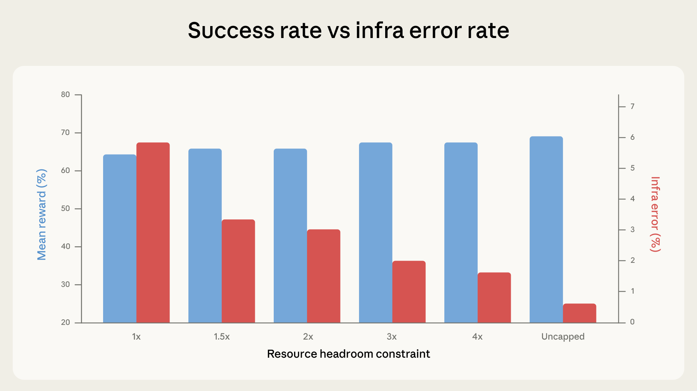

# 19_Quantifying infrastructure noise in agentic coding evals_量化智能体编码评估中的基础设施噪声

> 原文：https://www.anthropic.com/engineering/infrastructure-noise
> 作者：Gian Segato（Anthropic Engineering）｜发布日期：2026-02-05

## 📌 本篇速览

- 📅 2026-02-05　｜　⏱ 约 10 分钟　｜　📄 1,816 词 / 1 图
- ⭐ ★★★☆☆ **按需阅读** —— 凡是要跑或引用 agentic 评估的工程师都必须理解基础设施混杂因素，否则会把噪声当成模型能力差异做出错误决策。
- 🏷 智能体编码评估、基准测试可靠性、基础设施噪声、Terminal-Bench/SWE-bench、资源配置
- 🖼 [图解笔记（面试速记）](19_infrastructure-noise_直观图解与学习笔记.md)　·　🗂 [返回总目录](00_目录与阅读进度.md)

Anthropic 发现智能体编码基准（如 Terminal-Bench 2.0、SWE-bench）的分数会被基础设施配置显著影响：仅资源分配一项就能造成最高 6 个百分点的差距，超过排行榜头部模型之间的分差。文章分析了容器资源限制的执行方式（保障性分配 vs 硬性杀灭阈值）如何在 3x 余量以内影响评估稳定性、越过 3x 后则实际改变评估所测的能力，并建议把资源配置当作一等实验变量、分别指定两个参数并公开报告。核心结论：低于 3 个百分点的排行榜差距在评估配置未公开且一致之前都值得怀疑。

---

Agentic coding benchmarks like SWE-bench and Terminal-Bench are commonly used to compare the software engineering capabilities of frontier models—with top spots on leaderboards often separated by just a few percentage points.

SWE-bench、Terminal-Bench 这类智能体编码基准（agentic coding benchmark）常被用来比较前沿模型的软件工程能力——排行榜上的头部位置之间往往只差几个百分点。

These scores are often treated as precise measurements of relative model capability and increasingly inform decisions about which models to deploy.

这些分数经常被当作对模型相对能力的精确度量，并且越来越多地影响着"该部署哪个模型"的决策。

However, we’ve found that infrastructure configuration alone can produce differences that exceed those margins.

然而我们发现，仅仅是基础设施配置（infrastructure configuration）本身，就能造成超过这些差距的分数差异。

In internal experiments, the gap between the most- and least-resourced setups on Terminal-Bench 2.0 was 6 percentage points (p < 0.01).

在内部实验中，Terminal-Bench 2.0 上资源最充裕与最紧张的两种配置之间，分数差距达到了 6 个百分点（p < 0.01）。

Static benchmarks score a model's output directly—the runtime environment doesn’t factor into the result.

静态基准（static benchmark）直接对模型的输出打分——运行时环境（runtime environment）不会影响结果。

Agentic coding evals are different: models are given a full environment where they write programs, run tests, install dependencies, and iterate over multiple turns.

智能体编码评估（agentic coding eval）则不同：模型会得到一个完整的环境，在其中编写程序、运行测试、安装依赖，并进行多轮迭代。

The runtime is no longer a passive container, but an integral component of the problem-solving process.

运行时不再是一个被动的容器，而是解决问题过程中不可分割的组成部分。

Two agents with different resource budgets and time limits aren't taking the same test.

两个资源预算和时间限制不同的智能体，做的根本不是同一张考卷。

Eval developers have begun accounting for this.

评估的开发者们已经开始考虑这一点。

Terminal-Bench 2.0, for instance, specifies recommended CPU and RAM on a per-task basis in their latest 2.0 release.

例如，Terminal-Bench 在其最新的 2.0 版本中，为每个任务分别给出了推荐的 CPU 和内存（RAM）规格。

However, specifying resources isn't the same as enforcing them consistently.

然而，指定资源规格并不等于以一致的方式强制执行（enforce）它们。

Moreover, we discovered that enforcement methodology can change what the benchmark ends up actually measuring.

而且我们发现，强制执行的方式本身就能改变这个基准最终实际测量的东西。

### How we got here｜我们是如何发现这个问题的

We run Terminal-Bench 2.0 on a Google Kubernetes Engine cluster.

我们在一个 Google Kubernetes Engine 集群上运行 Terminal-Bench 2.0。

While calibrating the setup, we noticed our scores didn't match the benchmark’s official leaderboard, and infra error rates were surprisingly high: as many as 6% of tasks were failing because of pod errors, most of which were unrelated to the model’s ability to solve the tasks.

在校准这套环境的过程中，我们注意到自己的分数与该基准的官方排行榜对不上，而且基础设施错误率（infra error rate）高得出奇：多达 6% 的任务因为 pod 错误而失败，其中大多数与模型解题的能力毫无关系。

The discrepancy in scores came down to enforcement.

分数上的差异，归根结底出在资源限制的执行方式上。

Our Kubernetes implementation treated the per-task resource specs as both a floor and a hard ceiling: each container was guaranteed the specified resources but killed the moment it exceeded them.

我们的 Kubernetes 实现把每个任务的资源规格既当作下限（floor）又当作硬上限（hard ceiling）：每个容器都能获得所指定的资源保障，但一旦超出就会立即被杀掉。

Container runtimes enforce resources via two separate parameters: a guaranteed allocation—the resources reserved up front—and a hard limit at which the container is killed.

容器运行时（container runtime）通过两个相互独立的参数来执行资源限制：一个是保障性分配（guaranteed allocation）——预先预留的资源；另一个是硬限制（hard limit）——容器一旦触及就会被杀掉。

When these are set to the same value, there's zero headroom for transient spikes: a momentary memory fluctuation can OOM-kill a container that would otherwise have succeeded.

当这两个参数被设成同一个值时，瞬时资源尖峰（transient spike）就没有任何余量（headroom）：一次短暂的内存波动，就能把一个本可以成功完成任务的容器 OOM 杀掉（OOM-kill）。

To account for this, Terminal-Bench’s leaderboard uses a different sandboxing provider, whose implementation is more lenient, allowing temporary overallocation without terminating the container in order to favor infrastructural stability.

为了应对这一点，Terminal-Bench 的排行榜使用了另一家沙箱服务商（sandboxing provider），其实现更为宽松，允许临时的资源超额占用而不终止容器，以此优先保证基础设施的稳定性。

This finding raised a larger question: how much does resource configuration impact evaluation scores?

这个发现引出了一个更大的问题：资源配置到底会对评估分数产生多大影响？

To quantify the effect of the scaffold, we ran Terminal-Bench 2.0 across six resource configurations, from strict enforcement of the per-task specs (1x), having them act as both floor and ceiling, to completely uncapped.

为了量化脚手架（scaffold）的影响，我们在六种资源配置下运行了 Terminal-Bench 2.0：从对每任务规格的严格执行（1x，即规格同时充当下限和上限），一直到完全不设上限（uncapped）。

Everything else stayed constant: same Claude model, same harness, same task set.

其他一切保持不变：同一个 Claude 模型、同一套执行框架（harness）、同一组任务集。

In our experiments, success rates increased with resource headroom.

在我们的实验中，成功率随着资源余量的增加而上升。

This was primarily driven by infra error rates dropping monotonically at each step, going from 5.8% at strict enforcement to 0.5% when uncapped.

这主要是因为基础设施错误率在每一档都单调下降：从严格执行时的 5.8% 一路降到不设上限时的 0.5%。

The drop between strict enforcement to 3x headroom (5.8% to 2.1%) was significant at p < 0.001.

从严格执行到 3x 余量之间的下降（5.8% 降到 2.1%）在 p < 0.001 的水平上显著。

With more headroom, fewer containers get killed for exceeding their allocation.

余量越大，因超出资源配额而被杀掉的容器就越少。

From 1x through 3x, success scores fluctuate within the margins of noise (p=0.40).

从 1x 到 3x，成功率分数的波动都在噪声范围之内（p=0.40）。

Most of the tasks that were crashing at 1x would have failed regardless—which is something that we observed in the data.

在 1x 下崩溃的那些任务，大多数就算不崩溃也会失败——这一点我们在数据中得到了印证。

The agent explores, hits a resource wall, and gets preempted, but it was never on a path to a correct solution.

智能体不断探索，撞上资源墙，然后被中途终止（preempted）——但它本来就不在通往正确解的路上。

Starting around 3x, however, this trend changes: success rates climb faster than infra errors decline.

然而从 3x 左右开始，这一趋势发生了变化：成功率的攀升速度超过了基础设施错误率的下降速度。

Between 3x to uncapped, infra errors drop an additional 1.6 percentage points, while success jumps almost 4 percentage points.

从 3x 到不设上限之间，基础设施错误率又下降了 1.6 个百分点，而成功率却跃升了将近 4 个百分点。

The extra resources enable the agent to try approaches that only work with generous allocations, such as pulling in large dependencies, spawning expensive subprocesses, and running memory-intensive test suites.

额外的资源让智能体得以尝试那些只有在资源充裕时才行得通的方法，比如拉取大型依赖、启动开销高昂的子进程、运行内存密集型的测试套件。

At uncapped resources, the total lift over 1x is +6 percentage points (p < 0.01).

在资源不设上限时，相对 1x 的总提升为 +6 个百分点（p < 0.01）。

At the margins, tasks like `rstan-to-pystan` and `compile-compcert` significantly improve their success rates when getting memory headroom.

在临界处，`rstan-to-pystan`、`compile-compcert` 这类任务在获得内存余量后，成功率显著提升。

### How this affects measurement｜这对测量意味着什么

Up to roughly 3x Terminal-Bench specs, the additional resources fix infrastructure reliability problems, namely transient resource spikes.

在大约 Terminal-Bench 规格的 3x 以内，额外资源修复的是基础设施可靠性问题，即瞬时资源尖峰。

The sandboxing provider used by the Terminal-Bench maintainers is implicitly doing this behind the scenes; the eval gets more stable without getting easier.

Terminal-Bench 维护者所用的沙箱服务商，实际上就在幕后隐式地做着这件事；评估变得更稳定了，但并没有变得更简单。

Above the 3x mark, however, additional resources start actively helping the agent solve problems it couldn't solve before, which shows that limits can actually change what the eval measures.

然而一旦越过 3x 这条线，额外资源就开始实实在在地帮助智能体解决它此前解决不了的问题——这说明资源限制真的能改变评估所测量的东西。

Tight limits inadvertently reward very efficient strategies, while generous limits are more forgiving and reward agents that can better exploit all available resources.

严苛的限制会在无意中奖励极为高效的策略，而宽松的限制则更加包容，奖励那些更善于榨取全部可用资源的智能体。

An agent that writes lean, efficient code very fast will do well under tight constraints.

一个能飞快写出精简高效代码的智能体，在紧约束下会表现出色。

An agent that brute-forces solutions with heavyweight tools will do well under generous ones.

一个靠重量级工具暴力求解的智能体，则会在宽松约束下表现出色。

Both are legitimate things to test, but collapsing them into a single score without specifying the resource configuration makes the differences—and real-world generalizability—hard to interpret.

两者都是值得测试的合理能力，但如果不注明资源配置就把它们压缩成一个单一分数，这些差异——以及在真实世界中的泛化能力——就变得难以解读。

On `bn-fit-modify`, a Terminal-Bench task requiring Bayesian network fitting, some models’ first move is to install the standard Python data science stack: `pandas`, `networkx`, `scikit-learn,` and all their toolchain.

在 `bn-fit-modify`（一个需要做贝叶斯网络拟合的 Terminal-Bench 任务）上，有些模型的第一步就是安装标准的 Python 数据科学全家桶：`pandas`、`networkx`、`scikit-learn` 以及它们的整套工具链。

Under generous limits, this works.

在宽松的资源限制下，这一招行得通。

Under tight ones, the pod runs out of memory during installation, before the agent writes a single line of solution code.

而在严苛的限制下，pod 在安装依赖阶段就会内存耗尽——此时智能体连一行解题代码都还没写。

A leaner strategy exists (implementing the math from scratch using only the standard library), and some models do default to it. Others don’t.

其实存在一条更精简的路线（只用标准库从零实现相关数学计算），有些模型默认就会走这条路，另一些则不会。

Different models have different default approaches, and the resource configuration determines which of those approaches happen to succeed.

不同的模型有不同的默认解法，而资源配置决定了其中哪些解法恰好能成功。

We replicated the core finding across different Anthropic models.

我们在多个不同的 Anthropic 模型上复现了这一核心发现。

The direction of the effect was consistent, while the magnitude varied.

效应的方向是一致的，只是幅度有所不同。

The same trends seem to hold on models other than Claude, but we haven’t rigorously tested them.

同样的趋势在 Claude 之外的模型上似乎也成立，但我们尚未对其做过严格测试。

We also tested whether this pattern holds on evals outside Terminal-Bench by running a crossover experiment on SWE-bench.

我们还在 SWE-bench 上做了一次交叉实验（crossover experiment），以检验这一模式在 Terminal-Bench 之外的评估上是否同样成立。

We varied the total available RAM up to 5x the baseline across 227 problems with 10 samples each.

我们在 227 道题目上（每题采样 10 次）把总可用内存从基线一直调到基线的 5 倍。

The same effect held, though the magnitude was smaller: Scores again increased monotonically with RAM, but were only 1.54 percentage points higher at 5x than 1x.

同样的效应依然存在，只是幅度更小：分数再次随内存单调上升，但 5x 相比 1x 只高了 1.54 个百分点。

SWE-bench tasks are less resource-intensive, so a smaller effect is expected, but it shows resource allocation isn't neutral there either.

SWE-bench 的任务对资源的消耗更小，所以效应更小在意料之中，但这说明即便在那里，资源分配也并非中性因素。

### Other sources of variance｜其他方差来源

Resource allocation isn't the only hidden variable.

资源分配并不是唯一的隐藏变量。

In certain configurations, time limits too start playing a role.

在某些配置下，时间限制也会开始产生影响。

In principle, every element of the evaluation setup can influence the final score, from the cluster health to the hardware specs, from the concurrency level to even egress bandwidth.

原则上，评估环境的每一个要素都可能影响最终分数：从集群健康状况到硬件规格，从并发级别乃至出口带宽（egress bandwidth）。

Agentic evals are end-to-end system tests by construction, and any component of that system can act as a confounder.

智能体评估从构造上说就是端到端的系统测试，系统中的任何组件都可能成为混杂因素（confounder）。

We have observed anecdotally, for instance, that pass rates fluctuate with time of day, likely because API latency varies with traffic patterns and incidents.

举例来说，我们曾零星观察到通过率会随一天中的时段而波动，原因很可能是 API 延迟会随流量模式和线上事故而变化。

We have not formally quantified this effect, but it illustrates a larger point: the boundary between "model capability" and "infrastructure behavior" is blurrier than a single benchmark score suggests.

我们没有正式量化过这一效应，但它说明了一个更大的问题："模型能力"与"基础设施行为"之间的边界，远比一个单一的基准分数所暗示的更模糊。

A model provider can shield its eval infrastructure from this by dedicating hardware, but external evaluators can't easily do the same.

模型提供商可以通过配备专用硬件来让自己的评估基础设施免受这些干扰，但外部评测者很难做到同样的事情。

Public benchmarks are typically meant to measure pure model capabilities, but in practice they risk conflating them with infrastructure quirks.

公开基准通常旨在测量纯粹的模型能力，但在实践中，它们有把模型能力与基础设施的种种怪癖混为一谈的风险。

Sometimes this may be desirable, as it enables end-to-end testing of the entire stack, but more often it's not.

有时这也许是我们想要的，因为它能对整个技术栈做端到端测试，但更多时候并非如此。

For coding evals meant to be shared publicly, running at multiple times and on multiple days would help average out the noise.

对于打算公开发布的编码评估来说，在多个时段、多个日期分别运行，有助于把噪声平均掉。

### What we recommend｜我们的建议

The ideal scenario is to run each eval under the exact same hardware conditions—both the scaffold running the eval and the inference stack—as it would ensure perfect reproducibility across the board.

理想情况是在完全相同的硬件条件下运行每一次评估——包括运行评估的脚手架和推理栈（inference stack）——因为这能保证全方位的完美可复现性。

However, this may not always be practical.

然而，这并不总是可行的。

Given how container runtimes actually enforce resources—via a guaranteed allocation and a separate hard kill threshold—we recommend that evals specify both parameters per task, not a single pinned value.

考虑到容器运行时实际执行资源限制的方式——通过一个保障性分配和一个独立的硬性杀灭阈值（hard kill threshold）——我们建议评估为每个任务分别指定这两个参数，而不是钉死一个单一数值。

A single exact spec sets the guaranteed allocation equal to the kill threshold, leaving zero margin: the transient memory spikes we documented at 1x are enough to destabilize the eval.

单一精确规格会让保障性分配与杀灭阈值相等，不留任何余量：我们在 1x 下记录到的那些瞬时内存尖峰，就足以让评估失稳。

Separating the two parameters lets you give containers enough breathing room to avoid spurious OOM kills, while still enforcing a hard ceiling that prevents score inflation.

把这两个参数分开，你既能给容器留出足够的喘息空间来避免虚假的 OOM 杀灭，又仍然保有一个防止分数虚高的硬上限。

The band between them should be calibrated so that scores at the floor and ceiling fall within noise of each other.

两者之间的区间应当经过校准，使得在下限和上限处得到的分数彼此落在噪声范围之内。

For instance, in Terminal-Bench 2.0, a 3x ceiling over the per-task specs cut infra error rates by roughly two-thirds (5.8% to 2.1%, p < 0.001) while keeping the score lift modest and well within noise (p = 0.40).

例如，在 Terminal-Bench 2.0 中，把上限设为每任务规格的 3x，可以把基础设施错误率削减约三分之二（从 5.8% 降到 2.1%，p < 0.001），同时分数的提升幅度不大、完全处于噪声范围内（p = 0.40）。

That's a reasonable tradeoff: the infrastructure confounder is largely neutralized without removing meaningful resource pressure.

这是一个合理的权衡：基础设施这个混杂因素基本被消除，而有意义的资源压力仍然保留。

The exact multiplier will vary by benchmark and task distribution, and should thus be reported, but the empirical calibration principle is general.

具体倍数会因基准和任务分布而异，因此应当被如实报告，但这一经验校准原则是普适的。

### Why we care｜我们为什么在意这件事

These findings have practical consequences beyond eval infrastructure.

这些发现的现实影响超出了评估基础设施本身。

Benchmark scores are increasingly used as decision-making inputs, but this increased attention (and reliance) hasn’t always come with corresponding rigor in how they’re run or reported.

基准分数正越来越多地被用作决策依据，但这种日益增长的关注（和依赖），并不总是伴随着运行和报告方式上相应的严谨性。

As things stand today, a 2-point lead on a leaderboard might reflect a genuine capability difference, or it might reflect that one eval ran on beefier hardware, or even at a luckier time of day, or both.

以今天的现状来看，排行榜上 2 个百分点的领先，可能反映了真实的能力差异，也可能只是因为某次评估跑在更强悍的硬件上、甚至跑在了运气更好的时段——又或者两者兼有。

Without published (or standardized) setup configurations, it’s hard to tell from the outside unless interested parties go the extra mile to reproduce objective results under identical conditions.

在没有公开（或标准化）环境配置的情况下，外界很难分辨真相，除非相关方额外投入精力、在完全相同的条件下复现客观结果。

For labs like Anthropic, the implication is that resource configuration for agentic evals should be treated as a first-class experimental variable, documented and controlled with the same rigor as prompt format or sampling temperature.

对于 Anthropic 这样的实验室，这意味着智能体评估的资源配置应当被当作一等的实验变量（first-class experimental variable），以与提示词格式或采样温度（sampling temperature）同等的严谨程度加以记录和控制。

For benchmark maintainers, publishing recommended resource specs (as Terminal-Bench 2.0 does) can go a long way, while specifying enforcement methodology would close the gap we identified.

对于基准维护者，公布推荐的资源规格（如 Terminal-Bench 2.0 所做的那样）已经能起到很大作用，而进一步明确执行方式则能弥合我们所发现的这道缺口。

And for anyone consuming benchmark results, the core takeaway is that small score differences on agentic evals carry more uncertainty than the precision of the reported numbers suggests—especially as some confounders are simply too hard to control for.

而对于任何使用基准结果的人来说，核心结论是：智能体评估上的微小分差所携带的不确定性，比报告数字的精度所暗示的要大——尤其是有些混杂因素实在太难控制。

Until resource methodology is standardized, our data suggests that leaderboard differences below 3 percentage points deserve skepticism until the eval configuration is documented and matched.

在资源方法论实现标准化之前，我们的数据表明：排行榜上低于 3 个百分点的差距都值得怀疑，除非评估配置得到了记录并做到了一致。

The observed spread across the moderate range of resource configurations in Terminal-Bench is just below 2 percentage points.

在 Terminal-Bench 上，中等资源配置区间内观察到的分数散布略低于 2 个百分点。

Naive binomial confidence intervals already span 1-2 percentage points; the infrastructure confounders we document here stack on top of that, not within it.

朴素的二项置信区间（binomial confidence interval）本身就有 1-2 个百分点的跨度；我们在此记录的基础设施混杂因素是叠加在其之上的，而不是包含在其之内。

At the extremes of the allocation range, the spread reaches 6.

而在资源分配范围的两个极端之间，散布可达 6 个百分点。

A few-point lead might signal a real capability gap—or it might just be a bigger VM.

几个百分点的领先，可能标志着真实的能力差距——也可能只是虚拟机（VM）更大而已。

#### Acknowledgements｜致谢

Written by Gian Segato.

本文由 Gian Segato 撰写。

Special thanks to Nicholas Carlini, Jeremy Hadfield, Mike Merrill, and Alex Shaw for their contributions.

特别感谢 Nicholas Carlini、Jeremy Hadfield、Mike Merrill 和 Alex Shaw 的贡献。

This work reflects the collective efforts of several teams working on evaluations for coding agents.

这项工作凝聚了多个从事编码智能体评估工作的团队的集体努力。

Interested candidates who would like to contribute are welcome to apply at [anthropic.com/careers](http://anthropic.com/careers).

有意参与贡献的候选人，欢迎前往 [anthropic.com/careers](http://anthropic.com/careers) 申请。
