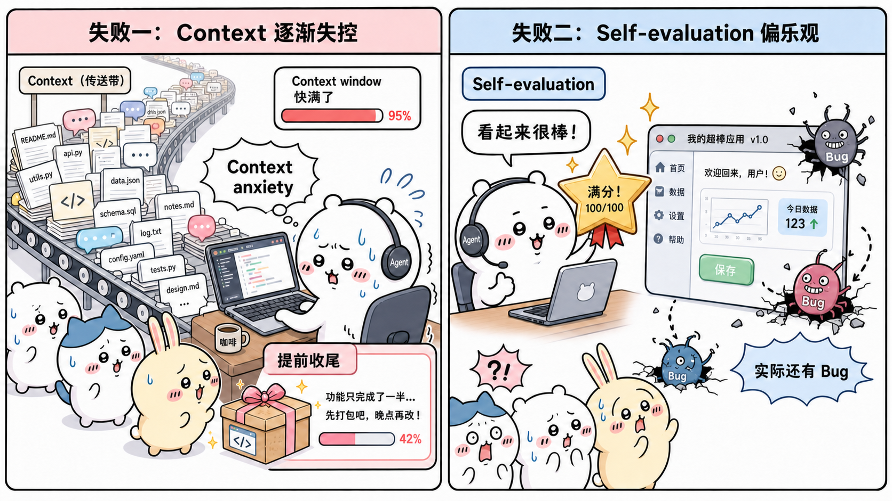
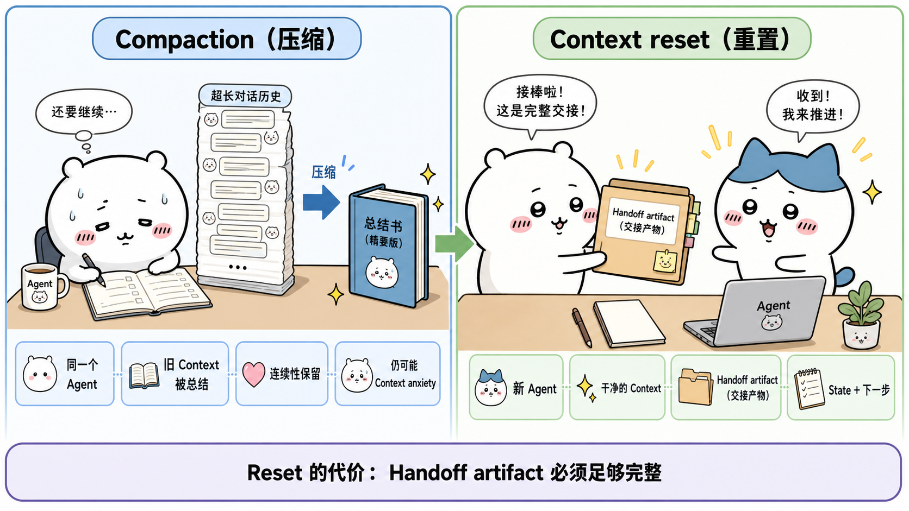
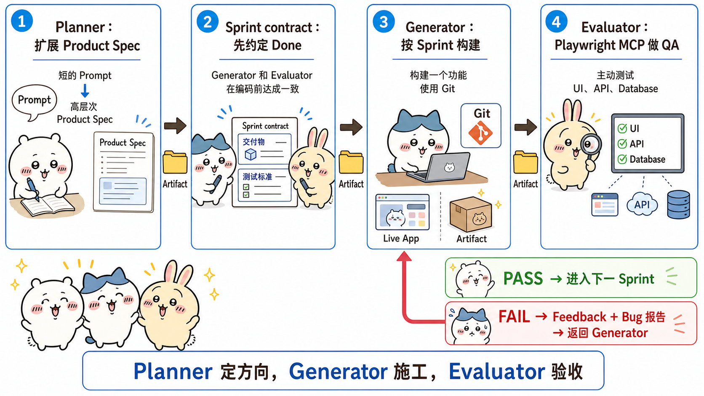
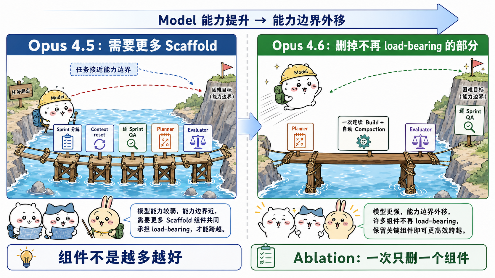

# Harness design for long-running application development：面试速记

> 2026-03-24 · 作者 Prithvi Rajasekaran（Anthropic Labs） · [官方原文](https://www.anthropic.com/engineering/harness-design-long-running-apps) · [本地逐句对照](21_harness-design-long-running-apps_逐句对照.md)

## 一句话讲明白

**模型再强，单次生成也没法同时扛住「产出、判断、纠错」三件事。作者受生成对抗网络（GAN）启发，把长时间自主开发拆成规划器（planner）、生成器（generator）、评估器（evaluator）三个智能体：规划器把一句话扩成产品规格，生成器持续施工，独立的评估器用 `Playwright` 像真实用户一样点完整个应用来验收、并按硬性阈值给每轮打分——而执行框架（harness）里的每个组件，本质上都是在补当前模型的某一处能力缺口，模型一升级就得回头验证它还承不承重。**

## 为什么值得读 / 能用在哪

- 它把「长任务智能体为什么会越跑越烂」讲透了，并给了两条能直接落地的解法：**把产出和评判分成两个智能体**、**把主观判断写成带阈值的可打分标准**。
- 它是少见的**带成本数字**的工程复盘：单智能体 20 分钟 9 美元，完整执行框架 6 小时 200 美元，贵 20 多倍——面试里聊「这套架构值不值」时，这组数字最有杀伤力。
- 后半段的**做减法**最有价值：新模型上线后该拆掉哪些脚手架、怎么拆（一次只拆一个），这是绝大多数人搭智能体系统时不会做的动作。
- 自己搭系统可以直接抄的四件事：产品规格前置、**开工前先谈 sprint 契约把「做完」定义清楚**、评估器走真实交互而不是看截图、用文件当跨智能体的外部状态。

## 核心要点

### 1. 长任务翻车的两种固定姿势



**失败模式一：上下文变长后失去连贯性。** 随着上下文窗口（context window）被填满：

- 忘掉早期约束，前后决策不一致；
- 注意力被陈旧信息占据，当前任务失焦；
- 出现**上下文焦虑（context anxiety）**——模型自以为快到上限了，于是提前草草收尾；
- 功能只做了一半，总结里却写「全部完成」。

**失败模式二：自我评估天然偏乐观。** 让智能体评价自己刚做完的东西：

- 它往往信心满满地大加赞赏，哪怕在人看来质量明显平庸；
- 在设计这类主观任务上最突出，因为**没有等价于软件测试的二元检查**——一个版式是精致还是平庸，本身就是主观判断；
- 即使在结果可验证的任务上，模型糟糕的判断力也照样拖后腿。

解法不是「让生成器学会自我批判」，而是**把干活的和评判的拆成两个智能体**。作者这段说得很实在，值得原样记住：

- 分离本身**不会**立刻消除宽松倾向——评估器毕竟也是个大模型，天生对模型生成的东西手下留情；
- 但**把一个独立评估器调得更挑剔，比让生成器一边创造一边彻底否定自己容易得多**；
- 而且一旦有了外部反馈，生成器就有了可以据以迭代的具体依据。

### 2. 上下文重置与压缩：两条路，两种代价



- **压缩（compaction）**：把较早的对话就地总结，**同一个智能体**在缩短后的历史上继续跑。保留了连续性，但没给它「干净的开局」，所以上下文焦虑仍可能存在。
- **上下文重置（context reset）**：彻底清空窗口，**启动一个全新智能体**，靠一份结构化交接（handoff）携带上一个智能体的状态与后续步骤。给了干净开局，代价是**风险全压在交接产物上**——它必须装够状态，下一个智能体才能顺利接手。重置还额外带来编排复杂度、token 开销和延迟。

**关键的是这条演进线，面试时讲出来很加分：**

1. 早期执行框架用 Sonnet 4.5，它的上下文焦虑严重到**光靠压缩撑不住**长任务，上下文重置成了不可或缺的一环。
2. 换成 Opus 4.5 后，这个毛病模型自己基本消除了，作者**把上下文重置整个删掉**，改成一个连续会话跑完整个构建，途中的上下文增长交给 `Claude Agent SDK` 的自动压缩处理。

上下文策略不是教条，是随模型行为调整的工程选择。

### 3. 前端实验：把「好不好看」变成可打分的标准


作者先在前端设计上做实验，因为自我评估的问题在这里最显眼——没干预时，Claude 总倾向于安全、可预期、技术上能用但视觉平庸的版式。

两条洞察：审美**无法**完全化约成一个分数，但**可以**用编码了设计原则的打分标准来改进；把「生成」和「打分」分离，就能造出推动生成器变强的反馈循环。核心的问法转换是：把「这个设计美不美？」换成「**它是否遵循了我们的优秀设计原则？**」——后者才给了模型一个具体标尺。

四条标准，同时写进生成器和评估器的提示词：

| 标准 | 实际在查什么 | 权重 |
|---|---|---|
| 设计质量（design quality） | 色彩、字体排印、版式、图像是否合成一个连贯整体、有独特气质，而不是零件拼凑 | **高** |
| 原创性（originality） | 有没有定制化决策的痕迹；模板版式、组件库默认样式、白卡片叠紫渐变这类「AI 垃圾」（AI slop）套路直接判负 | **高** |
| 工艺（craft） | 字体层级、间距一致性、色彩和谐、对比度——是能力检查不是创意检查 | 低 |
| 功能性（functionality） | 与审美无关的可用性：用户能不能看懂界面、找到主要操作、不靠猜完成任务 | 低 |

**为什么这样配权重**：Claude 在工艺和功能性上默认就得分不错，真正的缺口在设计质量和原创性；加重后两项的权重，是在**逼模型在审美上更敢冒险**。评估器则用带详细分数拆解的少样本示例（few-shot examples）校准，让它的判断对齐作者的偏好，并减少迭代之间的分数漂移。

**这个循环具体怎么跑的（细节值得记，面试时显得你真读过）：**

- 整个循环搭在 `Claude Agent SDK` 上，编排保持得很简单；
- 生成器先按用户提示词做一个 HTML/CSS/JS 前端；
- 评估器配了 `Playwright` MCP，**先自己在页面上导航、截图、仔细研究实现**，再逐条标准打分并写详细批评；反馈回流给生成器当下一轮输入；
- 每次生成跑 **5 到 15 轮**迭代；因为评估器是真的在操作页面而不是看静态截图，每轮都吃掉实打实的墙钟时间，**完整跑一遍最长要四个小时**；
- 生成器每次拿到评估后还要做一个策略决策：**分数走势好就沿当前方向打磨，路走不通就整个换一种美学风格**。

**三个反直觉的观察，很适合当面试里的「细节亮点」：**

- **标准本身就是提示词。** 写进「最好的设计具有博物馆级品质」这类措辞，会把设计推向某种特定的视觉趋同——评分标准不是中性的尺子，它同时是系统的隐性目标函数。
- **第一轮就已经变好。** 哪怕还没拿到任何评估器反馈，只是加了这些标准和配套语言，产出就明显强于完全不加提示词的基线。
- **最后一版不一定最好。** 分数总体随迭代上升然后进入平台期（仍有上升空间），但走势不是干净的线性；作者经常更喜欢中间某一版。实现复杂度也会随轮次膨胀——生成器为了回应反馈会越做越有野心。所以**每轮产物都要留档**。

一个标志性案例：给虚构的荷兰艺术博物馆做网站，**第 9 轮**是个干净精致的深色落地页，但没超出预期；**第 10 轮**它把方案整个推翻，重构想成空间体验——用 CSS 透视渲染的棋盘格地板 3D 房间、艺术品自由挂在墙上、展厅之间靠「门洞」导航而不是滚动或点击。作者说这种创意跳跃，**单次生成里从没见过**。

### 4. 三智能体架构：各补一处能力缺口



生成器—评估器循环天然对得上软件开发生命周期：**代码评审和质量验收（QA）扮演的就是设计评估器的角色**。作者把它扩成三个角色，每个角色对应此前观察到的一处具体短板。

**规划器：把 1–4 句话扩成完整产品规格（product spec）。**

- 上一代执行框架要求用户一开始就写好详细规格，这一步被自动化掉了；
- 提示词里要求它**在范围上要有野心**，但只关注产品上下文和高层技术设计；
- **刻意不写细粒度实现**——规划器一旦在上游把某个技术细节写错，错误会一路级联到下游实现；
- 更聪明的做法是**只约束「要交付什么」，让下游在干活过程中自己摸路径**；
- 还要求它主动找机会，把 AI 功能编织进规格里。

**生成器：按 sprint 推进，一次只从规格里挑一个功能做。**

- 技术栈：`React` + `Vite` + `FastAPI` + `SQLite`（后换成 `PostgreSQL`），配 `git` 做版本控制；
- 每个 sprint 结束、交给 QA 之前，先自评一遍自己的工作；
- 小步推进既能控住范围，也让失败更容易定位。

**评估器：像真实用户一样，把跑起来的应用整个点一遍。** 这一段是全文最该写实的地方：

- 动机很直白——**早先几版执行框架产出的应用往往看着唬人，真去用的时候还是有实打实的缺陷**；
- 它用 `Playwright` MCP **像用户那样一路点过去**，测三类东西：**界面功能、接口（API）端点、数据库状态**——不是看截图，是真的操作；
- 打分依据是**两块合起来**：① 它自己发现的缺陷；② 一套仿照前端实验、针对编码场景改写过的标准，覆盖 **产品深度、功能完整性、视觉设计、代码质量** 四项；
- **每条标准都有硬性阈值**：只要任意一条掉到阈值以下，**这个 sprint 直接判不通过**，生成器会收到「到底哪里出了问题」的详细反馈——不是给个总分了事；
- 验收时逐条走查 sprint 契约里的测试标准，对任何偏离预期行为的地方提缺陷单；契约细到**光 Sprint 3 就有 27 条覆盖关卡编辑器的标准**；
- 结论具体到无需额外排查就能直接动手修，例如：

| 契约标准 | 评估器的结论 |
|---|---|
| 矩形填充工具支持拖拽填满区域 | **不通过** —— 只在拖拽起点和终点放了瓦片；`fillRectangle` 函数存在，但抬起鼠标（`mouseUp`）时没被正确触发 |
| 可以选中并删除已放置的实体出生点 | **不通过** —— `LevelEditor.tsx:892` 的删除键（`Delete`）处理逻辑要求 `selection` 和 `selectedEntityId` 同时被设置，但点击实体只设置后者 |
| 可以通过接口重排动画帧顺序 | **不通过** —— `PUT /frames/reorder` 路由定义在 `/{frame_id}` 之后，框架把 `reorder` 当整型解析，返回 422 |

**sprint 契约（sprint contract）：写代码前先把「做完」定义清楚。** 这是三智能体架构里最容易被讲漏、但最可复制的一环：

1. **时机**：每个 sprint 开工前，**在任何一行代码写出来之前**，生成器和评估器先谈定一份契约，就「这块工作做到什么算完成」达成一致；
2. **为什么需要它**：产品规格是**刻意写得高层**的，中间缺一座桥——需要一个环节把**用户故事（user story）接到可测试的实现上**；
3. **怎么谈**：生成器提出「我打算建什么、成功要怎么验证」→ 评估器审这份提案，确认生成器**要做的是对的东西** → 两者反复迭代，**直到达成一致**；
4. **契约里写什么**：本轮的具体实现细节，以及用来验证完成度的**可测试行为**；
5. **谈拢之后**生成器才照着约定好的契约施工，做完交给 QA 按契约逐条验收。

好处是既让工作忠实于规格，又不至于过早把实现细节规定死；同时避免做完之后双方才发现对「做完」的理解不一致。

**通信全走文件。** 一个智能体写一个文件，另一个读它，然后要么在同一个文件里回应，要么新建一个文件让前者再读。文件的价值不只是「方便人类阅读」——它们是跨智能体、跨会话的**外部状态**，让系统不必把全部状态押在某一段上下文里。

### 5. 完整执行框架值不值：一笔要背下来的账

同一句提示词「做一个 2D 复古游戏制作器，含关卡编辑器、精灵编辑器、实体行为和可游玩的测试模式」，分别跑单智能体和完整执行框架（模型都是 Opus 4.5）：

| 方案 | 时长 | 成本 | 结果 |
|---|---:|---:|---|
| 单智能体 | 20 分钟 | 9 美元 | 界面初看符合预期，但布局浪费空间、**游戏是坏的**：实体出现在屏幕上却不响应输入，实体定义和游戏运行时之间的接线断了，表面看不出断在哪 |
| 完整执行框架 | 6 小时 | 200 美元 | 规划器把一句话扩成 **16 个功能、10 个 sprint** 的规格；编辑器更完整、有 AI 辅助生成、**核心玩法真能玩起来** |

贵 **20 多倍**，但质量差距一眼可见。规格里除了核心编辑器和游玩模式，还要求做精灵动画系统、行为模板、音效与音乐、AI 辅助的精灵生成器和关卡设计器、带可分享链接的游戏导出。成品上：画布铺满视口、面板尺寸得当、视觉识别统一（因为规划器读了前端设计技能并把设计语言写进了规格），精灵编辑器的工具面板、取色器、缩放控件都更好用，还自带了可以用提示词生成游戏各部分的 Claude 集成。差别最大的地方是游玩模式——**实体真的能操控，游戏真的能玩**。

但要注意作者的诚实之处，面试时把这段讲出来比只背结论更可信——完整版**并没有变完美**：

- 工作流仍然没讲清楚「要先做精灵和实体，再往关卡里放东西」，还是得靠乱点摸索；
- 物理有毛刺：角色跳上平台后会和平台重叠；
- AI 生成的关卡里有一堵跳不过去的墙，把人卡死。

作者的判断是：**这类问题是基础模型产品直觉上的欠缺，而不是这套执行框架本来要解决的事**；不过它也指出了方向——在框架内部做针对性迭代，还能继续提升产出质量。

**一个常被忽略的前提：评估器不是开箱即用的。** 作者的原话是「开箱即用的 Claude 是个很差劲的 QA 智能体」：

- 早期运行里它**识别出了真问题，然后自己说服自己「这没什么大不了」，照样放行**；
- 它还倾向于浮于表面地测，不去探边缘情况，隐蔽缺陷常常溜过去；
- 调优循环是：**读评估器日志 → 找出它与人判断分歧的例子 → 改 QA 提示词** ——这样走了好几轮，打分才让作者觉得说得过去；
- 即便调完，仍暴露出模型验收能力的上限：细小布局问题、局部不直观的交互、深层嵌套功能里没被充分操作到的缺陷。**验证能力还有可挖的空间。**

### 6. 模型升级后，执行框架要做减法



第一版结果令人鼓舞，但它**臃肿、缓慢、昂贵**。作者给出的一般性原则值得背下来：

> **执行框架里的每一个组件，都编码了一条关于「模型自己做不到什么」的假设；这些假设值得反复压力测试——既因为它们可能本来就不成立，也因为随着模型进步它们会很快过时。**

这和《构建高效智能体》里那句一脉相承：**先找到尽可能简单的方案，只在需要时才增加复杂度。**

**怎么拆（这是方法论重点）**：作者第一次简化时大刀阔斧砍了一通，还试了几个新点子，结果**没能复现原版性能，也说不清到底哪些部件是承重（load-bearing）的**。吸取教训后改成**一次只移除一个组件，然后考察它对最终结果的影响**——也就是消融实验（ablation）的思路。

**第二版（V2）具体拆了什么**：正好赶上 Opus 4.6 发布（官方描述：规划更周密、智能体任务撑得更久、大代码库中更可靠、代码评审和调试更强能抓住自己的错误，长上下文检索也大幅提升）——**而这些恰恰是当初这套执行框架用来补足的能力**。于是：

- **删掉 sprint 这一构造**，让生成器连续构建两个多小时，中间不做分解；
- **评估器从「每个 sprint 打一次分」改成运行结束时一次性评审**；
- **规划器和评估器都保留**——没有规划器时，生成器会范围定得过小：拿到原始提示词就直接开工不写规格，做出来的应用功能丰富度明显不如有规划器；
- 同时**加了新东西**：改提示词让生成器给每个应用建一个像样的内置智能体，能通过工具调用驱动应用自身功能。这块知识太新、训练数据覆盖稀薄，调了不少轮才做对——**做减法的同时也要做加法**。

**评估器要不要用，不是一锤定音的是非题，而是看任务落在能力边界的哪一侧：**

```text
任务明显在模型能稳定单干的范围内 → 评估器就是多余的开销
任务正好在能力边界上 → 评估器带来实打实的提升
任务超出可靠能力 → 分解任务 + 专门智能体 + 更强验证
```

4.5 时代这条边界离得很近，构建任务恰好在生成器单干的边缘，评估器全程都能抓到有意义的问题；4.6 把边界向外推了，很多任务落进了生成器自己就能搞定的范围。**但边界之外的那部分，评估器依旧承重。**

**第二版的验证实验**：一句话提示词，用 `Web Audio API` 在浏览器里做一个功能完备的数字音频工作站（DAW，即作曲、录音、混音用的音乐制作程序）。

| 阶段 | 时长 | 成本 |
|---|---:|---:|
| 规划器 | 4.7 分钟 | 0.46 美元 |
| 构建 第 1 轮 | 2 小时 7 分 | 71.08 美元 |
| QA 第 1 轮 | 8.8 分钟 | 3.24 美元 |
| 构建 第 2 轮 | 1 小时 2 分 | 36.89 美元 |
| QA 第 2 轮 | 6.8 分钟 | 3.09 美元 |
| 构建 第 3 轮 | 10.9 分钟 | 5.88 美元 |
| QA 第 3 轮 | 9.6 分钟 | 4.06 美元 |
| **合计** | **3 小时 50 分** | **124.70 美元** |

大部分时间花在构建上，它在**没有 sprint 分解**的情况下连贯跑了两个多小时——这正是 Opus 4.5 当年做不到的。

即便如此，**QA 依然抓到了真缺口**：

- 第一轮反馈：应用「设计还原度极佳、AI 智能体扎实、后端也不错」，但**主要失分点是功能完整度**——好几个核心功能只是摆设：片段无法在时间线上拖动、没有乐器界面面板（合成器旋钮、鼓垫）、没有图形化的效果器编辑器（均衡器 EQ 曲线、压缩器仪表）。评估器特意点明：**这些不是边缘情况，而是让产品好用的核心交互，而且规格里明确要求了。**
- 第二轮反馈：音频录制仍是空壳（按钮能切换状态但没有麦克风采集）、片段无法拖边缘调长度或切分、效果可视化只是数字滑块而不是图形（没有 EQ 曲线）。

最终成品有一个可用音乐制作程序的全部核心部件——浏览器里跑起来的编排视图、混音台、走带控制；作者还**完全靠提示词**拼出一小段歌曲：内置智能体设定速度和调性、铺旋律、搭鼓轨、调混音电平、加混响。

结论很清楚：**放任生成器自己干，它依然容易漏细节或把功能做成空壳，QA 在抓这些「最后一公里」问题上仍然有价值。**

两个必须记住的点：**页面上「存在一个控件」不等于产品里「实现了一个功能」**，评估器要验的是端到端行为；以及作者点的那句局限——**Claude 其实听不见声音**，所以 QA 反馈循环在音乐品味上效果打折，**评估器的能力上限，就是这套系统在那个维度上的上限**。

## 面试高频问答

**Q：长任务智能体跑着跑着就跑偏了，你怎么定位和解决？**
A：先分清是哪种失败模式。一种是上下文变长后失去连贯性，典型症状是忘掉早期约束、或者出现「上下文焦虑」提前草草收尾——对策是压缩或上下文重置，重置更彻底但把风险转移到交接产物上。另一种是自我评估过于乐观，功能做了一半却写「已完成」——这个靠加长上下文解决不了，必须把评判角色独立出去。

**Q：为什么非要拆一个独立的评估器？让模型自查不行吗？**
A：不行，模型对自己刚产出的东西有路径依赖，会脑补缺失的部分，找到缺陷也会说服自己不严重。但要说清一点：分离**不会自动**消除宽松倾向，评估器也是大模型，天生对模型生成的内容手下留情。真正的价值在于**可调优性**——把一个专职评估器调得更挑剔，比让生成器一边创造一边彻底否定自己容易得多，而且外部反馈给了生成器可迭代的具体依据。

**Q：你的评估器具体怎么做验收？给个总分行不行？**
A：不行，给总分等于没验收。这篇的做法有三个要点：第一，**真实交互**——评估器用 `Playwright` MCP 像用户一样把跑起来的应用点一遍，测界面功能、接口端点和数据库状态，而不是对着截图打分。第二，**双重依据**——打分同时看「它自己发现的缺陷」和「一套评分标准：产品深度、功能完整性、视觉设计、代码质量」。第三，**硬性阈值**——每条标准都有门槛，任意一条不达标，这一轮直接判失败，并且反馈的是具体问题清单，能直接动手修，而不是一个分数。补一句：评估器不是开箱即用的，作者靠反复读日志、对比人机判断分歧、改提示词，调了好几轮才可用。

**Q：sprint 契约解决了什么问题？听着像多一道流程。**
A：它解决的是「规格太高层、代码太具体，中间没有桥」。产品规格是**刻意**写高层的（写死细节会把上游的错误级联到下游），所以每个 sprint 开工前、写任何代码之前，生成器先提「我要建什么、成功怎么验证」，评估器审这份提案确认方向对，两边来回迭代直到达成一致，才开工。它把用户故事翻译成**可测试行为**，既让工作忠于规格，又不过早锁死实现；更重要的是避免做完之后双方才发现对「做完」的理解不一样。

**Q：多智能体执行框架成本这么高，什么时候才值得？**
A：看任务相对于模型能力边界的位置。明显在模型能稳定单干的范围内，评估器就是纯开销；正好在边界上，评估器能抓到实质缺口；超出可靠能力，才需要任务分解加专门智能体。文章给的价签是：单智能体 20 分钟 9 美元，完整框架 6 小时 200 美元，贵 20 多倍——所以这是笔要算的账，不是默认配置。

**Q：新模型上线了，你会怎么改现有的智能体系统？**
A：把每个组件当成一条「当前模型自己做不到这件事」的假设来逐条复查，新模型可能已经让假设过期。改法上有个坑：不要一次砍掉一大片，那样性能掉了也说不清是谁在承重。要一次只移除一个组件、跑完看影响，也就是做消融。文章的实例是删掉 sprint 分解、评估器改成末尾一次性评审，但保留规划器和评估器，同时新增了「让生成器给应用内置智能体」的提示词——**减法和加法要一起做**。

**Q：这篇文章最反直觉的结论是什么？**
A：模型变强**不会**让执行框架的设计空间缩小。有些问题确实会被下一代模型自己解决掉，脚手架可以拆；但模型越强，能在它之上搭出的、超越基线能力的复杂系统就越多。所以设计空间不是收缩，而是**位移**——AI 工程师真正有意思的活，是不断去找下一个新颖的组合。

## 必须记住的 9 句话

1. 执行框架（harness）的每个组件都编码了一条「模型自己做不到什么」的假设，模型升级后必须重新验证它是否还承重。
2. 长任务的两种失败模式：上下文变长导致失去连贯性（含上下文焦虑），以及自我评估系统性偏乐观。
3. 压缩是同一个智能体在缩短的历史上继续；上下文重置是新智能体读交接产物接班——干净开局换来的代价是交接产物必须装够状态。
4. 分离生成与评判本身不消除宽松，但**把独立评估器调挑剔，远比让生成器批判自己容易**。
5. 主观质量的正确问法不是「美不美」，而是「是否遵循了我们的原则」；而打分标准同时也是塑造产出的隐性提示词。
6. 评估器要**真操作**：用 `Playwright` 点界面、打接口、查数据库；打分依据是「发现的缺陷 + 产品深度／功能完整性／视觉设计／代码质量四条标准」，**每条都有硬阈值，一条不过整轮判失败**。
7. sprint 契约在写代码前就把「什么叫做完」变成可测试行为——生成器提案、评估器审、迭代到一致，用来桥接高层规格和可测试实现。
8. 文件是跨智能体、跨会话的外部状态，不只是给人读的文档。
9. 完整执行框架把 20 分钟 9 美元变成 6 小时 200 美元（20 多倍），换来核心功能真能跑；简化要用消融、一次只拆一个；**模型变强，设计空间不会缩小，只会位移。**

## 30 秒口述版

> 这篇讲怎么给长时间自主开发设计执行框架。朴素做法有两个死穴：上下文变长后失去连贯性甚至提前收尾，以及自己评自己总是偏乐观。作者受 GAN 启发，先做生成器加独立评估器的反馈循环，把「设计好不好」拆成设计质量、原创性、工艺、功能性四条可打分标准，前两条加权；再扩成规划器—生成器—评估器三智能体：规划器把一句话扩成有野心但不写死实现的产品规格，生成器按 sprint 施工，评估器用 `Playwright` MCP 像真实用户那样点完整个应用，测界面、接口和数据库，然后按「发现的缺陷 + 产品深度、功能完整性、视觉设计、代码质量四条带硬阈值的标准」打分，任一条不达标整个 sprint 判失败并回具体问题清单。关键的是每个 sprint 开工前，生成器和评估器要先把「做完长什么样」谈成一份契约，把高层规格桥接到可测试行为；全部通信走文件当外部状态。代价是 6 小时 200 美元、比单智能体贵 20 多倍，换来核心功能真能跑。到 Opus 4.6，作者用消融一次拆一个组件，删掉 sprint 分解、评估器改成末尾一次评审，但保留规划器和评估器——因为能力边界只是外移，边界之外评估器依然承重。核心结论：模型变强不会让执行框架的设计空间缩小，只会让它位移。

## 自测

- [ ] 能说出长任务的两种失败模式，以及各自对应的解法。
- [ ] 能解释压缩和上下文重置的区别、各自的代价，以及为什么后来能整个删掉。
- [ ] 能复述前端设计的四条标准和权重安排的理由，并说出循环跑 5–15 轮、最长四小时这两个数字。
- [ ] 能完整讲清评估器怎么验收：真实交互测什么三样、打分的两块依据、四条标准的名字、硬阈值意味着什么。
- [ ] 能说清 sprint 契约的时机、动机、协商过程，以及它在产品规格和代码之间解决了什么问题。
- [ ] 能解释为什么规划器要刻意避免写死细粒度实现。
- [ ] 能背出两组成本数字（单智能体 20 分钟 9 美元、完整框架 6 小时 200 美元；数字音频工作站那次 3 小时 50 分、124.70 美元）。
- [ ] 能解释「评估器要不要用」为什么取决于任务相对能力边界的位置，以及简化为什么必须一次只做一个消融。

---

> 插图说明：本文插图是用于技术学习的非官方同人式教学图，借用 Chiikawa、Hachiware 和 Usagi 的形象建立直觉；文章内容与角色版权分别归原作者及相应权利人所有。
