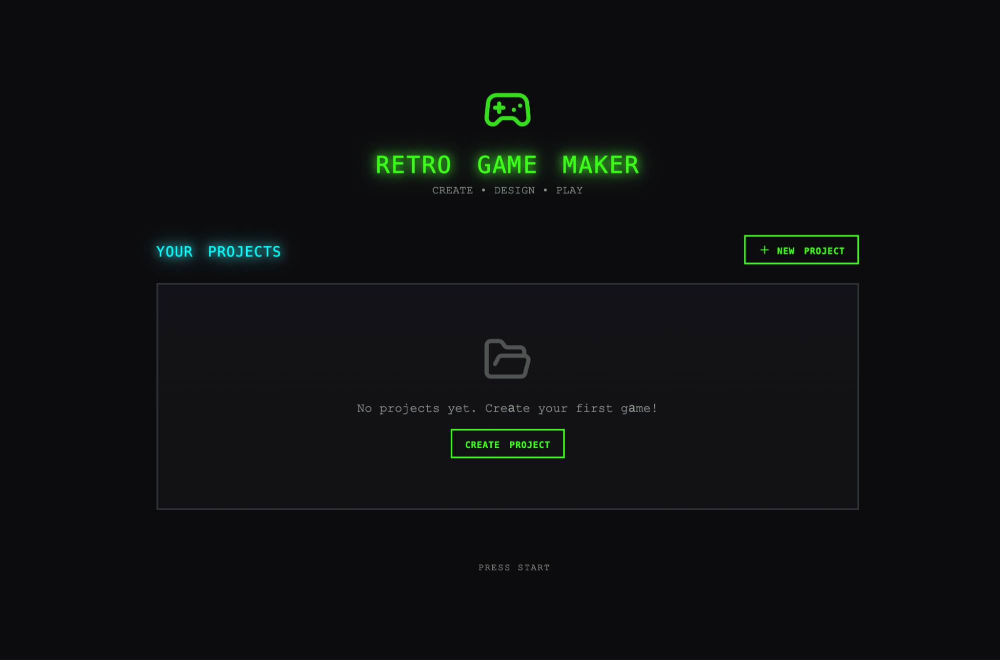
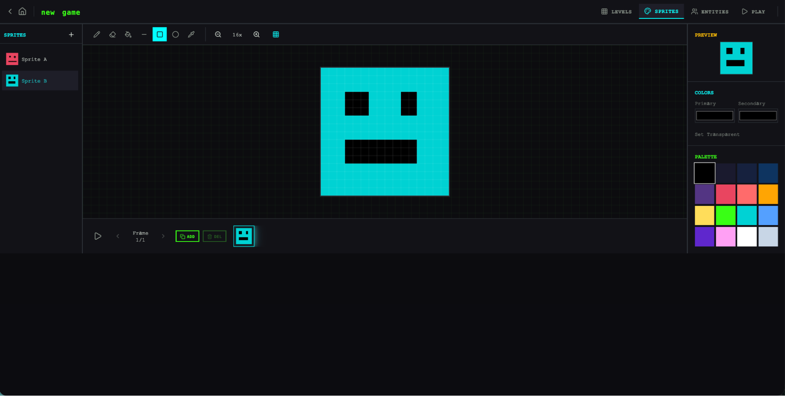
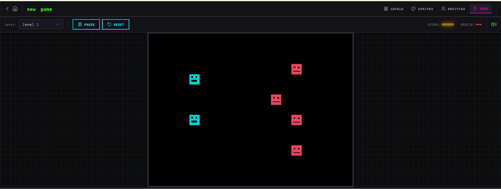
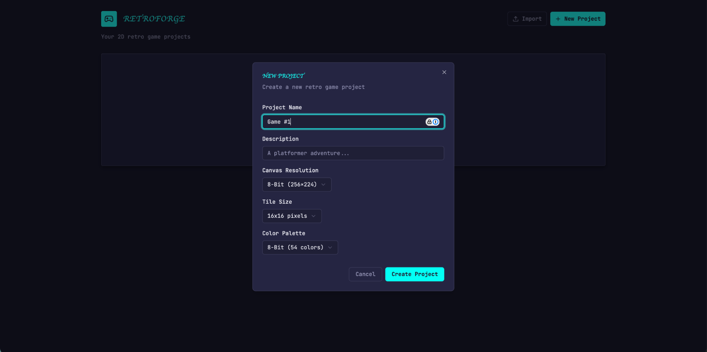
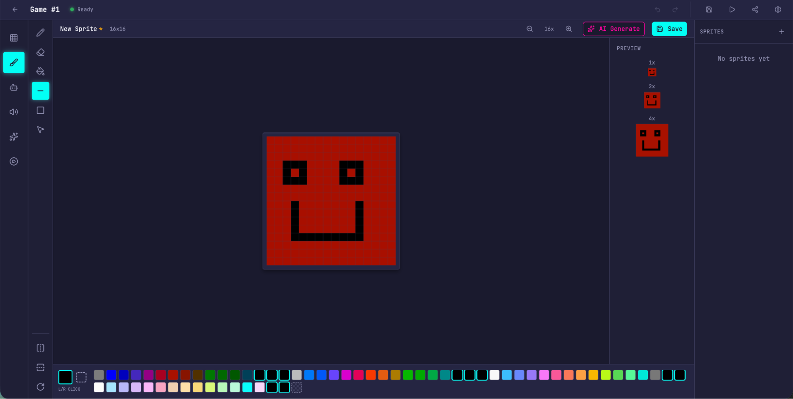
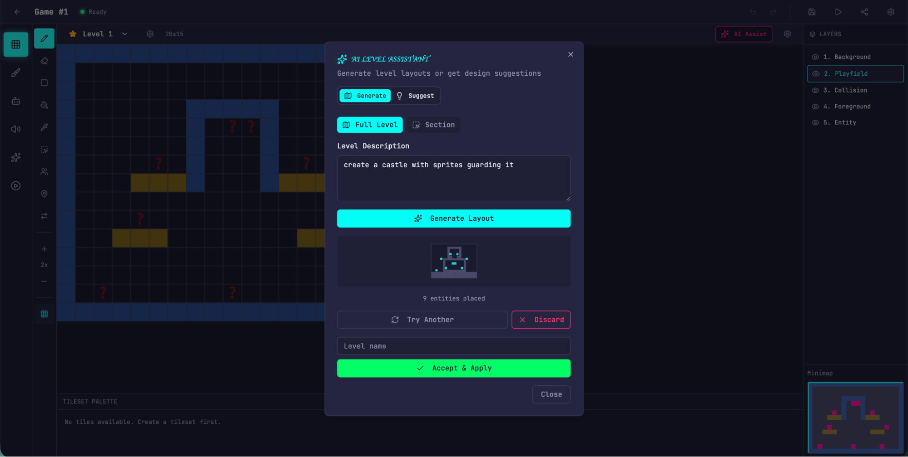
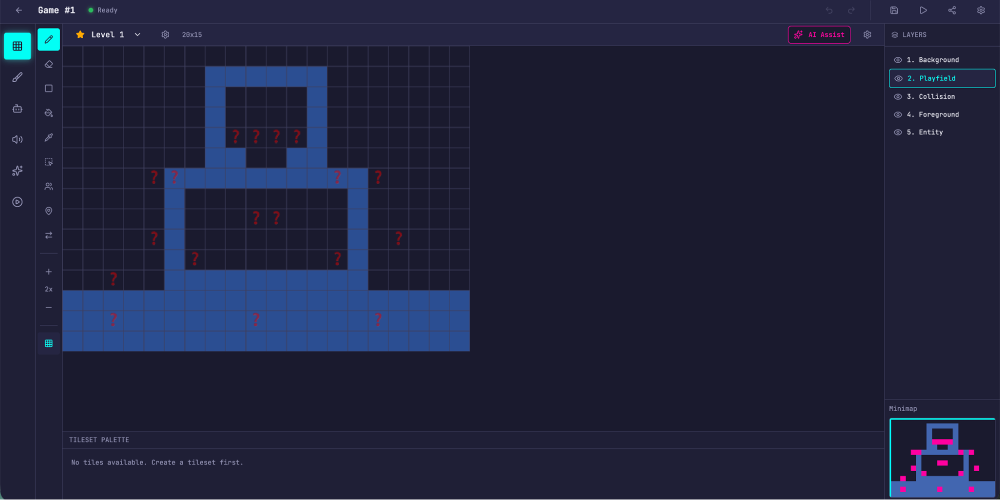
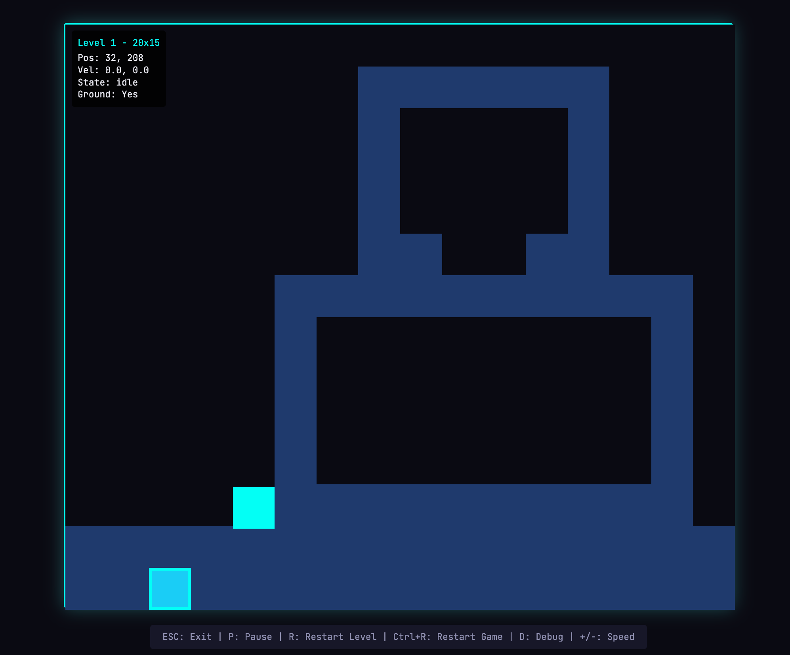

# 21_Harness design for long-running application development_面向长时间运行应用开发的 harness 设计

> 原文：https://www.anthropic.com/engineering/harness-design-long-running-apps
> 作者：Anthropic Engineering｜发布日期：2026-03-24

## 📌 本篇速览

- 📅 2026-03-24　｜　⏱ 约 35 分钟　｜　📄 5,608 词 / 0 图
- ⭐ ★★★★★ **必读** —— 把「评估器何时值得付出成本」量化成随模型能力移动的边界，并给出可复用的三智能体架构与真实成本数据，对做 Agent 系统工程的人极具参考价值。
- 🏷 harness 设计、多智能体架构、生成器-评估器循环、长时间运行智能体、上下文工程
- 🖼 [图解笔记（面试速记）](21_harness-design-long-running-apps_直观图解与学习笔记.md)　·　🗂 [返回总目录](00_目录与阅读进度.md)

Anthropic Labs 的 Prithvi Rajasekaran 分享了一套受 GAN 启发的多智能体 harness：用「规划器 + 生成器 + 评估器」三智能体架构，把「设计好不好」这类主观判断转化为可打分标准，并让评判者与执行者分离，从而在数小时无人干预的自主编码中产出复古游戏制作器、浏览器 DAW 等完整全栈应用。文章还记录了模型从 Opus 4.5 升级到 4.6 后作者如何逐个拆除不再「承重」的 harness 组件（如上下文重置、sprint 分解），并给出成本与时长实测数据。核心结论是：模型变强不会让 harness 设计空间缩小，只会让它位移。

---

*Written by Prithvi Rajasekaran, a member of our* [*Labs*](https://www.anthropic.com/news/introducing-anthropic-labs) *team.*

*本文作者 Prithvi Rajasekaran，是我们 Labs 团队的一员。*

Over the past several months I’ve been working on two interconnected problems: getting Claude to produce high-quality frontend designs, and getting it to build complete applications without human intervention.

过去几个月里，我一直在攻关两个相互关联的问题：让 Claude 产出高质量的前端设计，以及让它在没有人工干预的情况下构建出完整的应用程序。

This work originated with earlier efforts on our [frontend design skill](https://github.com/anthropics/claude-code/blob/main/plugins/frontend-design/skills/frontend-design/SKILL.md) and [long-running coding agent harness](https://www.anthropic.com/engineering/effective-harnesses-for-long-running-agents), where my colleagues and I were able to improve Claude’s performance well above baseline through prompt engineering and harness design—but both eventually hit ceilings.

这项工作源自我们早先在[前端设计技能（frontend design skill）]和[长时间运行编码智能体 harness（执行框架/脚手架）]上的努力——在那些工作中，我和同事们通过提示词工程（prompt engineering）与 harness 设计，把 Claude 的表现提升到了远高于基线（baseline）的水平——但两者最终都碰到了天花板。

To break through, I sought out novel AI engineering approaches that held across two quite different domains, one defined by subjective taste, the other by verifiable correctness and usability.

为了突破瓶颈，我开始寻找能同时适用于两个截然不同领域的新型 AI 工程方法：一个领域由主观品味定义，另一个则由可验证的正确性和可用性定义。

Taking inspiration from [Generative Adversarial Networks](https://en.wikipedia.org/wiki/Generative_adversarial_network) (GANs), I designed a multi-agent structure with a **generator** and **evaluator** agent.

受[生成对抗网络（Generative Adversarial Networks，GANs）]的启发，我设计了一个包含**生成器（generator）**智能体和**评估器（evaluator）**智能体的多智能体结构。

Building an evaluator that graded outputs reliably—and with taste—meant first developing a set of criteria that could turn subjective judgments like “is this design good?” into concrete, gradable terms.

要构建一个能可靠打分、而且有品味的评估器，首先要制定一套标准，把"这个设计好不好？"这类主观判断转化为具体、可打分的条目。

I then applied these techniques to long-running autonomous coding, carrying over two lessons from our earlier harness work: decomposing the build into tractable chunks, and using structured artifacts to hand off context between sessions.

随后我把这些技术应用到长时间运行的自主编码上，并沿用了早先 harness 工作中的两条经验：把构建过程分解成可处理的小块，以及用结构化产物（artifact）在会话（session）之间交接上下文。

The final result was a three-agent architecture—planner, generator, and evaluator—that produced rich full-stack applications over multi-hour autonomous coding sessions.

最终成果是一个由规划器（planner）、生成器和评估器组成的三智能体架构，它能在长达数小时的自主编码会话中产出功能丰富的全栈应用。

### Why naive implementations fall short｜为什么朴素的实现会力不从心

We've previously shown that harness design has a substantial impact on the effectiveness of long running agentic coding.

我们此前已经证明，harness 设计对长时间运行的智能体编码效果有着显著影响。

In an earlier [experiment](https://www.anthropic.com/engineering/effective-harnesses-for-long-running-agents), we used an initializer agent to decompose a product spec into a task list, and a coding agent that implemented the tasks one feature at a time before handing off artifacts to carry context across sessions.

在早先的一次[实验]中，我们用一个初始化器（initializer）智能体把产品规格（spec）分解成任务清单，再由一个编码智能体每次实现一个功能地完成任务，并交接产物以便在会话之间传递上下文。

The broader developer community has converged on similar insights, with approaches like the "[Ralph Wiggum](https://ghuntley.com/ralph/)" method using hooks or scripts to keep agents in continuous iteration cycles.

更广泛的开发者社区也殊途同归地得出了类似的洞见，比如"[Ralph Wiggum]"方法就用 hook 或脚本让智能体保持持续迭代的循环。

But some problems remained persistent.

但有些问题始终挥之不去。

For more complex tasks, the agent still tends to go off the rails over time.

面对更复杂的任务，智能体随着时间推移仍然容易"脱轨"。

While decomposing this issue, we observed two common failure modes with agents executing these sorts of tasks.

在拆解这个问题时，我们观察到智能体执行这类任务时的两种常见失败模式。

First is that models tend to lose coherence on lengthy tasks as the context window fills (see our post on [context engineering](https://www.anthropic.com/engineering/effective-context-engineering-for-ai-agents)).

第一种是：随着上下文窗口（context window）被填满，模型在冗长任务上容易失去连贯性（参见我们关于[上下文工程（context engineering）]的文章）。

Some models also exhibit "context anxiety," in which they begin wrapping up work prematurely as they approach what they believe is their context limit.

有些模型还会表现出"上下文焦虑"（context anxiety）：当它们接近自认为的上下文上限时，就会开始提前草草收尾。

Context resets—clearing the context window entirely and starting a fresh agent, combined with a structured handoff that carries the previous agent's state and the next steps—addresses both these issues.

上下文重置（context reset）——彻底清空上下文窗口、启动一个全新的智能体，并配合结构化交接（handoff）来携带前一个智能体的状态与后续步骤——可以同时解决这两个问题。

This differs from compaction, where earlier parts of the conversation are summarized in place so the same agent can keep going on a shortened history.

这与压缩（compaction）不同：压缩是把对话较早的部分就地总结，让同一个智能体在缩短后的历史上继续干下去。

While compaction preserves continuity, it doesn't give the agent a clean slate, which means context anxiety can still persist.

压缩虽然保留了连续性，却没有给智能体一个"干净的开局"（clean slate），这意味着上下文焦虑仍可能存在。

A reset provides a clean slate, at the cost of the handoff artifact having enough state for the next agent to pick up the work cleanly.

重置提供了干净的开局，代价是交接产物必须携带足够的状态，让下一个智能体能够顺利接手工作。

In our earlier testing, we found Claude Sonnet 4.5 exhibited context anxiety strongly enough that compaction alone wasn't sufficient to enable strong long task performance, so context resets became essential to the harness design.

在早先的测试中，我们发现 Claude Sonnet 4.5 的上下文焦虑严重到仅靠压缩不足以支撑出色的长任务表现，因此上下文重置成了 harness 设计中不可或缺的一环。

This solves the core issue, but adds orchestration complexity, token overhead, and latency to each harness run.

这解决了核心问题，但也给每次 harness 运行增加了编排（orchestration）复杂度、token 开销和延迟。

A second issue, which we haven’t previously addressed, is self-evaluation.

第二个问题是我们此前从未处理过的：自我评估（self-evaluation）。

When asked to evaluate work they've produced, agents tend to respond by confidently praising the work—even when, to a human observer, the quality is obviously mediocre.

当被要求评估自己产出的工作时，智能体往往会信心满满地大加赞赏——哪怕在人类观察者看来，质量明显平庸。

This problem is particularly pronounced for subjective tasks like design, where there is no binary check equivalent to a verifiable software test.

这个问题在设计这类主观任务上尤为突出，因为那里没有等价于可验证软件测试的二元检查。

Whether a layout feels polished or generic is a judgment call, and agents reliably skew positive when grading their own work.

一个版式究竟是精致还是平庸，本身就是主观判断，而智能体在给自己的工作打分时总是稳定地偏向正面。

However, even on tasks that do have verifiable outcomes, agents still sometimes exhibit poor judgment that impedes their performance while completing the task.

然而，即便在结果可验证的任务上，智能体在完成任务的过程中有时也会表现出糟糕的判断力，从而拖累表现。

Separating the agent doing the work from the agent judging it proves to be a strong lever to address this issue.

把干活的智能体和评判的智能体分开，被证明是解决这一问题的有力抓手。

The separation doesn't immediately eliminate that leniency on its own; the evaluator is still an LLM that is inclined to be generous towards LLM-generated outputs.

这种分离本身并不能立刻消除那种宽松倾向；评估器毕竟仍是一个 LLM，天然倾向于对 LLM 生成的产出手下留情。

But tuning a standalone evaluator to be skeptical turns out to be far more tractable than making a generator critical of its own work, and once that external feedback exists, the generator has something concrete to iterate against.

但事实证明，把一个独立的评估器调得更挑剔，要比让生成器批判自己的工作容易得多；而一旦有了这种外部反馈，生成器就有了可以据以迭代的具体依据。

### Frontend design: making subjective quality gradable｜前端设计：让主观质量变得可打分

I started by experimenting on frontend design, where the self-evaluation issue was most visible.

我先从前端设计入手做实验，因为自我评估的问题在这里最为显眼。

Absent any intervention, Claude normally gravitates toward safe, predictable layouts that are technically functional but visually unremarkable.

在没有任何干预的情况下，Claude 通常会倾向于安全、可预期的版式——技术上能用，视觉上却乏善可陈。

Two insights shaped the harness I built for frontend design.

有两点洞察塑造了我为前端设计构建的 harness。

First, while aesthetics can’t be fully reduced to a score—and individual tastes will always vary—they can be improved with grading criteria that encode design principles and preferences.

第一，虽然审美无法完全化约为一个分数——而且个人品味永远见仁见智——但借助编码了设计原则与偏好的打分标准（grading criteria），审美是可以被改进的。

"Is this design beautiful?" is hard to answer consistently, but "does this follow our principles for good design?" gives Claude something concrete to grade against.

"这个设计美不美？"很难有一致的答案，但"它是否遵循了我们的优秀设计原则？"就给了 Claude 一个可以据以打分的具体标尺。

Second, by separating frontend generation from frontend grading, we can create a feedback loop that drives the generator toward stronger outputs.

第二，把前端生成与前端打分分离开来，我们就能构建一个反馈循环，推动生成器产出更强的结果。

With this in mind, I wrote four grading criteria that I gave to both the generator and evaluator agents in their prompts:

基于这些想法，我写了四条打分标准，并把它们同时放进了生成器和评估器智能体的提示词里：

- **Design quality:** Does the design feel like a coherent whole rather than a collection of parts? Strong work here means the colors, typography, layout, imagery, and other details combine to create a distinct mood and identity.

- **设计质量（Design quality）：** 这个设计给人的感觉是一个连贯的整体，还是一堆零件的拼凑？在这一项上表现出色，意味着色彩、字体排印、版式、图像等各种细节共同营造出独特的氛围与识别度。

- **Originality:** Is there evidence of custom decisions, or is this template layouts, library defaults, and AI-generated patterns? A human designer should recognize deliberate creative choices. Unmodified stock components—or telltale signs of AI generation like purple gradients over white cards—fail here.

- **原创性（Originality）：** 是否有定制化决策的痕迹，还是只是模板版式、组件库默认样式和 AI 生成的老套路？人类设计师应该能从中辨认出深思熟虑的创意选择。未经修改的现成组件——或者白色卡片上叠紫色渐变这类一眼就能认出的 AI 生成痕迹——在这一项上直接判负。

- **Craft:** Technical execution: typography hierarchy, spacing consistency, color harmony, contrast ratios. This is a competence check rather than a creativity check. Most reasonable implementations do fine here by default; failing means broken fundamentals.

- **工艺（Craft）：** 技术执行层面：字体层级、间距一致性、色彩和谐度、对比度。这是能力检查而非创意检查。大多数说得过去的实现默认都能过关；不及格意味着基本功出了问题。

- **Functionality:** Usability independent of aesthetics. Can users understand what the interface does, find primary actions, and complete tasks without guessing?

- **功能性（Functionality）：** 与审美无关的可用性。用户能否理解界面的用途、找到主要操作、不靠猜就完成任务？

I emphasized design quality and originality over craft and functionality.

我把设计质量和原创性的权重放在工艺和功能性之上。

Claude already scored well on craft and functionality by default, as the required technical competence tended to come naturally to the model.

Claude 在工艺和功能性上默认就得分不错，因为所需的技术能力对模型来说往往信手拈来。

But on design and originality, Claude often produced outputs that were bland at best.

但在设计和原创性上，Claude 的产出往往充其量只能算平淡。

The criteria explicitly penalized highly generic “AI slop” patterns, and by weighting design and originality more heavily it pushed the model toward more aesthetic risk-taking.

这些标准明确惩罚高度同质化的"AI 垃圾"（AI slop）套路，并且通过加重设计与原创性的权重，推动模型在审美上更敢于冒险。

I calibrated the evaluator using few-shot examples with detailed score breakdowns.

我用带有详细分数拆解的少样本示例（few-shot examples）来校准评估器。

This ensured the evaluator’s judgment aligned with my preferences, and reduced score drift across iterations.

这确保了评估器的判断与我的偏好一致，也减少了迭代过程中的分数漂移。

I built the loop on the [Claude Agent SDK](https://platform.claude.com/docs/en/agent-sdk/overview), which kept the orchestration straightforward.

我在 [Claude Agent SDK] 上搭建了这个循环，这让编排工作保持得很简单。

A generator agent first created an HTML/CSS/JS frontend based on a user prompt.

首先由生成器智能体根据用户提示词做出一个 HTML/CSS/JS 前端。

I gave the evaluator the Playwright MCP, which let it interact with the live page directly before scoring each criterion and writing a detailed critique.

我给评估器配上了 Playwright MCP，让它能直接与运行中的页面交互，然后再逐条标准打分并写出详细的批评意见。

In practice, the evaluator would navigate the page on its own, screenshotting and carefully studying the implementation before producing its assessment.

实际运行中，评估器会自己在页面上导航、截图，仔细研究这份实现，然后才给出评估结论。

That feedback flowed back to the generator as input for the next iteration.

这些反馈会回流给生成器，作为下一轮迭代的输入。

I ran 5 to 15 iterations per generation, with each iteration typically pushing the generator in a more distinctive direction as it responded to the evaluator's critique.

每次生成我会跑 5 到 15 轮迭代，而生成器在回应评估器批评的过程中，通常每一轮都会被推向更有辨识度的方向。

Because the evaluator was actively navigating the page rather than scoring a static screenshot, each cycle took real wall-clock time.

由于评估器是真的在页面上主动导航，而不是对着一张静态截图打分，每一轮循环都要耗掉实打实的墙钟时间（wall-clock time）。

Full runs stretched up to four hours.

完整跑一遍最长要花到四个小时。

I also instructed the generator to make a strategic decision after each evaluation: refine the current direction if scores were trending well, or pivot to an entirely different aesthetic if the approach wasn't working.

我还要求生成器在每次评估之后做一个策略决策：如果分数走势不错，就沿着当前方向继续打磨；如果这条路走不通，就整个转向另一种完全不同的美学风格。

Across runs, the evaluator's assessments improved over iterations before plateauing, with headroom still remaining.

在多次运行中，评估器给出的评分随迭代不断提升，随后进入平台期，但仍留有上升空间。

Some generations refined incrementally. Others took sharp aesthetic turns between iterations.

有些生成结果是渐进式打磨，另一些则在迭代之间发生了审美上的急转弯。

The wording of the criteria steered the generator in ways I didn't fully anticipate.

打分标准的措辞对生成器的引导方式，超出了我原本的预料。

Including phrases like "the best designs are museum quality" pushed designs toward a particular visual convergence, suggesting that the prompting associated with the criteria directly shaped the character of the output.

加入"最好的设计具有博物馆级品质"这类措辞，会把设计推向某种特定的视觉趋同，这表明与标准相伴的提示词会直接塑造产出的气质。

While scores generally improved over iterations, the pattern was not always cleanly linear.

虽然分数总体上随迭代提升，但走势并不总是干净利落的线性。

Later implementations tended to be better as a whole, but I regularly saw cases where I preferred a middle iteration over the last one.

靠后的实现整体上往往更好，但我也经常遇到自己更喜欢中间某一版而不是最后一版的情况。

Implementation complexity also tended to increase across rounds, with the generator reaching for more ambitious solutions in response to the evaluator’s feedback.

实现复杂度也随轮次上升——生成器为了回应评估器的反馈，会去尝试更有野心的方案。

Even on the first iteration, outputs were noticeably better than a baseline with no prompting at all, suggesting the criteria and associated language themselves steered the model away from generic defaults before any evaluator feedback led to further refinement.

即使在第一轮迭代，产出也明显好于完全不加提示词的基线，这说明在评估器反馈带来进一步打磨之前，标准及其配套语言本身就已经把模型从千篇一律的默认风格中引导了出来。

In one notable example, I prompted the model to create a website for a Dutch art museum.

在一个令人印象深刻的例子中，我让模型为一家荷兰艺术博物馆创建网站。

By the ninth iteration, it had produced a clean, dark-themed landing page for a fictional museum.

到第九轮迭代时，它已经为一座虚构博物馆做出了一个干净的深色主题落地页。

The page was visually polished but largely in line with my expectations.

页面在视觉上很精致，但基本没有超出我的预期。

Then, on the tenth cycle, it scrapped the approach entirely and reimagined the site as a spatial experience: a 3D room with a checkered floor rendered in CSS perspective, artwork hung on the walls in free-form positions, and doorway-based navigation between gallery rooms instead of scroll or click.

然后，在第十轮，它把原方案整个推翻，把网站重新构想成一种空间体验：一个用 CSS 透视（perspective）渲染的、铺着棋盘格地板的 3D 房间，艺术品以自由位置挂在墙上，展厅之间靠"门洞"导航，而不是滚动或点击。

It was the kind of creative leap that I hadn't seen before from a single-pass generation.

这种创意上的飞跃，是我在单次生成（single-pass generation）中从未见过的。

🎬 **视频**：[本地文件](media/harness-design-long-running-apps-video-01.mp4)　·　[在线播放](https://cdn.sanity.io/files/4zrzovbb/website/9877febd34432f7f582aecd0023b951223605c6a.mp4)

### Scaling to full-stack coding｜扩展到全栈编码

With these findings in hand, I applied this GAN-inspired pattern to full-stack development.

带着这些发现，我把这套受 GAN 启发的模式应用到了全栈开发上。

The generator-evaluator loop maps naturally onto the software development lifecycle, where code review and QA serve the same structural role as the design evaluator.

生成器—评估器循环天然契合软件开发生命周期：在那里，代码评审（code review）和 QA 扮演的正是设计评估器所承担的那种结构性角色。

#### The architecture｜架构

In our earlier [long-running harness](https://www.anthropic.com/engineering/effective-harnesses-for-long-running-agents), we had solved for coherent multi-session coding with an initializer agent, a coding agent that worked one feature at a time, and context resets between sessions.

在我们早先的[长时间运行 harness]中，我们靠一个初始化器智能体、一个每次只做一个功能的编码智能体，以及会话之间的上下文重置，解决了跨会话连贯编码的问题。

Context resets were a key unlock: the harness used Sonnet 4.5, which exhibited the “context anxiety” tendency mentioned earlier.

上下文重置是一把关键钥匙：那套 harness 用的是 Sonnet 4.5，而它表现出了前面提到的"上下文焦虑"倾向。

Creating a harness that worked well across context resets was key to keeping the model on task.

设计出一个能在多次上下文重置之间良好运转的 harness，是让模型不跑偏的关键。

Opus 4.5 largely removed that behavior on its own, so I was able to drop context resets from this harness entirely.

Opus 4.5 基本上已经自行消除了这种行为，所以我得以在这套 harness 里彻底去掉上下文重置。

The agents were run as one continuous session across the whole build, with the [Claude Agent SDK](https://platform.claude.com/docs/en/agent-sdk/overview)'s automatic compaction handling context growth along the way.

整个构建过程中，这些智能体是作为一个连续会话运行的，途中的上下文增长交由 [Claude Agent SDK] 的自动压缩来处理。

For this work I built on the foundation from the original harness with a three-agent system, with each agent addressing a specific gap I'd observed in prior runs.

这次工作中，我在原有 harness 的基础上搭建了一个三智能体系统，每个智能体都对应我在此前运行中观察到的某个具体短板。

The system contained the following agent personas:

系统包含以下几种智能体角色（persona）：

**Planner:** Our previous long-running harness required the user to provide a detailed spec upfront.

**规划器（Planner）：** 我们之前的长时间运行 harness 要求用户在一开始就提供一份详细的规格说明。

I wanted to automate that step, so I created a planner agent that took a simple 1-4 sentence prompt and expanded it into a full product spec.

我想把这一步自动化，于是做了一个规划器智能体：它接收一段一到四句话的简单提示词，并把它扩展成一份完整的产品规格。

I prompted it to be ambitious about scope and to stay focused on product context and high level technical design rather than detailed technical implementation.

我在提示词里让它在范围上要有野心，并且把注意力放在产品上下文和高层技术设计上，而不是细节层面的技术实现。

This emphasis was due to the concern that if the planner tried to specify granular technical details upfront and got something wrong, the errors in the spec would cascade into the downstream implementation.

之所以这样强调，是担心规划器如果一上来就试图指定细粒度的技术细节、而且某处搞错了，规格中的错误就会一路级联到下游的实现中。

It seemed smarter to constrain the agents on the deliverables to be produced and let them figure out the path as they worked.

更聪明的做法似乎是：只在"要交付什么"上约束智能体，让它们在干活的过程中自己摸索路径。

I also asked the planner to find opportunities to weave AI features into the product specs. (See example in the Appendix at the bottom.)

我还要求规划器寻找机会，把 AI 功能编织进产品规格里。（示例见文末附录。）

**Generator:** The one-feature-at-a-time approach from the earlier harness worked well for scope management.

**生成器（Generator）：** 早先 harness 里"一次一个功能"的做法在范围管理上效果很好。

I applied a similar model here, instructing the generator to work in sprints, picking up one feature at a time from the spec.

我在这里沿用了类似的模式，让生成器按 sprint 推进，每次从规格里挑一个功能来做。

Each sprint implemented the app with a React, Vite, FastAPI, and SQLite (later PostgreSQL) stack, and the generator was instructed to self-evaluate its work at the end of each sprint before handing off to QA.

每个 sprint 都用 React、Vite、FastAPI 和 SQLite（后来换成 PostgreSQL）这套技术栈来实现应用，并且要求生成器在每个 sprint 结束、交给 QA 之前先自评一遍自己的工作。

It also had git for version control.

它还配有 git 做版本控制。

**Evaluator:** Applications from earlier harnesses often looked impressive but still had real bugs when you actually tried to use them.

**评估器（Evaluator）：** 早先几版 harness 产出的应用往往看着挺唬人，可真去用的时候还是有实打实的 bug。

To catch these, the evaluator used the Playwright MCP to click through the running application the way a user would, testing UI features, API endpoints, and database states.

为了逮住这些问题，评估器用 Playwright MCP 像真实用户那样把运行中的应用一路点过去，测试 UI 功能、API 端点和数据库状态。

It then graded each sprint against both the bugs it had found and a set of criteria modeled on the frontend experiment, adapted here to cover product depth, functionality, visual design, and code quality.

然后它会依据自己发现的 bug，以及一套仿照前端实验设计、并针对这里改写过的标准（覆盖产品深度、功能性、视觉设计和代码质量），给每个 sprint 打分。

Each criterion had a hard threshold, and if any one fell below it, the sprint failed and the generator got detailed feedback on what went wrong.

每条标准都设有硬性门槛，只要有任何一条低于门槛，这个 sprint 就算不通过，生成器会收到关于哪里出了问题的详细反馈。

Before each sprint, the generator and evaluator negotiated a sprint contract: agreeing on what "done" looked like for that chunk of work before any code was written.

在每个 sprint 开始之前，生成器和评估器会先谈定一份 sprint 契约（sprint contract）：在动手写任何代码之前，就先就这块工作的"完成"标准达成一致。

This existed because the product spec was intentionally high-level, and I wanted a step to bridge the gap between user stories and testable implementation.

之所以要有这一步，是因为产品规格刻意写得比较高层，我需要一个环节来弥合用户故事（user story）与可测试实现之间的落差。

The generator proposed what it would build and how success would be verified, and the evaluator reviewed that proposal to make sure the generator was building the right thing.

生成器提出自己打算做什么、以及如何验证成功，评估器则评审这份提案，确认生成器要做的是对的东西。

The two iterated until they agreed.

两者反复迭代，直到达成一致。

Communication was handled via files: one agent would write a file, another agent would read it and respond either within that file or with a new file that the previous agent would read in turn.

智能体之间的通信通过文件完成：一个智能体写一个文件，另一个智能体读它，然后要么在同一个文件里回应，要么新建一个文件，再由前一个智能体读取。

The generator then built against the agreed-upon contract before handing the work off to QA.

随后生成器就按照双方约定好的契约（contract）来构建，完成后把工作交给 QA。

This kept the work faithful to the spec without over-specifying implementation too early.

这样既让工作忠实于规格，又不至于过早地把实现细节规定死。

#### Running the harness｜运行这套 harness

For the first version of this harness, I used Claude Opus 4.5, running user prompts against both the full harness and a single-agent system for comparison.

在这套 harness 的第一个版本里，我用的是 Claude Opus 4.5，把用户提示词分别跑在完整 harness 和单智能体系统上作对比。

I used Opus 4.5 since this was our best coding model when I began these experiments.

我选择 Opus 4.5，是因为在我开始这些实验时它是我们最好的编码模型。

I wrote the following prompt to generate a retro video game maker:

我写了下面这段提示词，让它生成一个复古电子游戏制作工具：

> *Create a 2D retro game maker with features including a level editor, sprite editor, entity behaviors, and a playable test mode.*

> *做一个 2D 复古游戏制作器，功能包括关卡编辑器、精灵（sprite）编辑器、实体行为，以及可实际游玩的测试模式。*

The table below shows the harness type, length it ran for, and the total cost.

下表展示了 harness 类型、运行时长和总成本。

| **Harness** | **Duration** | **Cost** |
|---|---|---|
| Solo | 20 min | $9 |
| Full harness | 6 hr | $200 |

| **Harness（方案）** | **Duration（时长）** | **Cost（成本）** |
|---|---|---|
| 单智能体（Solo） | 20 分钟 | 9 美元 |
| 完整 harness | 6 小时 | 200 美元 |

The harness was over 20x more expensive, but the difference in output quality was immediately apparent.

这套 harness 贵了 20 多倍，但产出质量的差距一眼可见。

I was expecting an interface where I could construct a level and its component parts (sprites, entities, tile layout) then hit play to actually play the level.

我期待的是这样一个界面：我能搭建一个关卡及其组成部分（精灵、实体、瓦片布局），然后点"播放"真正把这一关玩起来。

I started by opening the solo run’s output, and the initial application seemed in line with those expectations.

我先打开了单智能体那次运行的产物，初看之下这个应用似乎符合上述期待。

As I clicked through, however, issues started to emerge.

然而随着我一路点下去，问题开始浮现。

The layout wasted space, with fixed-height panels leaving most of the viewport empty.

布局很浪费空间，固定高度的面板让视口（viewport）大部分区域都空着。

The workflow was rigid.

工作流很僵硬。

Trying to populate a level prompted me to create sprites and entities first, but nothing in the UI guided me toward that sequence.

想往关卡里放东西时，它提示我要先创建精灵和实体，但界面里没有任何东西引导我按这个顺序操作。

More to the point, the actual game was broken.

更关键的是，游戏本身是坏的。

My entities appeared on screen but nothing responded to input.

我的实体出现在了屏幕上，但没有任何东西响应输入。

Digging into the code revealed that the wiring between entity definitions and the game runtime was broken, with no surface indication of where.

深入代码后发现，实体定义与游戏运行时之间的接线断了，而表面上完全看不出断在哪里。



*Initial screen when opening the app created by the solo harness.*

*图注：打开单智能体方案所生成应用时的初始界面。*



*Creating a sprite in the sprite editor made by the solo harness*

*图注：在单智能体方案做出的精灵编辑器里创建一个精灵。*



*Trying unsuccessfully to play the level I created*

*图注：尝试游玩我创建的关卡，但没能成功。*

After evaluating the solo run, I turned my attention to the harness run.

评估完单智能体那次运行后，我把注意力转向了 harness 那一次。

This run started from the same one-sentence prompt, but the planner step expanded that prompt into a 16-feature spec spread across ten sprints.

这次运行起点是同一句提示词，但规划器这一步把它扩展成了一份含 16 个功能、分布在十个 sprint 中的规格。

It went well beyond what the solo run attempted.

它远远超出了单智能体那次尝试的范围。

In addition to the core editors and play mode, the spec called for a sprite animation system, behavior templates, sound effects and music, an AI-assisted sprite generator and level designer, and game export with shareable links.

除了核心编辑器和游玩模式之外，规格里还要求做精灵动画系统、行为模板、音效与音乐、AI 辅助的精灵生成器和关卡设计器，以及带可分享链接的游戏导出功能。

I gave the planner access to our [frontend design skill](https://github.com/anthropics/claude-code/blob/main/plugins/frontend-design/skills/frontend-design/SKILL.md), which it read and used to create a visual design language for the app as part of the spec.

我给规划器开放了我们的[前端设计技能]，它读完之后据此为这个应用设计了一套视觉设计语言，并写进了规格里。

For each sprint, the generator and evaluator negotiated a contract defining the specific implementation details for the sprint, and the testable behaviors that would be tested to verify completion.

在每个 sprint 里，生成器和评估器会协商出一份契约，明确该 sprint 的具体实现细节，以及用来验证完成度的可测试行为。

The app immediately showed more polish and smoothness than the solo run.

这个应用一上手就比单智能体那版更精致、更顺滑。

The canvas used the full viewport, the panels were sized sensibly, and the interface had a consistent visual identity that tracked the design direction from the spec.

画布铺满了整个视口，面板尺寸设置得当，界面呈现出与规格中设计方向一致的统一视觉识别。

Some of the clunkiness I'd seen in the solo run did remain—the workflow still didn't make it clear that you should build sprites and entities before trying to populate a level, and I had to figure that out by poking around.

我在单智能体版里见到的一些别扭之处仍然存在——工作流依然没有讲清楚"要先做精灵和实体，再往关卡里放东西"，我还是得靠自己乱点摸索出来。

This read as a gap in the base model’s product intuition rather than something the harness was designed to address, though it did suggest a place where targeted iteration inside the harness could help to further improve output quality.

这在我看来是基础模型产品直觉上的欠缺，而不是这套 harness 本就打算解决的问题；不过它确实指出了一个方向：在 harness 内部做针对性迭代，有望进一步提升产出质量。

Working through the editors, the new run's advantages over solo became more apparent.

一路用下来这些编辑器后，新版运行相对单智能体的优势就更明显了。

The sprite editor was richer and more fully featured, with cleaner tool palettes, a better color picker, and more usable zoom controls.

精灵编辑器更丰富、功能更完整：工具面板更清爽、取色器更好用、缩放控件也更顺手。

Because I'd asked the planner to weave AI features into its specs, the app also came with a built-in Claude integration that let me generate different parts of the game through prompting.

因为我要求规划器把 AI 功能编织进规格，这个应用还自带了 Claude 集成，让我可以通过提示词生成游戏的不同部分。

This significantly sped up the workflow.

这大大加快了工作流。



*Initial screen: Creating a new game, in the app built with the full harness*

*图注：初始界面——在完整 harness 构建出的应用里创建一个新游戏。*



*The sprite editor felt cleaner and easier to use*

*图注：精灵编辑器用起来更清爽、也更顺手。*



*Using the built in AI feature to generate the level*

*图注：使用内置的 AI 功能来生成关卡。*



*Using the built in AI feature to generate the level*

*图注：使用内置的 AI 功能来生成关卡。*



*Playing the game I generated*

*图注：游玩我生成出来的游戏。*

The biggest difference was in play mode.

差别最大的地方在游玩模式。

I was actually able to move my entity and play the game.

我真的能操控自己的实体、把游戏玩起来。

The physics had some rough edges—my character jumped onto a platform but ended up overlapping with it, which felt intuitively wrong—but the core thing worked, which the solo run did not manage.

物理效果还有些毛糙——我的角色跳上平台后会和平台重叠在一起，直觉上就不对——但核心功能是通的，而这一点单智能体那版根本没做到。

After moving around a bit, I did hit some limitations with the AI’s game level construction.

来回走了一阵之后，我确实撞上了 AI 构建关卡的一些局限。

There was a large wall that I wasn’t able to jump past, so I was stuck.

有一堵大墙我怎么也跳不过去，于是就卡死了。

This suggested there were some common sense improvements and edge cases that the harness could handle to further refine the app.

这说明还有一些常识性改进和边缘情况（edge case）可以交给 harness 去处理，从而把应用打磨得更好。

Reading through the logs, it was clear that the evaluator kept the implementation in line with the spec.

翻阅日志后可以清楚看到，是评估器让实现始终贴着规格走。

Each sprint, it walked through the sprint contract's test criteria and exercised the running application through Playwright, filing bugs against anything that diverged from expected behavior.

每个 sprint 里，它都会逐条走查 sprint 契约中的测试标准，并通过 Playwright 实际操作运行中的应用，对任何偏离预期行为的地方提交 bug。

The contracts were granular—Sprint 3 alone had 27 criteria covering the level editor—and the evaluator's findings were specific enough to act on without extra investigation.

这些契约很细——光是 Sprint 3 就有 27 条覆盖关卡编辑器的标准——而评估器给出的结论具体到无需额外排查即可直接动手修。

The table below shows several examples of issues our evaluator identified:

下表列出了评估器发现的若干问题示例：

| **Contract criterion** | **Evaluator finding** |
|---|---|
| Rectangle fill tool allows click-drag to fill a rectangular area with selected tile | **FAIL** — Tool only places tiles at drag start/end points instead of filling the region. `fillRectangle` function exists but isn't triggered properly on mouseUp. |
| User can select and delete placed entity spawn points | **FAIL** — Delete key handler at `LevelEditor.tsx:892` requires both `selection` and `selectedEntityId` to be set, but clicking an entity only sets `selectedEntityId`. Condition should be `selection \|\| (selectedEntityId && activeLayer === 'entity')`. |
| User can reorder animation frames via API | **FAIL** — `PUT /frames/reorder` route defined after `/{frame_id}` routes. FastAPI matches 'r`eorder`' as a frame_id integer and returns 422: "unable to parse string as an integer." |

| **Contract criterion（契约标准）** | **Evaluator finding（评估器发现）** |
|---|---|
| 矩形填充工具支持点击拖拽，用选中的瓦片填满一块矩形区域 | **不通过** —— 该工具只在拖拽的起点和终点放置瓦片，没有填满整个区域。`fillRectangle` 函数是存在的，但在 mouseUp 时没有被正确触发。 |
| 用户可以选中并删除已放置的实体出生点 | **不通过** —— `LevelEditor.tsx:892` 处的 Delete 键处理逻辑要求 `selection` 和 `selectedEntityId` 同时被设置，但点击实体时只会设置 `selectedEntityId`。判断条件应改为 `selection \|\| (selectedEntityId && activeLayer === 'entity')`。 |
| 用户可以通过 API 重排动画帧顺序 | **不通过** —— `PUT /frames/reorder` 路由定义在 `/{frame_id}` 系列路由之后。FastAPI 会把 'r`eorder`' 当成整型的 frame_id 来匹配，并返回 422："unable to parse string as an integer."（无法把字符串解析为整数。） |

Getting the evaluator to perform at this level took work.

要让评估器达到这个水平，是下了功夫的。

Out of the box, Claude is a poor QA agent.

开箱即用的 Claude 是个很差劲的 QA 智能体。

In early runs, I watched it identify legitimate issues, then talk itself into deciding they weren't a big deal and approve the work anyway.

在早期的运行里，我眼看着它识别出了确实存在的问题，然后又自己说服自己"这没什么大不了的"，照样把工作放行了。

It also tended to test superficially, rather than probing edge cases, so more subtle bugs often slipped through.

它还倾向于浮于表面地测试，而不去探查边缘情况，所以更隐蔽的 bug 常常就溜过去了。

The tuning loop was to read the evaluator's logs, find examples where its judgment diverged from mine, and update the QAs prompt to solve for those issues.

调优的循环就是：读评估器的日志，找出它的判断与我的判断出现分歧的例子，然后更新 QA 的提示词来解决这些问题。

It took several rounds of this development loop before the evaluator was grading in a way that I found reasonable.

这样的开发循环走了好几轮，评估器的打分方式才让我觉得说得过去。

Even then, the harness output showed the limits of the model’s QAing capabilities: small layout issues, interactions that felt unintuitive in places, and undiscovered bugs in more deeply nested features that the evaluator hadn't exercised thoroughly.

即便如此，harness 的产出仍暴露出模型 QA 能力的上限：细小的布局问题、某些地方不够直观的交互，以及藏在更深层嵌套功能里、评估器没有充分操作到而未被发现的 bug。

There was clearly more verification headroom to capture with further tuning.

显然，继续调优还能在验证能力上挖出更多空间。

But compared to the solo run, where the central feature of the application simply didn't work, the lift was obvious.

但和单智能体那次运行相比——那一版应用最核心的功能压根就跑不起来——这份提升是显而易见的。

#### Iterating on the harness｜在 harness 上做迭代

The first set of harness results was encouraging, but it was also bulky, slow, and expensive.

第一批 harness 结果令人鼓舞，但它同时也臃肿、缓慢、昂贵。

The logical next step was to find ways to simplify the harness without degrading its performance.

顺理成章的下一步，就是想办法在不损失性能的前提下简化这套 harness。

This was partly common sense and partly a function of a more general principle: every component in a harness encodes an assumption about what the model can't do on its own, and those assumptions are worth stress testing, both because they may be incorrect, and because they can quickly go stale as models improve.

这一半出于常识，一半源自一条更普遍的原则：harness 里的每一个组件，都编码了一条关于"模型自己做不到什么"的假设，而这些假设值得反复压力测试——既因为它们可能本来就不成立，也因为随着模型进步，它们会很快过时。

Our blog post [Building Effective Agents](https://www.anthropic.com/research/building-effective-agents) frames the underlying idea as "find the simplest solution possible, and only increase complexity when needed," and it's a pattern that shows up consistently for anyone maintaining an agent harness.

我们的博客文章[《构建高效智能体》（Building Effective Agents）]把这个底层思路总结为"先找到尽可能简单的方案，只在需要时才增加复杂度"，而对任何维护智能体 harness 的人来说，这个规律都会反复出现。

In my first attempt to simplify, I cut the harness back radically and tried a few creative new ideas, but I wasn't able to replicate the performance of the original.

第一次尝试简化时，我把 harness 大刀阔斧地砍了一通，还试了几个有创意的新点子，但没能复现出原版的性能。

It also became difficult to tell which pieces of the harness design were actually load-bearing, and in what ways.

而且这样一来也很难判断，harness 设计中到底哪些部件是真正"承重"的、又是以什么方式承重的。

Based on that experience, I moved to a more methodical approach, removing one component at a time and reviewing what impact it had on the final result.

吸取这次教训后，我改用了更有条理的方法：一次只移除一个组件，然后考察它对最终结果有什么影响。

As I was going through these iteration cycles, we also released Opus 4.6, which provided further motivation to reduce harness complexity.

就在我做这些迭代循环的过程中，我们发布了 Opus 4.6，这进一步促使我去降低 harness 的复杂度。

There was good reason to expect 4.6 would need less scaffolding than 4.5 did.

有充分理由相信，4.6 需要的脚手架（scaffolding）会比 4.5 更少。

From our [launch blog:](https://www.anthropic.com/news/claude-opus-4-6) "[Opus 4.6] plans more carefully, sustains agentic tasks for longer, can operate more reliably in larger codebases, and has better code review and debugging skills to catch its own mistakes."

引用我们的[发布博客]："[Opus 4.6] 规划得更周密，能把智能体任务撑得更久，在更大的代码库中运作得更可靠，代码评审和调试能力也更强，能抓住自己犯的错误。"

It also improved substantially on long-context retrieval.

它在长上下文检索（long-context retrieval）上也有大幅提升。

These were all capabilities the harness had been built to supplement.

而这些恰恰都是当初这套 harness 用来补足的能力。

#### Removing the sprint construct｜去掉 sprint 这一构造

I started by removing the sprint construct entirely.

我先是把 sprint 这个构造彻底去掉了。

The sprint structure had helped to decompose work into chunks for the model to work coherently.

sprint 结构原本的作用，是把工作切成小块，好让模型能连贯地推进。

Given the improvements in Opus 4.6, there was good reason to believe that the model could natively handle the job without this sort of decomposition.

考虑到 Opus 4.6 的进步，有充分理由相信模型不需要这种分解就能原生地扛下这份工作。

I kept both the planner and evaluator, as each continued to add obvious value.

规划器和评估器我都保留了，因为两者都仍在带来明显价值。

Without the planner, the generator under-scoped: given the raw prompt, it would start building without first speccing its work, and end up creating a less feature-rich application than the planner did.

没有规划器时，生成器会把范围定得过小：拿到原始提示词后，它会不先写规格就直接开工，最后做出的应用在功能丰富度上不如有规划器时。

With the sprint construct removed, I moved the evaluator to a single pass at the end of the run rather than grading per sprint.

去掉 sprint 构造后，我把评估器改成在运行结束时做一次性评审，而不是每个 sprint 打一次分。

Since the model was much more capable, it changed how load-bearing the evaluator was for certain runs, with its usefulness depending on where the task sat relative to what the model could do reliably on its own.

由于模型能力强了很多，评估器在某些运行中的"承重"程度也随之改变——它有多大用处，取决于任务相对于"模型自己能稳定做到的范围"处在什么位置。

On 4.5, that boundary was close: our builds were at the edge of what the generator could do well solo, and the evaluator caught meaningful issues across the build.

在 4.5 上，这条边界离得很近：我们的构建任务正好处在生成器单干所能胜任的边缘，评估器在整个构建过程中都能抓到有意义的问题。

On 4.6, the model's raw capability increased, so the boundary moved outward.

到了 4.6，模型的原始能力提升了，这条边界也就向外推移。

Tasks that used to need the evaluator's check to be implemented coherently were now often within what the generator handled well on its own, and for tasks within that boundary, the evaluator became unnecessary overhead.

那些过去需要评估器把关才能实现得连贯的任务，如今往往落在生成器自己就能搞定的范围内；对于边界之内的任务，评估器就成了多余的开销。

But for the parts of the build that were still at the edge of the generator’s capabilities, the evaluator continued to give real lift.

但对于构建中仍然处在生成器能力边缘的那些部分，评估器依旧带来了实打实的提升。

The practical implication is that the evaluator is not a fixed yes-or-no decision.

实践上的含义是：要不要用评估器，并不是一个一锤定音的是非题。

It is worth the cost when the task sits beyond what the current model does reliably solo.

当任务超出当前模型单干所能稳定完成的范围时，这份成本就值得付。

Alongside the structural simplification, I also added prompting to improve how the harness built AI features into each app, specifically getting the generator to build a proper agent that could drive the app's own functionality through tools.

在做结构简化的同时，我还增加了提示词，改进 harness 把 AI 功能嵌入每个应用的方式——具体来说，是让生成器构建一个像样的智能体，能通过工具调用来驱动应用自身的功能。

That took real iteration, since the relevant knowledge is recent enough that Claude's training data covers it thinly.

这花了不少功夫迭代，因为相关知识足够新，Claude 的训练数据对其覆盖得很稀薄。

But with enough tuning, the generator was building agents correctly.

但经过充分调优后，生成器已经能正确地构建智能体了。

#### Results from the updated harness｜更新版 harness 的结果

To put the updated harness to the test, I used the following prompt to generate a Digital Audio Workstation (DAW), a music production program for composing, recording, and mixing songs:

为了检验更新后的 harness，我用下面这段提示词生成了一个数字音频工作站（Digital Audio Workstation，DAW）——一种用于作曲、录音和混音的音乐制作程序：

> *Build a fully featured DAW in the browser using the Web Audio API.*

> *用 Web Audio API 在浏览器里构建一个功能完备的 DAW。*

The run was still lengthy and expensive, at about 4 hours and $124 in token costs.

这次运行依然又长又贵：大约 4 小时，token 成本约 124 美元。

Most of the time went to the builder, which ran coherently for over two hours without the sprint decomposition that Opus 4.5 had needed.

大部分时间花在构建器（builder）上，它在没有 Opus 4.5 所需的 sprint 分解的情况下，连贯运行了两个多小时。

| **Agent & Phase** | **Duration** | **Cost** |
|---|---|---|
| Planner | 4.7 min | $0.46 |
| Build (Round 1) | 2 hr 7 min | $71.08 |
| QA (Round 1) | 8.8 min | $3.24 |
| Build (Round 2) | 1 hr 2 min | $36.89 |
| QA (Round 2) | 6.8 min | $3.09 |
| Build (Round 3) | 10.9 min | $5.88 |
| QA (Round 3) | 9.6 min | $4.06 |
| **Total V2 Harness** | **3 hr 50 min** | **$124.70** |

| **Agent & Phase（智能体与阶段）** | **Duration（时长）** | **Cost（成本）** |
|---|---|---|
| 规划器（Planner） | 4.7 分钟 | 0.46 美元 |
| 构建（第 1 轮） | 2 小时 7 分钟 | 71.08 美元 |
| QA（第 1 轮） | 8.8 分钟 | 3.24 美元 |
| 构建（第 2 轮） | 1 小时 2 分钟 | 36.89 美元 |
| QA（第 2 轮） | 6.8 分钟 | 3.09 美元 |
| 构建（第 3 轮） | 10.9 分钟 | 5.88 美元 |
| QA（第 3 轮） | 9.6 分钟 | 4.06 美元 |
| **V2 harness 合计** | **3 小时 50 分钟** | **124.70 美元** |

As with the previous harness, the planner expanded the one-line prompt into a full spec.

和上一版 harness 一样，规划器把这一行提示词扩展成了一份完整规格。

From the logs, I could see the generator model did a good job planning the app and the agent design, wiring the agent up, and testing it before handing off to QA.

从日志可以看到，生成器模型在规划应用与智能体设计、把智能体接线连通、以及交给 QA 之前先自测这几件事上都做得不错。

That being said, the QA agent still caught real gaps.

话虽如此，QA 智能体仍然抓到了实实在在的缺口。

In its first-round feedback, it noted:

在第一轮反馈中，它写道：

> This is a strong app with excellent design fidelity, solid AI agent, and good backend. The main failure point is Feature Completeness — while the app looks impressive and the AI integration works well, several core DAW features are display-only without interactive depth: clips can't be dragged/moved on the timeline, there are no instrument UI panels (synth knobs, drum pads), and no visual effect editors (EQ curves, compressor meters). These aren't edge cases — they're the core interactions that make a DAW usable, and the spec explicitly calls for them.

> 这是个不错的应用：设计还原度极佳、AI 智能体扎实、后端也不错。主要的失分点在于功能完整度——虽然应用看上去很唬人、AI 集成也运转良好，但好几个核心 DAW 功能只是摆设、没有交互深度：片段（clip）无法在时间线上拖动/移动，没有乐器 UI 面板（合成器旋钮、鼓垫），也没有可视化的效果器编辑器（EQ 曲线、压缩器仪表）。这些都不是边缘情况——它们恰恰是让 DAW 好用的核心交互，而且规格里明确要求了。

In its second round feedback, it again caught several functionality gaps:

在第二轮反馈中，它又抓到了几处功能缺口：

> Remaining gaps:
- Audio recording is still stub-only (button toggles but no mic capture)
- Clip resize by edge drag and clip split not implemented
- Effect visualizations are numeric sliders, not graphical (no EQ curve)

> 仍存在的缺口：
- 音频录制仍然只是个空壳（按钮能切换状态，但没有麦克风采集）
- 拖拽边缘调整片段长度、以及片段切分都尚未实现
- 效果器的可视化只是数字滑块，不是图形化的（没有 EQ 曲线）

The generator was still liable to miss details or stub features when left to its own devices, and the QA still added value in catching those last mile issues for the generator to fix.

放任生成器自己干时，它依然容易漏掉细节或把功能做成空壳，而 QA 仍然在抓这些"最后一公里"问题、交给生成器修复这件事上带来了价值。

Based on the prompt, I was expecting a program where I could create melodies, harmonies, and drum patterns, arrange them into a song, and get help from an integrated agent along the way.

根据那段提示词，我期待的是这样一个程序：我能创作旋律、和声和鼓点，把它们编排成一首歌，并且一路上都能得到内置智能体的帮助。

The video below shows the result.

下面的视频展示了最终结果。

🎬 **视频**：[本地文件](media/harness-design-long-running-apps-video-02.mp4)　·　[在线播放](https://cdn.sanity.io/files/4zrzovbb/website/555910f9adb3938734940224e7a6f4c7cbbbd8f2.mp4)

The app is far from a professional music production program, and the agent's song composition skills could clearly use a lot of work.

这个应用离专业音乐制作软件还差得远，而且智能体的作曲水平显然还有很大提升空间。

Additionally, Claude can’t actually hear, which made the QA feedback loop less effective with respect to musical taste.

另外，Claude 其实"听不见"声音，这让 QA 反馈循环在音乐品味方面的效果打了折扣。

But the final app had all the core pieces of a functional music production program: a working arrangement view, mixer, and transport running in the browser.

但最终这个应用具备了一个可用音乐制作程序的全部核心部件：在浏览器里跑起来的编排视图（arrangement view）、混音台（mixer）和走带控制（transport）。

Beyond that, I was able to put together a short song snippet entirely through prompting: the agent set the tempo and key, laid down a melody, built a drum track, adjusted mixer levels, and added reverb.

不仅如此，我还完全靠提示词拼出了一小段歌曲：智能体设定了速度和调性，铺好旋律，搭出鼓轨，调整了混音电平，还加了混响。

The core primitives for song composition were present, and the agent could drive them autonomously, using tools to create a simple production from end to end.

作曲所需的核心原语（primitive）都在，而且智能体能自主驱动它们，通过工具调用端到端地完成一次简单的制作。

You might say it’s not pitch-perfect yet—but it’s getting there.

你可以说它还没到"音准完美"的程度——但正在往那儿走。（译注：pitch-perfect 一语双关，既指音准准确，也指"完美无瑕"。）

### What comes next｜接下来会怎样

As models continue to improve, we can roughly expect them to be capable of working for longer, and on more complex tasks.

随着模型不断进步，我们大致可以预期它们能工作更久、能承担更复杂的任务。

In some cases, that will mean the scaffold surrounding the model matters less over time, and developers can wait for the next model and see certain problems solve themselves.

在某些情况下，这意味着围绕模型搭建的脚手架会随着时间推移变得没那么重要，开发者只要等下一代模型出来，就会发现某些问题自己就消失了。

On the other hand, the better the models get, the more space there is to develop harnesses that can achieve complex tasks beyond what the model can do at baseline.

但另一方面，模型越强，可供开发 harness 的空间也就越大——这些 harness 能完成的复杂任务，会远超模型在基线状态下的能力。

With this in mind, there are a few lessons from this work worth carrying forward.

据此，这项工作中有几条经验值得沿用下去。

It is always good practice to experiment with the model you're building against, read its traces on realistic problems, and tune its performance to achieve your desired outcomes.

拿你要构建所依赖的那个模型亲自做实验、读它在真实问题上的执行轨迹（trace）、并调优它的表现以达成你想要的结果——这永远都是好习惯。

When working on more complex tasks, there is sometimes headroom from decomposing the task and applying specialized agents to each aspect of the problem.

在处理更复杂的任务时，把任务分解、并为问题的各个方面配上专门的智能体，有时还能挖出额外的提升空间。

And when a new model lands, it is generally good practice to re-examine a harness, stripping away pieces that are no longer load-bearing to performance and adding new pieces to achieve greater capability that may not have been possible before.

而每当新模型落地时，通常都值得重新审视一遍 harness：剥掉那些对性能已不再"承重"的部件，并加入新的部件，以获得此前可能还做不到的更强能力。

From this work, my conviction is that the space of interesting harness combinations doesn't shrink as models improve.

从这项工作出发，我的信念是：有意思的 harness 组合空间，并不会随着模型进步而收缩。

Instead, it moves, and the interesting work for AI engineers is to keep finding the next novel combination.

它只是发生了位移；而 AI 工程师真正有意思的工作，就是不断去找到下一个新颖的组合。

### Acknowledgements｜致谢

Special thanks to Mike Krieger, Michael Agaby, Justin Young, Jeremy Hadfield, David Hershey, Julius Tarng, Xiaoyi Zhang, Barry Zhang, Orowa Sidker, Michael Tingley, Ibrahim Madha, Martina Long, and Canyon Robbins for their contributions to this work.

特别感谢 Mike Krieger、Michael Agaby、Justin Young、Jeremy Hadfield、David Hershey、Julius Tarng、Xiaoyi Zhang、Barry Zhang、Orowa Sidker、Michael Tingley、Ibrahim Madha、Martina Long 和 Canyon Robbins 对这项工作的贡献。

Thanks also to Jake Eaton, Alyssa Leonard, and Stef Sequeira for their help shaping the post.

也感谢 Jake Eaton、Alyssa Leonard 和 Stef Sequeira 在本文成稿过程中提供的帮助。

### Appendix｜附录

Example plan generated by planner agent.

由规划器智能体生成的方案示例。

```
RetroForge - 2D Retro Game Maker

Overview
RetroForge is a web-based creative studio for designing and building 2D retro-style video games. It combines the nostalgic charm of classic 8-bit and 16-bit game aesthetics with modern, intuitive editing tools—enabling anyone from hobbyist creators to indie developers to bring their game ideas to life without writing traditional code.

The platform provides four integrated creative modules: a tile-based Level Editor for designing game worlds, a pixel-art Sprite Editor for crafting visual assets, a visual Entity Behavior system for defining game logic, and an instant Playable Test Mode for real-time gameplay testing. By weaving AI assistance throughout (powered by Claude), RetroForge accelerates the creative process—helping users generate sprites, design levels, and configure behaviors through natural language interaction.

RetroForge targets creators who love retro gaming aesthetics but want modern conveniences. Whether recreating the platformers, RPGs, or action games of their childhood, or inventing entirely new experiences within retro constraints, users can prototype rapidly, iterate visually, and share their creations with others.

Features
1. Project Dashboard & Management
The Project Dashboard is the home base for all creative work in RetroForge. Users need a clear, organized way to manage their game projects—creating new ones, returning to works-in-progress, and understanding what each project contains at a glance.

User Stories: As a user, I want to:

- Create a new game project with a name and description, so that I can begin designing my game
- See all my existing projects displayed as visual cards showing the project name, last modified date, and a thumbnail preview, so that I can quickly find and continue my work
- Open any project to enter the full game editor workspace, so that I can work on my game
- Delete projects I no longer need, with a confirmation dialog to prevent accidents, so that I can keep my workspace organized
- Duplicate an existing project as a starting point for a new game, so that I can reuse my previous work

Project Data Model: Each project contains:

Project metadata (name, description, created/modified timestamps)
Canvas settings (resolution: e.g., 256x224, 320x240, or 160x144)
Tile size configuration (8x8, 16x16, or 32x32 pixels)
Color palette selection 
All associated sprites, tilesets, levels, and entity definitions

...
```

（译注：以上为规划器智能体从一句话提示词扩展出的产品规格节选，原文为英文，此处保留原样不译。大意是：**RetroForge —— 2D 复古游戏制作器**。概述部分说明它是一个网页端创作工作室，把经典 8 位、16 位游戏美学的怀旧韵味与现代直观的编辑工具结合起来，让从爱好者到独立开发者的任何人都能不写传统代码就实现自己的游戏创意；平台提供四个整合的创作模块——基于瓦片的关卡编辑器、像素画精灵编辑器、可视化实体行为系统，以及即时可玩的测试模式——并全程编织进由 Claude 驱动的 AI 辅助，让用户通过自然语言生成精灵、设计关卡、配置行为。功能部分的第 1 项「项目仪表盘与管理」列出了用户故事（新建/浏览/打开/删除/复制项目）以及项目数据模型（项目元数据、画布分辨率、瓦片尺寸、调色板选择，以及所有关联的精灵、瓦片集、关卡与实体定义）。）
