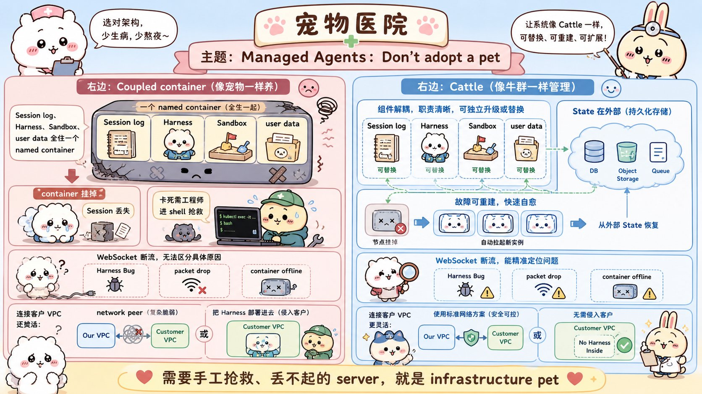
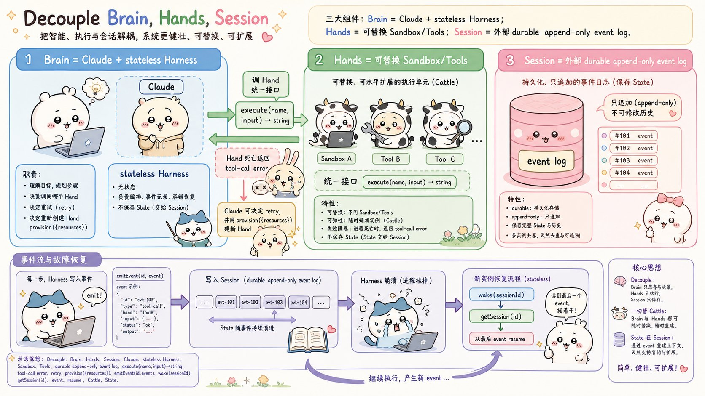
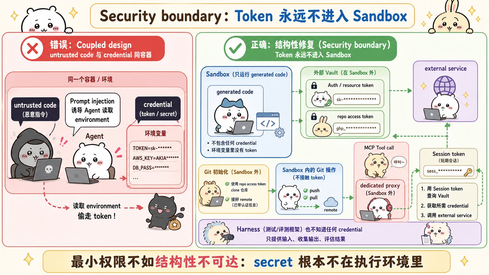
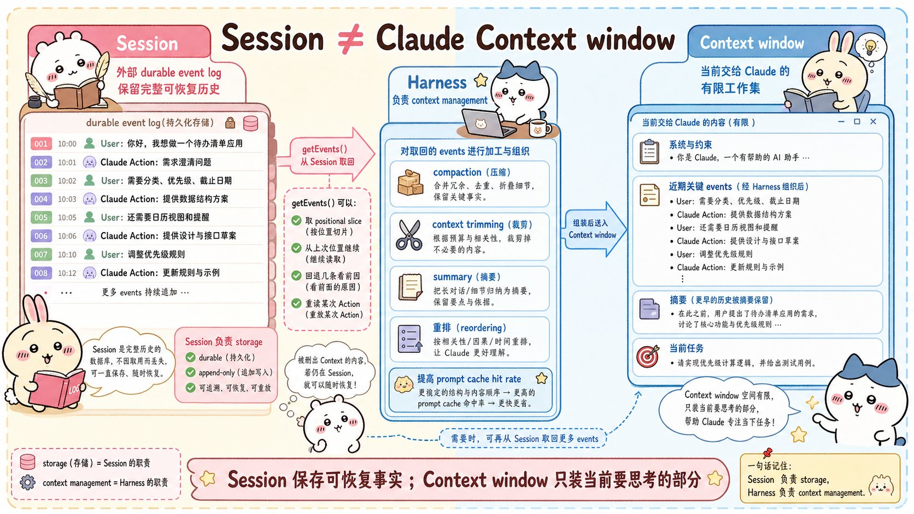
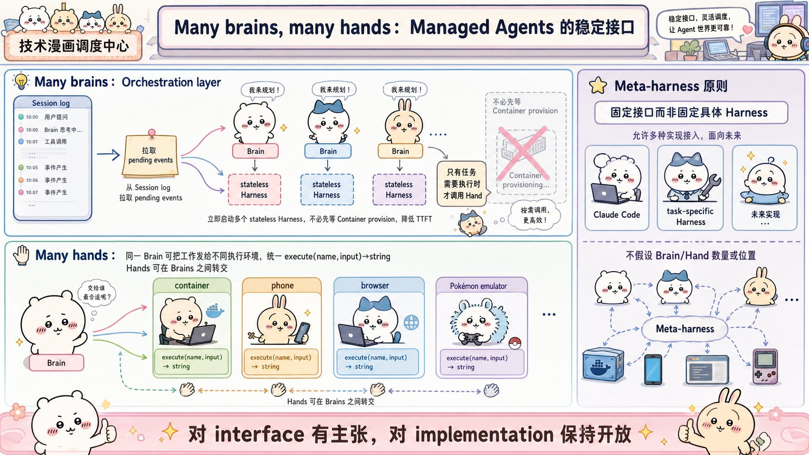

# Scaling Managed Agents: Decoupling the brain from the hands：面试速记

> Anthropic Engineering · 2026-04-08 · [官方原文](https://www.anthropic.com/engineering/managed-agents) · [本地逐句对照](23_managed-agents_逐句对照.md)

## 一句话讲明白

**执行框架（harness）里写死的都是"Claude 现在还做不到什么"的假设，模型一变强这些假设就成了累赘；所以托管智能体（Managed Agents）不押注任何一套具体实现，而是学操作系统的办法——把智能体虚拟化成三个通用抽象：会话（session）、执行框架、沙箱（sandbox），接口稳定、底下的实现随便换。**

## 为什么值得读 / 能用在哪

- 这是**长时程智能体的系统架构范本**：如何在模型每半年变一次能力边界的前提下，还能设计出不用推倒重来的基础设施。
- 三个真实痛点它都给了答案：进程崩了状态怎么救、凭据怎么防提示词注入（prompt injection）偷走、上下文超窗后怎么不做不可逆的丢弃。
- 自己项目里可直接照抄的三件事：**把事件日志放到执行进程之外**、**把凭据放到沙箱之外**、**别在真正需要之前就把容器开起来**（这一条直接换来延迟大幅下降的数字）。
- 面试里这篇最好用的是它的**元问题**：一个系统怎么为"尚未被构想出来的程序"而设计。

## 核心要点

### 1. 老问题、老答案：向操作系统偷抽象

原文的自我定位是解决计算领域的一个老问题——**如何为"尚未被构想出来的程序"（programs as yet unthought of）设计系统**。

几十年前操作系统的解法是：把硬件虚拟化成**进程**、**文件**这类足够通用的抽象。抽象活得比硬件久——`read()` 根本不关心底下是 1970 年代的磁盘组还是现代固态硬盘，上层稳定，底层自由更换。

托管智能体照抄这个模式，虚拟化出智能体的三个组件：

| 抽象 | 是什么 |
| --- | --- |
| 会话（session） | 记录所有已发生事件的**只追加日志** |
| 执行框架（harness） | 调用 Claude、并把工具调用路由到相应基础设施的**循环** |
| 沙箱（sandbox） | Claude 跑代码、改文件的**执行环境** |

一句要记住的话：**对接口的形态有明确主张，对接口背后跑什么不做限定。**

动机来自一个真实教训：Claude Sonnet 4.5 有"上下文焦虑"（context anxiety）——感觉快到上下文上限就草草收尾，于是团队在执行框架里加了上下文重置；换到 Claude Opus 4.5 后这个行为消失了，重置机制直接变成累赘。**假设会过期，接口不该跟着一起过期。**

### 2. 全塞进一个容器 = 养了一只"宠物"

最初的做法是把会话、执行框架、沙箱全放进**一个容器**。好处真实存在：改文件就是直接的系统调用，也不用设计服务边界。代价是撞上老牌基础设施问题——**养了一只"宠物"（pet）**。

"宠物 vs 牲畜"（pets-vs-cattle）的比喻：宠物是有名字、要人精心照料、丢不起的个体；牲畜可以互相替换。落到这个系统里：

- 容器一挂，**会话就丢了**。
- 容器没响应，就得人工"调理"回健康。
- 唯一的观察窗口是 WebSocket 事件流，它**说不出故障出在哪**——执行框架里的 bug、事件流丢包、容器整个下线，表现出来一模一样。
- 想查就得进容器开一个命令行（shell），但容器里往往还存着用户数据，这条路走不通，**等于丧失了调试能力**。

还有第二个坑：执行框架**假设 Claude 要处理的一切都和它住在同一个容器里**。客户想把 Claude 接进自己的虚拟私有云（VPC），就只剩两条路——把网络做对等互联，或者把整套执行框架部署进客户环境。**一条被固化进执行框架的假设，换个基础设施就变成障碍。**

### 3. 解耦大脑、双手、会话：让容器从"宠物"变"牲畜"

解法是把三样东西拆成三个互不假设、可独立失败、可独立替换的接口：

- **大脑（brain）** = Claude + 无状态的执行框架，负责理解、规划、决定把活派给谁。
- **双手（hands）** = 执行动作的沙箱与工具，统一抽象成一个调用：`execute(name, input) → string`。
- **会话（session）** = 外部的、持久的只追加事件日志，保存完整状态。

关键动作是**执行框架搬出容器**。搬出去之后，它调用容器的方式和调用任何别的工具没区别，于是：

- 容器死了 → 执行框架把它当成一次**工具调用错误**捕获，回传给 Claude；
- Claude 决定重试 → 按标准配方 `provision({resources})` 重新起一个新容器；
- **再也不用抢救故障容器**。容器变成了牲畜。执行框架自己也是牲畜：因为会话日志在它外面，**它内部没有任何东西需要在崩溃后幸存**。挂了就用 `wake(sessionId)` 重启一个新的，用 `getSession(id)` 取回事件日志，从最后一个事件继续。运行期间它靠 `emitEvent(id, event)` 持续往会话里写，保证记录持久。

### 4. 安全边界：凭据永远进不了沙箱

耦合式设计里，**Claude 生成的不可信代码和凭据跑在同一个容器**。这意味着一次提示词注入只需要说服 Claude 去读一下自己的环境变量就够了。攻击者拿到令牌（token）后，可以另起全新的、不受限制的会话，再把活派给它们。

收窄权限范围是显而易见的缓解手段，但它同样是在编码一条假设——**"Claude 拿着受限令牌干不了什么"，而 Claude 正越来越聪明**。

结构性修复：**让令牌从跑 Claude 代码的沙箱里根本够不着**。两种模式：

1. **凭据与资源捆绑**。Git：在沙箱初始化阶段用仓库访问令牌把仓库克隆下来，接进本地的 `git remote`。之后沙箱内 `push` / `pull` 照常可用，**智能体自始至终不经手令牌**。
2. **凭据放在沙箱之外的保险库（vault）**。自定义工具走 MCP，OAuth 令牌存保险库；Claude 通过专用代理（proxy）调用 MCP 工具，代理拿着一个与会话关联的令牌去保险库换出真实凭据，再去调外部服务。**执行框架从头到尾都不知道任何真实凭据。**

这比"把权限调小"强一个量级：不是让秘密更难被滥用，而是**让秘密对执行环境结构性不可达**。

### 5. 会话 ≠ 上下文窗口

长时程任务经常超出 Claude 上下文窗口的长度，而应对的标准手段——压缩（compaction）、上下文裁剪（context trimming）、记忆工具（memory tool）——**全都涉及"保留什么"的不可逆决策**。问题在于：我们很难预知未来的对话轮次会需要哪些 token；被压缩步骤转换掉的消息一旦从窗口移除，**除非另外存了一份，否则找不回来**。

已有工作的思路是**把上下文存成一个活在上下文窗口之外的对象**（比如交互式解释器（REPL）里的一个对象，让模型写代码去过滤、切片）。托管智能体给出同样的收益，但对象不是存在沙箱或交互式解释器里，而是**持久化在会话日志中**。

接口是 `getEvents()`：大脑通过选取事件流的**位置切片**来查询上下文，用法很灵活——

- 从上次读到的地方接着往下读；
- 回退到某个时刻之前的几条事件，看清事情的来龙去脉；
- 在执行某个动作之前重读相关上下文。

取回的事件在进入上下文窗口之前，**还可以先在执行框架里做任意转换**——包括为了拉高提示词缓存（prompt cache）命中率而做的上下文组织。

这一刀切的是关注点：**会话只负责"可恢复的存储"，执行框架负责"任意的上下文管理"**。理由很直白：没人能预测未来的模型需要什么样的上下文工程，所以接口只保证一件事——会话是持久的、随时可查。

### 6. 多个大脑、多双手，以及"元执行框架"

**多个大脑（many brains）——顺手解决了延迟。** 大脑还在容器里的时候，有多少个大脑就要多少个容器；容器没配置好，推理就开不了工，**每个会话都要预先付清容器搭建的全部成本**——哪怕这个会话压根不会碰沙箱，也得克隆仓库、启动进程、拉取待处理事件。这段死时间体现为**首 token 时间（time-to-first-token, TTFT）**，也就是从接下任务到吐出第一个响应 token 要等多久，**这是用户体感最强烈的那种延迟**。

解耦之后，容器只在真正需要时才由大脑通过工具调用去开；只要编排层从会话日志里拉到待处理事件，**推理立刻就能开始**。

> **数字：p50 首 token 时间下降约 60%，p95 下降超过 90%。** 扩展到多个大脑，无非就是启动多个无状态执行框架，需要时才接上手。

同一项改动还顺带解决了最早的客户抱怨：执行框架不在容器里了，"所有资源都在我旁边"这条假设自然消失，接客户 VPC 不必再做网络对等互联。

**多双手（many hands）。** 每只手都是一个工具：`execute(name, input) → string`，传名字和输入，返回字符串。这个接口能接任何自定义工具、任何 MCP 服务器和自研工具——**执行框架并不知道沙箱到底是容器、手机还是一台宝可梦模拟器**。而且没有任何一只手与特定大脑绑定，**大脑之间可以互相传递双手**。

注意这里有个时序判断：一开始把大脑放单容器，是因为**早期模型没能力对多个执行环境做推理并决定把活派到哪**；智能上来之后，单容器反而成了瓶颈——它一挂，大脑正伸向的每一只手的状态全丢。

**元执行框架（meta-harness）。** 托管智能体不预设 Claude 未来需要哪个**具体的**执行框架：Claude Code 是一个出色的执行框架、面向特定任务的窄域执行框架也已被证明表现卓越，它都能容纳。它有主张的只是围绕 Claude 的接口——**Claude 会需要操纵状态（会话）和执行计算（沙箱），会需要扩展到多个大脑、多双手**——但对大脑和手的**数量与位置不做任何假设**。

## 面试高频问答

**Q：为什么不干脆把智能体的所有组件放在一个容器里？简单又快。**
A：会养出"宠物"。容器一挂会话就丢，卡死了只能人工抢救，而唯一的观察窗口分不清是执行框架的 bug、事件流丢包还是容器下线；想进去查，容器里又存着用户数据。更硬的问题是它固化了"所有资源都在旁边"的假设，客户要接自己的 VPC 就只能做网络对等互联。

**Q：把执行框架搬出容器，到底换来了什么？**
A：三件事。第一，容器降级成可替换的牲畜——挂了就当一次工具调用错误回传给 Claude，重试时按标准配方重开一个。第二，执行框架自己也变成无状态的，崩了就重启并从会话日志的最后一个事件恢复。第三是性能：容器改成按需开，不碰沙箱的会话不用再等它，p50 首 token 时间降了约 60%，p95 降超过 90%。

**Q：智能体系统怎么防提示词注入偷凭据？**
A：别只做收窄权限——那是在赌"Claude 拿着受限令牌干不了坏事"，而模型越来越聪明。要做结构性隔离：凭据要么与资源捆绑（Git 在沙箱初始化时就用访问令牌克隆好仓库、接进本地的 `git remote`，之后推拉都不经手令牌），要么放在沙箱外的保险库里、由专用代理拿会话令牌换取后代为调用。执行框架自己都不知道真实凭据。

**Q：会话和上下文窗口有什么区别？为什么要分开？**
A：会话是完整、持久、只追加的事件日志；上下文窗口只是当前交给 Claude 的有限工作集。压缩和裁剪都是不可逆决策，而没人能预知未来几轮需要哪些 token。把日志放在窗口之外，就能用 `getEvents()` 取位置切片——接着上次读、回退看来龙去脉、动作前重读——然后在执行框架里做任意转换再喂给模型。会话保证可恢复，执行框架负责上下文管理。

**Q：这套架构最核心的设计哲学是什么？**
A：为"尚未被构想出来的程序"设计系统——操作系统靠把硬件虚拟化成进程、文件这类通用抽象活了几十年，`read()` 不关心底下是老磁盘还是固态硬盘。执行框架里编码的是"Claude 现在做不到什么"的假设，模型一进步就过期（上下文重置在 Opus 4.5 上直接成了累赘）。所以要对接口有主张、对实现不设限。

## 必须记住的 8 句话

1. 执行框架编码的是"Claude 做不到什么"的假设，而模型一变强，这些假设就会过期。
2. 把会话、执行框架、沙箱全塞进一个容器，等于给自己养了一只丢不起的"宠物"。
3. 三个抽象：会话＝只追加事件日志，执行框架＝调模型并路由工具调用的循环，沙箱＝执行环境。
4. `execute(name, input) → string` 把一切执行环境统一抽象成工具——容器、手机、模拟器都一样。
5. 执行框架搬出容器后，大脑和双手都变成可替换的"牲畜"，靠会话日志恢复。
6. 凭据不是"权限更小"，而是**对沙箱结构性不可达**：捆绑在资源上，或放在沙箱外的保险库里经代理使用。
7. 会话是完整可回溯的上下文对象，上下文窗口只是有限工作集；不可逆的丢弃要能被回滚。
8. 容器按需配置：p50 首 token 时间降约 60%，p95 降超 90%。

## 30 秒口述版

> 这篇讲的是 Anthropic 怎么把长时程智能体做成一个不会被模型进步淘汰的系统。他们的出发点是操作系统的老智慧：为"尚未被构想出来的程序"而设计——把硬件虚拟成进程和文件，抽象活得比硬件久。对应到智能体，就是虚拟出三个抽象：会话、执行框架、沙箱。最初三者塞在一个容器里，结果养出一只"宠物"：容器挂了会话就丢，故障还查不出在哪。解法是让执行框架走出容器，把大脑、双手、会话解耦——手统一成 `execute(name, input) → string` 这一个接口，容器挂了只是一次工具调用错误；执行框架无状态，崩了就从会话日志的最后一个事件恢复。安全上，凭据永远不进沙箱，要么捆绑在资源上，要么放在保险库里经代理调用。会话也不等于上下文窗口，它是窗口之外可以按位置切片回溯的上下文对象。副产品是延迟：容器改成按需开之后，p50 首 token 时间降了约 60%，p95 降超 90%。整体它是一个"元执行框架"：对接口有主张，对实现不设限。

## 自测

- [ ] 能说清"为尚未被构想出来的程序设计系统"这个类比，以及它和 `read()` 的关系。
- [ ] 能讲出耦合式容器的四个具体痛点（丢会话、要抢救、故障不可定位、无法调试）。
- [ ] 能画出大脑 / 双手 / 会话三者的职责与接口签名。
- [ ] 能分别说明容器故障与执行框架崩溃各自怎么恢复，用到哪几个调用。
- [ ] 能解释"凭据对沙箱结构性不可达"比"收窄权限"强在哪，并举出 Git 和 MCP 两个例子。
- [ ] 能区分会话存储与上下文管理的关注点，并说出 `getEvents()` 的三种典型用法。
- [ ] 能报出首 token 时间的两个数字，并说清是哪一项改动带来的。
- [ ] 能解释元执行框架为什么固定接口而不固定实现。

> 插图为学习用途的非官方同人式教学图，角色与文章版权归各自权利人。
