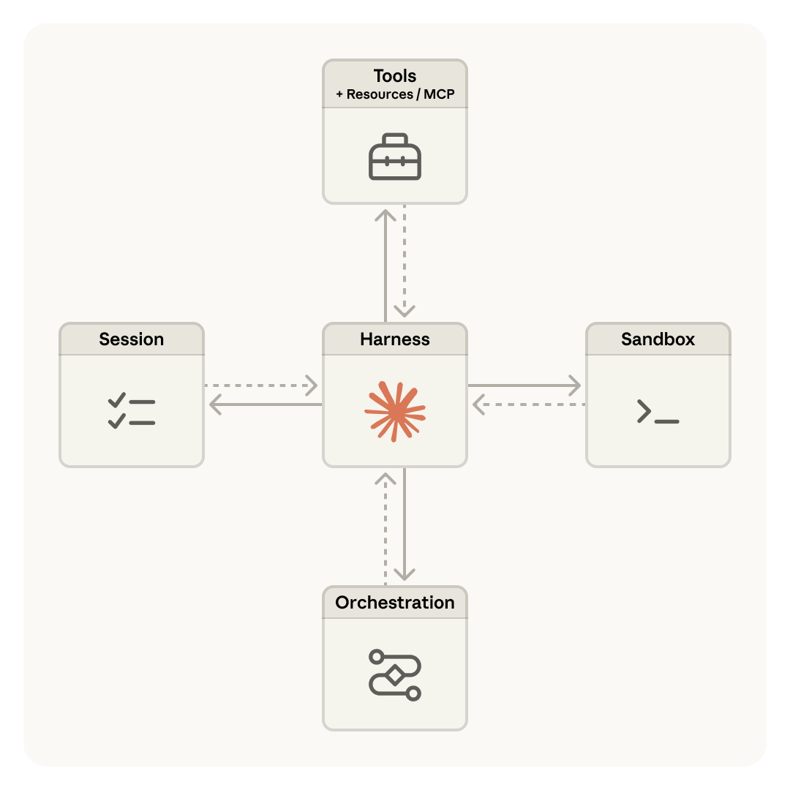
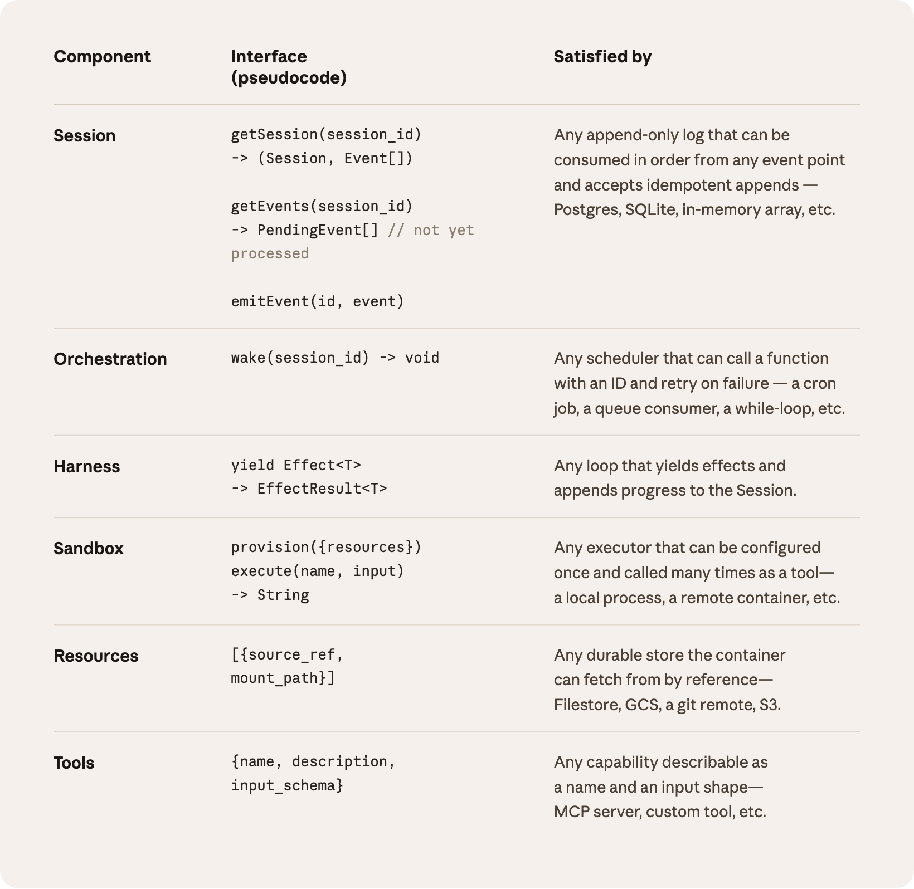
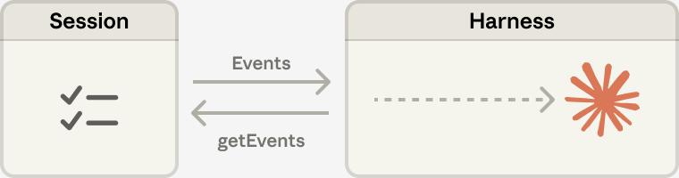
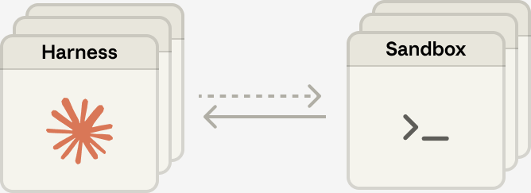

# 23_Scaling Managed Agents: Decoupling the brain from the hands_规模化 Managed Agents：让"大脑"与"双手"解耦

> 原文：https://www.anthropic.com/engineering/managed-agents
> 作者：Anthropic Engineering｜发布日期：2026-04-08

## 📌 本篇速览

- 📅 2026-04-08　｜　⏱ 约 10 分钟　｜　📄 2,067 词 / 4 图
- ⭐ ★★★★☆ **强烈推荐** —— 把智能体系统抽象成可演进接口的架构思路，对设计需长期维护、要跟着模型能力一起升级的 Agent 平台极有参考价值。
- 🏷 Managed Agents、meta-harness、brain/hands 解耦、session 事件日志、TTFT 延迟
- 🖼 [图解笔记（面试速记）](23_managed-agents_直观图解与学习笔记.md)　·　🗂 [返回总目录](00_目录与阅读进度.md)

文章讲述 Anthropic 如何把长时程智能体做成托管服务 Managed Agents：借鉴操作系统用 process、file 等抽象兼容「尚未被设想出的程序」的思路，把智能体虚拟化为 session（只追加事件日志）、harness（调用 Claude 的循环）、sandbox（执行环境）三个可独立替换的接口。核心变革是把 harness 移出容器，让容器从需要精心照料的「宠物」变成可随时抛弃的「牛」，由此获得故障隔离、凭据不进沙箱的安全边界、session 作为上下文窗口之外的可回溯上下文对象，以及 p50 首 token 延迟下降约 60%、p95 下降超 90% 的收益。

---

*Get started with Claude Managed Agents by following our* *[docs](https://platform.claude.com/docs/en/managed-agents/overview)**.*

*按照我们的文档，即可开始使用 Claude Managed Agents（托管智能体）。*

A running topic on the Engineering Blog is how to [build effective agents](https://www.anthropic.com/engineering/building-effective-agents) and [design harnesses](https://www.anthropic.com/engineering/effective-harnesses-for-long-running-agents) for [long-running work](https://www.anthropic.com/engineering/harness-design-long-running-apps).

工程博客上一个持续讨论的话题，是如何构建高效的智能体，以及如何为长时间运行的工作设计执行框架（harness）。

A common thread across this work is that harnesses encode assumptions about what Claude can’t do on its own.

贯穿这些工作的一条共同主线是：harness 里编码着关于"Claude 自己做不到什么"的假设。

However, those assumptions need to be frequently questioned because they can [go stale](http://www.incompleteideas.net/IncIdeas/BitterLesson.html) as models improve.

然而，这些假设需要经常被重新审视，因为随着模型的进步，它们可能会过时。

As just one example, in prior work [we found](https://www.anthropic.com/engineering/harness-design-long-running-apps) that Claude Sonnet 4.5 would wrap up tasks prematurely as it sensed its context limit approaching—a behavior sometimes called “context anxiety.”

仅举一例：在之前的工作中我们发现，Claude Sonnet 4.5 在感觉到上下文（context）上限临近时，会过早地草草收尾任务——这种行为有时被称为"上下文焦虑"（context anxiety）。

We addressed this by adding context resets to the harness.

我们的应对办法是在 harness 中加入上下文重置（context reset）机制。

But when we used the same harness on Claude Opus 4.5, we found that the behavior was gone.

但当我们把同一套 harness 用在 Claude Opus 4.5 上时，发现这种行为已经消失了。

The resets had become dead weight.

那些重置机制成了累赘（dead weight）。

We expect harnesses to continue evolving.

我们预计 harness 还会不断演化。

So we built Managed Agents: a hosted service in the Claude Platform that runs long-horizon agents on your behalf through a small set of interfaces meant to outlast any particular implementation—including the ones we run today.

因此我们构建了 Managed Agents：这是 Claude 平台上的一项托管服务，通过一小组接口替你运行长时程（long-horizon）智能体——这些接口的设计目标是比任何具体实现都活得更久，包括我们今天正在运行的那些实现。

Building Managed Agents meant solving an old problem in computing: how to design a system for “[programs as yet unthought of](http://www.catb.org/esr/writings/taoup/html/ch03s01.html).”

构建 Managed Agents 意味着要解决计算领域的一个老问题：如何为"尚未被构想出来的程序"（programs as yet unthought of）设计一套系统。

Decades ago, operating systems solved this problem by virtualizing hardware into abstractions—*process, file*—general enough for programs that didn't exist yet.

几十年前，操作系统靠把硬件虚拟化为抽象概念——**进程**（process）、**文件**（file）——解决了这个问题，这些抽象足够通用，能够支撑当时尚不存在的程序。

The abstractions outlasted the hardware.

这些抽象活得比硬件更久。

The `read()` command is agnostic as to whether it’s accessing a disk pack from the 1970s or a modern SSD.

`read()` 命令并不关心它访问的是 20 世纪 70 年代的磁盘组，还是一块现代 SSD。

The abstractions on top stayed stable while the implementations underneath changed freely.

上层的抽象保持稳定，而底层的实现可以自由更换。

Managed Agents follow the same pattern.

Managed Agents 遵循同样的模式。

We virtualized the components of an agent: a session (the append-only log of everything that happened), a harness (the loop that calls Claude and routes Claude’s tool calls to the relevant infrastructure), and a sandbox (an execution environment where Claude can run code and edit files).

我们把智能体的各个组件虚拟化了：会话（session，记录所有已发生事件的只追加日志）、harness（调用 Claude 并把 Claude 的工具调用路由到相应基础设施的循环），以及沙箱（sandbox，供 Claude 运行代码、编辑文件的执行环境）。

This allows the implementation of each to be swapped without disturbing the others.

这样一来，每个组件的实现都可以被替换，而不影响其他组件。

We're opinionated about the shape of these interfaces, not about what runs behind them.

我们对这些接口的形态有明确主张（opinionated），但对接口背后运行的是什么不做限定。

### Don’t adopt a pet｜别养"宠物"

We started by placing all agent components into a single container, which meant the session, agent harness, and sandbox all shared an environment.

我们最初把智能体的所有组件都放进一个容器（container），也就是说会话、智能体 harness 和沙箱共享同一个环境。

There were benefits to this approach, including that file edits are direct syscalls, and there were no service boundaries to design.

这种做法有它的好处，比如文件编辑就是直接的系统调用（syscall），也不需要设计任何服务边界。

But by coupling everything into one container, we ran into an old infrastructure problem: we’d adopted a *[pet](https://cloudscaling.com/blog/cloud-computing/the-history-of-pets-vs-cattle/)*.

但把所有东西耦合进一个容器后，我们撞上了一个古老的基础设施问题：我们养了一只**宠物**（pet）。

In the pets-vs-cattle analogy, a pet is a named, hand-tended individual you can’t afford to lose, while cattle are interchangeable.

在"宠物 vs 牲畜"（pets-vs-cattle）的比喻里，宠物是有名字、需要精心照料、丢不起的个体，而牲畜是可以互相替换的。

In our case, the server became that pet; if a container failed, the session was lost.

在我们的场景里，服务器就成了那只宠物；一旦容器挂掉，会话就丢了。

If a container was unresponsive, we had to nurse it back to health.

如果容器失去响应，我们就得把它"调理"回健康状态。

Nursing containers meant debugging unresponsive stuck sessions.

照料容器意味着要去调试那些失去响应、卡死的会话。

Our only window in was the WebSocket event stream, but that couldn’t tell us *where* failures arose, which meant that a bug in the harness, a packet drop in the event stream, or a container going offline all presented the same.

我们唯一的观察窗口是 WebSocket 事件流，但它没法告诉我们故障**出在哪里**——这意味着 harness 里的一个 bug、事件流中的一次丢包、或者容器整个下线，表现出来全都一样。

To figure out what went wrong, an engineer had to open a shell inside the container, but because that container often also held user data, that approach essentially meant we lacked the ability to debug.

要弄清楚哪里出了问题，工程师必须在容器里开一个 shell；但由于容器里往往还存着用户数据，这条路实际上走不通——等于我们丧失了调试能力。

A second issue was that the harness assumed that whatever Claude worked on lived in the container with it.

第二个问题是，harness 假设 Claude 处理的任何东西都和它一起住在容器里。

When customers asked us to connect Claude to their virtual private cloud, they had to either peer their network with ours, or run our harness in their own environment.

当客户要求我们把 Claude 接入他们的虚拟私有云（virtual private cloud，VPC）时，他们要么得把自己的网络与我们的做对等互联（peer），要么得在自己的环境里跑我们的 harness。

An assumption baked into the harness became a problem when we wanted to connect it to different infrastructure.

一条被固化进 harness 的假设，在我们想把它接到不同基础设施上时，就成了问题。

### Decouple the brain from the hands｜让大脑与双手解耦

The solution we arrived at was to decouple what we thought of as the “brain” (Claude and its harness) from both the “hands” (sandboxes and tools that perform actions) and the “session” (the log of session events).

我们最终得出的解决方案是：把我们所说的"大脑"（brain，即 Claude 及其 harness）与"双手"（hands，即执行动作的沙箱和工具）以及"会话"（session，会话事件日志）解耦（decouple）。

Each became an interface that made few assumptions about the others, and each could fail or be replaced independently.

三者各自成为一个接口，彼此之间几乎不做假设，每一个都可以独立地失败或被替换。

**The harness leaves the container.** Decoupling the brain from the hands meant the harness no longer lived inside the container.

**harness 走出容器。** 大脑与双手解耦，意味着 harness 不再住在容器里面。

It called the container the way it called any other tool: `execute(name, input) → string`.

它调用容器的方式，和调用任何其他工具一样：`execute(name, input) → string`。

The container became cattle.

容器变成了"牲畜"。

If the container died, the harness caught the failure as a tool-call error and passed it back to Claude.

如果容器挂了，harness 会把这次故障当作一个工具调用错误捕获下来，回传给 Claude。

If Claude decided to retry, a new container could be reinitialized with a standard recipe: `provision({resources})`.

如果 Claude 决定重试，就可以按标准配方重新初始化一个新容器：`provision({resources})`。

We no longer had to nurse failed containers back to health.

我们再也不用把故障的容器"调理"回健康状态了。

**Recovering from harness failure.** The harness also became cattle.

**从 harness 故障中恢复。** harness 自身也变成了"牲畜"。

Because the session log sits outside the harness, nothing in the harness needs to survive a crash.

由于会话日志存放在 harness 之外，harness 里没有任何东西需要在崩溃后幸存。

When one fails, a new one can be rebooted with `wake(sessionId)`, use `getSession(id)` to get back the event log, and resume from the last event.

当一个 harness 失败时，可以用 `wake(sessionId)` 重新启动一个新的，再用 `getSession(id)` 取回事件日志，从最后一个事件继续。

During the agent loop, the harness writes to the session with `emitEvent(id, event)` in order to keep a durable record of events.

在智能体循环（agent loop）运行期间，harness 会通过 `emitEvent(id, event)` 向会话写入数据，以保留一份持久化的事件记录。

**The security boundary.** In the coupled design, any untrusted code that Claude generated was run in the same container as credentials—so a prompt injection only had to convince Claude to read its own environment.

**安全边界。** 在耦合式设计中，Claude 生成的任何不可信代码都与凭据（credential）跑在同一个容器里——因此一次提示词注入（prompt injection）只需要说服 Claude 去读取它自己的环境就够了。

Once an attacker has those tokens, they can spawn fresh, unrestricted sessions and delegate work to them.

攻击者一旦拿到那些令牌（token），就能启动全新的、不受限制的会话，并把工作委派给它们。

Narrow scoping is an obvious mitigation, but this encodes an assumption about what Claude can't do with a limited token—and Claude is getting increasingly smart.

收窄权限范围（narrow scoping）是一个显而易见的缓解手段，但这同样编码了一条假设——假设 Claude 拿着受限令牌做不了什么——而 Claude 正变得越来越聪明。

The structural fix was to make sure the tokens are never reachable from the sandbox where Claude’s generated code runs.

结构性的修复办法，是确保这些令牌从运行 Claude 生成代码的沙箱里永远够不着。

We used two patterns to ensure this.

我们用了两种模式来保证这一点。

Auth can be bundled with a resource or held in a vault outside the sandbox.

鉴权（auth）信息要么与资源捆绑在一起，要么保存在沙箱之外的保险库（vault）中。

For Git, we use each repository’s access token to clone the repo during sandbox initialization and wire it into the local git remote.

对于 Git，我们在沙箱初始化阶段使用每个仓库的访问令牌克隆仓库，并把它接入本地的 git remote。

Git `push` and `pull` work from inside the sandbox without the agent ever handling the token itself.

Git 的 `push` 和 `pull` 在沙箱内部照常可用，而智能体自始至终不会经手令牌本身。

For custom tools, we support MCP and store OAuth tokens in a secure vault.

对于自定义工具，我们支持 MCP，并把 OAuth 令牌存放在一个安全保险库中。

Claude calls MCP tools via a dedicated proxy; this proxy takes in a token associated with the session.

Claude 通过一个专用代理（proxy）调用 MCP 工具；该代理接收一个与会话关联的令牌。

The proxy can then fetch the corresponding credentials from the vault and make the call to the external service.

代理随后可以从保险库中取出对应的凭据，并向外部服务发起调用。

The harness is never made aware of any credentials.

harness 从头到尾都不会知道任何凭据。

### The session is not Claude’s context window｜会话不是 Claude 的上下文窗口

Long-horizon tasks often exceed the length of Claude’s context window, and the standard ways to address this all involve irreversible decisions about what to keep.

长时程任务经常会超出 Claude 上下文窗口（context window）的长度，而应对这一问题的标准做法，全都涉及"该保留什么"的不可逆决策。

We’ve explored these techniques in [prior work](https://www.anthropic.com/engineering/effective-context-engineering-for-ai-agents) on context engineering.

我们在之前关于上下文工程（context engineering）的工作中探讨过这些技术。

For example, compaction lets Claude save a summary of its context window and the memory tool lets Claude write context to files, enabling learning across sessions.

例如，压缩（compaction）让 Claude 保存一份自己上下文窗口的摘要；记忆工具（memory tool）则让 Claude 把上下文写入文件，从而实现跨会话的学习。

This can be paired with context trimming, which selectively removes tokens such as old tool results or thinking blocks.

这还可以搭配上下文裁剪（context trimming），即有选择地移除某些 token，比如旧的工具结果或思考块（thinking block）。

But irreversible decisions to selectively retain or discard context can lead to failures.

但对上下文进行选择性保留或丢弃的不可逆决策，可能导致失败。

It is difficult to know which tokens the future turns will need.

我们很难预知未来的对话轮次会需要哪些 token。

If messages are transformed by a compaction step, the harness removes compacted messages from Claude’s context window, and these are recoverable only if they are stored.

如果消息被压缩步骤转换过，harness 就会把被压缩的消息从 Claude 的上下文窗口里移除，而这些消息只有在被另行存储的情况下才可恢复。

Prior work [has explored](https://arxiv.org/pdf/2512.24601) ways to address this by storing context as an object that lives *outside* the context window.

已有工作探索过一种解决思路：把上下文存成一个位于上下文窗口**之外**的对象。

For example, context can be an object in a REPL that the LLM programmatically accesses by writing code to filter or slice it.

例如，上下文可以是 REPL 里的一个对象，LLM 通过编写代码对它进行过滤或切片，以编程方式访问它。

In Managed Agents, the session provides this same benefit, serving as a context object that lives outside Claude’s context window.

在 Managed Agents 中，会话提供了同样的好处：它就是一个位于 Claude 上下文窗口之外的上下文对象。

But rather than be stored within the sandbox or REPL, context is durably stored in the session log.

但上下文不是存在沙箱或 REPL 里，而是持久化地存储在会话日志中。

The interface, `getEvents(),` allows the brain to interrogate context by selecting positional slices of the event stream.

`getEvents()` 这个接口允许大脑通过选取事件流的位置切片来查询（interrogate）上下文。

The interface can be used flexibly, allowing the brain to pick up from wherever it last stopped reading, rewinding a few events before a specific moment to see the lead up, or rereading context before a specific action.

这个接口用法非常灵活：大脑可以从上次读到的地方接着往下读，可以回退到某个时刻之前的几条事件以查看事情的来龙去脉，也可以在执行某个动作之前重读相关上下文。

Any fetched events can also be transformed in the harness before being passed to Claude’s context window.

任何取回的事件在传入 Claude 的上下文窗口之前，还可以先在 harness 中进行转换。

These transformations can be whatever the harness encodes, including context organization to achieve a high prompt cache hit rate and context engineering.

这些转换可以是 harness 编码的任何逻辑，包括为获得高提示词缓存（prompt cache）命中率而做的上下文组织，以及各种上下文工程。

We separated the concerns of recoverable context storage in the session and arbitrary context management in the harness because we can’t predict what specific context engineering will be required in future models.

我们把"会话中可恢复的上下文存储"与"harness 中任意的上下文管理"这两件事的关注点分离开，因为我们无法预测未来的模型会需要什么样的具体上下文工程。

The interfaces push that context management into the harness, and only guarantee that the session is durable and available for interrogation.

这套接口把上下文管理推给 harness 去做，自己只保证一件事：会话是持久的、随时可供查询。

### Many brains, many hands｜多个大脑，多双手

**Many brains.** Decoupling the brain from the hands solved one of our earliest customer complaints.

**多个大脑。** 大脑与双手的解耦，解决了我们最早收到的客户抱怨之一。

When teams wanted Claude to work against resources in their own VPC, the only path was to peer their network with ours, because the container holding the harness assumed every resource sat next to it.

当团队希望 Claude 操作他们自己 VPC 里的资源时，唯一的途径是把他们的网络与我们的做对等互联，因为装着 harness 的那个容器假设所有资源都在它旁边。

Once the harness was no longer in the container, that assumption went away.

一旦 harness 不再待在容器里，这条假设就不复存在了。

The same change had a performance payoff.

同一项改动还带来了性能上的回报。

When we initially put the brain in a container, it meant that many brains required as many containers.

我们最初把大脑放进容器时，这意味着有多少个大脑，就需要多少个容器。

For each brain, no inference could happen until that container was provisioned; every session paid the full container setup cost up front.

对每个大脑来说，容器没配置好之前，推理（inference）就无法开始；每个会话都要预先付清容器搭建的全部成本。

Every session, even ones that would never touch the sandbox, had to clone the repo, boot the process, fetch pending events from our servers.

每个会话——哪怕是那些根本不会碰沙箱的会话——都得克隆仓库、启动进程、从我们的服务器拉取待处理事件。

That dead time is expressed in time-to-first-token (TTFT), which measures how long a session waits between accepting work and producing its first response token.

这段"死时间"体现在首 token 时间（time-to-first-token，TTFT）上——它衡量的是会话从接下任务到产出第一个响应 token 之间要等多久。

TTFT is the latency the user most acutely *feels*.

TTFT 是用户**体感**最强烈的那种延迟。

Decoupling the brain from the hands means that containers are provisioned by the brain via a tool call `(execute(name, input) → string)` only if they are needed.

大脑与双手解耦之后，容器只在需要时才由大脑通过工具调用 `(execute(name, input) → string)` 来配置。

So a session that didn't need a container right away didn't wait for one.

于是，不需要立刻用到容器的会话，就不必为容器等待。

Inference could start as soon as the orchestration layer pulled pending events from the session log.

只要编排层（orchestration layer）从会话日志中拉取到待处理事件，推理就可以立即开始。

Using this architecture, our p50 TTFT dropped roughly 60% and p95 dropped over 90%.

采用这套架构后，我们的 p50 TTFT 下降了大约 60%，p95 下降了 90% 以上。

Scaling to many brains just meant starting many stateless harnesses, and connecting them to hands only if needed.

扩展到多个大脑，只不过意味着启动多个无状态（stateless）的 harness，并且仅在需要时才把它们连接到双手。

**Many hands.** We also wanted the ability to connect each brain to many hands.

**多双手。** 我们还希望每个大脑都能连接多双手。

In practice, this means Claude must reason about many execution environments and decide where to send work—a harder cognitive task than operating in a single shell.

在实践中，这意味着 Claude 必须对多个执行环境进行推理，并决定把工作发到哪里——这比在单个 shell 里操作是更难的认知任务。

We started with the brain in a single container because earlier models weren't capable of this.

我们一开始把大脑放在单个容器里，正是因为早期的模型还不具备这种能力。

As intelligence scaled, the single container became the limitation instead: when that container failed, we lost state for every hand that the brain was reaching into.

随着模型智能的提升，单容器反而成了瓶颈：那个容器一旦故障，大脑正在伸向的每一只手的状态都会随之丢失。

Decoupling the brain from the hands makes each hand a tool, `execute(name, input) → string`: a name and input go in, and a string is returned.

大脑与双手解耦后，每只手都成了一个工具，即 `execute(name, input) → string`：传入名称和输入，返回一个字符串。

That interface supports any custom tool, any MCP server, and our own tools.

这个接口可以支持任何自定义工具、任何 MCP 服务器，以及我们自己的工具。

The harness doesn’t know whether the sandbox is a container, a phone, or a Pokémon emulator.

harness 并不知道沙箱到底是一个容器、一部手机，还是一台宝可梦（Pokémon）模拟器。

And because no hand is coupled to any brain, brains can pass hands to one another.

而且，由于没有任何一只手与某个特定大脑耦合，大脑之间还可以互相传递双手。

### Conclusion｜结语

The challenge we faced is an old one: how to design a system for “programs as yet unthought of.”

我们面对的是一个古老的挑战：如何为"尚未被构想出来的程序"设计一套系统。

Operating systems have lasted decades by virtualizing the hardware into abstractions general enough for programs that didn't exist yet.

操作系统之所以能延续数十年，就是因为它把硬件虚拟化成了足够通用的抽象，能支撑当时还不存在的程序。

With Managed Agents, we aimed to design a system that accommodates future harnesses, sandboxes, or other components around Claude.

通过 Managed Agents，我们的目标是设计一个系统，能容纳未来围绕 Claude 出现的各种 harness、沙箱或其他组件。

Managed Agents is a meta-harness in the same spirit, unopinionated about the *specific* harness that Claude will need in the future.

Managed Agents 是同一精神下的"元 harness"（meta-harness）：它对 Claude 未来会需要哪个**具体的** harness 不做预设。

Rather, it is a system with general interfaces that allow many different harnesses.

相反，它是一个提供通用接口的系统，允许接入许多不同的 harness。

For example, Claude Code is an excellent harness that we use widely across tasks.

例如，Claude Code 就是一个出色的 harness，我们在各类任务中广泛使用它。

We’ve also shown that task-specific agent harnesses excel in narrow domains.

我们也已经证明，面向特定任务的智能体 harness 在窄域中表现卓越。

Managed Agents can accommodate any of these, matching Claude’s intelligence over time.

Managed Agents 可以容纳其中任何一种，随时间推移不断匹配 Claude 的智能水平。

Meta-harness design means being opinionated about the interfaces around Claude: we expect that Claude will need the ability to manipulate state (the session) and perform computation (the sandbox).

元 harness 设计意味着对围绕 Claude 的接口持明确主张：我们预期 Claude 将需要操纵状态的能力（会话），以及执行计算的能力（沙箱）。

We also expect that Claude will require the ability to scale to many brains and many hands.

我们也预期 Claude 将需要扩展到多个大脑、多双手的能力。

We designed the interfaces so that these can be run reliably and securely over long time horizons.

我们对接口的设计，就是为了让这些能力可以在很长的时间跨度上可靠、安全地运行。

But we make no assumptions about the number or location of brains or hands that Claude will need.

但对于 Claude 将需要多少个大脑或多少双手、它们又位于何处，我们不做任何假设。

### Acknowledgements｜致谢

Written by Lance Martin, Gabe Cemaj, and Michael Cohen.

本文由 Lance Martin、Gabe Cemaj 和 Michael Cohen 撰写。

Thanks to Nodir Turakulov and Jeremy Fox for helpful conversations on these topics.

感谢 Nodir Turakulov 和 Jeremy Fox 就这些主题进行的有益讨论。

Special thanks to the Agents API team and Jake Eaton for their contributions.

特别感谢 Agents API 团队和 Jake Eaton 的贡献。
