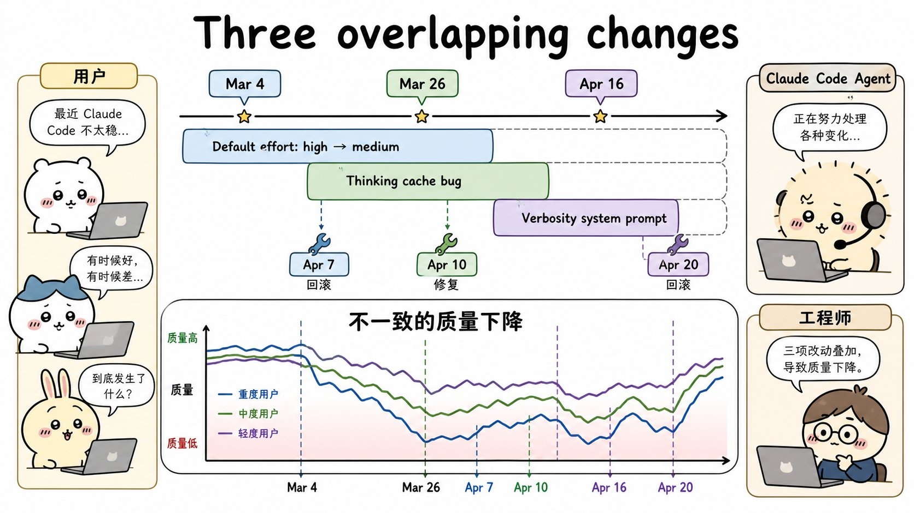
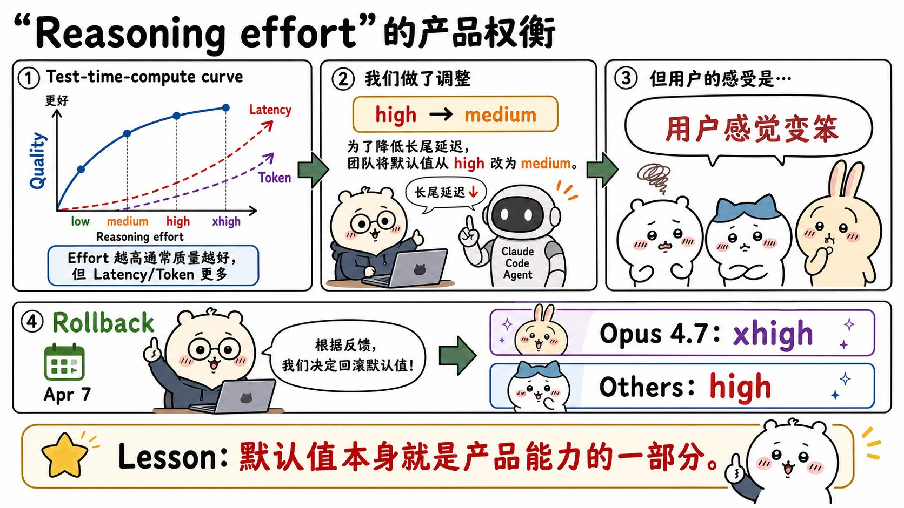
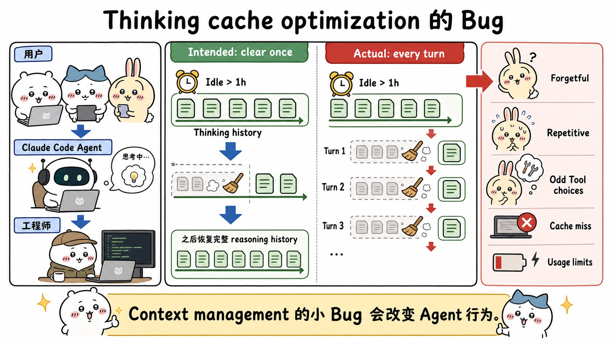
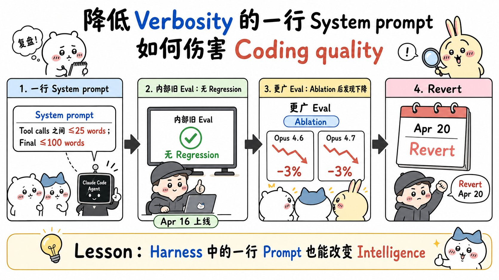
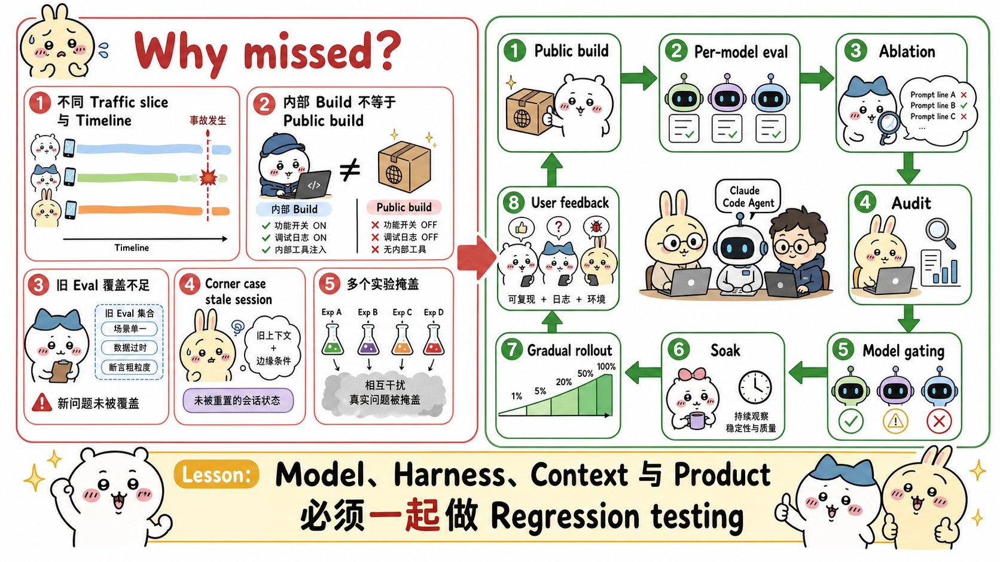

# An update on recent Claude Code quality reports：面试速记

> Anthropic Engineering · 2026-04-23 · [官方原文](https://www.anthropic.com/engineering/april-23-postmortem) · [本地逐句对照](24_april-23-postmortem_逐句对照.md)

## 一句话讲明白

**用户觉得 Claude Code「变笨了、健忘、老重复、用量掉得飞快」，根因不是模型退步，而是产品层的三处配置改动——默认推理力度（reasoning effort）从 `high` 降到 `medium`、一个提示词缓存优化的 bug 每轮都清掉旧思考、一条限制输出长度的系统提示词——分别落在不同模型、不同流量切片、不同时间线上，叠加成一场大面积但不一致的质量退化。结论：智能体产品必须把「模型 + 执行框架（harness）+ 上下文 + 对外构建版本」当成一个系统整体做回归测试，光测模型没用。**

## 为什么值得读 / 能用在哪

- 这是全集里最好的**反面教材**：一次事故同时演示了「默认值即产品能力」「上下文裁剪会杀掉推理连贯性」「一行提示词能砍掉 3% 分数」三件事，而且**模型权重一个字节都没动**。
- 面试里只要问到「你怎么保证智能体质量不退化」「上线前测什么」「用户说变差了你怎么查」，这篇给的是可直接背诵的完整答案链条：现象 → 三条根因 → 为什么漏检 → 八条治理措施。
- 自己项目里能直接抄：默认参数纳入评估、上下文裁剪必须做端到端行为验证、系统提示词每改一行都跑消融实验（ablation）。
- 还有一个容易被忽略的收益：它示范了**一份合格的事故复盘长什么样**——现象、根因、时间线、漏检原因、改进措施五段齐全，且每一条都带具体日期和版本号。写自己团队的复盘可以照这个骨架。

## 核心要点

### 一、三处独立改动，叠成一场「说不清」的退化

三条互相独立的改动，影响 Claude Code、Claude Agent SDK 和 Claude Cowork；**API 未受影响**。截至 **4 月 20 日（`v2.1.116`）全部修复**：

| # | 改动 | 上线 | 修复／回滚 | 受影响模型 |
| --- | --- | --- | --- | --- |
| 1 | 默认推理力度 `high` → `medium` | 3 月 4 日 | **4 月 7 日**回滚 | Sonnet 4.6、Opus 4.6 |
| 2 | 清理闲置会话旧思考的缓存优化（带 bug） | 3 月 26 日 | **4 月 10 日**修复（`v2.1.101`） | Sonnet 4.6、Opus 4.6 |
| 3 | 降低啰嗦程度的系统提示词 | 4 月 16 日 | **4 月 20 日**回滚 | Sonnet 4.6、Opus 4.6、Opus 4.7 |

**为什么难查**：每项改动打中的流量切片不同、时间线也不同，叠加起来的整体效果看上去就是「大范围、不一致的退化」。团队 3 月初就开始调查，但起初**分不清这是真退化还是用户反馈的正常波动**；内部日常使用和已有评估（eval）一开始都复现不出来。

4 月 23 日，Anthropic 为所有订阅用户**重置了用量限制**作为补偿。

### 二、默认值就是产品能力本身

2 月 Opus 4.6 在 Claude Code 上线时，默认推理力度设的是 `high`。很快有用户反馈：`high` 模式下偶尔思考过久，**界面看起来像卡死了**，延迟和 token 消耗都不成比例。

- 力度档位（effort level）是 Claude Code 把这个权衡交给用户的方式：**更多思考** ↔ **更低延迟 + 更少触顶用量限制**。
- 校准档位时，团队沿**测试时计算（test-time-compute）曲线**选点；产品层再挑其中一个点作为默认值，这个值就是发给 Messages API 的 effort 参数，其余档位通过 `/effort` 开放。
- 内部评估显示：对大多数任务，`medium` **智能只是略低、延迟显著更少**，还没有偶发的超长长尾延迟，且能让用量限制发挥到最大。于是 3 月 4 日把 `medium` 设为默认，并用产品内对话框解释了理由。

**结果打脸**：上线后不久用户就说 Claude Code 感觉变笨了。团队做了多轮设计迭代提醒用户可以改（启动提示、内联力度选择器、把 `ultrathink` 加回来），但**大多数用户仍然停在 `medium` 默认值上**。4 月 7 日撤销该决定。

**现在的默认值**：Opus 4.7 用 `xhigh`，其他所有模型用 `high`。

> 面试可以直接讲的判断：教训不是「永远选最高」，而是**绝大多数用户永远不改默认值，所以默认值决定了产品的真实能力上限**。用户的偏好是「默认给我最聪明的，简单任务我自己降下来」，而不是反过来。

### 三、缓存优化的 bug：把「为什么这么做」擦掉了

**正常机制**：Claude 推理过的内容会留在对话历史里，这样后续每一轮它都能看到自己当初**为什么**做了那些编辑和工具调用。

**本意的优化（3 月 26 日）**：用提示词缓存（prompt caching）让连续 API 调用更便宜更快；一段时间不活跃后提示词会被逐出缓存。所以——**会话闲置超过 1 小时后，下一次请求反正是缓存未命中（cache miss）**，那就顺手清掉旧的思考段落，减少发给 API 的未缓存 token，降低恢复成本；**之后恢复发送完整推理历史**。实现方式是 `clear_thinking_20251015` 这个 API 请求头（header）搭配 `keep:1`。

**实际的 bug**：这个清理不是只执行一次，而是**在该会话余下的每一轮都执行**。一旦某个会话越过闲置阈值一次，该进程后续每个请求都告诉 API「只保留最近一个推理块，之前的全丢」。

**还会层层叠加**：如果你在 Claude 正在执行工具调用的过程中发追加消息，就会在这个坏掉的标志位下开启新一轮，**连当前这一轮的推理都被丢掉**。

于是 Claude 继续执行，但越来越记不得自己为什么这么做，表现出来正是用户反馈的三件事：

- **健忘**（forgetful）
- **重复**（repetitive）
- **奇怪的工具选择**（odd tool choices）

**外加一条隐藏成本**：不断丢弃思考块导致后续请求持续缓存未命中——**这就是「用量限制掉得比预期快」那一类独立反馈的成因**。

**为什么这么难抓**：

- 两个不相关的实验掩盖了它：一个是仅限内部的、与消息排队相关的服务端实验；另一个是思考内容展示方式上的正交改动，它**在大多数命令行会话里把这个 bug 藏了起来，以至于测对外构建版本时也没发现**。
- bug 处在 **Claude Code 上下文管理、Anthropic API、扩展思考（extended thinking）三者的交汇处**——没有任何单一模块的测试覆盖得到。
- 引入它的改动**通过了**多轮人工与自动代码审查、单元测试、端到端测试、自动化验证和内部试用（dogfooding）。
- 只在边角场景（长时间闲置的会话）下触发，又难以复现，**花了一周多才确认根因**。

**一个有意思的回测**：调查中用 Opus 4.7 对肇事的那几个合并请求（pull request）回测了 `Code Review` 工具——**在给足代码仓库上下文的前提下，Opus 4.7 找到了这个 bug，Opus 4.6 没找到**。于是他们正在落地「把额外仓库作为代码审查上下文」的支持。

### 四、一行「少说点」的提示词，砍掉 3%

Opus 4.7 相对前代有个明显特点：**很啰嗦**。这让它在难题上更聪明，但也产出更多输出 token。发布前几周团队开始为它调优 Claude Code——降低啰嗦程度的手段有三类：**模型训练、提示词、改进产品里思考内容的交互体验**。三类最后全用上了，但其中新增的一条系统提示词造成了远超预期的影响：

> 「长度限制：工具调用之间的文字保持在 **25 词**以内。最终回复保持在 **100 词**以内，除非任务需要更多细节。」

- **数周内部测试、那一组评估没跑出任何回归**，团队因此很有信心，4 月 16 日随 Opus 4.7 一起上线。
- 事故调查时换了**覆盖面更广的一组评估**重做消融实验（ablation，即逐条移除系统提示词中的行，看每一行的影响）——其中一项评估显示 **Opus 4.6 和 Opus 4.7 都下降了 3%**。
- **4 月 20 日的发布里立即回滚**。

**为什么一行字这么致命**：「少说一点」表面上是个体验设置，实际压缩的是智能体在**工具调用之间表达计划、解释当前状态、检查自己假设**的空间。对编码智能体来说，工具调用间隙的那几十个字就是它的工作记忆和自我校验——砍掉它，等于让它闭着眼睛干活。

**这一条和第三条其实是同一个病**：缓存 bug 是**被动地**把过去的推理删掉，限长提示词是**主动地**不让它写出新的推理。两者都在削减智能体的「思考带宽」，只是一个从历史端下手、一个从生成端下手，最终症状都是行为变笨。

### 五、漏检的五个原因，与八条治理措施

**漏检的五个原因（面试很好用的清单）**：

1. 三项改动**流量切片和时间线都不同**，聚合信号看起来像噪声；
2. 内部员工用的是**测新功能的构建版本，不等于对外公开的构建版本**，内部试用信号失真；
3. **旧评估集覆盖面太窄**——同一条提示词，窄评估没反应，广评估直接掉 3%；
4. 只在**边角场景**（闲置超 1 小时的会话）触发；
5. **其他实验掩盖**了真实行为（消息排队实验 + 思考展示方式改动）。

**今后的八条改进**：

- 让**更大比例的内部员工使用与用户完全一致的公开构建版本**；
- 改进内部用的 `Code Review` 工具，并把改进版交付给客户；
- 对系统提示词改动施加**更严格的管控**；
- 每次系统提示词改动都跑**覆盖面广、按模型区分的评估套件**；
- **持续做逐行消融实验**，理解每一行的影响；
- 新建工具让提示词改动**更易审查和审计**；
- 在 `CLAUDE.md` 里加入指引，确保**针对特定模型的改动只在目标模型上生效**；
- 任何可能以智能为代价的改动，一律加**浸泡期（soak period）+ 更广的评估套件 + 渐进式发布（gradual rollout）**。

此外还开了 `@ClaudeDevs`（X）并在 GitHub 集中讨论帖里同步说明产品决策。最后 Anthropic 特别感谢了用 `/feedback` 命令反馈、或在网上发布**具体、可复现示例**的用户——正是这些人让问题得以定位。

## 面试高频问答

**Q：用户说「你们的智能体最近变笨了」，模型没换，你怎么查？**
A：先确认推理层和 API 没问题，然后把「产品层配置」全列出来当嫌疑人：默认参数、上下文裁剪策略、系统提示词、缓存策略。这次的三条根因全在这一层。关键动作是**按模型、按流量切片、按时间线**分别对齐——因为多项改动叠加时，聚合指标看起来只是噪声。同时要拿覆盖面更广的评估集重跑，窄评估集本来就漏检过一次。

**Q：默认参数值得单独做评估吗？**
A：值得，而且必须。Anthropic 的数据是：他们做了启动提示、内联选择器、把 `ultrathink` 加回来这么多引导，**大多数用户仍然停在默认值上**。默认值不是一个「建议」，它就是绝大多数人真实拿到的产品能力。这次把默认从 `high` 降到 `medium`，评估上只是「智能略低、延迟显著更少」，用户体感却直接是「变笨了」。

**Q：为什么裁剪历史思考内容风险这么高？**
A：因为对话历史里的推理**不只记录做了什么，更记录为什么这么做**。这次 bug 只保留最近一个推理块，智能体照样能继续执行，但逐渐不知道自己行为的理由，外在表现就是健忘、重复、工具选择奇怪。而且它有第二重代价：不断改写请求前缀会**持续造成缓存未命中**，用量消耗反而更快——省 token 的优化最后更费 token。

**Q：一条系统提示词改动，上线前该怎么验？**
A：跑**按模型区分的广评估套件**，再做**逐行消融实验**——移除某一行看指标变化。这次那条「25 词 / 100 词」限制在原有评估集上数周无回归，换更广的评估集立刻看到 Opus 4.6 和 4.7 各掉 3%。另外要走审计工具留痕、加浸泡期和灰度发布，别一次全量。

**Q：这次事故通过了代码审查、单测、端到端测试和内部试用，为什么还是漏了？**
A：因为 bug 在**上下文管理、API、扩展思考三个系统的交汇处**，没有任何单一模块的测试覆盖它；触发条件是边角场景（闲置超 1 小时的会话）；而且内部构建版本和公开构建版本不一致，加上另一个思考展示改动把现象藏住了。这说明**内部试用的信号只有在「用户用的就是你用的那一版」时才成立**。

## 必须记住的 8 句话

1. 用户感知的「变笨」可以完全由产品层配置造成，**模型权重一动没动**。
2. 三处改动：默认力度 `high`→`medium`（3/4 上线，4/7 回滚）、缓存清思考 bug（3/26 上线，4/10 修）、限长系统提示词（4/16 上线，4/20 回滚）；全部于 4 月 20 日 `v2.1.116` 收口。
3. 多项改动落在不同模型、不同流量切片、不同时间线，叠加后就是「大面积但不一致」的退化，**极难与正常波动区分**。
4. 默认值即产品能力：大多数用户不会改，引导做得再多也不会改。
5. 对话历史里的推理记录的是「为什么」；每轮清掉它，智能体就变得健忘、重复、工具选择奇怪。
6. 持续裁剪历史 = 持续缓存未命中 = **用量掉得更快**，省成本的优化反噬成本。
7. 一行限制输出长度的提示词，让 Opus 4.6 和 Opus 4.7 在一项评估上**各掉 3%**。
8. 治理要点：公开构建版本内部试用、按模型广评估、逐行消融、提示词审计、模型级门控、浸泡期 + 灰度发布。

## 30 秒口述版

> 这是 Anthropic 2026 年 4 月关于 Claude Code 质量下降的复盘。核心结论是：模型没退步，退步的是产品层的三处配置。一，3 月 4 日把默认推理力度从 `high` 降到 `medium` 省延迟，4 月 7 日回滚，现在 Opus 4.7 默认 `xhigh`、其他模型默认 `high`；教训是绝大多数用户永远不改默认值，默认值就是真实产品能力。二，3 月 26 日上线一个优化，本来只想在会话闲置超一小时后清一次旧思考，bug 导致此后每一轮都清，智能体不再知道自己为什么这么做，表现为健忘、重复、工具选择奇怪，还持续缓存未命中让用量掉得更快，4 月 10 日修复。三，4 月 16 日加了一条「工具调用之间不超过 25 词、最终回复不超过 100 词」的系统提示词，广评估下 Opus 4.6 和 4.7 各掉 3%，4 月 20 日回滚。这些改动通过了代码审查、单测、端到端测试和内部试用还是漏了，因为内部构建版和公开版不一致、评估集太窄、触发条件是边角场景、还被其他实验掩盖。整篇文章的真正教训是：智能体产品必须把模型、执行框架、上下文管理和公开构建版本当成一个系统一起做回归测试。

## 自测

- [ ] 能背出三处改动各自的上线与回滚／修复日期，以及分别影响哪些模型。
- [ ] 能解释推理力度在延迟、token 消耗和智能之间的权衡，以及现在的默认值是什么。
- [ ] 能画出缓存清思考的**本意行为**与**实际 bug 行为**的差别，并说清 `keep:1` 干了什么。
- [ ] 能说出为什么裁剪历史推理会同时造成「健忘」和「用量掉得快」两种现象。
- [ ] 能复述那条限长提示词的两个数字（25 词 / 100 词）和 3% 的评估下降。
- [ ] 能列出漏检的五个原因中的至少三个。
- [ ] 能说出四条以上的发布治理措施，并解释「浸泡期 + 灰度」为什么是这类事故的正解。

> 插图为学习用途的非官方同人式教学图，角色与文章版权归各自权利人。
