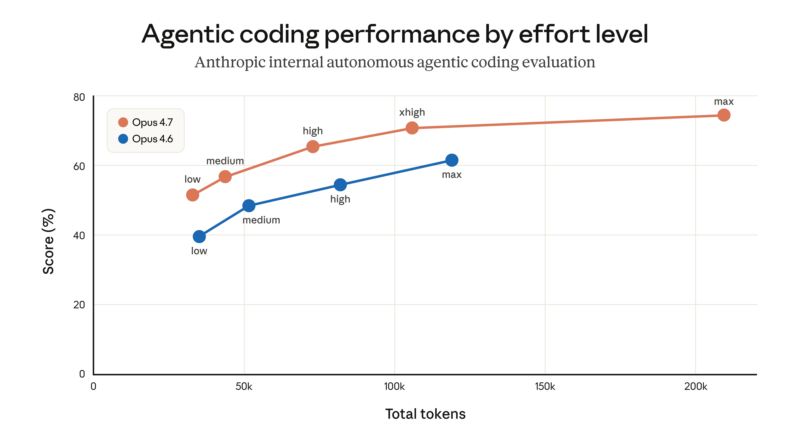
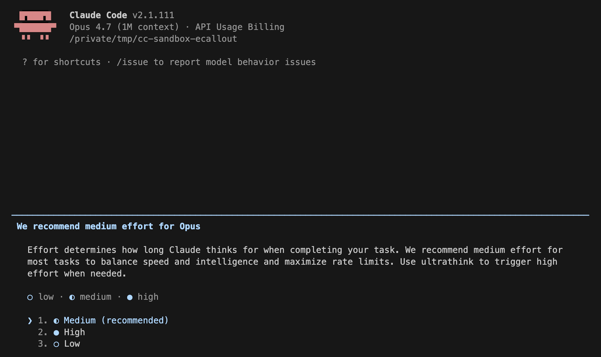
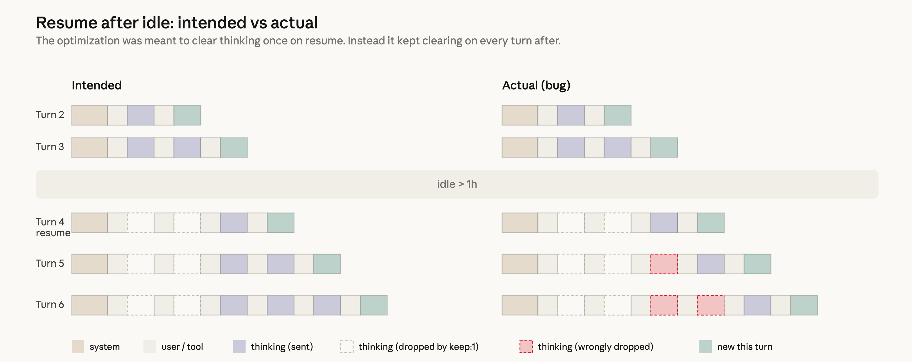

# 24_An update on recent Claude Code quality reports_关于近期 Claude Code 质量反馈的最新说明

> 原文：https://www.anthropic.com/engineering/april-23-postmortem
> 作者：Anthropic Engineering｜发布日期：2026-04-23

## 📌 本篇速览

- 📅 2026-04-23　｜　⏱ 约 10 分钟　｜　📄 1,719 词 / 3 图
- ⭐ ★★☆☆☆ **选读** —— 展示了产品层配置（effort、缓存优化、系统提示词）如何在不改模型的情况下显著影响智能体质量，是做 Agent 产品的好反面教材。
- 🏷 事后复盘、推理力度 effort、提示词缓存、系统提示词回归、Claude Code
- 🗂 [返回总目录](00_目录与阅读进度.md)

Anthropic 复盘了导致部分用户感到 Claude Code 变笨的三处独立改动：默认推理力度从 high 降为 medium（后回滚为 high/xhigh）、一个本应只执行一次的「清理闲置会话旧思考」优化因 bug 每轮都执行导致模型健忘重复、以及一条限制输出长度的系统提示词损害了编码质量。三者作用于不同流量切片和时间线，叠加后呈现为大面积不一致的质量下降。文章说明了每个问题的排查难点与修复时间，并承诺加强系统提示词变更管控、内部使用公开构建版本、改进 Code Review 工具。

---

Over the past month, we’ve been looking into reports that Claude’s responses have worsened for some users.

过去一个月里，我们一直在调查部分用户反馈的 Claude 回复质量变差的问题。

We’ve traced these reports to three separate changes that affected Claude Code, the Claude Agent SDK, and Claude Cowork.

我们已将这些反馈追溯到三项相互独立的改动，它们影响了 Claude Code、Claude Agent SDK 和 Claude Cowork。

The API was not impacted.

API 未受影响。

All three issues have now been resolved as of April 20 (v2.1.116).

截至 4 月 20 日（v2.1.116），这三个问题均已全部解决。

In this post, we explain what we found, what we fixed, and what we’ll do differently to ensure similar issues are much less likely to happen again.

在本文中，我们将说明我们发现了什么、修复了什么，以及今后会做出哪些改变，以确保类似问题再次发生的可能性大大降低。

We take reports about degradation very seriously.

我们非常严肃地对待关于质量退化（degradation）的反馈。

We never intentionally degrade our models, and we were able to immediately confirm that our API and inference layer were unaffected.

我们从不会故意降低模型的能力，并且我们当时就立刻确认了我们的 API 与推理层（inference layer）未受影响。

After investigation, we identified three different issues:

经过调查，我们确认了三个不同的问题：

1. On March 4, we changed Claude Code's default reasoning effort from `high` to `medium` to reduce the very long latency—enough to make the UI appear frozen—some users were seeing in `high` mode. This was the wrong tradeoff. We reverted this change on April 7 after users told us they'd prefer to default to higher intelligence and opt into lower effort for simple tasks. This impacted Sonnet 4.6 and Opus 4.6.

1. 3 月 4 日，我们将 Claude Code 的默认推理强度（reasoning effort）从 `high` 改为 `medium`，以缓解部分用户在 `high` 模式下遇到的超长延迟——长到足以让 UI 看起来像卡死了一样。这是一个错误的权衡。在用户告诉我们他们更希望默认获得更高的智能、在简单任务上再自行选择较低强度之后，我们于 4 月 7 日回滚了这项改动。该问题影响了 Sonnet 4.6 和 Opus 4.6。

2. On March 26, we shipped a change to clear Claude's older thinking from sessions that had been idle for over an hour, to reduce latency when users resumed those sessions. A bug caused this to keep happening every turn for the rest of the session instead of just once, which made Claude seem forgetful and repetitive. We fixed it on April 10. This affected Sonnet 4.6 and Opus 4.6.

2. 3 月 26 日，我们上线了一项改动：对空闲超过一小时的会话，清除 Claude 较早的思考内容（thinking），以降低用户恢复这些会话时的延迟。一个 bug 导致这一清除动作在该会话余下的每一轮都反复发生，而不是只发生一次，这让 Claude 显得健忘且重复。我们于 4 月 10 日修复了它。该问题影响了 Sonnet 4.6 和 Opus 4.6。

3. On April 16, we added a system prompt instruction to reduce verbosity. In combination with other prompt changes, it hurt coding quality and was reverted on April 20. This impacted Sonnet 4.6, Opus 4.6, and Opus 4.7.

3. 4 月 16 日，我们在系统提示词（system prompt）中加入了一条降低冗长程度（verbosity）的指令。它与其他提示词改动叠加后损害了编码质量，并于 4 月 20 日被回滚。该问题影响了 Sonnet 4.6、Opus 4.6 和 Opus 4.7。

Because each change affected a different slice of traffic on a different schedule, the aggregate effect looked like broad, inconsistent degradation.

由于每项改动影响的流量切片不同、上线时间线也不同，叠加起来的整体效果看上去就像一场大范围、不一致的质量退化。

While we began investigating reports in early March, they were challenging to distinguish from normal variation in user feedback at first, and neither our internal usage nor evals initially reproduced the issues identified.

虽然我们从 3 月初就开始调查这些反馈，但起初它们很难与用户反馈中的正常波动区分开来，而且无论是我们的内部日常使用还是评估（eval），一开始都没能复现所发现的这些问题。

This isn’t the experience users should expect from Claude Code.

这不是用户理应从 Claude Code 得到的体验。

As of April 23, we’re resetting usage limits for all subscribers.

自 4 月 23 日起，我们将为所有订阅用户重置用量限制（usage limits）。

### A change to Claude Code's default reasoning effort｜一项针对 Claude Code 默认推理强度的改动

When we released Opus 4.6 in Claude Code in February, we set the default reasoning effort to `high`.

今年 2 月我们在 Claude Code 中发布 Opus 4.6 时，将默认推理强度设为了 `high`。

Soon after, we received user feedback that Claude Opus 4.6 in high effort mode would occasionally think for too long, causing the UI to appear frozen and leading to disproportionate latency and token usage for those users.

不久之后，我们收到用户反馈：处于 high 强度模式的 Claude Opus 4.6 偶尔会思考过久，导致 UI 看起来像卡死了一样，并给这些用户带来不成比例的延迟和 token 消耗。

In general, the longer the model thinks, the better the output.

一般来说，模型思考得越久，输出质量就越好。

Effort levels are how Claude Code lets users set that tradeoff—more thinking versus lower latency and fewer usage limit hits.

强度档位（effort level）正是 Claude Code 让用户自行设定这一权衡的方式——是要更多思考，还是要更低延迟和更少触顶用量限制。

As we calibrate effort levels for our models, we take this tradeoff into account in order to pick points along the test-time-compute curve that give people the best range of options.

在为模型校准强度档位时，我们会把这一权衡纳入考量，以便在测试时计算（test-time-compute）曲线上选取能给用户最佳选择范围的那些点。

In the product layer, we then choose which point along this curve we set as our default, and that is the value we send to the Messages API as the effort parameter; we then make the other options available via `/effort`.

然后在产品层，我们再选定把曲线上的哪个点设为默认值——这个值就是我们作为 effort 参数发送给 Messages API 的值；其余选项则通过 `/effort` 提供给用户。

In our internal evals and testing, medium effort achieved slightly lower intelligence with significantly less latency for the majority of tasks.

在我们的内部评估和测试中，对大多数任务而言，medium 强度的智能水平只是略低，延迟却显著更少。

It also didn’t suffer from the same issues with occasional very long tail latencies for thinking, and it helped maximize users’ usage limits.

它也没有思考时偶发超长长尾延迟（long tail latency）的那类问题，还有助于让用户的用量限制发挥到最大。

As a result, we rolled out a change making medium the default effort, and explained the rationale via in-product dialog.

因此，我们上线了将 medium 设为默认强度的改动，并通过产品内对话框解释了这一决定的理由。

Soon after rolling out, users began reporting that Claude Code felt less intelligent.

上线后不久，用户就开始反馈 Claude Code 感觉变笨了。

We shipped a number of design iterations to make the current effort setting clearer in order to alert people they could change the default (notices on startup, an inline effort selector, and bringing back ultrathink), but most users retained the medium effort default.

我们做了多轮设计迭代来让当前的强度设置更醒目，以提醒大家可以更改默认值（启动时的提示、内联的强度选择器，以及把 ultrathink 加回来），但大多数用户仍保持着 medium 的默认强度。

After hearing feedback from more customers, we reversed this decision on April 7.

在听到更多客户的反馈后，我们于 4 月 7 日撤销了这一决定。

All users now default to `xhigh` effort for Opus 4.7, and `high` effort for all other models.

现在，所有用户在 Opus 4.7 上默认使用 `xhigh` 强度，在其他所有模型上默认使用 `high` 强度。

### A caching optimization that dropped prior reasoning｜一项丢掉先前推理内容的缓存优化

When Claude reasons through a task, that reasoning is normally kept in the conversation history so that on every subsequent turn, Claude can see why it made the edits and tool calls it did.

当 Claude 对一项任务进行推理时，这些推理内容通常会保留在对话历史中，这样在之后的每一轮里，Claude 都能看到自己当初为什么做了那些编辑和工具调用。

On March 26, we shipped what was meant to be an efficiency improvement to this feature.

3 月 26 日，我们上线了一项本意是提升这一机制效率的改动。

We use prompt caching to make back-to-back API calls cheaper and faster for users.

我们使用提示词缓存（prompt caching）来让连续的 API 调用对用户来说更便宜、更快。

Claude writes the input tokens to the cache when it makes an API request, then after a period of inactivity the prompt is evicted from cache, making room for other prompts.

Claude 在发起 API 请求时会把输入 token 写入缓存；一段时间不活跃后，该提示词就会被逐出（evict）缓存，为其他提示词腾出空间。

Cache utilization is something we manage carefully (more on our [approach](https://claude.com/blog/lessons-from-building-claude-code-prompt-caching-is-everything)).

缓存利用率是我们精细管理的对象（关于我们的[做法](https://claude.com/blog/lessons-from-building-claude-code-prompt-caching-is-everything)还有更多内容可读）。

The design should have been simple: if a session has been idle for more than an hour, we could reduce users’ cost of resuming that session by clearing old thinking sections.

这个设计本应很简单：如果一个会话已经空闲超过一小时，我们可以通过清除旧的思考段落，来降低用户恢复该会话的成本。

Since the request would be a cache miss anyway, we could prune unnecessary messages from the request to reduce the number of uncached tokens sent to the API.

既然这次请求反正会是一次缓存未命中（cache miss），我们就可以从请求中裁剪掉不必要的消息，减少发送给 API 的未缓存 token 数量。

We’d then resume sending full reasoning history.

之后我们会恢复发送完整的推理历史。

To do this we used the `clear_thinking_20251015` API header along with `keep:1`.

为此，我们使用了 `clear_thinking_20251015` 这个 API header，并搭配 `keep:1`。

The implementation had a bug.

但实现中有一个 bug。

Instead of clearing thinking history once, it cleared it on every turn for the rest of the session.

它不是只清除一次思考历史，而是在该会话余下的每一轮都清除一遍。

After a session crossed the idle threshold once, each request for the rest of that process told the API to keep only the most recent block of reasoning and discard everything before it.

一旦某个会话越过空闲阈值一次，该进程余下的每一个请求都会告诉 API 只保留最近的一个推理块（block），并丢弃在它之前的全部内容。

This compounded: if you sent a follow-up message while Claude was in the middle of a tool use, that started a new turn under the broken flag, so even the reasoning from the current turn was dropped.

问题还会层层叠加：如果你在 Claude 正在执行工具调用的过程中发送了追加消息，就会在这个坏掉的标志位下开启新的一轮，于是连当前这一轮的推理内容也被丢掉了。

Claude would continue executing, but increasingly without memory of why it had chosen to do what it was doing.

Claude 会继续执行，但越来越记不得自己当初为什么选择这么做。

This surfaced as the forgetfulness, repetition, and odd tool choices people reported.

这表现出来，就是大家所反馈的健忘、重复和奇怪的工具选择。

Because this would continuously drop thinking blocks from subsequent requests, those requests also resulted in cache misses.

由于这个 bug 会不断从后续请求中丢掉思考块，这些请求也随之造成缓存未命中。

We believe this is what drove the separate reports of usage limits draining faster than expected.

我们认为，这正是另一类独立反馈——用量限制消耗得比预期更快——背后的成因。

Two unrelated experiments made it challenging for us to reproduce the issue at first: an internal-only server-side experiment related to message queuing; and an orthogonal change in how we display thinking suppressed this bug in most CLI sessions, so we didn’t catch it even when testing external builds.

两个不相关的实验让我们起初很难复现这个问题：一个是仅限内部、与消息排队（message queuing）相关的服务端实验；另一个是我们在思考内容展示方式上的一项正交改动——它在大多数 CLI 会话中掩盖了这个 bug，以至于我们即使在测试对外构建版本时也没能发现它。

This bug was at the intersection of Claude Code’s context management, the Anthropic API, and extended thinking.

这个 bug 处在 Claude Code 的上下文管理、Anthropic API 与扩展思考（extended thinking）三者的交汇处。

The changes it introduced made it past multiple human and automated code reviews, as well as unit tests, end-to-end tests, automated verification, and dogfooding.

引入它的改动通过了多轮人工与自动化代码审查，还通过了单元测试、端到端测试、自动化验证和内部试用（dogfooding）。

Combined with this only happening in a corner case (stale sessions) and the difficulty of reproducing the issue, it took us over a week to discover and confirm the root cause.

再加上它只在一个边角场景（长时间闲置的会话）下发生、问题又难以复现，我们花了一周多的时间才发现并确认根本原因。

As part of the investigation, we back-tested [Code Review](https://code.claude.com/docs/en/code-review) against the offending pull requests using Opus 4.7.

作为调查的一部分，我们用 Opus 4.7 对肇事的那几个 pull request 回测了 [Code Review](https://code.claude.com/docs/en/code-review)。

When provided the code repositories necessary to gather complete context, Opus 4.7 found the bug, while Opus 4.6 didn't.

在提供了收集完整上下文所需的代码仓库后，Opus 4.7 找到了这个 bug，而 Opus 4.6 没有。

To prevent this from happening again, we are now landing support for additional repositories as context for code reviews.

为防止此类问题再次发生，我们目前正在落地"将额外仓库作为代码审查上下文"的支持。

We fixed this bug on April 10 in v2.1.101.

我们于 4 月 10 日在 v2.1.101 中修复了这个 bug。

### A system prompt change to reduce verbosity｜一项为降低冗长度而做的系统提示词改动

Our latest model, Claude Opus 4.7, has a notable behavioral quirk relative to its predecessor: as we [wrote about](https://www.anthropic.com/news/claude-opus-4-7) at launch, it tends to be quite verbose.

我们最新的模型 Claude Opus 4.7 相对前代有一个明显的行为特点：正如我们在发布时[所写](https://www.anthropic.com/news/claude-opus-4-7)，它往往相当啰嗦。

This makes it smarter on hard problems, but it also produces more output tokens.

这让它在难题上更聪明，但也会产生更多输出 token。

A few weeks before we released Opus 4.7, we started tuning Claude Code in preparation.

在发布 Opus 4.7 的几周前，我们就开始调优 Claude Code 以做准备。

Each model behaves slightly differently, and we spend time before each release optimizing the harness and product for it.

每个模型的行为都略有差异，我们在每次发布前都会花时间针对它优化执行框架（harness）和产品。

We have a number of tools to reduce verbosity: model training, prompting, and improving thinking UX in the product.

我们有多种手段来降低冗长度：模型训练、提示词，以及改进产品中思考内容的用户体验（UX）。

Ultimately we used all of these, but one addition to the system prompt caused an outsized effect on intelligence in Claude Code:

最终这些手段我们全都用上了，但其中新增的一条系统提示词，对 Claude Code 的智能水平造成了远超预期的影响：

> *“Length limits: keep text between tool calls to ≤25 words. Keep final responses to ≤100 words unless the task requires more detail.”*

> *「长度限制：工具调用之间的文字保持在 25 词以内。最终回复保持在 100 词以内，除非任务需要更多细节。」*

After multiple weeks of internal testing and no regressions in the set of evaluations we ran, we felt confident about the change and shipped it alongside Opus 4.7 on April 16.

经过数周的内部测试，且我们运行的那组评估没有出现任何回归（regression），我们对这项改动很有信心，于是在 4 月 16 日随 Opus 4.7 一起上线了它。

As part of this investigation, we ran more ablations (removing lines from the system prompt to understand the impact of each line) using a broader set of evaluations.

作为本次调查的一部分，我们用覆盖面更广的一组评估做了更多消融实验（ablation，即逐条移除系统提示词中的行，以理解每一行的影响）。

One of these evaluations showed a 3% drop for both Opus 4.6 and 4.7.

其中一项评估显示，Opus 4.6 和 4.7 都出现了 3% 的下降。

We immediately reverted the prompt as part of the April 20 release.

我们立即在 4 月 20 日的发布中回滚了这条提示词。

### Going forward｜今后的改进

We are going to do several things differently to avoid these issues: we’ll ensure that a larger share of internal staff use the exact public build of Claude Code (as opposed to the version we use to test new features); and we'll make improvements to our [Code Review](https://code.claude.com/docs/en/code-review) tool that we use internally, and ship this improved version to customers.

为避免此类问题，我们将在几个方面做出改变：我们会确保更大比例的内部员工使用与公开发布完全一致的 Claude Code 构建版本（而不是我们用来测试新功能的版本）；我们还会改进内部使用的 [Code Review](https://code.claude.com/docs/en/code-review) 工具，并把这个改进后的版本交付给客户。

We’re also adding tighter controls on system prompt changes.

我们还将对系统提示词的改动施加更严格的管控。

We will run a broad suite of per-model evals for every system prompt change to Claude Code, continuing ablations to understand the impact of each line, and we have built new tooling to make prompt changes easier to review and audit.

对 Claude Code 的每一次系统提示词改动，我们都会运行一套覆盖面广、按模型区分的评估，并持续做消融实验以理解每一行的影响；我们还构建了新的工具，让提示词改动更易于审查和审计。

We've additionally added guidance to our CLAUDE.md to ensure model-specific changes are gated to the specific model they're targeting.

此外，我们还在自己的 CLAUDE.md 中加入了指引，确保针对特定模型的改动只在其所针对的那个模型上生效（gated）。

For any change that could trade off against intelligence, we'll add soak periods, a broader eval suite, and gradual rollouts so we catch issues earlier.

对于任何可能以智能水平为代价的改动，我们都会增加浸泡期（soak period）、更广的评估套件和渐进式发布（gradual rollout），以便更早地发现问题。

We recently created @ClaudeDevs on X to give us the room to explain product decisions and the reasoning behind them in depth.

我们最近在 X 上创建了 @ClaudeDevs 账号，好让我们有空间深入解释产品决策及其背后的考量。

We'll share the same updates in centralized threads on GitHub.

我们也会在 GitHub 上的集中讨论帖（thread）里同步分享同样的更新。

Finally, we’d like to thank our users: the people who used the `/feedback` command to share their issues with us (or who posted specific, reproducible examples online) are the ones who ultimately allowed us to identify and fix these problems.

最后，我们想感谢我们的用户：正是那些通过 `/feedback` 命令向我们反馈问题（或在网上发布具体、可复现示例）的人，最终让我们得以定位并修复这些问题。

Today we are resetting usage limits for all subscribers.

今天，我们将为所有订阅用户重置用量限制。

We’re immensely grateful for your feedback and for your patience.

我们对你们的反馈和耐心深表感谢。
