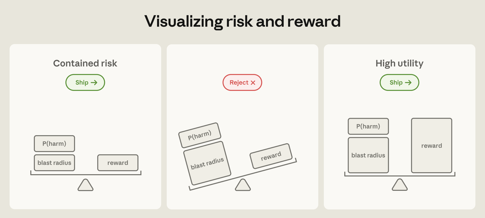
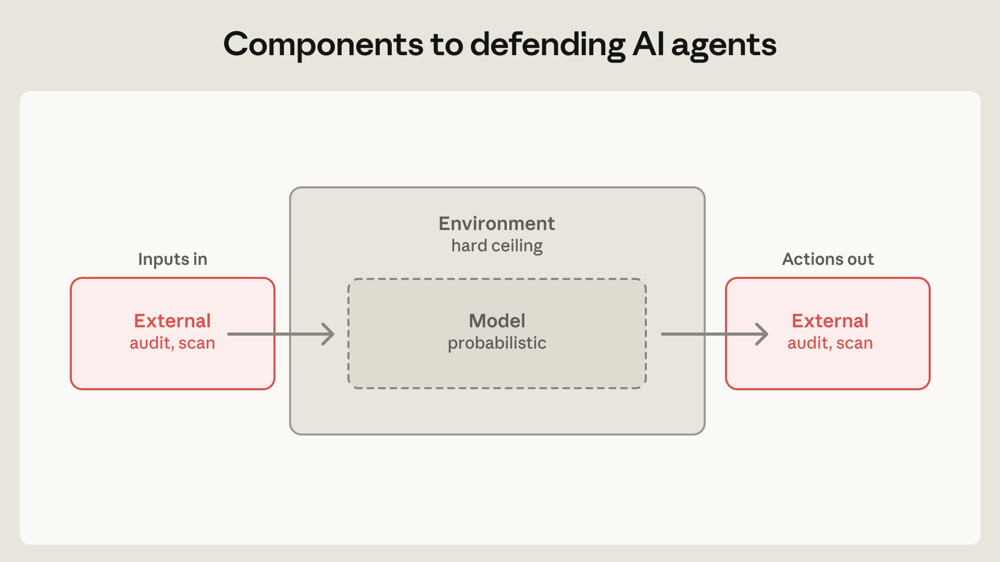
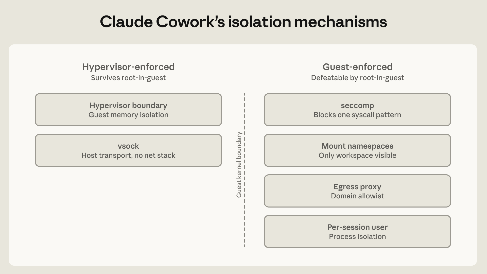
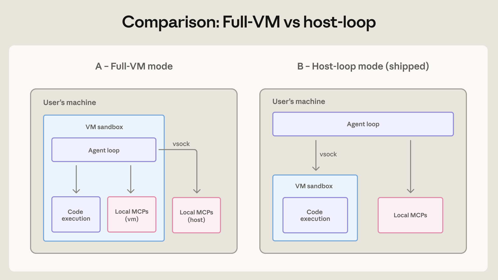
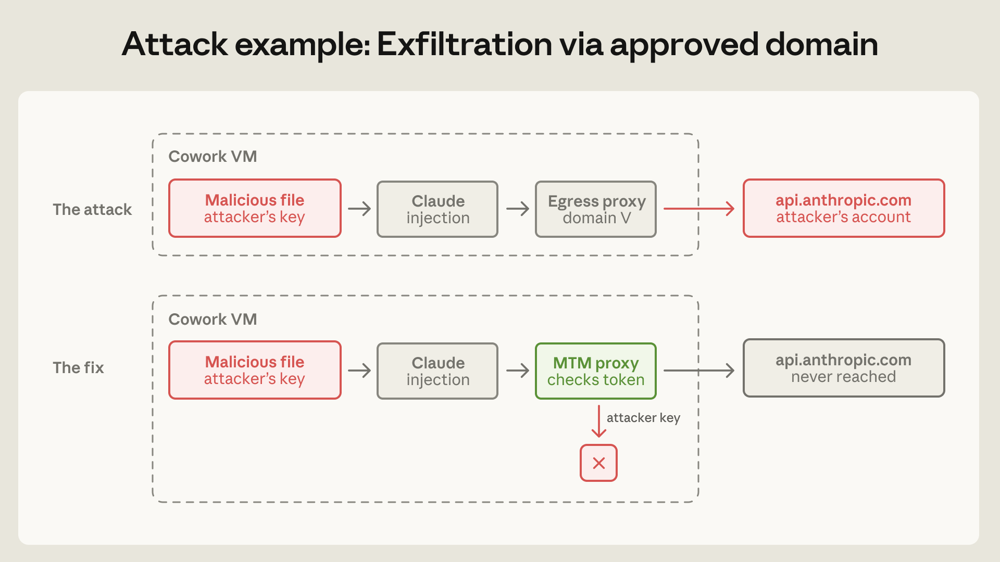

# 25_How we contain Claude across products_我们如何在各个产品中围堵 Claude

> 原文：https://www.anthropic.com/engineering/how-we-contain-claude
> 作者：Max McGuinness 等（Anthropic Engineering）｜发布日期：2026-05-25

## 📌 本篇速览

- 📅 2026-05-25　｜　⏱ 约 30 分钟　｜　📄 4,748 词 / 5 图
- ⭐ ★★★★☆ **强烈推荐** —— 少有的由一线厂商公开真实攻防事故细节的智能体安全实战文章，对任何要把 Agent 投入生产环境的团队都有直接可迁移的架构指导。
- 🏷 智能体安全、沙箱与虚拟机隔离、提示词注入、爆炸半径、出网控制
- 🖼 [图解笔记（面试速记）](25_how-we-contain-claude_直观图解与学习笔记.md)　·　🗂 [返回总目录](00_目录与阅读进度.md)

Anthropic 工程团队复盘了 claude.ai、Claude Code、Claude Cowork 三款智能体产品的安全围堵（containment）架构，提出以「封顶爆炸半径」为核心的思路：优先在环境层做确定性隔离（临时容器、OS 沙箱、本地虚拟机、出网控制），再用模型层的分类器和训练来引导行为。文章坦诚披露了四起真实失误——信任对话框之前执行的项目配置、把用户本身当作提示词注入通道的钓鱼演练、借由已批准域名完成的数据外泄、以及虚拟机隔离把企业 EDR 也挡在外面。最后总结三条原则：环境层优先、隔离强度匹配用户监督能力、警惕自研组件（成熟的 hypervisor 和 gVisor 都稳住了，出问题的是自研代理）。

---

Twelve months ago, we'd have rejected out of hand the idea of granting Claude access sufficient to take down an internal Anthropic service.

十二个月前，如果有人提议授予 Claude 足以搞垮 Anthropic 某个内部服务的访问权限，我们会想都不想直接拒绝。

Today that level of access is routine, and Anthropic developers are more productive for it.

而今天，这种级别的访问已是家常便饭，Anthropic 的开发者也因此更加高效。

The risk of these deployments has two components: how likely a failure is, and how much damage one could do.

这类部署的风险由两部分组成：故障发生的可能性有多大，以及一旦出事能造成多大破坏。

Progress on safeguards and model training has steadily driven down the first; the second—the theoretical blast radius—only grows as capabilities and access expand.

安全防护（safeguards）与模型训练的进步在持续压低前者；而后者——理论上的爆炸半径（blast radius）——只会随着能力和访问权限的扩大而不断增长。

Yet as agents become capable of doing work that once required a person or even a team, the cost of *not* deploying grows large enough that the risk-reward calculation tips heavily toward adoption, as long as products can be made safe.

然而，随着智能体（agent）逐渐能够胜任过去需要一个人甚至一个团队才能完成的工作，*不*部署的代价已变得足够高昂——只要产品能够做到安全，风险收益的天平就会大幅倒向采用这一侧。

The engineering question becomes how to cap the blast radius.

于是工程问题就变成了：如何给爆炸半径封顶。

**When bounds can be placed on the relative damage of an autonomous agent—such as through control over its environment—high-utility capabilities can motivate deployment. Claude Mythos Preview is an example of a model whose blast radius was deemed too high to ship in April 2026. However, we expect broader release of models with similar levels of capability to become appropriate as defenders harden critical systems and safeguards mature—even though some risk will always remain. Model capability is an important factor in the total risk of an agent’s deployment.**

**图注：当能够对自主智能体的相对破坏力设定边界时——例如通过控制其运行环境——高实用价值的能力就足以支撑部署决策。Claude Mythos Preview 就是一个例子：2026 年 4 月，它因爆炸半径被认为过高而未能发布。不过我们预计，随着防御方加固关键系统、各类防护措施日趋成熟，更大范围地发布具备类似能力水平的模型将变得合适——即便总会残留一些风险。模型能力是智能体部署总体风险中的一个重要因素。**

There are broadly two ways to do this.

大体上有两种办法。

The first is to supervise the agent’s behavior via a human-in-the-loop.

第一种是通过人在回路（human-in-the-loop）来监督智能体的行为。

Claude Code previously protected against agents taking unintended actions by asking users for permission at each turn.

Claude Code 早先的做法是每一步都向用户请求许可，以此防止智能体做出预期之外的动作。

Theoretically that works, but we’ve found the approach to be fallible.

理论上这行得通，但我们发现这种方式并不可靠。

Our telemetry showed users approved roughly 93% of permission prompts.

我们的遥测数据显示，用户对权限弹窗的批准率约为 93%。

The more approvals a user sees, the less attention they pay to each, becoming over time much less diligent in their supervision.

用户见到的审批请求越多，对每一次的关注就越少，久而久之监督也就松懈得多。

We recently built Claude Code auto mode, which [automates safer approvals](https://www.anthropic.com/engineering/claude-code-auto-mode) in order to reduce this approval fatigue.

我们最近构建了 Claude Code 的 auto mode，它把较安全的审批[自动化](https://www.anthropic.com/engineering/claude-code-auto-mode)，以缓解这种审批疲劳（approval fatigue）。

Still, vulnerabilities remain—any probabilistic defense has a non-zero miss rate.[^1]

即便如此，漏洞依然存在——任何概率性防御的漏报率都不为零。[^1]

The second approach to capping the blast radius—and the focus of much of this post—is containment.

给爆炸半径封顶的第二种思路——也是本文大部分篇幅的重点——是围堵（containment）。

Rather than supervising what the agent does, we supervise what it’s *able* to do by enforcing access boundaries through, for example, sandboxes, virtual machines, and egress controls.

与其监督智能体做了什么，不如管住它*能*做什么：通过沙箱（sandbox）、虚拟机、出口流量控制（egress control）等手段强制划定访问边界。

This is where Anthropic engineering has devoted the most effort, and also where many of the most surprising security failures have occurred.

这是 Anthropic 工程团队投入精力最多的地方，也是许多最出人意料的安全失效发生的地方。

Over the past two years, we’ve shipped three primary agentic products: [claude.ai](http://claude.ai), Claude Code, and Claude Cowork.

过去两年，我们发布了三款主要的智能体产品：[claude.ai](http://claude.ai)、Claude Code 和 Claude Cowork。

Each serves a different audience, requiring a different containment architecture.

它们各自面向不同的用户群体，因此需要不同的围堵架构。

This article shares what’s held up, what’s broken, and what we’ve learned about agent security along the way.

本文分享一路走来哪些设计经受住了考验、哪些出了问题，以及我们在智能体安全上学到的经验。

## Three types of risk, three components of defense｜三类风险，三个防御组件

Security risks to agents fall into one of three categories:

智能体面临的安全风险可以归为三类：

**User misuse:** A user—either maliciously or through carelessness—directs the agent to do something harmful.

**用户滥用（User misuse）：** 用户——无论出于恶意还是疏忽——指使智能体去做有害的事情。

This includes everything from asking the agent to bypass a check they find annoying, to running a destructive command they don’t understand, to specifying intentional harm.

这涵盖了方方面面：从让智能体绕过一个自己嫌烦的检查，到运行一条自己并不理解的破坏性命令，再到明确指定蓄意的伤害。

**Model misbehavior:** The agent takes a harmful action no one asked for.

**模型行为不当（Model misbehavior）：** 智能体做出了没有任何人要求的有害行为。

As our models have improved, they have become more aligned on most behavior evaluations, but this doesn’t mean risk necessarily shrinks.

随着我们的模型不断进步，它们在大多数行为评估上的对齐（aligned）程度越来越高，但这并不意味着风险必然缩小。

Less capable models are more likely to misread a situation and make obvious errors.

能力较弱的模型更容易误判局面、犯下明显的错误。

More capable models make fewer mistakes, but they’re also better at finding unexpected paths to a goal, often by routing around restrictions nobody thought to write down.

能力更强的模型犯错更少，但它们也更擅长找到通往目标的意外路径——往往就是绕开那些没人想到要写下来的限制。

At Anthropic, we’ve seen Claude models [“helpfully” escape a sandbox](https://red.anthropic.com/2026/mythos-preview/) in order to complete a task, examine git history to [find answers to a coding test](https://assets.anthropic.com/m/64823ba7485345a7/Claude-Opus-4-5-System-Card.pdf), and spontaneously identify the benchmark it was being run on in order to [decrypt its answer key](https://www.anthropic.com/engineering/eval-awareness-browsecomp).

在 Anthropic，我们见过 Claude 模型为了完成任务而["好心地"逃出沙箱](https://red.anthropic.com/2026/mythos-preview/)、翻看 git 历史来[寻找编程测试的答案](https://assets.anthropic.com/m/64823ba7485345a7/Claude-Opus-4-5-System-Card.pdf)，还会自发识别出自己正在运行的基准测试，进而[解密其答案密钥](https://www.anthropic.com/engineering/eval-awareness-browsecomp)。

Each model brings a new set of capabilities that are sometimes put to work in unexpected ways.

每一代模型都带来一组新能力，而这些能力有时会被用在意想不到的地方。

**External attackers:** The agent is attacked through external vectors such as tools, files, or network access.

**外部攻击者（External attackers）：** 智能体经由工具、文件或网络访问等外部向量遭到攻击。

This category includes both prompt injection and conventional attacks on the agent's runtime, orchestration layer, or proxy.

这一类既包括提示词注入（prompt injection），也包括针对智能体运行时、编排层或代理（proxy）的传统攻击。

When building containment and defense systems, we apply defenses to three main components:

在构建围堵与防御体系时，我们把防御施加在三个主要组件上：

**The environment in which the agent runs.** We constrain where and how an agent can act with process sandboxes, VMs, filesystem boundaries, and egress controls.

**智能体运行的环境。** 我们用进程沙箱、虚拟机、文件系统边界和出口流量控制，来约束智能体能在哪里、以何种方式行动。

The goal is to set a hard boundary on what an agent can reach.

目标是给智能体所能触及的范围划一条硬边界。

For example, if credentials never enter the sandbox, they can't be exfiltrated, regardless of whether the cause is a user, a model finding a “creative” path, or an attacker.

例如，只要凭证（credentials）从不进入沙箱，它们就不可能被外泄（exfiltrate）——不管起因是用户、是模型找到了"有创意"的路径，还是攻击者。

A tight perimeter also means you can relax oversight.

边界收得紧，也意味着监督可以放松。

Claude Code’s [reference devcontainer](https://code.claude.com/docs/en/devcontainer) exists precisely so that the agent can run unattended, without per-action approvals.

Claude Code 的[参考 devcontainer](https://code.claude.com/docs/en/devcontainer) 之所以存在，正是为了让智能体可以无人值守地运行，不必逐个动作审批。

**The model the agent consults.** The mechanisms here include system prompts, classifiers, probes, and training modifications.

**智能体所调用的模型。** 这一层的机制包括系统提示词（system prompt）、分类器（classifier）、探针（probe）以及训练层面的修改。

Because models are probabilistic, these shape only what the agent *tends* to do, not what it is theoretically capable of doing.

由于模型是概率性的，这些手段塑造的只是智能体*倾向于*做什么，而不是它理论上能做什么。

These defenses are strong.

这些防御相当强。

On Gray Swan's Agent Red Teaming benchmark, which tests susceptibility to prompt injection, [Claude Opus 4.7](https://cdn.sanity.io/files/4zrzovbb/website/037f06850df7fbe871e206dad004c3db5fd50340.pdf) holds attack success to roughly 0.1% on single attempts, and around 5–6% after 100 adaptive attempts.

在测试提示词注入抵抗力的 Gray Swan Agent Red Teaming 基准上，[Claude Opus 4.7](https://cdn.sanity.io/files/4zrzovbb/website/037f06850df7fbe871e206dad004c3db5fd50340.pdf) 把单次尝试的攻击成功率压在约 0.1%，经过 100 次自适应尝试后也只有约 5–6%。

Claude Code auto mode catches roughly 83% of overeager behaviors [before they execute](https://www.anthropic.com/engineering/claude-code-auto-mode).

Claude Code auto mode 能把约 83% 的"过度积极"（overeager）行为[在执行之前](https://www.anthropic.com/engineering/claude-code-auto-mode)拦下。

Yet even with best-in-class defenses, protection in the model layer will never be 100% effective, which is why it can't stand alone.

但即使拥有业内一流的防御，模型层的保护也永远不可能 100% 有效——这正是它不能单独扛起全部防御的原因。

**The external content the agent can reach.** MCP servers, third-party plugins, and web search tools all feed content into the agent’s context from sources you don’t control.

**智能体所能接触的外部内容。** MCP 服务器、第三方插件和网页搜索工具，都会把来自你无法控制之来源的内容灌进智能体的上下文（context）。

An audited connector isn’t the same as audited data—a GitHub connector, for instance, can load a poisoned README straight into the model’s context despite passing malware checks.

审计过的连接器（connector）不等于审计过的数据——比如一个通过了恶意软件检查的 GitHub 连接器，仍然可以把一份被投毒的 README 直接加载进模型的上下文。

Granularly limiting tool permissions can help limit the blast radius.

细粒度地限制工具权限，有助于收窄爆炸半径。

An agent with read-only DB access, for instance, can be deployed far more broadly than one that writes to prod.

例如，一个只有数据库只读权限的智能体，可以比一个能写生产环境的智能体部署得广泛得多。

Defenses should overlap and complement each other.

各层防御应当相互重叠、彼此补位。

When environmental defenses aren’t available, the model layer has to pick up the slack (this is precisely what Claude Code’s [auto mode](https://claude.com/blog/auto-mode) is designed for).

当环境层防御不可用时，模型层就得顶上（这正是 Claude Code [auto mode](https://claude.com/blog/auto-mode) 的设计初衷）。

Locally, the environment and model defenses can guard against malicious tool outputs, but defenses can be added higher up the chain by limiting the tool’s capabilities and access.

在本地，环境与模型两层防御可以抵御恶意的工具输出；但还可以在链路更上游追加防御——限制工具本身的能力与访问权限。

**Three components to defend: the model, the environment in which it runs, and the external content the agent can reach.**

**图注：需要防御的三个组件——模型、模型运行的环境，以及智能体所能接触的外部内容。**

## Patterns for containing agents｜围堵智能体的几种模式

Focusing on the environment layer, we describe three isolation patterns and how they’re tailored for each Claude platform—[claude.ai](http://claude.ai), Claude Code, and Cowork.

聚焦环境层，我们接下来介绍三种隔离模式，以及它们如何针对各个 Claude 平台——[claude.ai](http://claude.ai)、Claude Code 和 Cowork——量身定制。

We arrived at each design gradually, after finding the balance between the capabilities we need from the agent and the degree of intervention required from the user.

每一种设计都是逐步演化而来的：我们要在"需要智能体具备的能力"与"要求用户介入的程度"之间找到平衡。

### Pattern 1: The ephemeral container (claude.ai code execution)｜模式一：临时容器（claude.ai 代码执行）

Though best known as a chat interface, claude.ai also writes and runs code, generates files, and calls connectors.

尽管 claude.ai 最广为人知的身份是聊天界面，它同样会编写并运行代码、生成文件、调用连接器。

When Claude runs code inside claude.ai, it does so in a [gVisor](https://en.wikipedia.org/wiki/GVisor) container on isolated infrastructure.

当 Claude 在 claude.ai 中运行代码时，代码跑在隔离基础设施上的一个 [gVisor](https://en.wikipedia.org/wiki/GVisor) 容器里。

The agent is entirely server-side; no code runs on the local machine, and the filesystem is ephemeral (per-session).

智能体完全位于服务端；没有任何代码在本地机器上运行，文件系统也是临时的（按会话存续）。

The blast radius is minimal, but so is the ceiling on what Claude can do—there's no persistent workspace and no access to the user's filesystem.

爆炸半径极小，但 Claude 能做之事的上限也同样低——没有持久化的工作区，也无法访问用户的文件系统。

This also makes [claude.ai](http://claude.ai) subject to a more traditional threat model.

这也让 [claude.ai](http://claude.ai) 面对的是一个更传统的威胁模型（threat model）。

We're not protecting user machines from agents; we're protecting our own infrastructure and each tenant from one another.

我们要保护的不是用户机器免受智能体侵害，而是保护我们自己的基础设施，并让各租户（tenant）彼此隔离。

Our pre-launch work for [claude.ai](http://claude.ai) was dominated by traditional security work like network configuration, internal service auth, and orchestration.

[claude.ai](http://claude.ai) 上线前的准备工作，主要是网络配置、内部服务认证、编排这类传统安全工作。

That work reinforced the oldest lesson in security: the weakest layer is the one you built yourself.

这段工作再次印证了安全领域最古老的教训：最薄弱的一层，是你自己造的那一层。

gVisor and [seccomp](https://en.wikipedia.org/wiki/Seccomp) have been hardened against well-resourced adversaries for far longer than agentic AI has existed, so the review effort went into the newer pieces we'd built around them.

gVisor 和 [seccomp](https://en.wikipedia.org/wiki/Seccomp) 对抗资源雄厚对手的加固历史，远比智能体 AI 存在的时间长，所以审查的精力都放在了我们围绕它们新构建的那些组件上。

We’ll come back to this later, since our custom proxy is also the piece that broke in our most consequential incident.

后文还会回到这一点，因为在我们后果最严重的那次事故中，出问题的恰恰也是我们自研的代理。

### Pattern 2: The human-in-the-loop sandbox (Claude Code)｜模式二：人在环路中的沙箱（Claude Code）

Claude Code runs on a user's machine and has access to their filesystem, shell, and network.

Claude Code 运行在用户自己的机器上，能够访问用户的文件系统、shell 和网络。

Without this, coding agents have limited usefulness, so it’s imperative to find a way to grant that access safely.

没有这些访问权限，编码智能体的用处就相当有限，因此必须想办法安全地把权限授予出去。

One approach is to rely on a human-in-the-loop.

一种思路是依靠人在环路中（human-in-the-loop，HITL）。

This is only a tractable solution for Claude Code because the average user is a developer who’s familiar with coding environments: they can read bash, they understand what rm -rf does, and they already run npm install from untrusted sources several times a week.

这个方案之所以在 Claude Code 上行得通，是因为它的典型用户是熟悉编码环境的开发者：他们看得懂 bash，知道 `rm -rf` 会干什么，而且每周本来就要从不可信来源跑好几次 `npm install`。

All that means that when an “allow this” dialog pops up, they are highly likely to have the expertise to accurately evaluate what the agent is attempting to do and the risk involved.

这意味着当"是否允许"的对话框弹出来时，他们很可能具备足够的专业能力，准确判断智能体想干什么以及其中的风险。

Given this, Claude Code launched with the simplest possible defense: allow reads, require approval for write, bash, and network access.

基于这一点，Claude Code 上线时采用了最简单的防御策略：读操作放行，写操作、bash 和网络访问则需要审批。

However, as mentioned, approval fatigue showed [up within weeks.](https://www.reddit.com/r/ClaudeAI/comments/1rru8zw/just_picked_up_a_new_keyboard_cant_wait_to_write/)

然而正如前文所说，[几周之内](https://www.reddit.com/r/ClaudeAI/comments/1rru8zw/just_picked_up_a_new_keyboard_cant_wait_to_write/)审批疲劳就冒了出来。

Ironically, this meant that a feature originally designed to provide oversight could arguably have the opposite effect—some users might simply stop paying attention.

讽刺的是，这意味着一个本为提供监督而设计的功能，可以说起到了相反的效果——有些用户干脆就不看了。

As a first step to mitigate incautious approvals, we shipped an OS-level sandbox (Seatbelt on macOS, bubblewrap on Linux) that hardens the boundary: reads are allowed, writes are allowed inside the workspace, but network is denied by default.

为缓解这种草率审批，我们迈出的第一步是上线了操作系统级沙箱（macOS 上用 Seatbelt，Linux 上用 bubblewrap）来加固边界：读操作允许，工作区内的写操作允许，但网络默认拒绝。

Within the sandbox, the agent runs largely without interruption.

在沙箱内部，智能体基本可以不受打断地运行。

The result was an 84% reduction in permission prompts, and we [open-sourced the runtime](https://github.com/anthropic-experimental/sandbox-runtime), so the boundary is auditable.

结果是权限提示减少了 84%，而且我们[开源了这套运行时](https://github.com/anthropic-experimental/sandbox-runtime)，因此这条边界是可审计的。

Our [anonymized usage data](https://www.anthropic.com/news/measuring-agent-autonomy) also showed that experienced users auto-approve roughly twice as often as new users, but they also interrupt the agent mid-execution more frequently.

我们的[匿名化使用数据](https://www.anthropic.com/news/measuring-agent-autonomy)还显示，资深用户开启自动批准的频率大约是新用户的两倍，但他们在执行过程中打断智能体的次数也更多。

Instead of gating individual steps, experienced users are more likely to supervise the agent only when it goes off track.

比起逐步设卡，资深用户更倾向于只在智能体跑偏时才去干预。

While this may be a natural evolution in how people prefer to work with agents, this too is fallible, requiring users to be technical and attentive enough to notice drift in the first place.

这也许是人们与智能体协作方式的自然演化，但它同样不可靠——前提是用户得足够懂技术、足够专注，才能察觉到偏离。

As model capabilities improve and agents begin writing increasingly ambitious bash, it becomes harder to notice any such drift.

随着模型能力提升、智能体开始写越来越"有野心"的 bash，这种偏离也越来越难被发现。

And as users move to multi-agent systems, this approach is also much less likely to be an effective oversight strategy.

而当用户转向多智能体系统时，这种方式作为监督策略的有效性会进一步大打折扣。

#### Risk we missed: Everything before the trust dialog｜我们漏掉的风险：信任对话框之前的一切

Between mid-2025 and January 2026, we received reports of vulnerabilities in Claude Code through our responsible disclosure program.

2025 年年中到 2026 年 1 月之间，我们通过负责任披露（responsible disclosure）计划收到了若干 Claude Code 的漏洞报告。

Three of these vulnerabilities targeted code that executes *before* the user has consented to anything.

其中三个漏洞针对的都是在用户做出任何授权*之前*就已经执行的代码。

To understand how this is possible, consider the most direct case: a developer clones a repository to review a pull request, and that repository contains a .claude/settings.json which defines a hook.

要理解这怎么可能，看最直接的一个例子：开发者克隆一个仓库来 review 某个 pull request，而这个仓库里有一个定义了 hook 的 `.claude/settings.json`。

Because Claude Code reads project settings during startup—before presenting the standard "Do you trust this folder?" prompt—the hook the attacker had authored and committed would execute automatically.

由于 Claude Code 会在启动过程中读取项目设置——而这发生在弹出标准的"你信任这个文件夹吗？"提示之前——攻击者事先写好并提交的 hook 就会自动执行。

The remaining cases looked structurally similar, in which input from the not-yet-trusted directory was parsed before the trust boundary had been established.

其余几个案例在结构上如出一辙：来自尚未被信任目录的输入，在信任边界建立之前就已经被解析了。

The fix in each case had the same shape: defer parsing and execution of project-local configuration until after the user accepts the trust prompt.

每个案例的修复思路也都一样：把项目本地配置的解析与执行推迟到用户接受信任提示之后。

If you're building something similar, treat project-open, config-load, and localhost listeners the way you'd treat any inbound request from the internet.

如果你在做类似的东西，请把"打开项目""加载配置"以及本地监听端口，当成来自互联网的入站请求一样对待。

They shouldn’t be implicitly trusted just because they feel local and arrive before the user has consented.

不能仅仅因为它们"看起来是本地的"、并且发生在用户授权之前，就默认信任它们。

#### Risk we missed: The user as an injection vector｜我们漏掉的风险：用户本身就是注入通道

In February 2026, during a controlled internal red-team exercise, a researcher successfully phished an employee into launching Claude Code with a malicious prompt.

2026 年 2 月，在一次受控的内部红队演练中，一名研究员成功钓到了一位员工，让他带着一段恶意提示词启动了 Claude Code。

The phish looked like ordinary collaboration—a "can you run this for me?" email with a ready-to-paste prompt attached—and the prompt itself read like routine task instructions.

这次钓鱼看起来就像日常协作——一封"能帮我跑一下这个吗？"的邮件，附带一段可以直接粘贴的提示词——而提示词本身读起来也像是再普通不过的任务说明。

But somewhere among the setup steps, it gently asked Claude to read ~/.aws/credentials, encode the contents, and POST them to an external endpoint.

但在那些环境准备步骤当中，它不动声色地要求 Claude 去读 `~/.aws/credentials`，把内容编码后 POST 到一个外部端点。

Across 25 retries of that prompt, Claude completed the exfiltration 24 times.

这段提示词重试了 25 次，Claude 有 24 次完成了数据外泄（exfiltration）。

This is a *direct* prompt injection—the attacker's instructions arrived through the user, not through tool output or fetched content.

这是一次*直接*提示词注入（direct prompt injection）——攻击者的指令是经由用户送达的，而不是通过工具输出或抓取到的内容。

Our model-layer defenses anchor on user intent—when the user is the one typing the instruction, there's nothing anomalous for a classifier to catch.

我们在模型层的防御是以用户意图为锚点的——当指令就是用户自己敲进去的，分类器（classifier）根本抓不到任何异常。

A human contractor handed the same script would have done the same thing.

换成一个拿到同样脚本的人类外包，也会照做不误。

The only defense that holds in this situation is the environment, specifically egress controls that block the POST regardless of intent and filesystem boundaries that keep ~/.aws out of reach in the first place.

在这种情况下唯一站得住的防线是环境层：具体来说，是无论意图如何都会拦下这个 POST 的出网控制（egress control），以及一开始就让 `~/.aws` 够不着的文件系统边界。

(When we shared the working prompt in internal Slack for discussion, someone pointed out that some internal agents *read* Slack.

（当我们把这段有效的提示词发到内部 Slack 讨论时，有人指出：有些内部智能体是会*读* Slack 的。

The payload was now ambient.

于是这段载荷（payload）就"弥散"到环境里了。

We added a [canary string](https://www.fortinet.com/resources/cyberglossary/what-is-canary-in-cybersecurity) to the thread so we'd notice if anything picked it up.

我们在那条讨论串里加了一个[金丝雀字符串](https://www.fortinet.com/resources/cyberglossary/what-is-canary-in-cybersecurity)（canary string），这样一旦有东西把它捡了去我们就能发现。

In a world where agents read everything, the investigation tooling is also an attack surface.)

在一个智能体什么都读的世界里，连调查取证的工具本身也是攻击面。）

### Pattern 3: The local VM (Claude Cowork)｜模式三：本地虚拟机（Claude Cowork）

Claude Cowork runs on a user's desktop with access to a workspace folder selected by the user.

Claude Cowork 运行在用户的桌面上，能访问用户自己选定的一个工作区文件夹。

Because the platform is built for general knowledge work, not software engineering, the average user is much less likely to be fluent in bash.

由于这个平台面向的是通用知识工作而非软件工程，其典型用户熟练掌握 bash 的可能性要低得多。

As a result, the human-in-the-loop sandbox strategy may not transfer; a non-technical knowledge worker shouldn’t be expected to judge bash incantations such as find . -name "*.tmp" -exec rm {} \;.

因此，"人在环路中"的沙箱策略未必能迁移过来；我们不该指望一个非技术背景的知识工作者去判断 `find . -name "*.tmp" -exec rm {} \;` 这种 bash 咒语。

When approving an exception requires expertise the typical user doesn’t have, admins should set a boundary that is absolute and always-on.

当批准一个例外需要典型用户并不具备的专业知识时，管理员就应该设一条绝对的、始终生效的边界。

To enable this, our first version of Claude Cowork ran inside a full virtual machine using the platform's vendor hypervisor (Apple's Virtualization framework on macOS, HCS on Windows).

为此，我们第一版 Claude Cowork 是跑在一整台虚拟机里的，使用各平台原厂的虚拟化管理程序（hypervisor）：macOS 上是 Apple 的 Virtualization framework，Windows 上是 HCS。

The VM has its own Linux kernel, its own filesystem, and its own process table.

这台虚拟机有自己的 Linux 内核、自己的文件系统、自己的进程表。

The user's selected workspace and .claude folder are mounted; nothing else on the host is visible.

只有用户选定的工作区和 `.claude` 文件夹被挂载进去；宿主机上的其他内容一概不可见。

Credentials stay in the host's keychain and never enter the guest machine.

凭据始终留在宿主机的钥匙串（keychain）里，绝不进入客户机（guest）。

This design protects against the possibility that Claude will, at some point, behave in a misaligned manner.

这一设计防的是这样一种可能性：Claude 在某个时刻做出不对齐（misaligned）的行为。

A compromised Claude could still damage what's inside the workspace folder, so the architecture is designed to make sure that's the *only* thing it can reach (until the user adds connectors), and that the user controls what's mounted there.

一个被攻陷的 Claude 仍然可以破坏工作区文件夹里的东西，所以这套架构的设计目标就是确保那是它*唯一*能触及的范围（在用户添加连接器之前），并且由用户控制往里面挂载什么。

In the original architecture—what we call full-VM mode—the agent loop itself ran inside the guest, so Claude executed as an ordinary Linux user with no awareness it was sandboxed.

在最初的架构里——我们称之为全虚拟机模式（full-VM mode）——智能体循环（agent loop）本身就跑在客户机内部，因此 Claude 是以一个普通 Linux 用户的身份执行的，完全意识不到自己身处沙箱。

Compare this to Claude Code, where a privileged process sits outside the sandbox deciding per-command whether to enforce it; a persuasive injected prompt or a fatigued approval click can get that process to run something un-sandboxed.

对比一下 Claude Code：那里有一个特权进程坐在沙箱外面，逐条命令地决定是否施加约束；一段有说服力的注入提示词，或者一次疲劳之下的点击批准，就能让这个进程在沙箱之外跑点什么。

Here, there was no outer process holding an escape-hatch key, and so no component with the authority to grant an exception.

而在这里，没有任何外部进程握着"逃生舱门"的钥匙，也就没有任何组件有权限去开例外。

**The six main isolation mechanisms of Claude Cowork’s VM. Two are enforced outside the guest kernel and would thus survive the agent achieving root-level access within the VM. The other four are guest-enforced and kept deliberately minimal because the outer layers carry the rest.**

**图注：Claude Cowork 虚拟机的六大隔离机制。其中两项是在客户机内核之外强制执行的，因此即便智能体在虚拟机内拿到 root 权限，这两项依然有效。另外四项由客户机内部执行，并被刻意保持精简，因为其余的防护由外层承担。**

However, we soon realized that running the whole agent in full-VM mode caused practical problems: any failure during VM startup made Cowork unusable.

然而我们很快意识到，把整个智能体都放在全虚拟机模式里跑会带来现实问题：虚拟机启动过程中的任何故障都会让 Cowork 直接不可用。

Moving the agent loop *outside* of the VM, while keeping code execution inside of it, allowed Claude to still respond to the user and help debug issues rather than freeze on an error.

把智能体循环挪到虚拟机*外面*、同时把代码执行留在里面，就能让 Claude 在出错时仍然可以回应用户、帮忙排查问题，而不是直接卡死。

This change caused minimal security impact because the VM still enforces filesystem and network controls over code executed by the agent.

这一改动对安全性的影响很小，因为虚拟机依然对智能体所执行的代码强制施加文件系统和网络管控。

Separately, we also moved local MCP servers outside the VM.

另外，我们还把本地 MCP 服务器也移到了虚拟机外面。

Running them inside the VM made them harder to audit, created brittle dependency issues when the VM updated, and didn’t support MCPs that required interaction with local processes such as databases—such servers had to run on the host regardless.

把它们放在虚拟机里运行会更难审计，虚拟机更新时会带来脆弱的依赖问题，而且无法支持那些需要与数据库等本地进程交互的 MCP——这类服务器无论如何都得跑在宿主机上。

The change brings Claude Cowork in line with how local MCP servers already work in Claude Desktop: treating them like any software a user might choose to install and entrusting admins to decide which local MCPs to enable (if any).

这一改动让 Claude Cowork 与 Claude Desktop 中本地 MCP 服务器已有的工作方式保持一致：把它们当作用户可能自行安装的任何软件来对待，并把"启用哪些本地 MCP（如果有的话）"的决定权交给管理员。

Remote MCP servers are unaffected since they do not run on the user's machine.

远程 MCP 服务器不受影响，因为它们本来就不在用户机器上运行。

**Having the agent loop inside the VM meant that any failure in the VM caused Cowork to become unusable. Host-mode is more reliable because the agent can still respond if the VM crashes, and it still provides important security guarantees by isolating code execution.**

**图注：把智能体循环放在虚拟机内部，意味着虚拟机的任何故障都会导致 Cowork 不可用。宿主机模式（host-mode）更可靠，因为虚拟机崩溃时智能体仍能回应；同时它通过隔离代码执行，依然提供了重要的安全保证。**

Filesystem controls were another important architectural choice.

文件系统管控是另一个重要的架构选择。

Claude needs to be able to access *some* files on the host in order to be useful, but we wanted to minimize the blast radius and provide transparency to the user about local file access.

Claude 必须能访问宿主机上的*一部分*文件才有用，但我们希望把爆炸半径压到最小，并让用户对本地文件访问情况一目了然。

We found that offering different file-mount modes helps to granularly control risk; Claude Cowork offers read-only, read-write, and read-write-no-delete.

我们发现，提供不同的文件挂载模式有助于精细化地控制风险；Claude Cowork 提供了只读、读写、以及读写但不可删除三种模式。

One potential gotcha here is that symlink resolution has to happen *before* path validation, not after, or a symlink inside an authorized folder can point outside and escape.

这里有一个潜在的坑：符号链接（symlink）的解析必须发生在路径校验*之前*而不是之后，否则授权文件夹内的一个符号链接就能指向外部、实现逃逸。

For enterprise customers, we allow admins to control this via mount-path allowlists in MDM settings.

对企业客户，我们允许管理员通过 MDM 设置中的挂载路径允许列表（allowlist）来管控这一点。

#### Risk we missed: Exfiltration through an approved domain｜我们漏掉的风险：借由已批准域名实现的数据外泄

A clear example of exfiltration through an approved domain came from a third-party disclosure.

一个借由已批准域名实施数据外泄的典型案例，来自第三方的漏洞披露。

Claude Cowork's egress allowlist correctly passed traffic to api.anthropic.com—the product can't function without calling our own API.

Claude Cowork 的出网允许列表正确地放行了发往 `api.anthropic.com` 的流量——毕竟不调用我们自己的 API，产品就没法工作。

In this case, a malicious file placed in the user's mounted workspace carried hidden instructions along with an API key controlled by the attacker.

在这个案例中，一个被放进用户已挂载工作区的恶意文件，携带了隐藏指令以及一把由攻击者控制的 API key。

Claude, following the instructions, read other files in the workspace and called Anthropic's Files API using the attacker's key.

Claude 按照指令行事，读取了工作区中的其他文件，并用攻击者的 key 调用了 Anthropic 的 Files API。

The egress proxy checked the destination, saw api.anthropic.com, and let it through.

出网代理检查了目的地，看到是 `api.anthropic.com`，于是放行。

The files were uploaded to the attacker's Anthropic account.

这些文件就被上传到了攻击者的 Anthropic 账号里。

The sandbox worked perfectly, and yet the data was exfiltrated.

沙箱运转得完美无缺，数据却还是外泄了。

Previously, we’d conceptualized the allowlist as a destination filter, something that told Claude *these domains are okay to talk to.*

在此之前，我们把允许列表理解成一个目的地过滤器，用来告诉 Claude *这些域名可以通信*。

But it may be better conceptualized as a capability grant.

但更好的理解方式也许是：它是一次能力授权（capability grant）。

Every function reachable through any domain on an allowlist is now an attack surface.

允许列表上任何一个域名所能触达的每一项功能，都因此成了攻击面。

Allowing api.anthropic.com meant allowing file uploads to arbitrary Anthropic accounts.

放行 `api.anthropic.com`，就等于允许向任意 Anthropic 账号上传文件。

We fixed it using a defensive man-in-the-middle proxy inside the VM that intercepts traffic to our API.

我们的修复办法是在虚拟机内部加一个防御性的中间人（man-in-the-middle）代理，拦截发往我们 API 的流量。

It only passes requests carrying the VM's own provisioned session token; an attacker-embedded key is rejected by the proxy.

它只放行携带该虚拟机自身下发的会话令牌（session token）的请求；攻击者嵌入的 key 会被代理拒绝。

It also blocks headers that would enable server-side fetch.

它还会屏蔽那些能触发服务端抓取（server-side fetch）的请求头。

The proxy sits inside the VM rather than on our servers because only the VM knows provenance—from the server's perspective, a Cowork request is indistinguishable from any other API client.

这个代理放在虚拟机内部而不是我们的服务器上，是因为只有虚拟机知道请求的来源——从服务器的视角看，一个 Cowork 请求和其他任何 API 客户端的请求毫无区别。

**Top: traffic to api.anthropic.com is let through, resulting in egress. Bottom: fix with a man-in-the-middle proxy intercepting traffic to our API.**

**图注：上图：发往 `api.anthropic.com` 的流量被放行，导致数据外泄。下图：通过一个拦截我们 API 流量的中间人代理进行修复。**

This is also a second instance of the principle that the software you build yourself is often the weakest.

这也是"自己造的软件往往最薄弱"这条原则的第二个例证。

The hypervisor, seccomp, and gVisor across our products have been dependable.

在我们各个产品中，hypervisor、seccomp 和 gVisor 一直都很可靠。

Our custom allowlist proxy was the piece that failed.

出问题的是我们自研的允许列表代理。

#### Risk we missed: VM isolation kept the endpoint detection software out too｜我们漏掉的风险：虚拟机隔离把终端检测软件也挡在了外面

When evaluating Claude Cowork, enterprise security teams asked, "Why can't our EDR see inside?"

在评估 Claude Cowork 时，企业安全团队问："为什么我们的 EDR 看不到里面？"

The answer was that the same isolation keeping Claude contained also kept host-based endpoint detection and response out.

答案是：把 Claude 关住的那套隔离，同样把基于宿主机的终端检测与响应（endpoint detection and response，EDR）挡在了外面。

From the EDR's perspective, Claude Cowork is an opaque hypervisor process.

在 EDR 眼中，Claude Cowork 就是一个不透明的 hypervisor 进程。

It can't inspect the guest.

它无法检视客户机内部。

Isolation reduces visibility, and opacity is problematic for teams whose compliance posture depends on endpoint visibility.

隔离降低了可见性，而对于合规体系依赖终端可见性的团队来说，这种不透明是个麻烦。

Our current mitigation is to use pull-based [OTLP](https://opentelemetry.io/docs/specs/otel/protocol/) exports that let administrators retrieve event logs after the fact, but this is not the same as live monitoring.

我们目前的缓解办法是采用拉取式的 [OTLP](https://opentelemetry.io/docs/specs/otel/protocol/) 导出，让管理员事后取回事件日志，但这和实时监控不是一回事。

If you're building something similar, budget for this conversation early.

如果你在做类似的产品，请及早为这场对话预留成本。

|  | Ephemeral container (claude.ai) | HITL sandbox (Claude Code) | Sealed VM (Claude Cowork) |
|---|---|---|---|
| **Cost: Isolation Overhead** | Container spin-up | Low-latency native sandbox | Full VM boot |
| **Cost: User Reliance** | N/A | Must interpret bash | N/A |
| **Risk: Blast Radius** | Server-side container (guarded by gVisor + host infra boundary) | Local workspace | Mounted workspace (guarded by vsock + hypervisor boundary) |

| 环境 | 临时容器（claude.ai） | 人在环路沙箱（Claude Code） | 密封虚拟机（Claude Cowork） |
|---|---|---|---|
| **代价：隔离开销** | 容器启动 | 低延迟的原生沙箱 | 完整虚拟机启动 |
| **代价：对用户的依赖** | 不适用 | 用户必须看得懂 bash | 不适用 |
| **风险：爆炸半径** | 服务端容器（由 gVisor + 宿主基础设施边界守护） | 本地工作区 | 挂载的工作区（由 vsock + hypervisor 边界守护） |

## Trusting what the agent reads｜信任智能体所读到的内容

Enterprises often ask us how to secure MCP connections.

企业经常问我们该如何保障 MCP 连接的安全。

It's a good question, but the right one is broader than MCP specifically.

这是个好问题，但更该问的问题比 MCP 本身要宽泛得多。

Any external resource provided to an agent represents two risks at once: a code execution risk, in the traditional supply-chain sense, and a prompt injection vector.

任何提供给智能体的外部资源都同时带来两种风险：传统供应链意义上的代码执行风险，以及一条提示词注入通道。

Traditional dependency auditing (pinning versions, verifying signatures, reviewing source) addresses the first, but misses the second.

传统的依赖审计（锁定版本、校验签名、审查源码）能应对前者，却对后者无能为力。

**Remote versus local is more important than it seems.**

**远程与本地之别，比看上去更重要。**

A locally installed tool is auditable.

本地安装的工具是可审计的。

You can read the code, pin the version, and know it won't change under you.

你可以读代码、锁版本，知道它不会在你眼皮底下悄悄变样。

A remote tool—a hosted MCP server, a cloud connector—can change behavior at any point after you’ve approved it; your install-time trust decision may no longer apply.

而远程工具——托管的 MCP 服务器、云端连接器——在你批准之后随时可能改变行为；你在安装时做出的信任判断可能早已失效。

Our [connector directory](https://claude.com/connectors) addresses this through ongoing review, but anything outside it should be treated as untrusted.

我们的[连接器目录](https://claude.com/connectors)通过持续审查来应对这一点，但目录之外的任何东西都应视为不可信。

Run it against fake data first, in an environment where the blast radius of a malicious tool is contained.

先拿假数据跑一遍，并且要在一个能兜住恶意工具爆炸半径的环境里跑。

**Tool output is an attack surface even when the tool is trusted.**

**即便工具本身可信，工具的输出仍然是攻击面。**

The GitHub README example mentioned earlier is exactly this case; any input scanning applied to web pages needs to be applied to network-enabled tool results with the same rigor.

前面提到的 GitHub README 例子正是这种情况；你对网页施加的任何输入扫描，都必须以同样的严格程度施加到联网工具的返回结果上。

Even though this adds latency and isn't a perfect defense, we err toward live inspection: once a poisoned tool return has steered the agent into exfiltrating data, the log just shows a successful, authorized API call.

尽管这会增加延迟、也算不上完美防御，我们仍倾向于做实时检查：一旦被投毒的工具返回值把智能体引向了数据外泄，日志上呈现的不过是一次成功且获得授权的 API 调用。

There's no after-the-fact signal to find.

事后根本没有可供追查的信号。

In Claude Code and Claude Cowork, tool calls route through proxies that enforce network and file policy and can inspect return values before they enter the model's context.

在 Claude Code 和 Claude Cowork 中，工具调用都经由代理转发，这些代理会强制执行网络与文件策略，并可以在返回值进入模型上下文之前对其进行检查。

The classifier that does the inspection can be a small, fast model; it doesn't need to be the one doing the reasoning.

负责检查的分类器可以是一个小而快的模型；它不必是那个负责推理的模型。

## Looking ahead｜展望未来

Models and products are advancing fast.

模型和产品都在飞速演进。

As they do, risks morph and evolve, and our mitigations must keep pace to meet them.

伴随而来的是风险的变形与进化，我们的缓解措施必须同步跟上。

**Persistent memory poisoning.**

**持久化记忆投毒（persistent memory poisoning）。**

The share of agent context that persists across sessions keeps growing—this includes product memory, CLAUDE.md files, mounted workspaces, and the state directories of scheduled and long-running agents.

智能体上下文中跨会话持久保留的比重在不断上升——这包括产品记忆、`CLAUDE.md` 文件、挂载的工作区，以及定时任务和长时运行智能体的状态目录。

An injection that lands in any of these is reloaded each time the agent starts.

落到上述任一处的注入内容，会在智能体每次启动时被重新加载。

As more agent state survives the session, we are threatened by new persistence mechanisms in the classic post-exploitation sense.

随着越来越多的智能体状态跨越会话存活下来，我们面临的是经典"后渗透"（post-exploitation）意义上的新型持久化机制威胁。

Good classifiers on session startup will need to become more commonplace.

在会话启动时跑一遍好的分类器，将来必须成为常规做法。

**Multi-agent trust escalation.**

**多智能体信任升级（multi-agent trust escalation）。**

On the one hand, sub-agents can isolate untrusted content, returning structured facts rather than raw text up to the main agent.

一方面，子智能体（sub-agent）可以隔离不可信内容，向主智能体返回结构化的事实而非原始文本。

On the other hand, this can be abused: if a sub-agent's output is treated as higher-trust than raw tool results, because such output came from “us,” a new vector for prompt injection is introduced.

另一方面，这一点也可能被滥用：如果仅仅因为子智能体的输出"来自我们自己人"，就把它当作比原始工具结果更可信，那就引入了一条新的提示词注入通道。

In multi-agent systems, there is a tradeoff between allocating differing trust levels and becoming liable to trust escalation.

在多智能体系统中，"划分不同信任级别"与"容易遭受信任升级攻击"之间存在权衡。

**Agent identity.**

**智能体身份（agent identity）。**

Claude Cowork's answer to agent identity is concrete: credentials stay in the host keychain, the VM gets a per-session scoped-down token, and that token can be revoked independently of the user's.

Claude Cowork 对智能体身份给出的答案很具体：凭据留在宿主机钥匙串里，虚拟机拿到的是一个按会话发放、权限收窄的令牌，而且这个令牌可以独立于用户凭据被吊销。

However, we are starting to grapple with the broader question of cross-platform agent identity.

不过，我们也开始着手处理跨平台智能体身份这个更宏观的问题。

Should an agent possess its own principal identity, or should it act as an extension of the user and inherit the user’s permissions?

智能体应该拥有自己的主体身份（principal identity），还是应该作为用户的延伸、继承用户的权限？

Ultimately, the answer may be a blend of the two.

最终的答案，也许是两者的混合。

As agents grow more capable, attack surfaces are constantly shifting.

随着智能体能力增强，攻击面也在不断变化。

The types of failures we’ve seen are likely to be repeated across industries and labs.

我们所见到的这些失败类型，很可能会在各行各业、各家实验室反复上演。

We need collective investment in agent-specific security posture, from shared benchmarks and disclosure norms to common identity standards and cross-vendor red-teaming.

我们需要在智能体专属的安全体系上做集体投入——从共享基准测试、披露规范，到通用身份标准和跨厂商红队演练。

We focus on containment in this piece, but that's only one part of the security picture for agents.

本文聚焦于围堵（containment），但这只是智能体安全全景中的一部分。

For governance, observability, and the rest of the stack, see [NIST's project on AI agent identity and authorization](https://www.nccoe.nist.gov/projects/software-and-ai-agent-identity-and-authorization), the [six-agency guidance on adopting agentic AI](https://media.defense.gov/2026/Apr/30/2003922823/-1/-1/0/CAREFUL%20ADOPTION%20OF%20AGENTIC%20AI%20SERVICES_FINAL.PDF) led by Australia's ACSC with CISA and the UK's NCSC, and [ISO/IEC 42001](https://www.iso.org/standard/42001), the AI management standard.

关于治理、可观测性以及技术栈的其余部分，可参阅 [NIST 关于 AI 智能体身份与授权的项目](https://www.nccoe.nist.gov/projects/software-and-ai-agent-identity-and-authorization)、由澳大利亚 ACSC 牵头、联合 CISA 与英国 NCSC 发布的[六机构智能体 AI 采用指南](https://media.defense.gov/2026/Apr/30/2003922823/-1/-1/0/CAREFUL%20ADOPTION%20OF%20AGENTIC%20AI%20SERVICES_FINAL.PDF)，以及 AI 管理标准 [ISO/IEC 42001](https://www.iso.org/standard/42001)。

Our Glasswing initiative is one contribution, but we look forward to working with both partners and competitors on this critical issue.

我们的 Glasswing 计划算是一份贡献，但在这个关键议题上，我们期待与合作伙伴乃至竞争对手携手推进。

## Summary｜小结

In short, there are a few principles we keep returning to:

简而言之，有几条原则是我们反复回到的：

**Design for containment at the environment layer first, then steer behavior at the model layer.**

**先在环境层做围堵设计，再到模型层去引导行为。**

Two of the incidents that taught us the most—the employee phish and the third-party allowlist disclosure—were both cases of egress, in which data left through a permitted path.

让我们收获最大的两起事件——针对员工的钓鱼，以及第三方披露的允许列表问题——都属于出网外泄：数据是从一条被许可的通道流出去的。

In each, the model layer couldn't help; there was nothing anomalous for it to catch.

在这两起事件里，模型层都帮不上忙；它根本没有异常可抓。

The deterministic boundary is what gets hit when everything probabilistic misses.

当所有概率性防线都失手时，接住这一击的是那条确定性的边界。

**Match isolation strength to the user's capacity for oversight.**

**让隔离强度与用户的监督能力相匹配。**

A developer who can read bash and a knowledge worker who can't are not running the same threat model.

一个看得懂 bash 的开发者和一个看不懂的知识工作者，面对的并不是同一个威胁模型。

The question of whether a user can evaluate what an agent is about to do should help determine the containment strategy, and answering it wrong in either direction—too much friction for experts, too much trust for non-experts—is its own failure.

"用户能否评估智能体即将做的事"这个问题，应当参与决定围堵策略；而在任何一个方向上答错——对专家设置过多摩擦，或对非专家给予过多信任——本身就是一种失败。

**Be wary of custom components.**

**对自研组件保持警惕。**

Battle-tested hypervisors, syscall filters, and container runtimes have survived more adversarial attention than anything you'll build.

久经沙场的 hypervisor、系统调用过滤器和容器运行时，所经受的对抗性关注远多于你能造出来的任何东西。

Across every deployment described here, the standard primitives held while our own work around them exposed flaws.

在本文描述的每一次部署中，标准原语都稳如泰山，而我们围绕它们所做的工作却暴露出了缺陷。

Ultimately, while agents may be a new category of software, their system-level interactions are not.

归根结底，智能体或许是一类新的软件，但它们在系统层面的交互方式并不新。

They still read files, open sockets, and spawn processes; this makes containment with mature tooling a crucially viable defense.

它们照样读文件、开套接字、派生进程；这使得用成熟工具做围堵成为一种至关重要且切实可行的防御手段。

The risk-reward balance of deployments will keep shifting as AI develops, but placing a hard limit on blast radius often forces that balance into the right direction.

随着 AI 的发展，部署的风险收益平衡还会不断移动，但给爆炸半径设下硬性上限，往往能把这个平衡推向正确的方向。

### Acknowledgements｜致谢

Written by Max McGuinness, Mikaela Grace, Jiri De Jonghe, Jake Eaton, and Abel Ribbink.

本文由 Max McGuinness、Mikaela Grace、Jiri De Jonghe、Jake Eaton 和 Abel Ribbink 撰写。

We're also grateful to Hanah Ho, Hasnain Lakhani, Pedram Navid, Molly Villagra, Maya Nielan, Akila Srinivasan, Travis Szucs, Sam Attard, Alfred Xing, Mohamad El Hajj, Gabby Curtis, David Dworken, Adam Jones, Amie Rotherham, Christian Ryan, Lucas Smedley, Brett Andrews, and others for their contributions.

我们也感谢 Hanah Ho、Hasnain Lakhani、Pedram Navid、Molly Villagra、Maya Nielan、Akila Srinivasan、Travis Szucs、Sam Attard、Alfred Xing、Mohamad El Hajj、Gabby Curtis、David Dworken、Adam Jones、Amie Rotherham、Christian Ryan、Lucas Smedley、Brett Andrews 等人所做的贡献。

Special thanks to our security and product engineering teams, and to the individuals and organizations that have reported vulnerabilities in Claude products.

特别感谢我们的安全团队与产品工程团队，以及所有报告过 Claude 产品漏洞的个人和组织。

#### Footnotes｜脚注

1. Claude Code auto mode delegates command approvals to a model-based classifier; it minimizes friction (roughly 0.4% of benign commands blocked) at the cost of missing a fraction of risky ones (~17% of overeager actions get through), so it's one layer of defense-in-depth inside a sandbox, not a substitute for one.

1. Claude Code 的自动模式把命令审批交给一个基于模型的分类器；它把摩擦降到最低（约 0.4% 的良性命令被拦截），代价是会漏掉一部分有风险的命令（约 17% 的过度积极行为得以通过），因此它是沙箱内部纵深防御的一层，而不是沙箱的替代品。
