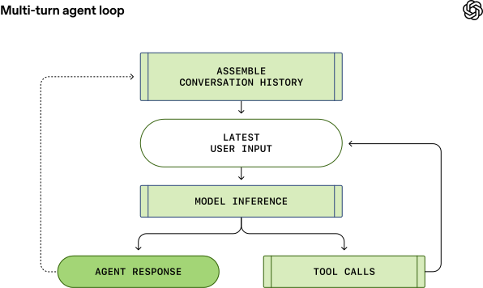
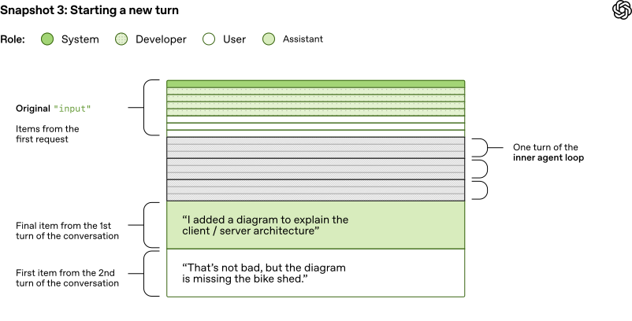

# 01_Unrolling the Codex agent loop_深入解析 Codex 智能体循环

> 英文原文：https://openai.com/index/unrolling-the-codex-agent-loop/
> 官方中文：https://openai.com/zh-Hans-CN/index/unrolling-the-codex-agent-loop/
> 作者：OpenAI｜发布日期：2026-01-23
> 版式说明：逐句中英对照——每一句（或一小段连续的）英文下面紧跟中文；译文以 OpenAI 官方中文版为基准，官方中文缺失处由本文补译并标注。关键术语首次出现时在译文中保留英文原词，便于对照记忆。

---

[Codex CLI](https://developers.openai.com/codex/cli) is our cross-platform local software agent, designed to produce high-quality, reliable software changes while operating safely and efficiently on your machine.

[Codex CLI](https://developers.openai.com/codex/cli) 是我们打造的跨平台本地软件智能体，其设计宗旨是在你的计算机上安全、高效地运行，并交付高质量、可靠的软件变更。

We've learned a tremendous amount about how to build a world-class software agent [since we first launched the CLI in April](https://openai.com/index/introducing-o3-and-o4-mini/).

[自四月首次发布该 CLI 以来](https://openai.com/zh-Hans-CN/index/introducing-o3-and-o4-mini/)，我们在构建先进软件智能体方面积累了丰富经验。

To unpack those insights, this is the first post in an ongoing series where we'll explore various aspects of how Codex works, as well as hard-earned lessons.

为分享这些收获与思考，我们推出了本系列文章。作为开篇之作，本文将深入解析 Codex 的运作机制与核心原理，并分享我们在实践中积累的经验。

(For an even more granular view on how the Codex CLI is built, check out our open source repository at [https://github.com/openai/codex](https://github.com/openai/codex). Many of the finer details of our design decisions are memorialized in GitHub issues and pull requests if you'd like to learn more.)

（如需详细了解 Codex CLI 的底层实现细节，请查看我们的开源仓库：[https://github.com/openai/codex](https://github.com/openai/codex)。我们的许多设计决策细节都记录在 GitHub 的议题和 Pull Request 中，可供深入查阅。）

To kick off, we'll focus on the _agent loop_, which is the core logic in Codex CLI that is responsible for orchestrating the interaction between the user, the model, and the tools the model invokes to perform meaningful software work.

首先，我们将聚焦于 _智能体循环_（agent loop）—— 这是 Codex CLI 的核心逻辑，负责协调用户、模型以及模型为执行任务所调用的工具三者之间的交互。

We hope this post gives you a good view into the role our agent (or "harness") plays in making use of an LLM.

希望本文能帮助你全面理解我们的智能体（或称"运行框架"，harness）在运用大语言模型（LLM）时所发挥的关键作用。

Before we dive in, a quick note on terminology: at OpenAI, "Codex" encompasses a suite of software agent offerings, including Codex CLI, Codex Cloud, and the Codex VS Code extension.

在深入之前，先简单说明一下术语：在 OpenAI，"Codex"是指一系列软件智能体产品，包括 Codex CLI、Codex Cloud 和 Codex VS Code 扩展。

This post focuses on the Codex _harness_, which provides the core agent loop and execution logic that underlies all Codex experiences and is surfaced through the Codex CLI.

本文重点探讨 Codex 的 _运行框架_（harness）。它提供了核心的智能体循环与执行逻辑，是所有 Codex 体验的基石，并通过 Codex CLI 对外提供。

For ease here, we'll use the terms "Codex" and "Codex CLI" interchangeably.

为行文简洁，下文将交替使用"Codex"与"Codex CLI"。

## The agent loop｜智能体循环

At the heart of every AI agent is something called "the agent loop." A simplified illustration of the agent loop looks like this:

对任何一个 AI 智能体来说，其核心都是一套称为"智能体循环"的运行机制。其简化示意如下图所示：

*图注：智能体循环（Agent loop）的最简形态——用户输入进入模型推理，推理结果要么是给用户的智能体响应（终止），要么是一次工具调用；工具调用的结果回流到模型推理，形成闭环。*

To start, the agent takes _input_ from the user to include in the set of textual instructions it prepares for the model known as a _prompt_.

首先，智能体接收用户 _输入_（input），并将其整合为一系列可供模型使用的文本指令，这一系列指令称为 _提示_（prompt）。

The next step is to query the model by sending it our instructions and asking it to generate a response, a process known as _inference_.

接着，智能体将指令发送给模型，并要求模型生成响应，这个过程称为 _推理_（inference）。

During inference, the textual prompt is first translated into a sequence of input [tokens](https://platform.openai.com/docs/concepts#tokens)—integers that index into the model's vocabulary.

在推理过程中，文本提示首先被转换为一串输入 [Token](https://platform.openai.com/docs/concepts#tokens) —— 这些 Token 是用于索引模型词汇表的整数值。

These tokens are then used to sample the model, producing a new sequence of output tokens.

随后，这些 Token 被用于对模型进行采样（sampling），从而生成一串新的输出 Token。

The output tokens are translated back into text, which becomes the model's response.

输出 Token 会转换回文本作为模型响应。

Because tokens are produced incrementally, this translation can happen as the model runs, which is why many LLM-based applications display streaming output.

由于 Token 是逐次生成的，转换过程可以与模型运行同步进行，因此许多大语言模型应用能实现流式输出。

In practice, inference is usually encapsulated behind an API that operates on text, abstracting away the details of tokenization.

实际应用中，推理过程通常封装在一个处理文本的 API 内部，从而对使用者隐藏了 Token 化（tokenization）的细节。

As the result of the inference step, the model either (1) produces a final response to the user's original input, or (2) requests a _tool call_ that the agent is expected to perform (e.g., "run `ls` and report the output").

推理步骤完成后，模型可能产生两种结果：(1) 生成对用户原始输入的最终响应；或 (2) 请求智能体执行一次 _工具调用_（tool call，例如，"运行 `ls` 命令并返回结果"）。

In the case of (2), the agent executes the tool call and appends its output to the original prompt.

若是情况 (2)，智能体则执行所请求的工具调用，并将工具执行的结果追加到原始提示中。

This output is used to generate a new input that's used to re-query the model; the agent can then take this new information into account and try again.

工具的输出结果将用于生成新的输入，并再次提交给模型；智能体基于这个更新后的上下文，开始新一轮推理。

This process repeats until the model stops emitting tool calls and instead produces a message for the user (referred to as an _assistant message_ in OpenAI models).

此过程循环往复，直至模型不再发起工具调用，转而生成一条面向用户的消息（在 OpenAI 模型中称为 _助手消息_，assistant message）。

In many cases, this message directly answers the user's original request, but it may also be a follow-up question for the user.

多数情况下，此消息会直接回应用户的初始请求，但也可能是一个向用户提出的追问。

Because the agent can execute tool calls that modify the local environment, its "output" is not limited to the assistant message.

由于智能体能够执行会修改本地环境的工具调用，因此其"输出"并不局限于助手消息本身。

In many cases, the primary output of a software agent is the code it writes or edits on your machine.

在许多场景下，软件智能体最主要的"输出"，其实是它在你计算机上直接编写或修改的代码。

Nevertheless, each turn always ends with an assistant message—such as "I added the `architecture.md` you asked for"—which signals a termination state in the agent loop.

然而，每一轮交互最终都会由一条助手消息来结束，例如"你要求的 `architecture.md` 文件已添加"，这标志着智能体循环达到终止状态。

From the agent's perspective, its work is complete and control returns to the user.

从智能体的视角来看，其任务已告完成，控制权也随之交还给用户。

The journey from _user input_ to _agent response_ shown in the diagram is referred to as one _turn_ of a conversation (a _thread_ in Codex).

图中所示的从 _用户输入_ 到 _智能体响应_ 的完整过程，被称为一次对话 _轮次_（turn，在 Codex 中也称为一个 _对话线程_，thread）。

Though this _conversation turn_ can include many iterations between the **model inference** and **tool calls**.

需要注意的是，一次 _对话轮次_ 可能包含**模型推理**与**工具调用**之间的多次循环迭代。

Every time you send a new message to an existing conversation, the conversation history is included as part of the prompt for the new turn, which includes the messages and tool calls from previous turns:

每当你向既有对话发送新消息时，包括之前所有轮次的消息与工具调用在内的完整对话历史，都会被纳入新轮次的提示中：

*图注：多轮（multi-turn）智能体循环——相比上一张图，新一轮开始前多了"汇总对话历史"这一步：上一轮的智能体响应会被回填进历史，与最新用户输入一起送入模型推理，因此提示会随对话轮次单调变长。*

This means that as the conversation grows, so does the length of the prompt used to sample the model.

这意味着，随着对话的推进，用于模型采样的提示也会越来越长。

This length matters because every model has a _context window_, which is the maximum number of tokens it can use for one inference call.

提示长度至关重要，因为每个模型都有一个 _上下文窗口_（context window），即其单次推理调用所能处理的最大 Token 数。

Note this window includes both input _and_ output tokens.

需要注意，此窗口的容量同时涵盖了输入 _与_ 输出 Token。

As you might imagine, an agent could decide to make hundreds of tool calls in a single turn, potentially exhausting the context window.

可以想象，智能体在单轮交互中可能发起数百次工具调用，因此存在耗尽上下文窗口的风险。

For this reason, _context window management_ is one of the agent's many responsibilities.

正因如此，_上下文窗口管理_ 便成了智能体的核心职责之一。

Now, let's dive in to see how Codex runs the agent loop.

现在，让我们深入 Codex 内部，看其如何运行智能体循环。

## Model inference｜模型推理

The Codex CLI sends HTTP requests to the [Responses API](https://platform.openai.com/docs/api-reference/responses) to run model inference.

Codex CLI 通过向 [Responses API](https://platform.openai.com/docs/api-reference/responses) 发送 HTTP 请求来执行模型推理。

We'll examine how information flows through Codex, which uses the Responses API to drive the agent loop.

接下来，我们将详细分析信息如何流经 Codex，以及它如何利用 Responses API 来驱动智能体循环。

*   [When using ChatGPT login](https://github.com/openai/codex/blob/d886a8646cb8d3671c3029d08ae8f13fa6536899/codex-rs/core/src/model_provider_info.rs#L141) with the Codex CLI, it uses `https://chatgpt.com/backend-api/codex/responses` as the endpoint

*   [通过 ChatGPT 登录](https://github.com/openai/codex/blob/d886a8646cb8d3671c3029d08ae8f13fa6536899/codex-rs/core/src/model_provider_info.rs#L141)使用 Codex CLI 时，会使用 `https://chatgpt.com/backend-api/codex/responses` 作为端点

*   [When using API-key authentication](https://github.com/openai/codex/blob/d886a8646cb8d3671c3029d08ae8f13fa6536899/codex-rs/core/src/model_provider_info.rs#L143) with OpenAI hosted models, it uses `https://api.openai.com/v1/responses` as the endpoint

*   [使用 API 密钥对 OpenAI 托管模型进行身份验证](https://github.com/openai/codex/blob/d886a8646cb8d3671c3029d08ae8f13fa6536899/codex-rs/core/src/model_provider_info.rs#L143)时，会使用 `https://api.openai.com/v1/responses` 作为端点

*   When running Codex CLI with `--oss` to use [gpt-oss](https://openai.com/index/introducing-gpt-oss/) with [ollama 0.13.4+](https://github.com/openai/codex/pull/8798) or [LM Studio 0.3.39+](https://lmstudio.ai/blog/openresponses), it defaults to `http://localhost:11434/v1/responses` running locally on your computer

*   使用 `--oss` 参数运行 Codex CLI 以配合 [gpt-oss](https://openai.com/zh-Hans-CN/index/introducing-gpt-oss/)（并与 [ollama 0.13.4+](https://github.com/openai/codex/pull/8798) 或 [LM Studio 0.3.39+](https://lmstudio.ai/blog/openresponses) 一同使用）时，默认端点为本地运行的 `http://localhost:11434/v1/responses`

*   Codex CLI can be used with the Responses API hosted by a cloud provider such as Azure

*   Codex CLI 也可与 Azure 等云服务商托管的 Responses API 协同运行

Let's explore how Codex creates the prompt for the first inference call in a conversation.

接下来，我们探讨 Codex 如何为对话中的第一次推理调用创建提示。

### Building the initial prompt｜构建初始提示

As an end user, you don't specify the prompt used to sample the model verbatim when you query the Responses API.

作为最终用户，你在查询 Responses API 时，并不需要逐字输入用于对模型进行采样的提示。

Instead, you specify various input types as part of your query, and the Responses API server decides how to structure this information into a prompt that the model is designed to consume.

取而代之的是，你只需在查询中指定各类输入，Responses API 服务器会负责将这些信息组织成模型可接受的提示结构。

You can think of the prompt as a "list of items"; this section will explain how your query gets transformed into that list.

你可以将提示理解为一个"项目列表"（list of items）；本节将阐述你的查询如何被转换为此列表。

In the initial prompt, every item in the list is associated with a role.

在初始提示中，列表内的每个项目都关联一个角色（role）。

The `role` indicates how much weight the associated content should have and is one of the following values (in decreasing order of priority): `system`, `developer`, `user`, `assistant`.

`role` 决定了其关联内容的权重优先级，取值如下（按优先级降序排列）：`system`、`developer`、`user`、`assistant`。

*   [`instructions`](https://platform.openai.com/docs/api-reference/responses/create#responses_create-instructions): system (or developer) message inserted into the model's context

*   [`instructions`](https://platform.openai.com/docs/api-reference/responses/create#responses_create-instructions)：插入到模型上下文中的系统（或开发者）消息

*   [`tools`](https://platform.openai.com/docs/api-reference/responses/create#responses_create-tools): a list of tools the model may call while generating a response

*   [`tools`](https://platform.openai.com/docs/api-reference/responses/create#responses_create-tools)：模型在生成响应时可能调用的工具列表

*   [`input`](https://platform.openai.com/docs/api-reference/responses/create#responses_create-input): a list of text, image, or file inputs to the model

*   [`input`](https://platform.openai.com/docs/api-reference/responses/create#responses_create-input)：提供给模型的文本、图像或文件输入列表

The `tools` field is a list of tool definitions that conform to a schema defined by the Responses API. For Codex, this includes tools that are provided by the Codex CLI, tools that are provided by the Responses API that should be made available to Codex, as well as tools provided by the user, usually via MCP servers:

`tools` 字段是一个工具定义列表，需符合 Responses API 定义的 schema。对 Codex 而言，这一列表通常包含：Codex CLI 内置工具、通过 Responses API 向 Codex 开放的工具，以及用户（通常通过 MCP 服务器）提供的工具：

最后，JSON 负载中的 `input` 字段本身也是一个项目列表。在添加用户消息之前，Codex 会先[将以下项目插入](https://github.com/openai/codex/blob/99f47d6e9a3546c14c43af99c7a58fa6bd130548/codex-rs/core/src/codex.rs#L1387-L1415) `input`：（译注：本段英文原文抓取版此处缺失，仅存官方中文，故保留中文单侧）

1. A message with `role=developer` that describes the sandbox that _applies only to the Codex-provided_ `shell` _tool_ defined in the `tools` section. That is, other tools, such as those provided from MCP servers, are not sandboxed by Codex and are responsible for enforcing their own guardrails.

1. 一条 `role=developer` 的消息，用于描述沙盒权限。此沙盒 _仅适用于在_ `tools` 部分定义的、由 Codex 提供的 `shell` _工具_。也就是说，其他工具（例如来自 MCP 服务器的工具）不受 Codex 沙盒限制，需自行负责执行其防护措施。

2. (Optional) A message with `role=developer` whose contents are the `developer_instructions` value read from the user's `config.toml` file.

2. （可选）一条 `role=developer` 的消息，其内容是从用户 `config.toml` 文件中读取的 `developer_instructions` 值。

3. (Optional) A message with `role=user` whose contents are the "user instructions," which are not sourced from a single file but are [aggregated across multiple sources](https://github.com/openai/codex/blob/99f47d6e9a3546c14c43af99c7a58fa6bd130548/codex-rs/core/src/project_doc.rs#L37-L42). In general, more specific instructions appear later:

3. （可选）一条 `role=user` 的消息，其内容为"用户指令"，这些指令并非源自单一文件，而是[从多个来源聚合而来](https://github.com/openai/codex/blob/99f47d6e9a3546c14c43af99c7a58fa6bd130548/codex-rs/core/src/project_doc.rs#L37-L42)。通常，更具体的指令会出现在更靠后的位置：

*   Contents of `AGENTS.override.md` and `AGENTS.md` in `$CODEX_HOME`

*   `$CODEX_HOME` 目录中 `AGENTS.override.md` 和 `AGENTS.md` 的内容

*   Subject to a limit (32 KiB, by default), look in each folder from the Git/project root of the `cwd` (if it it exists) up to the `cwd` itself: add the contents of any of `AGENTS.override.md`, `AGENTS.md`, or any filename specified by `project_doc_fallback_filenames in config.toml`

*   受大小限制（默认 32 KiB），从 `cwd` 的 Git/项目根目录（如果存在）开始，向上逐级检查每个目录，直至 `cwd` 本身：添加 `AGENTS.override.md`、`AGENTS.md`、或 config.toml 中由 `project_doc_fallback_filenames` 指定的任何文件的内容

*   If any [skills](https://developers.openai.com/codex/skills/) have been configured:

*   如果已配置任何[技能](https://developers.openai.com/codex/skills/)：

Once Codex has done all of the above computation to initialize the `input`, it appends the user message to start the conversation.

当 Codex 根据前述计算对 `input` 进行初始化后，就会将用户消息追加进去，从而开始一轮新的对话。

The previous examples focused on the content of each message, but note that each element of `input` is a JSON object with `type`, [`role`](https://www.reddit.com/r/OpenAI/comments/1hgxcgi/what_is_the_purpose_of_the_new_developer_role_in/), and `content` as follows:

前面的示例侧重于每条消息的内容，但请注意，`input` 中的每个元素都是一个 JSON 对象，包含 `type`、[`role`](https://www.reddit.com/r/OpenAI/comments/1hgxcgi/what_is_the_purpose_of_the_new_developer_role_in/) 和 `content` 字段，如下所示：

Once Codex builds up the full JSON payload to send to the Responses API, it then makes the HTTP POST request with an `Authorization` header depending on how the Responses API endpoint is configured in `~/.codex/config.toml` (additional HTTP headers and query parameters are added if specified).

当 Codex 构建好要发送给 Responses API 的完整 JSON 负载后，它会根据 `~/.codex/config.toml` 中 Responses API 端点的配置，发起一个带有 `Authorization` 标头的 HTTP POST 请求（如果指定了额外的 HTTP 头和查询参数，也会一并添加）。

When an OpenAI Responses API server receives the request, it uses the JSON to derive the prompt for the model as follows (to be sure, a custom implementation of the Responses API could make a different choice):

当 OpenAI 的 Responses API 服务器收到请求时，它会使用 JSON 为模型推导出提示，如下所示（当然，Responses API 的自定义实现可能做出不同选择）：

*图注：Snapshot 1「构建初始提示」——提示开头三项（system 消息、由 `tools` 推导的工具定义、由 `instructions` 推导的指令）顺序由服务器决定；其后是来自 `input` 的项目，顺序由客户端控制，依次为 Codex 在 `build_initial_context()` 中生成的 `<permissions instructions>`、`developer_instructions`、`AGENTS.md`、`<environment_context>`，最后才是用户消息。颜色区分 system / developer / user 三种角色。*

As you can see, the order of the first three items in the prompt is determined by the server, not the client.

如你所见，提示中前三个项目的顺序由服务器决定，而非客户端。

That said, of those three items, only the content of the _system message_ is also controlled by the server, as the `tools` and `instructions` are determined by the client.

也就是说，在这三个项目中，只有 _system message_ 的内容也由服务器控制，因为 `tools` 和 `instructions` 由客户端决定。

These are followed by the `input` from the JSON payload to complete the prompt.

之后，来自 JSON 负载的 `input` 会紧随其后，从而完成整个提示的构建。

Now that we have our prompt, we are ready to sample the model.

现在，我们已准备好提示，可以对模型进行采样。

### The first turn｜第一轮对话

This HTTP request to the Responses API initiates the first "turn" of a conversation in Codex.

这次对 Responses API 的 HTTP 请求开启了 Codex 中的第一轮对话。

The server replies with a Server-Sent Events ([SSE](https://en.wikipedia.org/wiki/Server-sent_events)) stream.

服务器回复一个服务器发送事件（[SSE](https://en.wikipedia.org/wiki/Server-sent_events)）流。

The `data` of each event is a JSON payload with a `"type"` that starts with `"response"`, which could be something like this (a full list of events can be found in our [API docs](https://platform.openai.com/docs/api-reference/responses-streaming)):

每个事件的 `data` 是一个 JSON 负载，其 `"type"` 字段以 `"response"` 开头，可能类似以下示例（完整事件列表请参阅我们的 [API 文档](https://platform.openai.com/docs/api-reference/responses-streaming)）：

Codex [consumes the stream of events](https://github.com/openai/codex/blob/2a68b74b9bf16b64e285495c1b149d7d6ac8bdf4/codex-rs/codex-api/src/sse/responses.rs#L334-L342) and republishes them as internal event objects that can be used by a client.

Codex 会[处理事件流](https://github.com/openai/codex/blob/2a68b74b9bf16b64e285495c1b149d7d6ac8bdf4/codex-rs/codex-api/src/sse/responses.rs#L334-L342)，并将其重新发布为可供客户端使用的内部事件对象。

Events like `response.output_text.delta` are used to support streaming in the UI, whereas other events like `response.output_item.added` are transformed into objects that are appended to the `input` for subsequent Responses API calls.

像 `response.output_text.delta` 这样的事件用于支持 UI 中的流式输出，而像 `response.output_item.added` 这样的事件则被转换为对象，并追加到 `input` 中，供后续的 Responses API 调用使用。

Suppose the first request to the Responses API includes two `response.output_item.done` events: one with `type=reasoning` and one with `type=function_call`.

假设对 Responses API 的第一次请求包含两个 `response.output_item.done` 事件：一个 `type=reasoning`，另一个 `type=function_call`。

These events must be represented in the `input` field of the JSON when we query the model again with the response to the tool call:

当我们带着工具调用的响应再次查询模型时，这些事件必须体现在 JSON 的 `input` 字段中：

The resulting prompt used to sample the model as part of the subsequent query would look like this:

那么，用于在后续查询中对模型进行采样的提示将如下所示：

*图注：Snapshot 2「回传工具调用结果」——第一次请求的全部项目原封不动地留在前面（Original `input`），第二次调用只在末尾追加三项新内容：`reasoning`、`function_call` 与 `function_call_output`。这正是"旧提示是新提示的精确前缀"的直观呈现，也是提示缓存能命中的前提。*

In particular, note how the old prompt _is an exact prefix_ of the new prompt.

需要特别注意的是，旧提示是新提示的 _精确前缀_（exact prefix）。

This is intentional, as this makes subsequent requests much more efficient because it enables us to take advantage of _prompt caching_ (which we'll discuss in the next section on performance).

这是有意为之的，因为这样可以显著提升后续请求的效率，让我们得以充分利用 _提示缓存_（prompt caching，详见下一节"性能"部分）。

Looking back at our first diagram of the agent loop, we see that there could be many iterations between inference and tool calling. The prompt may continue to grow until we finally receive an assistant message, indicating the end of the turn:

回顾智能体循环的第一张示意图，我们可以看到推理和工具调用之间可能发生多次迭代。提示可能会持续增长，直到我们最终收到一条助手消息，标志该轮对话结束：

In the Codex CLI, we present the assistant message to the user and focus the composer to indicate to the user that it's their "turn" to continue the conversation.

在 Codex CLI 中，我们会向用户展示助手消息，并自动聚焦输入框，提示用户该轮到自己继续输入、推进对话了。

If the user responds, both the assistant message from the previous turn, as well as the user's new message, must be appended to the `input` in the Responses API request to start the new turn:

如果用户做出回应，则上一轮的助手消息和用户的新消息都必须追加到 Responses API 请求的 `input` 中，以开始新一轮对话：

*图注：Snapshot 3「开启新一轮」——第一次请求的原始项目之上，叠着内层智能体循环若干次"推理↔工具调用"迭代产生的条目；再往下是第一轮的收尾项（助手消息"我加了一张图来说明客户端/服务端架构"），最后是第二轮的首项（用户的新消息）。至此角色多了一种 assistant。*

Once again, because we are continuing a conversation, the length of the `input` we send to the Responses API keeps increasing:

再次强调，随着对话不断推进，我们发送给 Responses API 的 `input` 长度会不断增加：

Let's examine what this ever-growing prompt means for performance.

接下来，我们分析这个不断增长的提示会对性能产生什么样的影响。

### Performance considerations｜性能考量

You might be asking yourself, "Wait, isn't the agent loop _quadratic_ in terms of the amount of JSON sent to the Responses API over the course of the conversation?"

不少读者这时可能会想到："如果把整段对话都算上，发送到 Responses API 的 JSON 总量是不是呈 _二次增长_（quadratic）？"

And you would be right.

这种直觉是正确的。

While the Responses API does support an optional [`previous_response_id`](https://platform.openai.com/docs/api-reference/responses/create#responses_create-previous_response_id) parameter to mitigate this issue, Codex does not use it today, primarily to keep requests fully stateless and to support Zero Data Retention (ZDR) configurations.

尽管 Responses API 确实支持一个可选的 [`previous_response_id`](https://platform.openai.com/docs/api-reference/responses/create#responses_create-previous_response_id) 参数来缓解此问题，但 Codex 目前并未使用它，主要是为了保持请求完全无状态，并支持零数据保留（Zero Data Retention，ZDR）配置。

Avoiding `previous_response_id` simplifies things for the provider of the Responses API because it ensures that every request is _stateless_.

选择不使用 `previous_response_id`，可以让 Responses API 提供方的实现更简单，因为每个请求都将保持 _无状态_（stateless）。

This also makes it straightforward to support customers who have opted into [Zero Data Retention (ZDR)](https://platform.openai.com/docs/guides/migrate-to-responses#4-decide-when-to-use-statefulness), as storing the data required to support `previous_response_id` would be at odds with ZDR.

对选择启用[零数据保留（ZDR）](https://platform.openai.com/docs/guides/migrate-to-responses#4-decide-when-to-use-statefulness)的客户而言，这也让支持流程更简单明晰，因为只要依赖 `previous_response_id`，就需要存储相应数据，而这与 ZDR 的原则相违背。

Note that ZDR customers do not sacrifice the ability to benefit from proprietary reasoning messages from prior turns, as the associated `encrypted_content` can be decrypted on the server.

请注意，ZDR 客户不会牺牲从先前轮次专有推理消息中获益的能力，因为相关的 `encrypted_content` 可以在服务器上解密。

(OpenAI persists a ZDR customer's decryption key, but not their data.)

（OpenAI 会保存 ZDR 客户的解密密钥，但不会保存他们的数据。）

See PRs [#642](https://github.com/openai/codex/pull/642) and [#1641](https://github.com/openai/codex/pull/1641) for the related changes to Codex to support ZDR.

有关支持 ZDR 的 Codex 相关更改，请参见 PR [#642](https://github.com/openai/codex/pull/642) 和 [#1641](https://github.com/openai/codex/pull/1641)。

Generally, the cost of sampling the model dominates the cost of network traffic, making sampling the primary target of our efficiency efforts.

通常，模型采样的成本远高于网络流量成本，因此采样成为我们提升效率的主要目标。

This is why prompt caching is so important, as it enables us to reuse computation from a previous inference call.

正因如此，提示缓存才至关重要，它使我们能够重用先前推理调用中的计算。

When we get cache hits, _sampling the model is linear rather than quadratic_.

一旦命中缓存，_模型采样的开销就会从二次复杂度降为线性复杂度_。

Our [prompt caching](https://platform.openai.com/docs/guides/prompt-caching#structuring-prompts) documentation explains this in more detail:

我们的[提示缓存](https://platform.openai.com/docs/guides/prompt-caching#structuring-prompts)文档有更详细的说明：

_Cache hits are only possible for exact prefix matches within a prompt._

_缓存命中仅在提示内部存在精确的前缀匹配时才可能发生。_

_To realize caching benefits, place static content like instructions and examples at the beginning of your prompt, and put variable content, such as user-specific information, at the end._

_为实现缓存优势，请将指令和示例等静态内容置于提示开头，而将用户特定信息等可变内容置于提示末尾。_

_This also applies to images and tools, which must be identical between requests._

_这也适用于图像和工具，它们在各次请求间必须完全相同。_

With this in mind, let's consider what types of operations could cause a "cache miss" in Codex:

考虑到这一点，让我们看看哪些类型的操作可能导致 Codex 发生"缓存未命中"（cache miss）：

*   Changing the `tools` available to the model in the middle of the conversation.

*   在对话中途更改模型可用的 `tools`。

*   Changing the `model` that is the target of the Responses API request (in practice, this changes the third item in the original prompt, as it contains model-specific instructions).

*   更改作为 Responses API 请求目标的 `model`（实际上，这会更改原始提示中的第三项，因为该项包含模型特定的指令）。

*   Changing the sandbox configuration, approval mode, or current working directory.

*   更改沙盒配置、审批模式或当前工作目录。

The Codex team must be diligent when introducing new features in the Codex CLI that could compromise prompt caching.

Codex 团队在为 Codex CLI 引入可能损害提示缓存的新功能时，必须格外谨慎。（译注：官方中文版此处缺失，本句为补译）

As an example, our initial support for MCP tools introduced a [bug where we failed to enumerate the tools in a consistent order](https://github.com/openai/codex/pull/2611), causing cache misses.

举个例子，我们最初对 MCP 工具的支持就引入了一个 [bug：工具的枚举顺序无法保持一致](https://github.com/openai/codex/pull/2611)，从而导致缓存未命中。（译注：官方中文版此处缺失，本句为补译）

Note that MCP tools can be particularly tricky because MCP servers can change the list of tools they provide on the fly via a [`notifications/tools/list_changed`](https://modelcontextprotocol.io/specification/2025-11-25/server/tools#list-changed-notification) notification.

需要注意的是，MCP 工具尤其棘手，因为 MCP 服务器可以通过 [`notifications/tools/list_changed`](https://modelcontextprotocol.io/specification/2025-11-25/server/tools#list-changed-notification) 通知，在运行过程中动态改变自己提供的工具列表。（译注：官方中文版此处缺失，本句为补译）

Honoring this notification in the middle of a long conversation can cause an expensive cache miss.

在一段长对话进行到中途时响应这类通知，会带来代价高昂的缓存未命中。（译注：官方中文版此处缺失，本句为补译）

When possible, we handle configuration changes that happen mid-conversation by appending a _new_ message to `input` to reflect the change rather than modifying an earlier message:

在可能的情况下，我们通过向 `input` 追加一条 _新_ 消息（而非修改之前的消息）来处理对话中发生的配置更改：

*   If the sandbox configuration or approval mode changes, we [insert](https://github.com/openai/codex/blob/99f47d6e9a3546c14c43af99c7a58fa6bd130548/codex-rs/core/src/codex.rs#L1037-L1057) a new `role=developer` message with the same format as the original `<permissions instructions>` item.

*   如果沙盒配置或审批模式发生变化，我们[插入](https://github.com/openai/codex/blob/99f47d6e9a3546c14c43af99c7a58fa6bd130548/codex-rs/core/src/codex.rs#L1037-L1057)一条新的 `role=developer` 消息，其格式与原始的 `<permissions instructions>` 项目相同。

*   If the current working directory changes, we [insert](https://github.com/openai/codex/blob/99f47d6e9a3546c14c43af99c7a58fa6bd130548/codex-rs/core/src/codex.rs#L1017-L1035) a new `role=user` message with the same format as the original `<environment_context>`.

*   如果当前工作目录发生变化，我们[插入](https://github.com/openai/codex/blob/99f47d6e9a3546c14c43af99c7a58fa6bd130548/codex-rs/core/src/codex.rs#L1017-L1035)一条新的 `role=user` 消息，其格式与原始的 `<environment_context>` 相同。

We go to great lengths to ensure cache hits for performance.

我们竭尽全力确保缓存命中以提升性能。

There's another key resource we have to manage: the context window.

我们还需管理另一个关键资源：上下文窗口。

Our general strategy to avoid running out of context window is to _compact_ the conversation once the number of tokens exceeds some threshold.

为避免耗尽上下文窗口，我们采用的通用策略是：当 Token 总数超过设定阈值时，就对当前对话进行 _压缩_（compact）。

Specifically, we replace the `input` with a new, smaller list of items that is representative of the conversation, enabling the agent to continue with an understanding of what has happened thus far.

具体来说，我们用一个新的、更小的项目列表替换 `input`，该列表代表了对话内容，使智能体能够在理解已发生情况的基础上继续工作。

An early [implementation of compaction](https://github.com/openai/codex/pull/1527) required the user to manually invoke the `/compact` command, which would query the Responses API using the existing conversation plus custom instructions for [summarization](https://github.com/openai/codex/blob/e2c994e32a31415e87070bef28ed698968d2e549/SUMMARY.md).

早期的[压缩实现](https://github.com/openai/codex/pull/1527)要求用户手动调用 `/compact` 命令，该命令会使用现有对话加上用于[摘要](https://github.com/openai/codex/blob/e2c994e32a31415e87070bef28ed698968d2e549/SUMMARY.md)的自定义指令来查询 Responses API。

Codex used the resulting assistant message containing the summary [as the new `input`](https://github.com/openai/codex/blob/e2c994e32a31415e87070bef28ed698968d2e549/codex-rs/core/src/codex.rs#L1424) for subsequent conversation turns.

Codex 将包含摘要的助手消息结果[用作新的 `input`](https://github.com/openai/codex/blob/e2c994e32a31415e87070bef28ed698968d2e549/codex-rs/core/src/codex.rs#L1424)，用于后续对话轮次。

Since then, the Responses API has evolved to support a special [`/responses/compact` endpoint](https://platform.openai.com/docs/guides/conversation-state#compaction-advanced) that performs compaction more efficiently.

此后，Responses API 不断演进，现已支持一个专用的 [`/responses/compact` 端点](https://platform.openai.com/docs/guides/conversation-state#compaction-advanced)，能更高效地完成压缩。（译注：官方中文版此处缺失，本句为补译）

It returns [a list of items](https://platform.openai.com/docs/api-reference/responses/compacted-object) that can be used in place of the previous `input` to continue the conversation while freeing up the context window.

它会返回[一个项目列表](https://platform.openai.com/docs/api-reference/responses/compacted-object)，可用于替换原有的 `input`，在释放上下文窗口的同时让对话得以继续。（译注：官方中文版此处缺失，本句为补译）

This list includes a special `type=compaction` item with an opaque `encrypted_content` item that preserves the model's latent understanding of the original conversation.

该列表中包含一个特殊的 `type=compaction` 项目，其中带有一个不透明的 `encrypted_content` 项，用于保留模型对原始对话的潜在理解（latent understanding）。（译注：官方中文版此处缺失，本句为补译）

Now, Codex automatically uses this endpoint to compact the conversation when the [`auto_compact_limit`](https://github.com/openai/codex/blob/99f47d6e9a3546c14c43af99c7a58fa6bd130548/codex-rs/core/src/codex.rs#L2558-L2560) is exceeded.

如今，一旦超过 [`auto_compact_limit`](https://github.com/openai/codex/blob/99f47d6e9a3546c14c43af99c7a58fa6bd130548/codex-rs/core/src/codex.rs#L2558-L2560)，Codex 就会自动调用该端点对对话进行压缩。（译注：官方中文版此处缺失，本句为补译）

## Coming next｜下期预告

We've introduced the Codex agent loop and walked through how Codex crafts and manages its context when querying a model.

我们已经介绍了 Codex 智能体循环，并逐步讲解了 Codex 在查询模型时如何构建和管理其上下文。

Along the way, we highlighted practical considerations and best practices that apply to anyone building an agent loop on top of the Responses API.

在此过程中，我们强调了在 Responses API 之上构建智能体循环时的实用考量和最佳实践。

While the agent loop provides the foundation for Codex, it's only the beginning.

虽然智能体循环为 Codex 奠定了基础，但这仅仅是个开始。

In upcoming posts, we'll dig into the CLI's architecture, explore how tool use is implemented, and take a closer look at Codex's sandboxing model.

在接下来的文章中，我们将深入探讨 CLI 的架构、研究工具使用的实现方式，并仔细审视 Codex 的沙盒模型。
