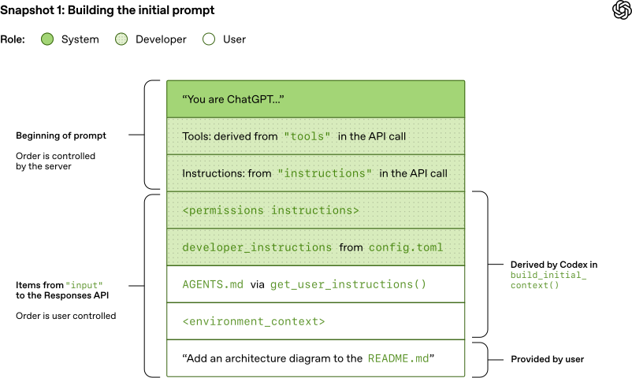
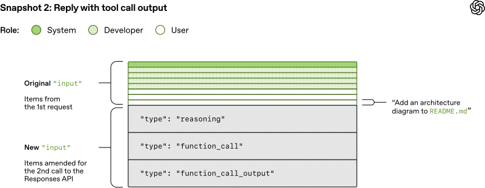

# 01_深入解析 Codex 智能体循环_面试速记

> OpenAI · 2026-01-23 · 系列开篇
> [英文原文](https://openai.com/index/unrolling-the-codex-agent-loop/) · [官方中文](https://openai.com/zh-Hans-CN/index/unrolling-the-codex-agent-loop/) · [本地逐句对照](01_Unrolling%20the%20Codex%20agent%20loop_深入解析%20Codex%20智能体循环_逐句对照.md)

## 一句话讲明白

**这篇把 Codex CLI 的智能体循环（agent loop）从头拆开给你看：用户输入 → 拼提示 → 推理 → 要么给最终答复、要么发起工具调用 → 把工具输出追加回提示 → 再推理，直到吐出一条助手消息（assistant message）为止；而这个循环真正的工程难点不在"怎么转"，在于提示会随对话单调变长，于是整段对话的数据量是二次增长的——救命的两根柱子是提示缓存（prompt caching）和上下文压缩（compaction）：前者要求新提示必须是旧提示的精确前缀，后者在 Token 超阈值时用一个更小的项目列表把 `input` 整体换掉。**

## 为什么值得读 / 能用在哪

- 这是**极少见的、由模型厂商自己把自家编码智能体的循环逐层剖开**的文章，配着开源仓库 `openai/codex` 的具体代码行和 PR 编号，可信度高、细节硬。
- 面试里它覆盖三个高频考点：智能体循环的标准形状、Responses API 的心智模型、以及"长对话怎么不烧钱不爆窗口"。
- 落到自己项目：只要你在做多轮工具调用的智能体，文中"**追加新消息而不是修改旧消息**"这一条可以立刻抄进代码——它是保住缓存命中率最便宜的规矩。
- 反向价值也大：它明确点名了几种**会把缓存打穿**的操作，其中两条直接和 MCP 有关，正好是很多人自己踩过的坑。

## 核心要点

### 1. 智能体循环长什么样：一轮（turn）的完整解剖

*图注：循环的最简形态——用户输入 → 模型推理 → 岔成两条出口：给用户的智能体响应（终止）或工具调用；工具调用结果回流到推理，直到出现助手消息才算一轮结束。自测第一条"能不看稿画出循环"对着这张图默画即可。*

- **输入 → 提示**：智能体拿到用户输入（input），把它整合进一组文本指令，这组指令就叫提示（prompt）。
- **推理（inference）**：提示先被切成一串输入 Token（索引模型词表的整数），拿去对模型采样（sampling），产出输出 Token，再转回文本。因为 Token 是逐个产生的，转换可以边跑边做——这就是流式输出的由来。实际中推理被封装在一个处理文本的 API 后面，Token 化（tokenization）细节对使用者不可见。
- **两种出口**：模型要么 (1) 给出最终响应，要么 (2) 请求一次工具调用（tool call，例如"运行 `ls` 并报告输出"）。
- 走 (2) 的话，智能体执行工具、**把输出追加到原提示上**，生成新输入再问一次模型。如此往复，**直到模型不再发起工具调用、改为产出一条助手消息**——这条消息标志着循环进入终止状态，控制权交还用户。
- 注意一个反直觉点：**软件智能体最主要的"输出"往往不是那条助手消息，而是它在你机器上写下或改掉的代码。** 但每一轮仍然必须以助手消息收尾（"你要的 `architecture.md` 已添加"）。
- 从用户输入到智能体响应叫一**轮**（turn，Codex 里也叫一个对话线程 thread）；**一轮内部可以有多次"推理 ↔ 工具调用"的迭代**。
- 每次你在既有对话里发新消息，**之前所有轮次的消息和工具调用都会被完整带进新一轮的提示**。于是提示越来越长——而每个模型都有上下文窗口（context window），即单次推理能用的最大 Token 数，**输入和输出共用这一个额度**。
- 一次轮次里智能体可能发起**数百次工具调用**，足以耗尽窗口。所以**上下文窗口管理是智能体的核心职责之一**。

### 2. Responses API 的心智模型：把提示当成"项目列表"

这是全文最该背下来的一句抽象：**你不是逐字写提示，你是在提交一个"项目列表"（list of items），由 Responses API 服务器决定怎么把它组织成模型能吃的提示。**

- 初始提示里**每个项目都带一个角色（role）**，`role` 决定内容的权重优先级，**降序排列**是：`system` > `developer` > `user` > `assistant`。
- 客户端能填的三个字段：
  - `instructions`：插进模型上下文的系统（或开发者）消息；
  - `tools`：模型可调用的工具定义列表，需符合 Responses API 规定的结构；对 Codex 来说包含 CLI 内置工具、Responses API 侧开放的工具、以及用户经 MCP 服务器提供的工具；
  - `input`：给模型的文本、图像或文件输入列表——**它本身也是一个项目列表**。
- **Codex 在追加用户消息之前，会先往 `input` 里塞这几项**（顺序即优先级由低到高的具体化）：
  1. 一条 `role=developer` 消息描述沙盒权限。**关键限定：该沙盒只管 `tools` 里 Codex 自带的 `shell` 工具**；MCP 服务器提供的工具**不受 Codex 沙盒约束，得自己负责防护**。这一条面试常被追问安全边界，务必记住。
  2. （可选）一条 `role=developer` 消息，内容是 `config.toml` 里读到的 `developer_instructions`。
  3. （可选）一条 `role=user` 消息，即"用户指令"，**不来自单一文件，而是多来源聚合**，且**越具体的指令排得越靠后**：先是 `$CODEX_HOME` 下的 `AGENTS.override.md` 和 `AGENTS.md`；再在**默认 32 KiB 上限**内，从 `cwd` 所在的 Git／项目根目录逐级向下走到 `cwd` 本身，收集各层的 `AGENTS.override.md`、`AGENTS.md` 或 `config.toml` 中 `project_doc_fallback_filenames` 指定的文件；若配置了技能（skills），也在此并入。
- 做完这些初始化，**才把用户消息追加进去**开始对话。`input` 的每个元素都是带 `type`、`role`、`content` 的 JSON 对象。
- 拼好完整 JSON 负载后，Codex 按 `~/.codex/config.toml` 的配置发起带 `Authorization` 标头的 HTTP POST。
- **服务器侧的分工要记清**：提示中**前三项的顺序由服务器决定，不是客户端**；这三项里**只有系统消息的内容也归服务器管**，`tools` 和 `instructions` 的内容仍由客户端决定。随后 `input` 接在后面，提示构建完成。

*图注：初始提示自上而下的完整排布——前三项（system 消息、`tools`、`instructions`）顺序由服务器决定，其后 `input` 部分顺序由客户端控制：`<permissions instructions>`、`developer_instructions`、`AGENTS.md`、`<environment_context>`，最后才是用户消息。绿色深浅对应 system / developer / user 三种角色。对着这张图复述本节，自测第 2、3 条一次过。*

- 端点有四种形态：ChatGPT 登录走 `https://chatgpt.com/backend-api/codex/responses`；API 密钥走 `https://api.openai.com/v1/responses`；带 `--oss` 参数配 `gpt-oss` 加 ollama 0.13.4+ 或 LM Studio 0.3.39+ 时默认打本地的 `http://localhost:11434/v1/responses`；也可以接 Azure 等云服务商托管的 Responses API。

### 3. 一轮怎么跑完：流式事件与"精确前缀"

- 服务器回的是**服务器发送事件（Server-Sent Events, SSE）流**，每个事件的 `data` 是一个 JSON 负载，`"type"` 以 `"response"` 开头。
- Codex 消费这个流，把它重新发布成客户端可用的内部事件对象。分工是：
  - `response.output_text.delta` 这类事件**喂界面做流式显示**；
  - `response.output_item.added` 这类事件**被转成对象追加进 `input`**，供后续 Responses API 调用使用。
- 举例：第一次请求返回两个 `response.output_item.done`，一个 `type=reasoning`、一个 `type=function_call`。带着工具调用结果再问模型时，**这两项必须原样体现在新的 `input` 里**。
- **于是出现全文的核心工程约束：旧提示是新提示的_精确前缀_（exact prefix）。这是刻意设计的**，目的就是吃到提示缓存。
- 用户接着回话时，上一轮的助手消息 + 用户新消息一起追加进 `input`，开启新一轮。`input` 长度持续增长。

*图注："精确前缀"这件事一张图说清：第一次请求的全部项目原样留在上半部分不动，第二次调用只在末尾追加 `reasoning`、`function_call`、`function_call_output` 三项。只要动了上半部分的任何一项，前缀就断了，整段缓存作废——这正是"能追加就绝不修改"规矩的由来。*

### 4. 提示缓存：为什么关键，以及什么会打穿它

**先记住这个量级判断**：整段对话发往 Responses API 的 JSON 总量确实是**二次增长（quadratic）**的。Responses API 有个可选的 `previous_response_id` 参数能缓解，**但 Codex 今天不用它**——原因有两个：保持请求**完全无状态（stateless）**，以及支持**零数据保留（Zero Data Retention, ZDR）**配置；要支持 `previous_response_id` 就得存数据，和 ZDR 的原则相冲突。

> 补一个容易被追问的细节：**ZDR 客户并不会因此损失前几轮专有推理消息带来的收益**，因为相关的 `encrypted_content` 可以在服务器上解密——OpenAI 保存 ZDR 客户的解密密钥，但不保存他们的数据。相关改动见 PR `#642` 和 `#1641`。

**为什么缓存是重点**：**模型采样的成本远高于网络流量成本**，所以优化的靶子是采样而不是传输。提示缓存让我们复用上一次推理的计算——**一旦命中缓存，模型采样的开销就从二次复杂度降为线性复杂度**。这一句是本节的最高价值结论。

官方缓存文档的三条规矩：

1. **缓存命中只在提示内部存在精确前缀匹配时才可能发生**；
2. 把指令、示例这类**静态内容放在提示开头**，把用户特定信息这类**可变内容放在末尾**；
3. **这条同样适用于图像和工具——它们在各次请求之间必须完全相同。**

**会导致缓存未命中（cache miss）的操作**（面试直接背这三条）：

- 在对话中途**更改模型可用的 `tools`**；
- **更改请求目标 `model`**——实际影响的是原始提示里的第三项，因为那一项含有模型特定的指令；
- **更改沙盒配置、审批模式或当前工作目录**。

**两个和 MCP 直接相关的真实教训**：

- Codex 最初支持 MCP 工具时引入过一个 bug：**工具枚举顺序无法保持一致**，直接造成缓存未命中（修复见 PR `#2611`）。工具集合没变、只是顺序抖动，就足以打穿前缀匹配——这个例子非常好用。
- **MCP 服务器可以通过 `notifications/tools/list_changed` 通知在运行中动态改变自己提供的工具列表。** 在一段长对话进行到中途去响应这类通知，会带来**代价高昂的缓存未命中**。所以 MCP 工具"尤其棘手"。

**Codex 的应对规矩，一句话**：**能追加就不要修改。** 对话中途发生的配置变更，尽量通过往 `input` **追加一条新消息**来反映，而不是回头改早先的消息——

- 沙盒配置或审批模式变了 → 插入一条新的 `role=developer` 消息，格式与最初那条 `<permissions instructions>` 相同；
- 当前工作目录变了 → 插入一条新的 `role=user` 消息，格式与最初那条 `<environment_context>` 相同。

原文的态度很直白：**为了性能，团队"竭尽全力"确保缓存命中；引入任何可能损害提示缓存的新功能时都必须格外谨慎。**

### 5. 上下文压缩：从手动 `/compact` 到 `/responses/compact` 端点

总策略一句话：**当 Token 总数超过设定阈值，就压缩（compact）当前对话——用一个新的、更小的、能代表整段对话的项目列表把 `input` 整个换掉**，让智能体带着"已经发生了什么"的理解继续干活。

**第一代（客户端做摘要）**：

- 需要用户**手动敲 `/compact` 命令**（见 PR `#1527`）；
- 它拿现有对话 + 一段自定义的摘要指令（仓库里的 `SUMMARY.md`）去查 Responses API；
- 把返回的、含摘要的**助手消息当作新的 `input`**，供后续轮次使用。
- 特征：**摘要是一段自然语言文本，压缩逻辑住在客户端**。

**第二代（服务端专用端点）**：

- Responses API 演进出了专用的 **`/responses/compact` 端点**，压缩做得更高效；
- 它返回**一个项目列表**，直接替换原有的 `input`，在释放上下文窗口的同时让对话继续；
- 列表里含一个特殊的 **`type=compaction` 项目，带一个不透明的 `encrypted_content`，用来保留模型对原始对话的_潜在理解_（latent understanding）**——这是第二代相对第一代最本质的升级：**保住的不只是文字摘要，还有模型内部的状态**；
- 如今 Codex 在**超过 `auto_compact_limit` 时自动调用该端点**，用户不必再手动触发。

一句话讲清演进：**从"用户手动、客户端拼一段文字摘要"到"自动触发、服务端返回一份带加密潜在状态的项目列表"。**

## 和 Anthropic 的对照（面试最能加分的一节）

### 对照《Effective context engineering for AI agents》——同一个词，两种压缩

| 维度 | OpenAI / Codex | Anthropic / Claude Code |
| --- | --- | --- |
| 压缩发生在哪 | 早期在客户端，现在下沉到 **`/responses/compact` 服务端端点** | 在**运行框架（harness）内部**，由模型对消息历史做总结 |
| 压缩产物是什么 | **一个项目列表**，含 `type=compaction` 项与不透明的 `encrypted_content` | 一段**自然语言摘要**，再加上**最近访问的 5 个文件** |
| 保什么、丢什么 | 靠加密内容保住模型的潜在理解，具体取舍不对外暴露 | 明确规定：**保留架构决策、未解决的 bug、实现细节**，丢弃冗余的工具输出与消息 |
| 怎么调优 | 由端点封装，客户端只设 `auto_compact_limit` 阈值 | 在复杂运行轨迹上调压缩提示词，**先最大召回率、再迭代提精确率** |
| 触发方式 | 超过 `auto_compact_limit` 自动触发 | 逼近窗口上限时压缩，另有更轻量的**工具结果清除（tool result clearing）** |

**结论式判断（可以直接讲）**：两家都认定压缩是长对话的第一根杠杆，但**责任边界划在了不同的地方**——OpenAI 把它做成 API 的一等公民，客户端只管调；Anthropic 把它留在框架侧，换来对"保什么丢什么"的可调可控。前者省心且能保住模型内部状态，后者透明且可针对自己的任务做召回／精确率取舍。

### 更尖锐的一处张力：保缓存，还是保上下文？

- **OpenAI 这篇的主旋律是"别动前缀"**：提示单调增长、旧提示必须是新提示的精确前缀、配置变更一律靠追加新消息、工具列表连**顺序**都不许抖。优化目标是**复用已有计算**。
- **Anthropic 那篇的主旋律是"少即是多"**：注意力是有限预算，每一步都要甄选出**尽可能小的一组高信号 Token**，该裁的工具就裁、该清的工具结果就清。优化目标是**减少 Token 本身**。
- **这两件事天然打架**：任何"中途裁剪上下文／增删工具"的动作，都会打穿前缀缓存。面试时把这句话讲出来最能显功力——**上下文工程的每一次裁剪，都是在拿缓存命中率换注意力质量，两者要放在一起算账**；Codex 的折中就是"只在超过阈值时一次性压缩，平时绝不动前缀"。

### 对照《Effective harnesses for long-running agents》——一个管一轮，一个管跨会话

- **Codex 这篇解决的是"一段对话内部"的问题**：窗口会满 → 压缩；请求会变贵 → 缓存。它的状态载体始终是那个 `input` 项目列表。
- **Anthropic 那篇的立场恰恰是"压缩解决不了这两件事"**：一把梭（一次想做太多）和过早宣布完工，靠压缩救不回来，因为**项目真正的状态本来就不只存在于聊天记录里**。它的解法是把状态**搬到磁盘上的产物**——`feature_list.json`、`claude-progress.txt`、git 历史、`init.sh`——让新会话从零上下文也能接班。
- **两者其实是互补而不是竞争的**：Codex 讲的是同一个线程内怎么活得久，Anthropic 讲的是**线程之间怎么交接班**。
- **有意思的收敛点**：Codex 从 `$CODEX_HOME` 和项目各层聚合 `AGENTS.md`（32 KiB 上限、越具体越靠后），本质上和 Anthropic 的"文件即长期记忆"是同一招——**把稳定的项目知识放进文件，让它成为提示中最靠前、最不变的那一段**。顺带还有个额外好处：静态内容在前，正好满足提示缓存的第 2 条规矩。

## 面试高频问答

**Q：Codex 为什么不用 `previous_response_id`？不用它不是每次都要重传全部历史吗？**
A：确实要重传，整段对话的 JSON 是二次增长的。但他们判断**采样成本远大于网络成本**，所以宁可多传字节也要换两样东西：请求完全无状态，以及支持零数据保留（ZDR）——`previous_response_id` 要求服务端存数据，和 ZDR 冲突。而重传的代价被提示缓存吃掉了：命中缓存后采样从二次降为线性。ZDR 客户也不吃亏，前几轮的推理内容以 `encrypted_content` 形式带着走，服务器有密钥可解密。

**Q：接了 MCP 之后智能体明显变慢变贵，你会先查什么？**
A：先查提示缓存是不是被打穿了，因为文章点名 MCP 是重灾区，两个具体原因：**工具枚举顺序不稳定**（Codex 自己就出过这个 bug，PR `#2611`），以及 MCP 服务器通过 **`notifications/tools/list_changed`** 在长对话中途改工具列表。缓存命中只认精确前缀匹配，而工具在各次请求之间必须完全相同——集合没变、只是顺序抖了，也一样未命中。修法就是给工具枚举做稳定排序，并且慎重决定长对话中途要不要响应 `list_changed`。

**Q：对话中途用户切了工作目录 / 改了审批模式，你怎么把这个变化告诉模型？**
A：**绝不回头改早先那条消息，而是往 `input` 末尾追加一条新消息**，格式和最初那条保持一致——沙盒或审批模式变了就追加 `role=developer` 版的 `<permissions instructions>`，工作目录变了就追加 `role=user` 版的 `<environment_context>`。原因是改旧消息会破坏"旧提示是新提示精确前缀"这个不变式，整段缓存作废；追加则完全不影响前缀。

**Q：`/compact` 和 `/responses/compact` 有什么本质区别？**
A：第一代是手动的、客户端的：用户敲 `/compact`，拿现有对话加一段摘要指令去问模型，把返回的助手消息当新 `input`——**留下的只是一段文字**。第二代是自动的、服务端的：`/responses/compact` 直接返回一个项目列表替换 `input`，里面有个 `type=compaction` 项带不透明的 `encrypted_content`，**保住了模型对原始对话的潜在理解，而不只是文字摘要**。触发也从人工变成超过 `auto_compact_limit` 自动执行。

**Q：Codex 的沙盒能不能保护 MCP 工具？**
A：不能，这是文章明确划的边界。那条 `role=developer` 的沙盒说明**只适用于 `tools` 里 Codex 自带的 `shell` 工具**；MCP 服务器提供的工具不受 Codex 沙盒约束，**必须自己负责执行防护措施**。所以引入第三方 MCP 服务器时，安全责任是落在服务器一侧的，不能想当然以为宿主帮你兜底。

**Q：讲讲你理解的"提示就是一个项目列表"这个心智模型有什么用？**
A：它把"写提示"变成了"管一个有序结构"。每个项目带角色（`system` > `developer` > `user` > `assistant` 优先级降序），顺序即优先级，静态的排前面、可变的排后面。这个模型一确立，三件事就都顺了：缓存靠"前缀不变"来保，配置变更靠"追加而非修改"来做，压缩就是"用一个更小的列表整体替换 `input`"。**换句话说，缓存、变更、压缩三个问题在同一个抽象下有了同一套答案。**

## 必须记住的 8 句话

1. 智能体循环 = 输入 → 拼提示 → 推理 → 要么最终答复、要么工具调用 → 工具输出追加回提示 → 再推理，直到出现助手消息才算一轮结束。
2. 一轮内部可以有数百次工具调用；上下文窗口同时装输入和输出 Token，所以上下文窗口管理是智能体的核心职责之一。
3. Responses API 的心智模型是"项目列表"：`instructions` + `tools` + `input`，每项带角色，优先级 `system` > `developer` > `user` > `assistant`。
4. 前三项的顺序由服务器定，其中只有系统消息的内容归服务器管；`tools` 和 `instructions` 的内容仍由客户端决定。
5. 旧提示必须是新提示的精确前缀——这是刻意设计，为的是吃提示缓存；**命中缓存后采样从二次复杂度降为线性**。
6. 打穿缓存的三类操作：中途改 `tools`、改 `model`、改沙盒／审批模式／工作目录；MCP 的两个具体坑是工具枚举顺序不稳定和 `notifications/tools/list_changed`。
7. 配置变更一律"追加新消息"而不是"修改旧消息"：沙盒／审批走 `<permissions instructions>`，工作目录走 `<environment_context>`。
8. 压缩从手动 `/compact`（客户端拼文字摘要）演进到 `/responses/compact`（自动触发，返回带 `type=compaction` 和 `encrypted_content` 的项目列表，保住模型的潜在理解）。

## 30 秒口述版

> Codex 的智能体循环本身很朴素：把用户输入拼成提示，送去推理，模型要么给最终答复、要么请求一次工具调用；工具输出追加回提示再问一遍，直到出现一条助手消息，这一轮才结束。真正的工程含量在提示管理上。Responses API 的心智模型是"提示是一个项目列表"，每项带角色，服务器决定前三项的顺序。因为每一轮都把全部历史带上，整段对话的数据量是二次增长的；Codex 不用 `previous_response_id`，为的是请求完全无状态并支持零数据保留。它靠两件事扛住：一是提示缓存——旧提示必须是新提示的精确前缀，命中之后采样从二次降为线性，所以中途改工具、改模型、改沙盒或工作目录都会打穿缓存，MCP 尤其危险，工具枚举顺序不稳定和 `list_changed` 通知都出过事，规矩是能追加就绝不修改旧消息；二是上下文压缩——Token 超阈值时用一个更小的项目列表把 `input` 整体换掉，从早期手动 `/compact` 做文字摘要，演进到今天自动调 `/responses/compact` 端点，返回的列表里带一个加密项，保住模型对原始对话的潜在理解。和 Anthropic 对比很有意思：Anthropic 强调裁剪上下文、只留高信号 Token，OpenAI 强调别动前缀、保住缓存，这两个方向天然冲突，Codex 的折中就是平时绝不动前缀、只在超阈值时一次性压缩。

## 自测

- [ ] 能不看稿画出智能体循环的完整流程，并说出"一轮"的终止条件是什么。
- [ ] 能说出 Responses API 的三个客户端字段、四种角色的优先级顺序，以及哪些部分由服务器决定。
- [ ] 能复述 Codex 在追加用户消息前塞进 `input` 的三类项目，包括 `AGENTS.md` 的聚合规则和 32 KiB 上限。
- [ ] 能解释"旧提示是新提示的精确前缀"为什么是刻意设计，以及命中缓存后复杂度的变化。
- [ ] 能一口气列出三类缓存未命中的操作，外加两个 MCP 特有的坑。
- [ ] 能说清"追加新消息而非修改旧消息"的两个具体场景和各自用的消息格式。
- [ ] 能对比 `/compact` 与 `/responses/compact` 的四点差异（触发方式、执行侧、产物形态、保住了什么）。
- [ ] 能讲出 Anthropic 的压缩与 OpenAI 的压缩在责任边界上的差异，以及"保缓存还是保上下文"这处张力。
