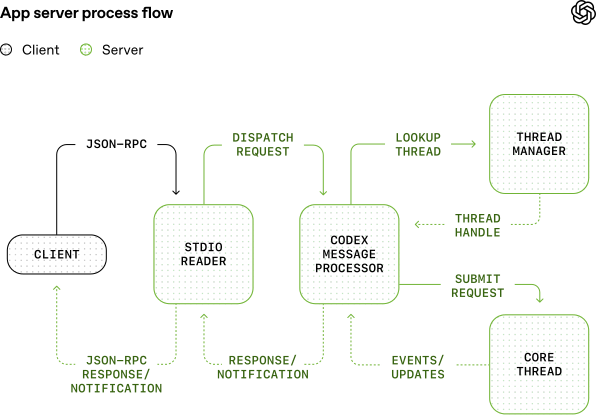
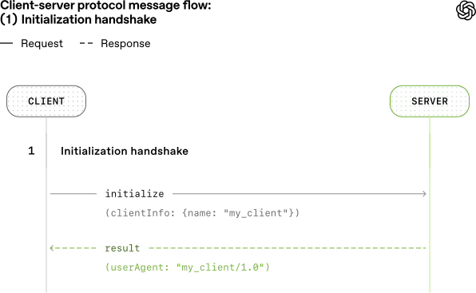
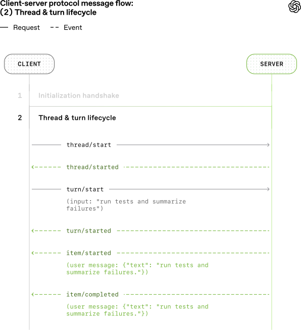
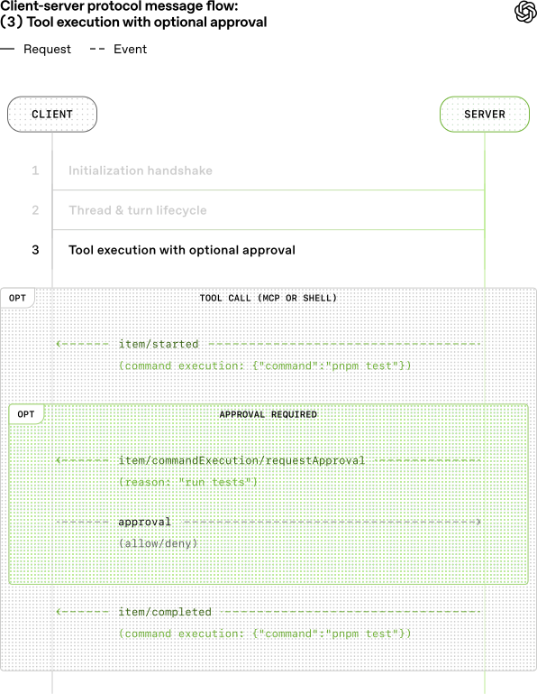
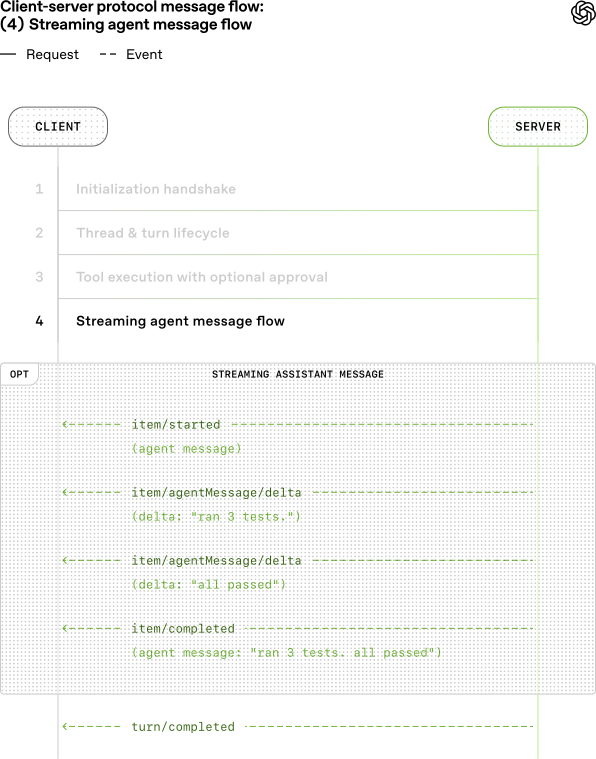
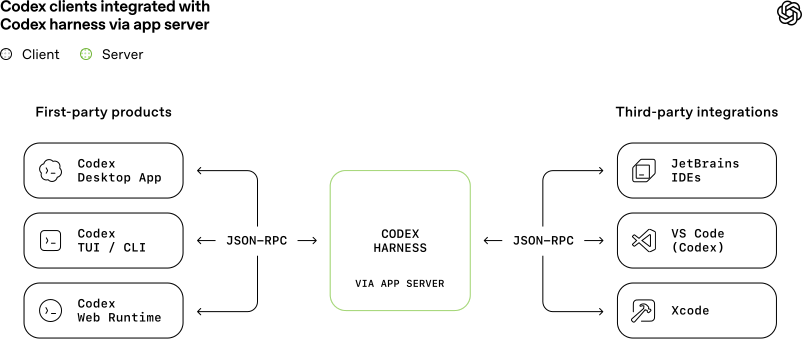

# 02_Unlocking the Codex harness: how we built the App Server_解锁 Codex 运行框架：我们如何构建 App Server

> 英文原文：https://openai.com/index/unlocking-the-codex-harness/
> 官方中文：https://openai.com/zh-Hans-CN/index/unlocking-the-codex-harness/
> 作者：OpenAI｜发布日期：2026-02-04
> 版式说明：逐句中英对照——每一句（或一小段连续的）英文下面紧跟中文翻译。**译文以 OpenAI 官方中文版为准**，未自行重译；官方中文缺失或漏译处由补译并标注。关键术语首次出现时在译文中保留英文原词，便于对照记忆。

---

In this post, we'll introduce the Codex App Server; we'll share our learnings so far on the best ways to bring Codex's capabilities into your product to help your users supercharge their workflows.

在这篇文章中，我们将介绍 Codex App Server，并分享我们迄今为止所掌握的经验，助你将 Codex 的功能引入产品，以便用户能够大幅提升工作流效率。

We'll cover the App Server's architecture and protocol and how it integrates with different Codex surfaces, as well as tips on leveraging Codex, whether you want to turn Codex into a code reviewer, an SRE agent, or a coding assistant.

我们将介绍 App Server 的架构和协议，及其如何与不同的 Codex 界面集成，并分享利用 Codex 的技巧；无论你是想让 Codex 充当代码审查员、SRE 智能体，还是编程助手，它都能助你一臂之力。

## Origin of the App Server｜App Server 的起源

Before diving into architecture, it's helpful to know the App Server's backstory.

在深入了解架构之前，不妨先看看 App Server 的背景故事。

Initially, the App Server was a practical way to reuse the Codex harness across products that gradually evolved into our standard protocol.

最初，App Server 是一种在不同产品中复用 Codex 运行框架（harness）的实用方法，后来逐渐演变为我们的标准协议。

Codex CLI started as a TUI (terminal user interface), meaning Codex is accessed through the terminal.

Codex CLI 最初曾作为 TUI（终端用户界面），这意味着你可以通过终端访问 Codex。

When we built the VS Code extension (a more IDE-friendly way to interact with Codex agents), we needed a way to use the same harness so as to drive the same agent loop from an IDE UI without re-implementing it.

当我们构建 VS Code 扩展（一种更适用于与 Codex 智能体交互的 IDE 友好型方案）时，我们需要应用相同的运行框架，在不重新实施的情况下，从 IDE 用户界面 (UI) 驱动相同的智能体循环。

That meant supporting rich interaction patterns beyond request/response, such as exploring the workspace, streaming progress as the agent reasons, and emitting diffs.

这意味着要支持超越请求/响应的丰富交互模式，例如探索工作空间、在智能体进行推理时流式传输进程，以及输出差异。

We first experimented with exposing [Codex as an MCP server⁠(opens in a new window)](https://github.com/openai/codex/pull/2264), but maintaining MCP semantics in a way that made sense for VS Code proved difficult.

我们最初尝试将 [Codex 作为 MCP 服务器⁠（在新窗口中打开）](https://github.com/openai/codex/pull/2264)对外发布，但我们发现难以运用 VS Code 方案来维护 MCP 语义。

Instead, we introduced a JSON-RPC protocol that mirrored the TUI loop, which became the [unofficial first version⁠(opens in a new window)](https://github.com/openai/codex/pull/4471) of the App Server.

相反，我们引入了一个类似 TUI 循环的 JSON-RPC 协议，它成为了 App Server 的[非官方首发版本⁠（在新窗口中打开）](https://github.com/openai/codex/pull/4471)。

At the time, we didn't expect other clients to depend on the App Server, so it wasn't designed as a stable API.

当时，我们并未预料到其他客户会选择 App Server，因为其设计初衷并非是构建稳定的 API。

As Codex adoption grew over the next few months, internal teams and external partners wanted the ability to embed the same harness in their own products in order to accelerate their users' software development workflows.

在接下来的几个月里，随着 Codex 的应用率不断增长，内部团队和外部合作伙伴希望能够在其自研产品中嵌入同一个运行框架，以加速其用户的软件开发工作流。

For example, JetBrains and Xcode wanted an IDE-grade agent experience, while the Codex desktop app needed to orchestrate many Codex agents in parallel.

例如，JetBrains 和 Xcode 希望获得 IDE 级智能体体验，而 Codex 桌面应用则需要并行编排多个 Codex 智能体。

Those demands pushed us to design a platform surface that both our products and partner integrations could safely depend on over time.

这些需求促使我们设计了一个平台界面，确保我们的产品和合作伙伴集成能够基于该平台实现长期稳定运行。

It needed to be easy to integrate and backward compatible, meaning we could evolve the protocol without breaking existing clients.

它既要易于集成，又要向后兼容，这意味着我们可以在不破坏现有客户端的情况下优化该协议。

Next, we'll walk through how we designed the architecture and protocol so different clients can use the same harness.

接下来，我们将逐步介绍如何设计相关架构和协议，以便不同的客户端可以应用同一个运行框架。

## Inside the Codex harness｜在 Codex 运行框架内

First, let's zoom in on what's inside the Codex harness and how the Codex App Server exposes it to clients.

首先，让我们聚焦于 Codex harness 内部的运行框架，以及 Codex App Server 如何向客户端呈现这一框架。

In our last Codex [blog](https://openai.com/index/unrolling-the-codex-agent-loop/), we broke down the core agent loop that orchestrates the interaction between the user, the model, and the tools.

在上一篇 Codex [博客](https://openai.com/index/unrolling-the-codex-agent-loop/)中，我们拆解了用于协调用户、模型和工具间交互的核心智能体循环。

This is the core logic of the Codex harness, but there's more to the full agent experience:

这正是 Codex 运行框架的核心逻辑，但完整的智能体体验远不止于此：

**1. Thread lifecycle and persistence**. A thread is a Codex conversation between a user and an agent.

**1. 线程生命周期和持久性**。线程（thread）是用户与智能体间的 Codex 对话。

Codex creates, resumes, forks, and archives threads, and persists the event history so clients can reconnect and render a consistent timeline.

Codex 可创建、恢复、派生和归档线程，并持久保存事件历史记录，以便客户端重新连接并呈现一致的时间线。

**2. Config and auth**. Codex loads configuration, manages defaults, and runs authentication flows like "Sign in with ChatGPT," including credential state.

**2. 配置和身份验证**。Codex 可加载配置、管理默认值，并运行“使用 ChatGPT 登录”等身份验证流程，包括凭据状态。

**3. Tool execution and extensions**. Codex executes shell/file tools in a sandbox and wires up integrations like MCP servers and skills so they can participate in the agent loop under a consistent policy model.

**3. 工具执行和扩展**。Codex 可在沙盒中执行 shell/文件工具，并连接 MCP 服务器和技能等集成，从而根据一致的策略模式参与智能体循环。

All the agent logic we mentioned here, including the core agent loop, lives in a part of the Codex CLI codebase called "[Codex core⁠(opens in a new window)](https://github.com/openai/codex/tree/main/codex-rs/core)."

我们在此提到的所有智能体逻辑（包括核心智能体循环），都位于 Codex CLI 代码库中名为“[Codex 核心⁠（在新窗口中打开）](https://github.com/openai/codex/tree/main/codex-rs/core)”的模块内。

Codex core is both a library where all the agent code lives and a runtime that can be spun up to run the agent loop and manage the persistence of one Codex thread (conversation).

“Codex 核心”既是一个存放所有智能体代码的存储库，也是一个可启动的运行时环境，可用于运行智能体循环并管理 Codex 线程（对话）的持久性。

To be useful, the Codex harness needs to be accessible to clients.

为了发挥效力，Codex 运行框架需要授予客户端访问权限。

That's where the App Server comes in.

这正是 App Server 的“用武之地”。

The App Server is both the JSON-RPC protocol between the client and the server and a long-lived process that hosts the Codex core threads.

App Server 既是客户端与服务器间的 JSON-RPC 协议，也是托管 Codex 核心线程的长期进程。

*图注：App Server 进程流程图。客户端发出的 JSON 请求先由 stdio 读取器接收，交给 Codex 消息处理器；线程管理器为每条线程启动一个核心会话（Codex core thread），消息处理器再与各会话直接通信、提交请求并接收事件更新。*

As we can see from the diagram above, an App Server process has four main components: the stdio reader, the Codex message processor, the thread manager, and core threads.

如上图所示，App Server 进程包含四个主要组件：stdio 读取器、Codex 消息处理器、线程管理器和核心线程。

The thread manager spins up one core session for each thread, and the Codex message processor then communicates with each core session directly to submit client requests and receive updates.

线程管理器可为每个线程启动一个核心会话，Codex 消息处理器则可直接与每个核心会话通信，以提交客户端请求并接收更新。

One client request can result in many event updates, and these detailed events are what allow us to build a rich UI on top of the App Server.

一个客户端请求可能会导致多个事件更新，正是这些详细的事件支持我们在 App Server 上构建丰富的用户界面。

Furthermore, the stdio reader and the Codex message processor serve as the translation layer between the client and Codex core threads.

此外，stdio 读取器和 Codex 消息处理器可作为客户端与 Codex 核心线程间的转换层。

They translate client JSON-RPC requests into Codex core operations, listen to Codex core's internal event stream, and then transform those low-level events into a small set of stable, UI-ready JSON-RPC notifications.

它们可将客户端 JSON-RPC 请求转换为 Codex 核心操作，监听 Codex 核心的内部事件流，然后将这些低级事件转换为一小组稳定的用户界面就绪型 JSON-RPC 通知。

The JSON-RPC protocol between the client and the App Server is fully bidirectional.

客户端与 App Server 间的 JSON-RPC 协议处于完全双向模式。

A typical thread has a client request and many server notifications.

典型的线程包含一个客户端请求和多个服务器通知。

In addition, the server can initiate requests when the agent needs input, like an approval, and then pause the turn until the client responds.

此外，当智能体需要输入（例如审批）时，服务器可以发起请求，然后暂停该轮次，直到客户端响应。

## The conversation primitives｜对话原语

Next, we'll break down the conversation primitives, the building blocks of the App Server protocol.

接下来，我们将拆解对话原语（conversation primitives），即 App Server 协议的构建模块。

Designing an API for an agent loop is tricky because the user/agent interaction is not a simple request/response.

为智能体循环设计 API 颇为棘手，因为用户/智能体交互并非简单的请求/响应。

One user request can unfold into a structured sequence of actions that the client needs to represent faithfully: the user's input, the agent's incremental progress, artifacts produced along the way (e.g., diffs).

一个用户请求可能会展开为一系列结构化的操作序列，客户端需要忠实呈现相应信息：用户的输入、智能体的增量进度，以及在此过程中产生的工件（例如，差异文件）。

To make that interaction stream easy to integrate and resilient across UIs, we landed on three core primitives with clear boundaries and lifecycles:

为了确保交互流易于集成并在各种用户界面中保持弹性，我们确定了三个包含明确边界和生命周期的核心原语：

**1. Item:** An item is the atomic unit of input/output in Codex.

**1. 项目（Item）：** 项目是 Codex 中输入/输出的基本单位。

Items are typed (e.g., user message, agent message, tool execution, approval request, diff) and each has an explicit lifecycle:

各个项目都有相应的类型（例如，用户消息、智能体消息、工具执行、审批请求、差异），并且每一个项目都有明确的生命周期：

- `item/started` when the item begins

- `item/started`：当项目开始时

- optional `item/*/delta` events as content streams in (for streaming item types)

- 可选的 `item/*/delta` 事件：作为内容流输入（用于流式项目类型）

- `item/completed` when the item finalizes with its terminal payload

- `item/completed`：当项目完成其终端负载时

This lifecycle lets clients start rendering immediately on `started`, stream incremental updates on `delta`, and finalize on `completed`.

此生命周期允许客户端在 `started` 时立即开始渲染，在 `delta` 时流式传输增量更新，并在 `completed` 时最终完成处理。

**2. Turn:** A turn is one unit of agent work initiated by user input.

**2. 轮次（Turn）**：轮次是由用户输入发起的智能体工作单位。

It begins when the client submits an input (for example, "run tests and summarize failures") and ends when the agent finishes producing outputs for that input.

当客户端提交输入（例如，“运行测试并总结失败”）时，轮次就会启动；当智能体为该输入生成输出时，轮次就会终止。

A turn contains a sequence of items that represent the intermediate steps and outputs produced along the way.

一个轮次包含一系列项目，这些项目代表了在此过程中产生的中间步骤和输出结果。

**3. Thread:** A thread is the durable container for an ongoing Codex session between a user and an agent.

**3. 线程（Thread）**：线程是用户与智能体间正在进行的 Codex 会话的持久容器。

It contains multiple turns.

它包含多个轮次。

Threads can be created, resumed, forked, and archived.

线程可以被创建、恢复、派生和归档。

Thread history is persisted so clients can reconnect and render a consistent timeline.

线程历史记录会被持久化保存，以便客户端重新连接并呈现一致的时间线。

Now, we'll look at a simplified conversation between a client and an agent, where the conversation is represented by primitives:

现在，我们来看看客户端和智能体间的简化对话，该对话由原语表示：

At the beginning of the conversation, the client and the server need to establish the `initialize` handshake.

在对话开始时，客户端和服务器需要建立 `initialize` 握手。

The client must send a single `initialize` request before any other method, and the server acknowledges with a response.

客户端必须在调用任何其他方法前发送一个 `initialize` 请求，服务器会通过响应进行确认。

This gives the server a chance to advertise capabilities and lets both sides agree on protocol versioning, feature flags, and defaults before the real work begins.

这样，服务器就能展现自己的能力，并确保双方在真正投入运行前就协议版本、功能标志和默认值达成一致。

*图注：客户端与服务器协议消息流——初始化（Initialization）阶段。客户端在调用任何其他方法之前先发送单个 `initialize` 请求，服务器以响应确认，双方在此完成能力声明与协议版本、功能标志、默认值的协商。*

Here's an example payload from OpenAI's VS Code extension:

以下是 OpenAI VS Code 扩展的负载示例：

This is what the server returns:

以下是服务器返回的内容：

When a client makes a new request, it will first create a thread and then a turn.

当客户端发起新请求时，它会先创建一个线程，然后创建一个轮次。

The server will send back notifications for progress (`thread/started` and `turn/started`).

服务器将返回进度通知（`thread/started` 和 `turn/started`）。

It will also send back inputs it registers as items, like the user message here.

它还会返回自身识别为项目的输入，比如此示例中的用户消息。

*图注：客户端与服务器协议消息流——线程（Thread）阶段。客户端发起新请求时先创建线程、再创建轮次，服务器回传 `thread/started` 与 `turn/started` 进度通知，并把识别为项目（item）的输入（如用户消息）一并回传。*

Tool calls are also sent back to the client as items.

工具调用也会作为项目发送回客户端。

Additionally, the server may ask for client approval before it can run an action by sending a server request.

此外，服务器在执行操作之前，可能会通过发送服务器请求来请求客户端进行审批。

The approval will pause the turn until the client replies with either "allow" or "deny."

审批将暂停该轮次，直到客户端回复“允许”或“拒绝”。

*图注：客户端与服务器协议消息流——工具调用（Tool）阶段。工具调用同样作为项目回传给客户端；执行动作前服务器可主动发起审批请求，该轮次会一直暂停，直到客户端回复“允许”或“拒绝”。*

This is what the approval flow looks like in the VS Code extension:

VS Code 扩展中的审批流程如下：

*图注：深色主题界面中的权限提示：“Do you want to allow me to run pnpm test for this workspace?”它列出了以下选项：1) 是；2) 是，且不再询问以 pnpm test 开头的命令；3) 否，且底部设有提交按钮。*

In the end, the server sends an agent message and then ends the turn with `turn/completed`.

最后，服务器会发送一条智能体消息，然后以 `turn/completed` 结束该轮次。

The agent message delta events stream pieces of the message back until the message is finalized with `item/completed`.

智能体消息增量事件会持续流式返回消息片段，直到消息以 `item/completed` 收尾。

*图注：客户端与服务器协议消息流——流式传输（Streaming）阶段。服务器以 `item/*/delta` 事件持续流式返回智能体消息片段，消息以 `item/completed` 定稿，整个轮次最终以 `turn/completed` 结束。*

The messages in the diagram are simplified for readability.

为便于理解，示意图中的信息已经过简化。

If you want to see the JSON for a full turn, you can run the test client from the Codex CLI repo:

如果你想查看完整轮次的 JSON，可以从 Codex CLI 代码仓库运行测试客户端：

## Integrating with clients｜与客户端集成

Now, let's look at how different client surfaces embed Codex via the App Server.

现在，让我们看看不同的客户端界面如何通过 App Server 嵌入 Codex。

We'll cover three patterns: local apps and IDEs, Codex web runtime, and the TUI.

我们将介绍三种模式：本地应用和 IDE、Codex Web 运行时，以及 TUI。

*图注：Codex 各客户端与 Codex 运行框架的集成方式。TUI／CLI、VS Code 等 IDE 扩展、Codex Web 与桌面应用都通过 App Server 接入同一套 harness，传输层统一为 stdio 上的 JSON-RPC（JSONL）。*

Across all three, the transport is JSON-RPC over stdio (JSONL).

在上述三种模式中，传输方式均为 JSON-RPC over stdio (JSONL)。

JSON-RPC makes it straightforward to build client bindings in the language of your choice.

JSON-RPC 可助你使用所选的语言，轻松构建客户端绑定。

Codex surfaces and partner integrations have implemented App Server clients in languages including Go, Python, TypeScript, Swift, and Kotlin.

Codex 界面和合作伙伴集成已在 Go、Python、TypeScript、Swift 和 Kotlin 等多种语言中部署 App Server 客户端。

For TypeScript, you can generate definitions directly from the Rust protocol by running:

对于 TypeScript，你可以通过运行以下命令直接从 Rust 协议生成定义：

For other languages, you can generate a JSON Schema bundle and feed it into your preferred code generator by running:

对于其他语言，你可以生成一个 JSON 模式捆绑包，并通过运行以下命令将其输入到你首选的代码生成器中：

#### Local Apps & IDEs｜本地应用和 IDE

*图注：VS Code 的屏幕截图，图中包含正在运行的 Codex 扩展。Rust 测试文件已打开，其下方的 Codex 面板显示仅运行 fmt 和 cargo test -p codex-app-server 的描述，表明格式化和测试正在进行中，需等待通过/失败的最终结果。*

Local clients typically bundle or fetch a platform-specific App Server binary, launch it as a long-running child process, and keep a bidirectional stdio channel open for JSON-RPC.

本地客户端通常会捆绑或获取特定平台的 App Server 二进制文件，将其作为一个长期运行的子进程启动，并为 JSON-RPC 开通一个双向 stdio 通道。

In our VS Code extension and Desktop App, for example, the shipped artifact includes the platform-specific Codex binary and is pinned to a tested version so the client always runs the exact bits we validated.

例如，在我们的 VS Code 扩展和桌面应用中，随附的工件包含特定平台的 Codex 二进制文件，并固定为已测试版本，以便客户端始终运行与验证完全一致的代码。

Not every integration can ship client updates frequently.

并非所有集成都能频繁发布客户端更新。

Some partners like Xcode decouple release cycles by keeping the client stable and allowing it to point to a newer App Server binary when needed.

部分合作伙伴（如 Xcode）通过保持客户端稳定，并在需要时允许其指向更新的 App Server 二进制文件，解耦发布周期。

That way they can adopt server-side improvements (for example, better auto-compaction in Codex core or newly supported config keys) and roll out bug fixes without waiting for a client release.

这样一来，他们就可以应用服务器端的优化（例如，Codex 核心中更好的自动压缩或新的支持配置键），并推出错误修复程序，而无需等待客户端发布。

The App Server's JSON-RPC surface is designed to be backward compatible, so older clients can talk to newer servers safely.

App Server 的 JSON-RPC 接口采用向后兼容设计，因此旧版客户端可以安全地与新版服务器通信。

#### Codex Web

*图注：Codex Web 界面的屏幕截图：显示标题为“更新登录成功消息”的更新内容。左侧面板汇总了变更、测试和已修改的文件，右侧面板则展示了 login.rs 的代码差异，且包含“更新登录成功消息”字样。*

Codex Web uses the Codex harness, but runs it in a container environment.

Codex Web 使用 Codex 运行框架，但其在容器环境中运行。

A worker provisions a container with the checked-out workspace, launches the App Server binary inside it, and maintains a long-lived JSON-RPC over stdio[2](https://openai.com/index/unlocking-the-codex-harness/#citation-bottom-2) channel.

工作节点会提供一个包含已签出工作空间的容器，在其中启动 App Server 二进制文件，并通过 stdio[2](https://openai.com/zh-Hans-CN/index/unlocking-the-codex-harness/#citation-bottom-2) 通道维护长期运行的 JSON-RPC。

The web app (running in the user's browser tab) talks to the Codex backend over HTTP and SSE, which streams task events produced by the worker.

Web 应用（在用户的浏览器标签页中运行）通过 HTTP 和 SSE 与 Codex 后端对话，后者则会流式传输由工作节点生成的任务事件。

This keeps the browser-side UI lightweight while still giving us a consistent runtime across desktop and web.

这样既能保持浏览器端用户界面的轻量化状态，又能在桌面和 Web 端保持一致的运行时。

Because web sessions are ephemeral (tabs close, networks drop), the web app cannot be the source of truth for long-running tasks.

由于网页会话为临时性质（标签页关闭、网络中断），因此 Web 应用不能作为长期任务的可信数据源。

Keeping state and progress on the server means work continues even if the tab disappears.

在服务器上保留状态和进度意味着，即使标签页消失，任务也会继续运行。

The streaming protocol and saved thread sessions make it easy for a new session to reconnect, pick up where it left off, and catch up without rebuilding state in the client.

流式传输协议和已保存的线程会话可支持新会话轻松实现重新连接、从中断处继续运行，并快速同步状态，而无需在客户端内重建状态。

#### TUI/Codex CLI

*图注：运行 Codex CLI 的终端屏幕截图。图中显示了包含 gpt-5.2-codex medium 模型的 OpenAI Codex 横幅、“为我解释应用服务器的原理”字样的用户命令以及“正在运行”状态。图片下方则显示“为 @filename 编写测试”字样的建议，且包含快捷方式选项。*

Historically, the TUI was a "native" client that ran in the same process as the agent loop and talked directly to Rust core types rather than the app-server protocol.

就传统意义而言，TUI 是一个“原生”客户端，它在与智能体循环相同的进程中运行，且直接与 Rust 核心类型通信，而非使用应用服务器协议。

That made early iteration fast, but it also made the TUI a special-case surface.

这有助于提高早期迭代速度，同时也会让 TUI 成为特殊的界面。

Now that the App Server exists, we plan to [refactor the TUI⁠(opens in a new window)](https://github.com/openai/codex/pull/10192) to use it so it behaves like any other client: launch an App Server child process, speak JSON-RPC over stdio, and render the same streaming events and approvals.

既然 App Server 已经存在，我们计划[重构 TUI⁠（在新窗口中打开）](https://github.com/openai/codex/pull/10192) 以投入实际应用，确保其发挥类似于其他客户端的作用：启动一个 App Server 子进程，通过 stdio 进行 JSON-RPC 通信，并渲染相同的流式事件和审批。

This unlocks workflows where the TUI can connect to a Codex server running on a remote machine, keeping the agent close to compute and continuing work even if the laptop sleeps or disconnects, while still delivering live updates and controls locally.

这样一来，TUI 就可以连接远程设备上运行的 Codex 服务器，确保智能体部署于接近计算资源的位置，即使笔记本电脑休眠或断开连接也能继续运行，同时还能在本地实现实时更新和控制。

## Choosing the right protocol｜选择合适的协议

Codex App Server will be the first-class integration method we maintain moving forward, but there are also other methods with more limited functionality.

Codex App Server 将是我们今后维护的首要集成方案，但也有其他功能较为有限的方法。

By default, we'd recommend that clients use Codex App Server to integrate with Codex, but it's worth taking a look at different integration methods and understanding their pros and cons.

默认情况下，我们建议客户使用 Codex App Server 与 Codex 集成，借鉴其他集成方法并深入研究其优缺点。

Below are the most common ways to drive Codex and when each might be a good fit.

以下是驱动 Codex 的最常见方式，以及每种方式的应用场景。

### JSON-RPC protocols｜JSON-RPC 协议

#### Codex as an MCP server｜作为 MCP 服务器的 Codex

Run [`codex mcp-server`⁠(opens in a new window)](https://developers.openai.com/codex/guides/agents-sdk/) and connect from any MCP client that supports stdio servers (e.g., [OpenAI Agents SDK⁠(opens in a new window)](https://openai.github.io/openai-agents-js/)).

运行 [`codex mcp-server`⁠（在新窗口中打开）](https://developers.openai.com/codex/guides/agents-sdk/)，然后从任何支持 stdio 服务器的 MCP 客户端连接（例如，[OpenAI Agents SDK⁠（在新窗口中打开）](https://openai.github.io/openai-agents-js/)）。

This is a good fit if you already have an MCP-based workflow and want to invoke Codex as a callable tool.

如果你已构建基于 MCP 的工作流，并希望将 Codex 作为可调用的工具，那么这一方案就是理想选择。

The downside is that you only get what MCP exposes, so Codex-specific interactions that rely on richer session semantics (e.g., diff updates) may not map cleanly through MCP endpoints.

其缺点在于，你只能获取 MCP 公开的内容，因此依赖更丰富会话语义（例如，差异更新）的 Codex 特定交互可能无法通过 MCP 端点清晰映射。

#### Cross-provider agent harness protocols｜跨提供商智能体运行框架协议

Some ecosystems offer a portable interface that can target multiple model providers and runtimes.

部分生态系统可面向多个模型提供商和运行时环境提供可移植接口。

This can be a good fit if you want one abstraction that coordinates multiple agents.

如果你需要借助抽象化来协调多个智能体，这就是一个不错的选择。

The tradeoff is that these protocols often converge on the common subset of capabilities, which can make richer interactions harder to represent, especially when provider-specific tool and session semantics matter.

其代价在于，这些协议往往趋同于通用的功能子集，这可能会使更丰富的交互难以表示，特别是当特定提供商的工具和会话语义至关重要时。

This space is evolving quickly, and we expect that more common standards will emerge as we figure out the best primitives to represent real-world agent workflows ([skills⁠(opens in a new window)](https://agentskills.io/home) is a good example of this).

这一领域正在迅速发展，我们预计，随着 OpenAI 不断探索用于表示真实智能体工作流的最佳原语，更多的通用标准也会相继涌现（[技能⁠（在新窗口中打开）](https://agentskills.io/home)就是其中的典型案例）。

#### Codex App Server

Choose the App Server when you want the full Codex harness exposed as a stable, UI-friendly event stream.

当你希望将完整的 Codex 运行框架以稳定的用户界面友好型事件流形式展示时，请选择 App Server。

You get both the full functionality of the agent loop and other supporting features like Sign in with ChatGPT, model discovery, and configuration management.

你将同时获得智能体循环的完整功能，以及其他支持功能，例如使用 ChatGPT 登录、模型发现和配置管理。

The main cost is integration work, since you need to build the client-side JSON-RPC binding in your language.

其主要成本在于集成工作，因为你需要使用所选的语言构建客户端的 JSON-RPC 绑定。

In practice, however, Codex is able to do a lot of the heavy lifting if you feed it the JSON schema and documentation.

但实际上，如果你向 Codex 提供 JSON 模式和文档，它就能完成大量繁重的工作。

Many teams we worked with were able to make to a working integration quickly using Codex.

与我们合作的许多团队都会使用 Codex 快速开发可用集成。

### Other ways to Embed Codex｜嵌入 Codex 的其他方法

A lightweight, scriptable CLI mode for one-off tasks and CI runs.

一种轻量级、可编写脚本的 CLI 模式，适用于一次性任务和 CI 运行。

It's a good fit for automation and pipelines where you want a single command to run to completion non-interactively, stream structured output for logs, and exit with a clear success or failure signal.

它适用于自动化和管道场景，在这些场景中，你希望通过一条命令以非交互形式实现全程运行，为日志流式传输结构化输出，并在退出时发出明确的成功或失败信号。

A TypeScript library for programmatically controlling local Codex agents from within your own application.

TypeScript 代码库，用于在你自己的应用程序中以编程方式控制本地 Codex 智能体。

It's best when you want a native library interface for server-side tools and workflows without building a separate JSON-RPC client.

当你希望为服务器端工具和工作流提供原生库接口，而无需构建单独的 JSON-RPC 客户端时，它就是最佳选择。

Since it shipped earlier than the App Server, it currently supports fewer languages and a smaller surface area.

由于它比 App Server 更早发布，目前支持的语言较少，且覆盖范围也较小。

If there is developer interest, we may add additional SDKs that wrap the App Server protocol so teams can cover more of the harness surface without writing JSON-RPC bindings.

如果开发人员有意了解相关信息，我们可能会添加更多封装 App Server 协议的 SDK，以便你的团队覆盖更多的运行框架界面，而无需编写 JSON-RPC 绑定。

## Taking this forward｜推进相关工作

In this post, we shared how we approach designing a new standard for interacting with agents and how to turn the Codex harness into a stable, client-friendly protocol.

在这篇文章中，我们分享了如何设计与智能体交互的新标准，以及如何将 Codex 运行框架转变为稳定的客户端友好型协议。

We covered how the App Server exposes Codex core, lets clients drive the full agent loop, and powers a wide range of surfaces including the TUI, local IDE integrations, and the web runtime.

我们介绍了 App Server 如何公开 Codex 核心，如何支持客户端驱动整个智能体循环，以及如何为 TUI、本地 IDE 集成和网络运行时等环境提供动力。

If this sparked ideas for integrating Codex into your own workflows, it's worth giving App Server a try.

如果这激发了你将 Codex 集成至专属工作流的灵感，那么 App Server 值得一试。

All the source code lives in the Codex CLI open-source [repo⁠(opens in a new window)](https://github.com/openai/codex/blob/main/codex-rs/app-server/README.md).

所有源代码都存放在 Codex CLI 开源[代码仓库⁠（在新窗口中打开）](https://github.com/openai/codex/blob/main/codex-rs/app-server/README.md)中。

Feel free to share your feedback and feature requests.

欢迎你分享反馈意见和功能建议。

We're excited to hear from you and to keep making agents more accessible to everyone.

我们期望收到你的回复，并将继续面向所有用户推广智能体。
