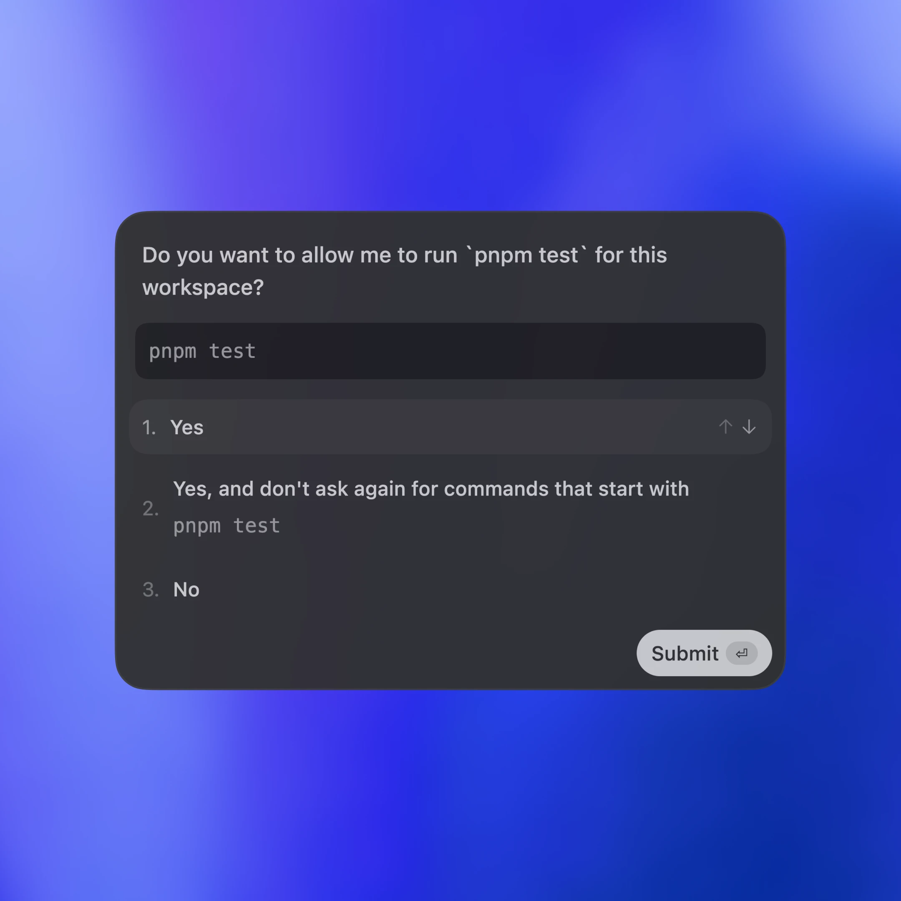
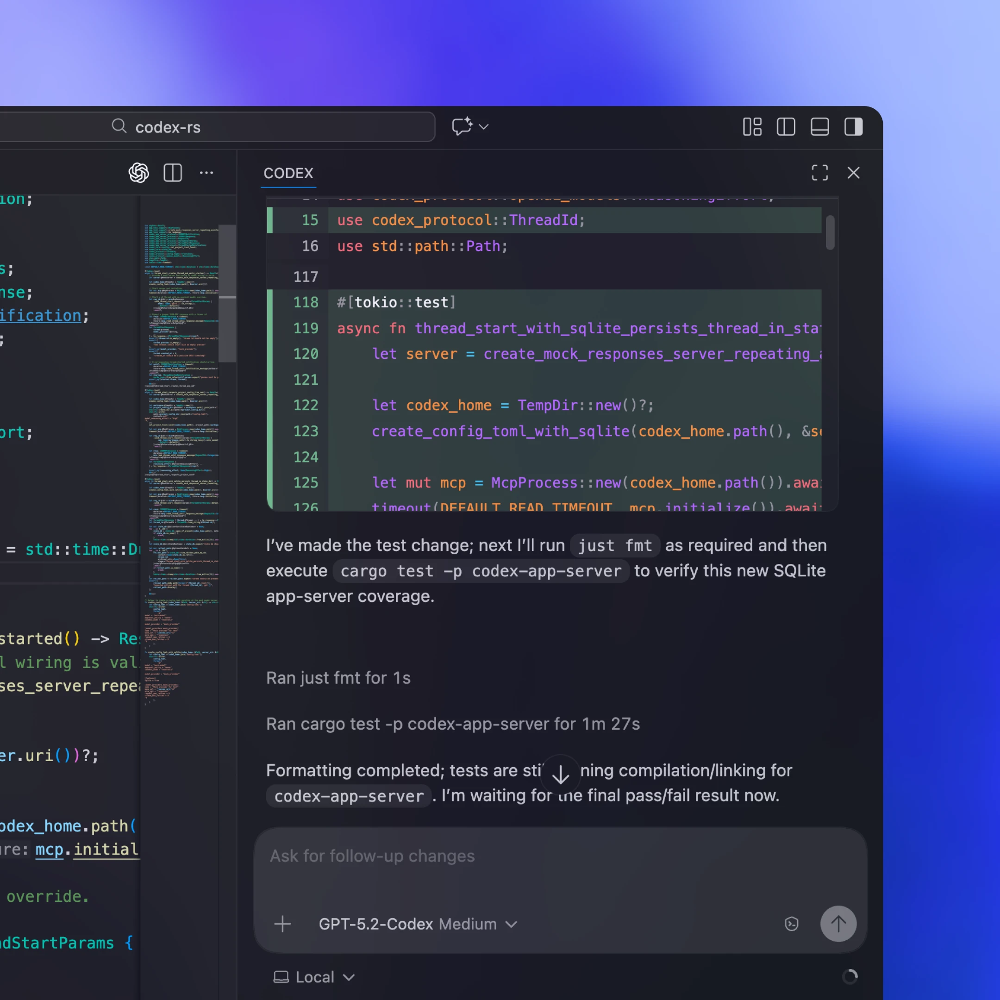
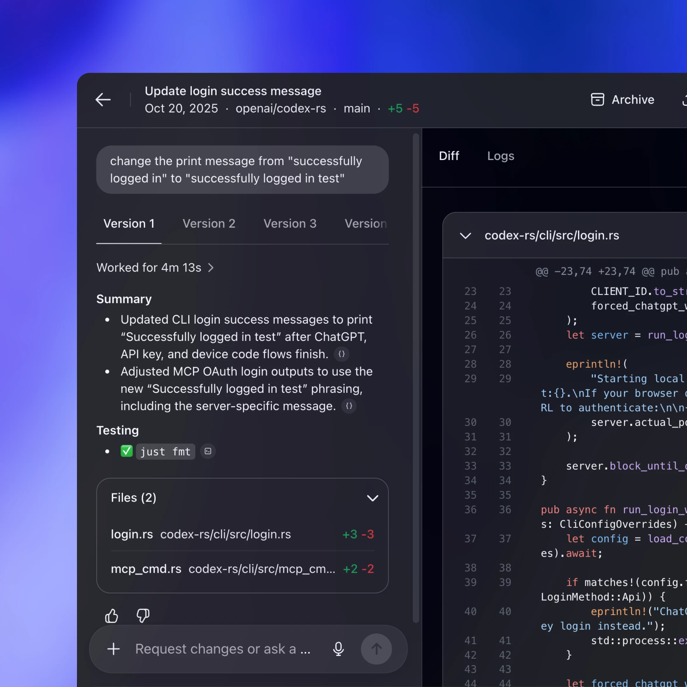
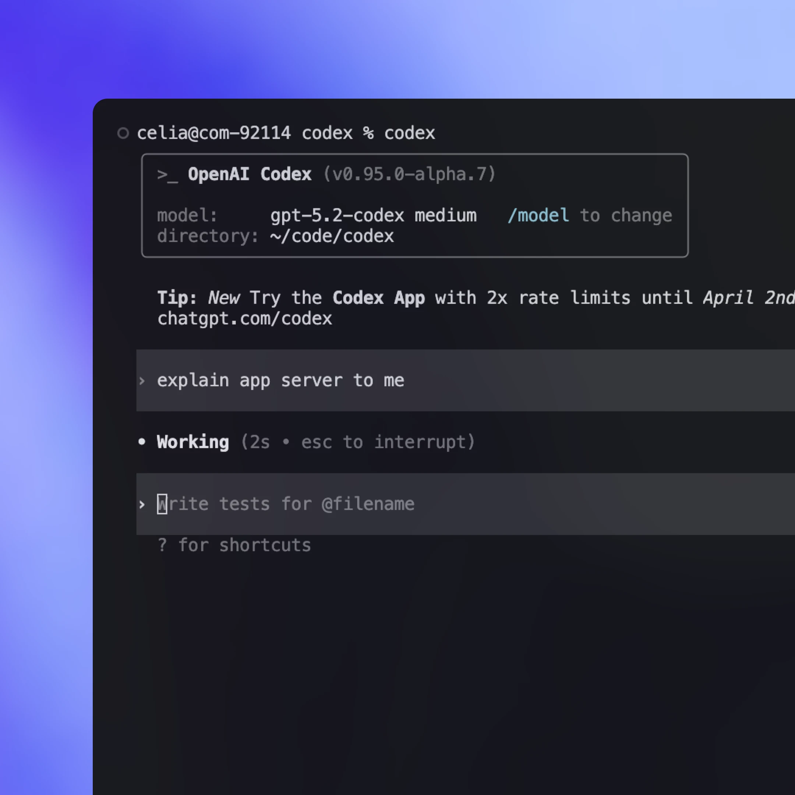

# 02_解锁 Codex 运行框架_面试速记

> OpenAI · 2026-02-04 · [英文原文](https://openai.com/index/unlocking-the-codex-harness/) · [官方中文](https://openai.com/zh-Hans-CN/index/unlocking-the-codex-harness/) · [本地逐句对照](02_Unlocking%20the%20Codex%20harness_解锁%20Codex%20运行框架_逐句对照.md)

## 一句话讲明白

**Codex 的智能体逻辑全部集中在一个叫「Codex 核心（Codex core）」的模块里，App Server 则把这个运行框架（harness）包成一个长期运行的进程加一套 JSON-RPC 协议对外开放——于是终端界面（TUI）、VS Code／JetBrains／Xcode 插件、网页端、桌面应用都不必各自重写一遍智能体循环，只需要各写一个客户端绑定；协议用「项目 / 轮次 / 线程」三个对话原语描述交互，向后兼容，客户端和服务端因此可以各自独立演进。**

## 为什么值得读 / 能用在哪

- 这是**「一套智能体内核如何同时支撑多个产品界面」的官方工程范本**——痛点极其常见：命令行做完了要做 IDE 插件，IDE 插件做完了要做网页端，每做一个就把智能体循环重抄一遍，行为还对不齐。
- 它给的答案不是「抽个公共库」，而是**把运行框架变成一个进程 + 一份协议**，界面只负责渲染事件流。这条思路可以直接搬到自己的智能体产品上。
- 面试里它是「智能体系统架构 / 协议设计」这一档的好素材，尤其能回答：**为什么 MCP 不够用、为什么要自己定协议**。
- 顺带给了版本偏斜（version skew）的实用解法：协议向后兼容 + 客户端固定版本 / 指向更新的服务端二进制，两种发布节奏可以解耦。

---

## 核心要点

### 一、起源：先有复用需求，后有协议

App Server 不是设计出来的，是**长出来的**。原文自己说得很直白：最初它只是一个在多个产品间复用 Codex 运行框架的实用做法，后来才逐渐演变成标准协议。

时间线值得记住，面试时讲演进过程比讲结论更有说服力：

1. **Codex CLI 最早是一个 TUI（终端用户界面）**，通过终端访问 Codex。
2. 做 VS Code 扩展时，需要**用同一套运行框架、从 IDE 界面驱动同一个智能体循环，而不是重新实现一遍**。
3. 但这要求支持超出「请求/响应」的丰富交互：探索工作空间、在智能体推理时流式推送进度、输出代码差异（diff）。
4. **第一次尝试是把 Codex 做成 MCP 服务器**（[PR 2264](https://github.com/openai/codex/pull/2264)）——结论是：**难以用适合 VS Code 的方式维护 MCP 语义**。
5. 改成引入一个**模仿 TUI 循环的 JSON-RPC 协议**（[PR 4471](https://github.com/openai/codex/pull/4471)），这就是 App Server 的非官方首发版。当时并没打算给别人用，**所以没有按稳定 API 来设计**。
6. 随着采用率上升，内部团队和外部合作伙伴都想把同一个运行框架嵌进自己产品：**JetBrains 和 Xcode 要 IDE 级的智能体体验，Codex 桌面应用要并行编排多个 Codex 智能体**。
7. 这些需求逼出了一个真正的平台接口，硬指标只有两条：**易于集成**、**向后兼容**（协议可以演进而不破坏现有客户端）。

**一句可背的结论：先复用，后协议；协议的稳定性需求是被第三方使用逼出来的，不是一开始就有的。**

### 二、运行框架里到底有什么，App Server 又是什么

上一篇 Codex 博客拆的是**核心智能体循环**（协调用户、模型、工具之间的交互）。这篇明确说：**那只是运行框架的核心逻辑，完整的智能体体验还多三块**——

1. **线程生命周期与持久化**。线程（thread）就是用户和智能体之间的一次 Codex 对话。Codex 能创建、恢复、派生（fork）、归档线程，并**持久保存事件历史**，客户端因此可以重连并渲染出一致的时间线。
2. **配置与身份验证**。加载配置、管理默认值、跑「使用 ChatGPT 登录」这类认证流程，含凭据状态。
3. **工具执行与扩展**。在沙箱（sandbox）中执行 shell / 文件工具，并接入 MCP 服务器、技能（skills）这类扩展，让它们**在一致的策略模型下参与智能体循环**。

这些逻辑全部住在 Codex CLI 代码库里一个叫 [Codex 核心](https://github.com/openai/codex/tree/main/codex-rs/core) 的模块。它有双重身份：**既是存放全部智能体代码的库，也是一个可启动的运行时——一个实例负责跑一条线程的智能体循环并管理其持久化。**

而 **App Server 同样是双重身份**（这是本文最该记住的一句）：

> **App Server 既是客户端与服务端之间的 JSON-RPC 协议，也是一个托管 Codex 核心线程的长期运行进程。**

进程内部有**四个主要组件**：`stdio 读取器`、`Codex 消息处理器`、`线程管理器`、`核心线程`。

*图注：App Server 进程流程图。客户端的 JSON 请求先由 stdio 读取器接收并交给 Codex 消息处理器；线程管理器为每条线程启动一个核心会话，消息处理器再与各会话直接通信、提交请求并接收事件更新。这张图就是「四个组件」的全貌。*

- **线程管理器为每条线程启动一个核心会话**；
- **Codex 消息处理器**直接和每个核心会话通信，提交客户端请求、接收更新；
- **stdio 读取器 + 消息处理器 = 转换层**：把客户端的 JSON-RPC 请求翻译成 Codex 核心操作，监听 Codex 核心的内部事件流，再把这些低层事件**转换成一小组稳定的、界面就绪的 JSON-RPC 通知**。

**一个客户端请求可以产生很多条事件更新**——正是这些细粒度事件让上层能做出丰富的界面。协议是**完全双向**的：典型线程是「一个客户端请求 + 多个服务端通知」，同时**服务端也能主动发起请求**（比如需要审批时），并**暂停当前轮次直到客户端回复**。

### 三、三个对话原语：项目 / 轮次 / 线程

给智能体循环设计 API 之所以棘手，是因为**用户与智能体的交互不是简单的请求/响应**：一个用户请求会展开成一串结构化的动作序列——用户输入、智能体的增量进度、过程中产生的工件（例如代码差异），客户端都得忠实呈现。

OpenAI 最后落到**三个边界清晰、各有生命周期的核心原语**：

| 原语 | 定义 | 关键点 |
|---|---|---|
| **项目（item）** | Codex 中输入/输出的**原子单位** | 有类型：用户消息、智能体消息、工具执行、审批请求、差异 |
| **轮次（turn）** | 由一次用户输入发起的**一个智能体工作单位** | 输入提交时开始，输出产出完毕时结束；内含一串项目 |
| **线程（thread）** | 一次持续会话的**持久容器** | 内含多个轮次；可创建/恢复/派生/归档；历史持久化 |

项目的生命周期是三段式，**面试时能默写出这三个事件名就够用**：

- `item/started`：项目开始；
- 可选的 `item/*/delta`：内容流式到达（仅限流式类型的项目）；
- `item/completed`：项目以其最终负载收尾。

**这个生命周期的意义**：客户端在 `started` 就能立刻开始渲染，在 `delta` 时流式更新，在 `completed` 时定稿——所以界面永远不用等整段结果。

一次完整对话的顺序（可以当作口述脚本）：

1. **`initialize` 握手**：客户端**必须在调用任何其他方法之前**发送**一个** `initialize` 请求，服务端应答确认。这一步让服务端**声明自己的能力**，双方在真正干活之前就**协议版本、功能标志、默认值**达成一致。
2. 新请求到来 → 先建线程、再建轮次 → 服务端回 `thread/started` 和 `turn/started`。
3. 服务端把它识别为项目的输入（比如用户消息）回传；工具调用同样作为项目回传。
4. 执行动作前可能发**服务端请求**要审批，**审批会暂停该轮次**，直到客户端回「允许」或「拒绝」。

5. 最后服务端发出智能体消息，以 `turn/completed` 结束轮次；消息本体由增量事件持续流式返回，直到 `item/completed` 收尾。

*图注：协议消息流的流式传输阶段。服务端用 `item/*/delta` 事件持续回传消息片段，消息以 `item/completed` 定稿，整个轮次以 `turn/completed` 收尾——这正是「界面永远不用等整段结果」的机制。*

想看一个完整轮次的原始 JSON，可以跑 Codex CLI 代码仓库里的测试客户端。

### 四、三种客户端形态，同一套运行框架

**三种模式：本地应用与 IDE、Codex Web 运行时、TUI。三者的传输方式统一是 JSON-RPC over stdio（JSONL）。**

*图注：Codex 各客户端与同一套运行框架的集成关系。TUI／CLI、VS Code 等 IDE 扩展、Codex Web、桌面应用都经 App Server 接入同一个 harness——这张图是整篇文章的结论图，「一个运行框架，多种脸面」看这一张就够。*

选 JSON-RPC 的现实收益：**用任何语言构建客户端绑定都很直接**。原文点名说 Codex 各界面与合作伙伴集成已经用 **Go、Python、TypeScript、Swift、Kotlin** 实现了 App Server 客户端。TypeScript 可以**直接从 Rust 协议生成定义**；其他语言可以生成一个 JSON Schema 捆绑包喂给自己习惯的代码生成器。

#### 本地应用与 IDE

- 本地客户端通常**捆绑或下载一个特定平台的 App Server 二进制文件，把它作为长期运行的子进程启动**，并保持一条双向 stdio 通道跑 JSON-RPC。
- VS Code 扩展和桌面应用的发布包里**直接带上特定平台的 Codex 二进制，并固定在已测版本**——保证客户端跑的就是验证过的那份代码。
- **并不是所有集成都能频繁发版**。Xcode 这类合作伙伴的做法是：**客户端保持稳定，需要时让它指向更新的 App Server 二进制**，从而**解耦发布周期**。
- 这样就能白拿服务端侧的改进（例如 **Codex 核心里更好的自动压缩、新支持的配置键**）和缺陷修复，**不必等客户端发版**。
- 前提是协议本身**向后兼容：旧客户端可以安全地和新服务端通信。**

#### Codex Web

- Codex Web **用的是同一套 Codex 运行框架，只是跑在容器环境里**。
- 流程：一个**工作节点**准备好带已签出工作空间的容器 → 在容器内启动 App Server 二进制 → 维持一条长期的 JSON-RPC over stdio 通道。
- 浏览器里的网页应用**通过 HTTP 和 SSE 与 Codex 后端通信**，后端流式推送工作节点产生的任务事件。**浏览器端因此保持轻量，桌面端与网页端却共享一致的运行时。**
- 关键判断：**网页会话是临时的（标签页会关、网络会断），所以网页应用不能作为长时任务的可信数据源。状态和进度留在服务端，标签页消失了活照样干。**
- 流式协议 + 已保存的线程会话让新会话**重连、续跑、追平状态，而不必在客户端重建状态**。

#### TUI / Codex CLI

- **历史包袱**：TUI 一直是个「原生」客户端，**和智能体循环跑在同一个进程里，直接和 Rust 核心类型对话，不走 App Server 协议**。
- 代价说得很坦率：**早期迭代快，但也让 TUI 成了一个特例界面。**
- 现在的计划是[重构 TUI](https://github.com/openai/codex/pull/10192) 去用 App Server，**让它跟其他客户端没有区别**：启动 App Server 子进程、走 stdio 上的 JSON-RPC、渲染同样的流式事件与审批。
- 解锁的新能力很值得记：**TUI 可以连到跑在远程机器上的 Codex 服务端**——**智能体离算力更近，笔记本休眠或断网也能继续干活，本地仍能实时看进度、给指令。**

### 五、四种集成方式怎么选

App Server 是官方今后维护的**首选集成方式**，但原文老实列了各方案的取舍：

| 方式 | 适合场景 | 代价 |
|---|---|---|
| **Codex 作为 MCP 服务器**（跑 `codex mcp-server`，任何支持 stdio 的 MCP 客户端可连，例如 OpenAI Agents SDK） | 已经有基于 MCP 的工作流，想把 Codex 当成一个**可调用的工具** | **只能拿到 MCP 暴露出来的东西**；依赖更丰富会话语义的交互（如差异更新）**难以干净地映射到 MCP 端点** |
| **跨提供商的智能体运行框架协议** | 想用**一套抽象协调多个智能体**、面向多个模型提供商和运行时 | 这类协议**往往收敛到能力的公共子集**，更丰富的交互难以表达，尤其当特定提供商的工具与会话语义很重要时 |
| **Codex App Server** | 想把**完整运行框架**以稳定、界面友好的事件流形式拿到手：完整智能体循环 + 使用 ChatGPT 登录、模型发现、配置管理 | **主要成本是集成工作**——要用自己的语言写客户端 JSON-RPC 绑定。缓解办法很实际：**把 JSON Schema 和文档喂给 Codex，它能干掉大部分体力活**，很多合作团队因此很快就跑通了集成 |
| **轻量可脚本化的 CLI 模式 / TypeScript 代码库** | CLI 模式适合一次性任务与 CI：一条命令非交互跑完、结构化输出进日志、退出码明确成功或失败；TypeScript 库适合在自己的服务端应用里以编程方式控制本地 Codex 智能体，不想另写 JSON-RPC 客户端 | TypeScript 库**比 App Server 更早发布，目前支持的语言更少、覆盖面更小**；官方表示若开发者有需求，可能再加封装 App Server 协议的 SDK |

**一句判断：MCP 是工具层协议，App Server 是会话/界面层协议——它们不是替代关系，是分层关系。**这也解释了第一节里「把 Codex 做成 MCP 服务器行不通」的原因：**用工具层的语义去表达一个完整智能体界面，天然会丢信息。**

---

## 和 Anthropic 的对照

读过 Anthropic 全集的话，这篇最好玩的地方是**它和 Anthropic 在做同一件事的两个不同侧面**。

**共同点：都在把运行框架和执行环境解耦。**

- Anthropic《Scaling Managed Agents》把智能体虚拟化成三个抽象——**会话（session）、运行框架（harness）、沙箱（sandbox）**，核心动作是**把运行框架搬出容器**，容器从此变成可随时替换的「牲畜」，会话是外部的只追加事件日志。
- OpenAI 这篇的核心动作是**把运行框架从客户端进程里搬出来**，变成一个独立的长期进程 + JSON-RPC 协议，客户端从此只是渲染器。
- **两边都得出同一条结论：客户端／执行进程不能是可信数据源，状态必须活在它们外面。** Anthropic 说的是「会话日志在运行框架之外，运行框架崩了也没东西需要幸存」；OpenAI 说的是「网页会话是临时的，状态留服务端，标签页关了活照跑」。

**差异一：解耦的方向正好互补。**

- Anthropic 解的是**「一个大脑，多种双手」**——运行框架不变，底下的沙箱/基础设施（甚至客户自己的 VPC）可以随便换。
- OpenAI 解的是**「一个运行框架，多种脸面」**——内核不变，上面的 CLI／IDE 插件／网页／桌面端可以随便加。
- 合起来正好是一张完整的图：**中间那层运行框架，上要对客户端稳定，下要对执行环境不做假设。**

**差异二：抽象粒度不同，暴露出各自的关注点。**

- Anthropic 的工具接口窄到只有一句 `execute(name, input) → string`——因为它关心的是「手能不能换、崩了能不能重来」。
- OpenAI 的原语是**项目 / 轮次 / 线程**加上 `item/started`、`item/*/delta`、`item/completed` 的生命周期——因为它关心的是「界面能不能忠实、增量地把过程画出来」。
- 有意思的是**线程这个抽象两边高度重合**：Anthropic 的会话是只追加事件日志，OpenAI 的线程持久化事件历史让客户端重连后渲染一致时间线，**做法几乎一样**。

**差异三：怎么应对「假设会过期」。**

- Anthropic《Harness design for long-running application development》和《Managed Agents》反复讲同一件事：**运行框架里写死的每个组件都是在补当前模型的能力缺口，模型一变强就该做减法**（Sonnet 4.5 的上下文焦虑逼出了上下文重置，换 Opus 4.5 后整块删掉）。
- OpenAI 这篇的对应动作是**协议层的向后兼容 + `initialize` 握手里的版本与能力协商**，再加上 Xcode 那种「客户端固定、指向更新的服务端二进制」的发布解耦。
- **两种解法针对的是两种过期**：Anthropic 防的是**模型能力变化让脚手架过期**，OpenAI 防的是**协议演进让客户端过期**。面试时把这两句并排讲，显得读得细。
- 还有一个隐蔽的呼应：**TUI 那条「原生快路径当初提速、如今成了特例、计划拆掉」的线，本质就是 Anthropic 说的「做减法」**——脚手架完成历史使命就该删。

**差异四：对 MCP 的态度。**

- Anthropic 是 MCP 的作者，在《Effective harnesses for long-running agents》里直接用 Puppeteer MCP 服务器做端到端验证——**把 MCP 当工具接入层用**。
- OpenAI 尝试过把整个 Codex 暴露成 MCP 服务器，结论是**维护适合 VS Code 的 MCP 语义太难**，于是另起 JSON-RPC 协议；但同时**Codex 核心内部照样把 MCP 服务器当扩展接进智能体循环**。
- **所以这不是「谁否定谁」，而是层次之争：MCP 擅长「把能力接进循环」，不擅长「把整个循环的过程流式呈现给界面」。**

---

## 面试高频问答

**Q：一套智能体内核要同时支撑命令行、IDE 插件和网页端，你会怎么设计？**
A：不要抽公共库，要抽**进程 + 协议**。把智能体循环、线程持久化、配置认证、沙箱工具执行都收进一个内核模块，外面包一层长期运行的服务进程，用 JSON-RPC over stdio 对外，客户端只写一个绑定、只负责渲染事件流。Codex 就是这么做的：TUI、VS Code、JetBrains、Xcode、网页端、桌面应用共用一套 Codex 核心，网页端只是把这个进程放进容器、再用 HTTP + SSE 把事件转给浏览器。

**Q：既然有 MCP，为什么 OpenAI 还要自己定一套协议？**
A：因为层次不对。他们真的试过把 Codex 做成 MCP 服务器，结论是难以用适合 VS Code 的方式维护 MCP 语义——**你只能拿到 MCP 暴露的东西**，而依赖丰富会话语义的交互（比如差异的增量更新、审批打断、流式推理进度）没法干净地映射到 MCP 端点。所以他们改成模仿 TUI 循环的 JSON-RPC。**MCP 是工具层，App Server 是会话与界面层，Codex 内部照样把 MCP 服务器当扩展接进循环。**

**Q：为什么要设计项目 / 轮次 / 线程这三个原语？两个不行吗？**
A：因为智能体交互不是请求/响应，一次输入会展开成一串结构化动作。三个原语各管一个时间尺度：**项目**是原子输入/输出（用户消息、工具执行、审批请求、差异），带 `started`／`delta`／`completed` 三段生命周期，让界面能立刻渲染并增量更新；**轮次**是一次用户输入触发的一个工作单位，内含一串项目；**线程**是持久容器，含多个轮次，可创建、恢复、派生、归档。少一层就会丢掉「边界」或「持久化」其中之一。

**Q：客户端和服务端发版节奏对不上怎么办？**
A：两手。第一，协议**向后兼容**，旧客户端能安全地和新服务端通信；第二，`initialize` 握手强制在任何其他方法之前进行，服务端在里面声明能力，双方就协议版本、功能标志和默认值达成一致。落地案例是 Xcode：**客户端保持稳定，指向更新的 App Server 二进制**，白拿服务端的改进（比如更好的自动压缩、新配置键）和缺陷修复，不必等客户端发版。

**Q：为什么网页端不能把状态放在浏览器里？**
A：网页会话天生是临时的——标签页会关、网络会断，所以浏览器不能当长时任务的可信数据源。Codex Web 的做法是工作节点起容器、在容器里跑 App Server 二进制、状态和进度都留在服务端，浏览器只通过 HTTP 和 SSE 收事件。好处有两个：**标签页没了任务照跑**，以及**新会话靠流式协议加已保存的线程会话直接重连续跑，不用在客户端重建状态**。

**Q：这套设计和 Anthropic 的 Managed Agents 有什么异同？**
A：同的是内核思路——**都把运行框架和执行环境解耦，都把状态外置成可重连的事件日志/线程历史**。异的是方向：Anthropic 是「一个大脑换多种双手」，把运行框架搬出容器让容器变成可替换的牲畜；OpenAI 是「一个运行框架换多种脸面」，把运行框架搬出客户端让界面变成纯渲染器。抽象粒度也随之不同：Anthropic 的工具接口窄到 `execute(name, input) → string`，OpenAI 的原语则细到项目的 `delta` 事件，因为它要驱动 UI。

---

## 必须记住的 9 句话

1. App Server 是长出来的不是设计出来的：先是复用 Codex 运行框架的实用手段，被第三方依赖后才变成标准协议。
2. 第一次尝试是把 Codex 暴露成 MCP 服务器，失败原因是**难以用适合 VS Code 的方式维护 MCP 语义**；替代方案是模仿 TUI 循环的 JSON-RPC。
3. Codex 核心 = 存放全部智能体代码的库 + 可启动的运行时，一个实例跑一条线程。
4. 完整运行框架 = 核心智能体循环 + 线程生命周期与持久化 + 配置与认证 + 沙箱里的工具执行与扩展（MCP 服务器、技能）。
5. **App Server 有双重身份：客户端与服务端之间的 JSON-RPC 协议，以及托管 Codex 核心线程的长期进程。**
6. 进程四个组件：stdio 读取器、Codex 消息处理器、线程管理器、核心线程；前两者是转换层，把内部低层事件转成一小组稳定的、界面就绪的通知。
7. 三个对话原语：项目（原子输入/输出，`started`／`delta`／`completed`）、轮次（一次用户输入的工作单位）、线程（可创建/恢复/派生/归档的持久容器）。
8. 三种客户端形态（本地应用与 IDE、Codex Web、TUI）传输统一是 JSON-RPC over stdio（JSONL）；已有 Go、Python、TypeScript、Swift、Kotlin 五种语言的客户端实现。
9. 协议完全双向：服务端可以主动发请求（如审批）并暂停轮次，直到客户端回「允许」或「拒绝」。

---

## 30 秒口述版

> 这篇讲的是 OpenAI 怎么把 Codex 的智能体内核开放给所有界面。Codex 的全部智能体逻辑住在一个叫 Codex 核心的模块里，它既是库也是运行时，一个实例管一条线程；除了核心循环，还包含线程生命周期与持久化、配置与认证、沙箱里的工具执行与扩展。App Server 就是把这套东西暴露出去的方式——它同时是一份 JSON-RPC 协议和一个托管核心线程的长期进程，内部由 stdio 读取器、消息处理器、线程管理器和核心线程组成，前两者充当转换层，把内部低层事件转成一小组稳定的、界面就绪的通知。协议用项目、轮次、线程三个原语描述交互，项目有 started／delta／completed 三段生命周期，所以界面能立刻渲染并增量更新；协议完全双向，服务端要审批时可以主动发请求并暂停轮次。三种客户端形态——本地 IDE 捆绑二进制当子进程跑、网页端把二进制放进容器再用 HTTP 和 SSE 转给浏览器、TUI 正准备从原生特例重构成普通客户端——传输统一是 stdio 上的 JSON-RPC。**一句话总结：把运行框架变成进程加协议，界面就只剩渲染。**这和 Anthropic 把运行框架搬出容器、换成会话/框架/沙箱三抽象是同一件事的两个方向：一个换双手，一个换脸面。

---

## 自测

- [ ] 能说清 App Server 的双重身份，以及进程内四个组件各干什么。
- [ ] 能说出他们为什么放弃「Codex 作为 MCP 服务器」，以及 MCP 和 App Server 的层次关系。
- [ ] 能默写项目的三段生命周期事件名，并解释这样设计对界面渲染的意义。
- [ ] 能区分项目、轮次、线程三个原语各自的边界与生命周期。
- [ ] 能讲清 `initialize` 握手解决什么问题（能力声明 + 版本/功能标志/默认值协商）。
- [ ] 能说出 Xcode 那种「客户端稳定、指向更新服务端二进制」的做法解决了什么痛点。
- [ ] 能解释为什么网页端不能作为长时任务的可信数据源，以及 Codex Web 的容器 + SSE 架构。
- [ ] 能说出 TUI 目前的特殊之处、重构计划，以及重构后解锁的远程运行能力。
- [ ] 能把 App Server 与 Anthropic 的会话/运行框架/沙箱三抽象做一次异同对比。
