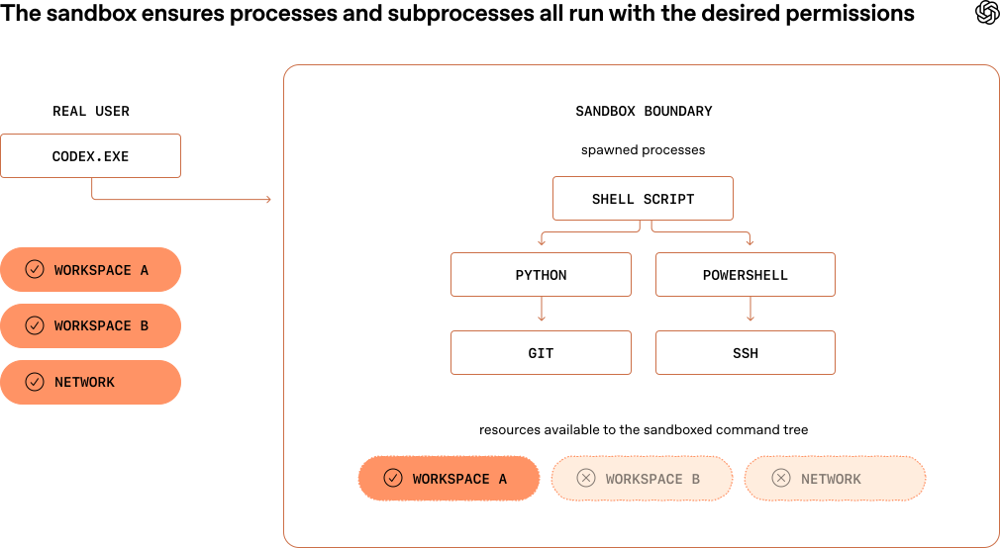
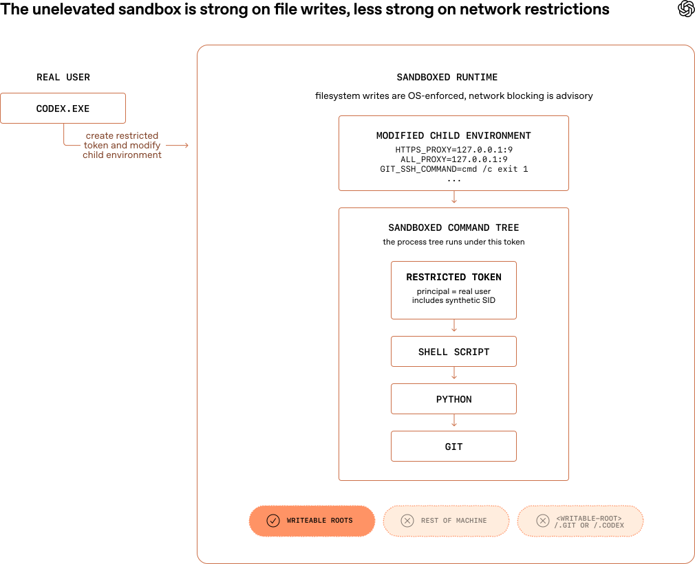
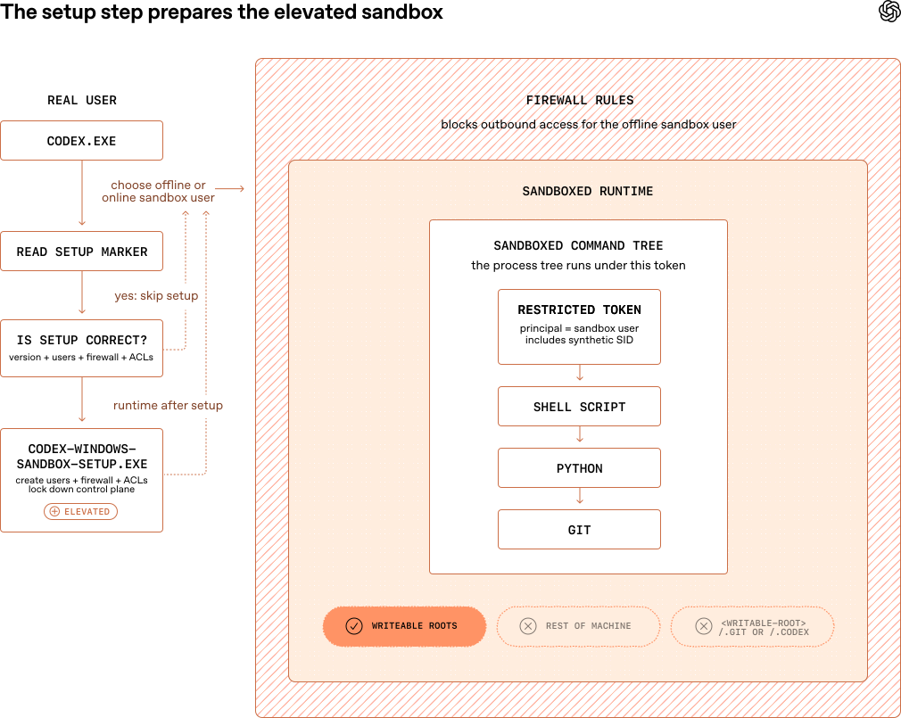
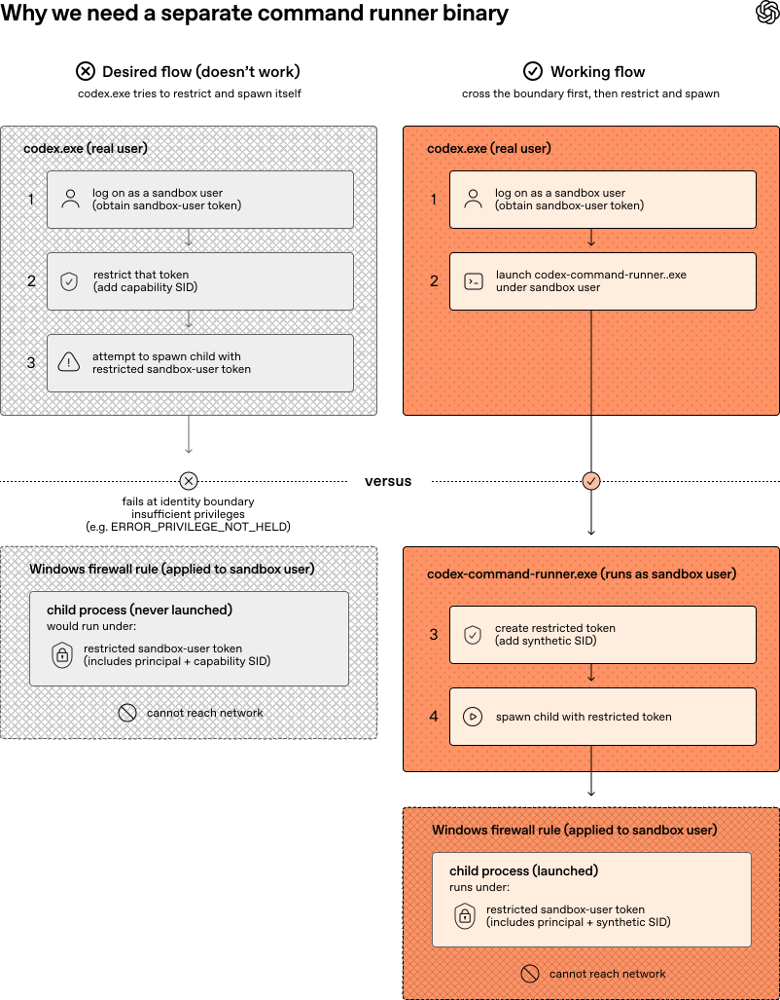

# 03_Building a safe, effective sandbox to enable Codex on Windows_为 Windows 上的 Codex 构建安全高效的沙箱环境

> 英文原文：https://openai.com/index/building-codex-windows-sandbox/
> 官方中文：https://openai.com/zh-Hans-CN/index/building-codex-windows-sandbox/
> 作者：OpenAI｜发布日期：2026-05-13
> 版式说明：逐句中英对照——每一句（或一小段连续的）英文下面紧跟中文翻译。中文译文以 OpenAI 官方中文版为基准，官方缺失或漏译处由译者补译并加注说明。关键术语首次出现时在译文中保留英文原词，便于对照记忆。

---

When I joined the Codex engineering team in September 2025, Codex for Windows didn’t have a sandbox implementation meaning that Windows users were forced to choose between two subpar options when using OpenAI's coding agents:

我在 2025 年 9 月加入 Codex 工程团队时，Codex Windows 版还未实现沙箱功能。这意味着 Windows 用户在使用 OpenAI 的编程智能体 (coding agent) 时，需要在以下两种不理想的选项中做出选择：

1.   Approving nearly every command (even reads) that a coding agent wanted to run, which is inefficient and pesky. A major benefit of using Codex is that you don’t have to do all the tedious work yourself.

1.   批准几乎所有命令（包括读取操作）：智能体想要运行的每条命令都需要用户审批。这不仅效率低下，而且非常繁琐。而使用 Codex 的核心优势，本就是为了让人免于承担这些枯燥的工作。

2.   Enabling Full Access mode: letting Codex run all commands without approval or restrictions, which removes friction at the expense of oversight.

2.   启用“完全访问”模式 (Full Access mode)：允许 Codex 在没有任何审批或限制的情况下运行所有命令。这虽然消除了操作阻力，却牺牲了安全监管。

[Codex⁠](https://openai.com/codex/), our coding agent, runs on developer laptops—whether that’s through the CLI, the IDE extension, or the desktop app.

作为我们的编程智能体，[Codex⁠](https://openai.com/codex/) 运行在开发者的笔记本电脑上 — 无论是通过 CLI、IDE 扩展还是桌面应用程序。

It manages a conversation between a human at a keyboard and a model running in the cloud to handle inference.

它负责管理键盘前的用户与在云端进行推理的模型之间的对话。

Codex runs with the permissions of a real user by default, meaning it can do everything the user can do.

默认情况下，Codex 以真实用户的权限运行，这意味着它拥有和用户完全相同的操作能力。

This is powerful and potentially dangerous.

这很强大，但也伴随着潜在的危险。

The coding model may tell the harness to run commands locally, from running tests to reading or editing a file to creating a Git branch, so Codex's default mode attempts to find the right balance between effectiveness and safety.

编程模型可能会指示框架 (harness) 在本地运行命令，从运行测试、读取或编辑文件，到创建 Git 分支。因此，Codex 的默认模式试图在“有效性”与“安全性”之间找到恰当的平衡。

This default mode allows Codex to read files almost anywhere and write files within your workspace (i.e., the directory where you’re running Codex), with no internet access unless you specify you want it.

在这种默认模式下，Codex 可以读取几乎任何地方的文件，并在你的工作空间（即运行 Codex 的目录）内写入文件，同时除非你明确指定，否则它无法访问网络。

To achieve this automatic constraint of writing files and accessing the network within safe bounds, Codex needs a sandbox environment that actually enforces these constraints.

为了在安全范围内自动实现对文件写入和网络访问的约束，Codex 需要一个能够真正执行这些限制的沙箱环境。

A _sandbox_ is a constrained execution environment.

_沙箱_ 是一个受限的执行环境。

When a developer uses Codex, their computer's operating system launches a command with reduced permissions, and those constraints propagate down the process tree.

当开发者使用 Codex 时，其计算机的操作系统会启动一个运行权限降低的命令，并且这些限制会向下传递到进程树 (process tree)。

Every Codex command is sandboxed from the start, and every descendant process stays inside the same boundary.

每一个 Codex 命令从一开始就处于沙箱之中，且其所有子进程 (descendant process) 也都保持在相同的边界内。

*图注：沙箱确保进程及其所有子进程都在同一条边界内、以既定的约束运行——`codex.exe` 由真实用户启动，而它派生出的 shell 脚本、Python、Git、SSH 等整棵进程树都留在沙箱边界内，只能访问被允许的工作空间与网络资源。*

Codex needs isolation features enforced by the computer's operating system to implement an effective sandbox.

为了实现行之有效的沙箱，Codex 需要利用计算机操作系统强制执行的隔离特性。

Some operating systems provide utilities that do this well (e.g., Seatbelt on MacOs, seccomp or bubblewrap on Linux); however, Windows doesn’t currently provide this type of capability out of the box.

一些操作系统提供了能够很好实现这一功能的工具，例如 macOS 上的 Seatbelt，以及 Linux 上的 seccomp 或 bubblewrap。然而，Windows 目前并未内置此类功能。

To make Codex just as safe and delightful to use on Windows as it already is everywhere else, we needed to implement our own sandbox.

若 Windows 用户希望享受到与其他平台一样安全且顺畅的 Codex 使用体验，则需要实现自己的沙箱方案。

## Where existing Windows tools fell short｜现有 Windows 工具的局限性

Windows offers some tools and primitives for isolation.

Windows 确实提供了一些用于隔离的工具和原语。

While none of them quite met our requirements, we looked at a number of potential solutions—namely, AppContainer, Windows Sandbox, and Mandatory Integrity Control labeling.

虽然它们都无法完全满足我们的需求，但我们评估了多种潜在的解决方案，具体包括 AppContainer、Windows Sandbox 以及 Mandatory Integrity Control 标签。

**AppContainer**

*   **What:** AppContainer is the native Windows sandbox, a capability-based isolation model built for apps that know, up front, exactly what they need to access.

*   **定义**：AppContainer 是 Windows 原生沙箱，是一种基于能力的隔离模型。它专为那些在启动前就明确知晓自身所需访问权限的应用程序而设计。

*   **Why**: Appealing because it offers a real OS boundary instead of best-effort restrictions.

*   **优势**：其吸引力在于它提供了真正的操作系统级别边界，而不仅仅是尽力而为的限制。

*   **Why not**: Codex is not one tightly scoped app. It drives open-ended developer workflows: shells, Git, Python, package managers, build tools, and whatever other binaries the agent decides it needs. In practice, that made AppContainer the wrong shape for the problem. It was strong isolation, but for a much narrower class of workloads than “let an agent operate like a developer.”

*   **劣势**：然而，Codex 并不是一个应用场景单一的程序。它需要驱动开放式的开发者工作流，包括 shell、Git、Python、包管理器、构建工具，以及智能体认为需要的任何其他二进制文件。在实际应用中，这使得 AppContainer 的模式与当前问题并不匹配。虽然它提供了高强度的隔离，但它针对的工作负载类型，远比“让智能体像开发者一样进行操作”要狭窄得多。

**Windows Sandbox**

*   **What:** Windows Sandbox is Microsoft’s disposable lightweight VM. You get a fresh Windows desktop with a strong isolation boundary, and whatever you do inside it disappears when the session ends.

*   **定义**：Windows Sandbox 是微软推出的一种一次性轻量级虚拟机。它能提供一个拥有强隔离边界的全新 Windows 桌面环境，且会话结束时，你在其中进行的所有操作都会自动销毁。

*   **Why**: Interesting for obvious reasons—far more compatible with arbitrary software than AppContainer, and from a security perspective it’s a much stronger box.

*   **优势**：其吸引力显而易见 — 与 AppContainer 相比，它对任意软件的兼容性要好得多，而且从安全角度来看，它是一个更坚固的隔离盒。

*   **Why not**: Codex needs to act directly on the user’s actual checkout, tools, and environment, not inside a separate throwaway desktop that would need setup and host/guest bridging. It also had a fundamental product problem: Windows Sandbox isn’t even available on Windows Home SKUs.

*   **劣势**：然而，Codex 需要直接在用户真实的签出代码 (checkout)、工具和环境中操作，而不是在一个需要进行配置以及主机/虚拟机桥接的独立一次性桌面内运行。此外，它还面临一个根本性的产品问题：Windows 10/11 家庭版 (Home SKU) 甚至根本不支持 Windows Sandbox。

**Mandatory Integrity Control (MIC) integrity labeling｜Mandatory Integrity Control (MIC) 完整性标签**

*   **What**: Windows has a concept called “integrity levels,” such as low, medium, and high, that determine how much the system trusts objects and processes. The basic rule is that a lower-integrity process cannot write to an object with a higher integrity level, even if the normal ACL would otherwise allow it. For example, a low-integrity process is treated as less trusted, so Windows blocks it from writing to normal medium-integrity objects, unless those objects are explicitly relabeled to allow it.

*   **定义**：Windows 中有一个名为“完整性级别”的概念（如低、中、高），用于决定系统对对象和进程的信任程度。其基本规则是，低完整性进程无法写入高完整性级别的对象，即使常规的访问控制列表 (ACL) 允许该操作也不行。例如，低完整性进程会被视为不够信任的进程，因此 Windows 会阻止其写入常规的中完整性对象，除非这些对象被明确重新贴上允许写入的标签。

*   **Why**: MIC looked elegant on paper—run Codex at low integrity, relabel the writable roots as low integrity, and let Windows enforce no-writes everywhere else. That would've given us a non-admin path with a real OS mechanism behind it.

*   **优势**：MIC 在理论上看起来很优雅 — 让 Codex 在低完整性下运行，为可写根目录重新贴上低完整性标签，然后让 Windows 在其他所有地方强制执行禁止写入的规定。这将为我们提供一条无需管理员权限，且背后有真实操作系统机制支撑的路径。

*   **Why not**: Like ACLs, integrity labels modify the real host filesystem, and in this case the semantic change is especially broad. Marking a workspace as low integrity does not just mean “Codex can write here.” It means low-integrity processes _in general_ can write there. On a real developer machine, that turns the user’s actual checkout into a low-integrity sink for the host, which is much riskier than granting carefully targeted ACLs to one sandbox design. Even if medium-integrity developer tools continue to work, the underlying trust model of the workspace has changed in a way that’s hard to contain and harder to justify.

*   **劣势**：但与 ACL 一样，完整性标签修改的是真实的主机文件系统，而且在这种情况下，语义层面的改变尤为广泛。将一个工作区标记为低完整性，并不单单意味着“Codex 可以在这里写入”，它还意味着 _普通的_ 低完整性进程大都可以向这里写入。在真实的开发者电脑上，这会使用户真实的签出代码变成主机上的低完整性汇点 (sink)，这比针对某种沙箱设计授予精心规划的 ACL 要危险得多。即便中完整性的开发工具仍能正常工作，但工作空间底层的信任模型已经发生了改变，这种改变很难控制，也更难证明其合理性。

Having evaluated all of the options as non-starters, we started designing our own solution to bring a good Codex experience to Windows users.

在评估完所有方案并确认均不可行后，我们开始设计自己的解决方案，以便为 Windows 用户带来出色的 Codex 体验。

## The first prototype: the "unelevated sandbox"｜首个原型：“未提权的沙箱”

Our first working prototype used a combination of Windows concepts and tools to implement the isolation we needed.

我们的第一个可用原型结合了多种 Windows 概念和工具，从而实现了所需的隔离。

From the beginning, one goal was to make this work without requiring _elevation_, meaning that Codex would not need to prompt the user for administrator privileges just to set up or run the sandbox.

从一开始，我们的目标之一就是让沙箱在不要求 _提权 (elevation)_ 的情况下运行，这意味着 Codex 无需为了配置或运行沙箱而向用户申请管理员权限。

That meant figuring out how to put reasonable limits on two things: file writes and network access.

这就需要我们想出办法，对两件事施加合理的限制：文件写入和网络访问。

### Limiting file writes｜限制文件写入

If we didn’t limit file writes at all, we’d have a safety issue.

如果对文件写入完全不加限制，就会带来安全问题。

If we limited file writes too much, the sandbox would hurt user productivity, needing to ask for constant approval.

但如果限制得过于严苛，沙箱又需要频繁请求用户审批，从而损害用户的生产力。

To solve this problem, we relied on two important Windows building blocks: SIDs and write-restricted tokens.

为了解决这一问题，我们依赖了两个关键的 Windows 构建基块：安全标识符 (SID) 和写入受限令牌 (write-restricted token)。

#### SIDs let us give the sandbox an identity｜利用 SID 为沙箱赋予身份

A SID, or security identifier, is the identity Windows ties to permissions.

SID，即安全标识符 (security identifier)，是 Windows 与权限绑定的身份证明。

Each user has a SID, groups have SIDs, and even a single login session gets its own SID.

每个用户都有一个 SID，各种组有 SID，甚至单次登录会话也会获得专属的 SID。

For example, a current logged-in session might have a SID like `S-1-5-5-X-Y`.

例如，当前登录的会话可能拥有类似于 `S-1-5-5-X-Y` 的 SID。

The SID assigned to the local administrators group might be `S-1-5-32-544`.

而本地管理员组被分配的 SID 可能是 `S-1-5-32-544`。

Windows also lets you create synthetic SIDs that don’t correspond to a real user but can still appear in ACLs (access control lists), which define who can read/write/execute specific files or directories.

Windows 还允许创建合成 SID，它们并不对应真实的用户，但仍能出现在访问控制列表 (ACL) 中。ACL 负责定义谁可以对特定的文件或目录进行读取、写入或执行操作。

That makes SIDs a useful primitive for our sandbox: we can create SIDs exclusively for the Codex sandbox to use, without interfering with anything else on the machine.

这使得 SID 成为我们沙箱中一个非常有用的原语：我们可以创建仅供 Codex 沙箱使用的专属 SID，而不会干扰计算机上的其他任何东西。

#### Write-restricted tokens limit where Codex can modify files｜利用写入受限令牌限制 Codex 修改文件的路径

Process tokens are security objects in Windows that define identity and privileges for a running process.

在 Windows 中，进程令牌 (process token) 是一种安全对象，用于定义运行中进程的身份和特权。

They determine what actions a process can perform.

它们决定了进程可以执行哪些操作。

A _write-restricted token_ is a particular type of process token that makes Windows perform an additional access check on write operations.

而 _写入受限令牌 (write-restricted token)_ 是一种特定类型的进程令牌，它会让 Windows 在处理写入操作时执行额外的访问检查。

In order for a write to succeed, two checks must pass:

为了成功进行写入，必须通过以下两项检查：

1.   The normal user identity (the token “owner”) must be allowed to do it

1.   常规用户身份（即令牌的“所有者”）必须被允许执行该操作

2.   At least one SID in the token’s restricted SID list must also be granted access

2.   令牌中“受限 SID 列表”里的至少一个 SID 也必须被授予访问权限

In practice, these checks let us use ACLs to define exactly where the sandbox could modify the filesystem, which offered the granularity we needed around write operations.

在实际应用中，这些检查让我们可以利用 ACL 来精确定义沙箱可以在文件系统的哪些位置进行修改，从而为我们提供了写入操作所需的细粒度控制。

With SIDs and write-restricted tokens, our unelevated sandbox worked like this:

结合 SID 和写入受限令牌，“未提权沙箱”的工作流程如下：

1.   The sandbox setup created a synthetic SID called `sandbox-write`.

1.   沙箱配置会创建一个名为 `sandbox-write` 的合成 SID。

2.   The `sandbox-write` SID was granted write, execute, and delete access to
    1.   The current working directory
    2.   Any additional `writable_roots` configured in `config.toml`.

2.   该 `sandbox-write` SID 被授予对以下位置的写入、执行和删除权限：
    1.   当前工作目录
    2.   在 `config.toml` 中配置的任何其他 `writable_roots`

3.   The sandbox setup explicitly denied that same SID write access to “read-only within writable” locations such as:
    1.   `<cwd>/.git`
    2.   `<cwd>/.codex`
    3.   `<cwd>/.agents`

3.   沙箱配置程序会明确拒绝该 SID 对“可写目录内的只读”位置的写入权限，例如：
    1.   `<cwd>/.git`
    2.   `<cwd>/.codex`
    3.   `<cwd>/.agents`

4.   Codex launched commands under a write-restricted token whose restricted SID list includes `Everyone`, the current logged in session SID, and the `sandbox-write` synthetic SID.

4.   Codex 在写入受限令牌下启动命令，该令牌的受限 SID 列表包含了 `Everyone`、当前登录的会话 SID 以及 `sandbox-write` 合成 SID。

*图注：沙箱写入必须同时满足「常规用户可写」和「沙箱 SID 可写」两个条件。表中逐条列出示例路径的判定结果——工作目录与额外可写根允许写入，`<cwd>/.git`、`<cwd>/.codex` 等虽然真实用户可写，但被显式拒绝（可写根内部的只读挖空），`C:/Windows/System32` 这类位置则两道检查都过不了。*

This flow effectively solved limiting file writes and seemed promising.

这一流程有效地解决了限制文件写入的问题，并且看起来很有前景。

Now we needed a solution for limiting the sandbox's network access.

接下来，我们需要一个能够限制沙箱网络访问的解决方案。

### Limiting network access｜限制网络访问

Limiting network access is an important part of the sandbox; without it, malicious code could exfiltrate data from the machine up to the internet.

限制网络访问是沙箱设计的重要组成部分。如果不加限制，恶意代码就可能将计算机中的数据窃取并上传到互联网。

Because we wanted to avoid an elevation requirement, we had limited options to strongly block network traffic.

由于我们希望避免提权要求，因此在强力阻断网络流量方面的选择非常有限。

The tools we wanted to use, like Windows Firewall, generally could not be installed without admin permissions.

我们原本想使用的工具（如 Windows 防火墙）通常都需要管理员权限才能配置。

Without Windows Firewall as an option, we limited what we could control.

在无法使用 Windows 防火墙的情况下，我们只能尽力限制我们所能控制的部分。

We tried to make the child environment fail-closed for the kinds of networked tools developers actually use, so that Git commands, package installers, etc., would fail in the sandbox and the user would have to approve any internet-facing operations.

我们尝试让子环境对开发者实际使用的各类网络工具表现为“故障关闭” (fail-closed) 状态，从而使沙箱内的 Git 命令、包安装程序等运行失败，迫使用户必须对任何面向互联网的操作进行审批。

The idea was to poison the obvious escape hatches: send proxy-aware traffic to a dead endpoint, make Git’s HTTP(S) transport do the same, and make Git over SSH fail immediately.

我们的核心思路是“毒化”那些显而易见的逃逸通道：将具备代理感知能力的流量重定向到一个死端（无效端点），让 Git 的 HTTP(S) 传输层也执行同样的操作，并使基于 SSH 的 Git 操作立即失败。

On top of that, we prepended a small `denybin` directory to PATH and reordered `PATHEXT` so stub SSH and SCP scripts would resolve before the real binaries.

此外，我们还在 PATH 的最前端添加了一个小型的 `denybin` 目录，并重新调整了 `PATHEXT` 的顺序，以便让 SSH 和 SCP 存根脚本先于真实的二进制文件被解析执行。

For example, here are some of the specific environment overrides we used to limit network access:

作为参考，以下是我们用于限制网络访问的部分具体环境覆写配置：

*   `HTTPS_PROXY=http://127.0.0.1:9`
*   `ALL_PROXY=http://127.0.0.1:9`
*   `GIT_HTTPS_PROXY=http://127.0.0.1:9`
*   `NO_PROXY=localhost,127.0.0.1,::1`
*   `GIT_SSH_COMMAND=cmd /c exit 1`

That caught a lot of normal tool-driven traffic, but it was still only advisory.

这种做法虽然拦截了大量由常规工具驱动的流量，但它仍然只是建议性的。

A process could ignore the environment, bypass PATH, or just open sockets directly—too risky.

任何进程都可以忽略环境变量、绕过 PATH，或者直接建立套接字 (socket) 进行连接 — 这带来很大风险。

*图注：未提权沙箱的全貌——文件写入由操作系统强制执行，网络封锁却只是「建议性」的。`codex.exe` 以真实用户身份创建受限令牌并改写子环境（`HTTPS_PROXY`、`ALL_PROXY`、`GIT_SSH_COMMAND` 等指向死端），整棵沙箱化进程树在该令牌下运行，令牌主体仍是真实用户、并附带合成 SID，因此只有可写根可写，机器其余部分不可写。*

### The unelevated approach came with tradeoffs｜未提权方案的权衡与代价

As with any interesting software implementation, the first prototype had some pros and cons.

与任何复杂的软件实现一样，第一个原型也同时具备优缺点。

While it got the job done with only a few standard Windows capabilities, allowed for very explicit and granular filesystem writes, and ran unelevated—cutting the need for users to accept excessive elevation prompts or be admins on their local machine—it had some real drawbacks, some of which disqualified it from becoming our final design:

虽然它仅靠几项标准的 Windows 功能就完成了任务，实现了非常明确且细粒度的文件系统写入限制，并且能够在未提权的状态下运行（让用户免于频繁点击烦人的提权提示，也无需拥有本地计算机的管理员权限），但它也存在一些缺陷，其中部分缺陷甚至使其无法成为我们的最终设计方案：

*   Speed of setup: Applying workspace ACLs can be expensive depending on the topology of the workspace directory.

*   配置速度慢：应用工作空间 ACL 的开销可能会很高，具体取决于工作空间目录的拓扑结构。

*   Footprint: We applied real ACLs to the developer’s system, although the footprint is not particularly invasive because all the applied ACLs pertain to a custom-created synthetic SID that is used only by the sandbox.

*   系统痕迹：我们向开发者的系统应用了真实的 ACL。不过这种痕迹的侵入性并不算大，因为所有应用的 ACL 都只关联一个定制创建的合成 SID，且该 SID 仅供沙箱使用。

*   Difficult-to-change semantics: The reliance on ACLs for file-based restrictions means it’s expensive and complex to change sandbox semantics. Whereas on macOS, we can dynamically change how we generate the `.sbpl` file used to configure Seatbelt, the Windows sandbox could require a slow and intense operation to adjust ACLs.

*   语义难以更改：依赖 ACL 来实现基于文件的限制，意味着更改沙箱语义的成本高昂且过程复杂。在 macOS 上，我们可以动态更改用于配置 Seatbelt 的 `.sbpl` 文件的生成方式；而在 Windows 上，调整 ACL 则可能需要执行一次缓慢且繁重的操作。

*   Network protection is weak. As mentioned before, it was “advisory,” would definitely be circumvented by some programs that implemented their own networking stack, and wasn’t designed to hold up to adversarial code.

*   网络防护薄弱：如前所述，这种防护只是“建议性”的。某些实现了自身网络栈的程序肯定能绕过它，而且它在设计之初就无法抵御恶意对抗代码。

The first three issues are inherent to a custom sandbox implementation that’s flexible enough for agentic flows.

前三个问题是定制沙箱实现所固有的代价 — 因为沙箱必须具备足够的灵活性来应对智能体工作流。

The network suppression story was different, though.

然而，网络抑制的情况却截然不同。

### Network suppression is too important｜网络抑制至关重要

In addition to a malicious agent being able to easily circumvent the environment-based network suppression, plenty of good-intentioned code/binaries would also circumvent it simply if they didn’t honor the environment proxy variables, or if they implemented their own socket-based network code.

除了恶意智能体可以轻松绕过基于环境变量的网络抑制之外，许多出于好意的正常代码或二进制文件，只要它们不遵循环境代理变量，或者实现了自己基于套接字 (socket) 的网络代码，也会轻易绕过这一限制。

We felt that this aspect was enough to consider investing in a better sandbox mode.

我们认为，仅凭这一点就足以让我们决定去投入研发更好的沙箱模式。

To gain better network suppression, we wanted to use Windows Firewall, which allows us to block outbound network traffic for users or programs.

为了获得更好的网络抑制效果，我们希望使用 Windows 防火墙，因为它允许我们阻止用户或程序的出站网络流量。

Unfortunately, we couldn’t effectively create a functional firewall rule that applied only to the commands spawned by the Codex harness for a few reasons:

然而，由于以下几个原因，我们无法有效创建一条仅适用于由 Codex 框架 (harness) 启动的命令的有效防火墙规则：

*   Windows doesn’t allow matching a firewall rule to the non-principal identity of a restricted token. This means we couldn’t apply a firewall rule to “any token that includes our synthetic SID in its restricted SID list."

*   Windows 不允许将防火墙规则与受限令牌的非主要身份 (non-principal identity) 进行匹配。这意味着我们无法将防火墙规则应用于“任何在其受限 SID 列表中包含我们合成 SID 的令牌”。

*   While we could create a firewall rule that matches a specific binary, that only allows us to limit networking for `codex.exe` itself. It wouldn’t apply to the processes that the agent spawns on behalf of the user, like Git or Python processes.

*   虽然我们可以创建一条匹配特定二进制文件的防火墙规则，但这只能让我们限制 `codex.exe` 本身的网络访问。它无法应用于智能体代表用户启动的其他进程，例如 Git 或 Python 进程。

*   Other firewall match dimensions were the wrong shape, too. User-scoped rules still matched the real Windows user in the unelevated design, not just the restricted child. Program-path rules were too coarse: they could block `codex.exe` or `python.exe` generally, but not this one sandboxed invocation of `python.exe`. Port- or address-based rules were also the wrong policy entirely. For instance, we didn’t want to block port 443; we wanted to block arbitrary outbound access for this specific restricted process tree.

*   其他防火墙匹配维度也同样不适用。在未提权的设计中，用户范围 (user-scoped) 的规则仍然匹配的是真实的 Windows 用户，而不仅仅是受限的子进程。程序路径规则又过于粗犷：它们可以普遍阻止 `codex.exe` 或 `python.exe`，但无法阻止本次被沙箱隔离的特定 `python.exe` 调用。基于端口或地址的规则在策略上也是完全错误的。例如，我们并不想阻止 443 端口，而是想阻止这个特定受限进程树的任意出站访问。

To apply a firewall rule specifically to our sandboxed commands, we needed to run them as a separate principal, not as the “real” user.

为了将防火墙规则专门应用于我们沙箱化的命令，我们需要让它们作为一个独立的外部主体 (principal) 运行，而不是作为“真实”用户。

This approach led us down a new path, one in which we relaxed our “no elevation” constraint.

这种方法引领我们走上了一条新路径。在这条路径上，我们放宽了“不提权”这一限制条件。

## The redesign: the "elevated sandbox"｜重新设计：“提权沙箱”

The next iteration of the sandbox, which is our current implementation, requires elevated admin permissions at setup time.

沙箱的下一次迭代（即我们目前的实现方案）在配置时需要管理员提权权限。

I therefore refer to it as “the elevated sandbox.”

因此，我将其称为“提权沙箱 (elevated sandbox)”。

At the boundary where Codex spawns a command on the system, the elevated sandbox looks like the unelevated one.

在 Codex 向系统启动命令这一环节上，提权沙箱与未提权沙箱看起来非常相似。

It still runs child processes under a restricted token—similarly a `write_restricted` token with the same restricted SID list of `[Everyone, Logon,``Synthetic``]`—however, the principal of this token is no longer the actual Windows user but one of two local users created by Codex itself:

它仍然在受限令牌 — 同样是包含 `[Everyone, Logon,``Synthetic``]` 相同受限 SID 列表的 `write_restricted` 令牌 — 下运行子进程。然而，该令牌的主要身份不再是真实的 Windows 用户，而是由 Codex 自身创建的两个本地用户之一：

*   `CodexSandboxOffline` (the one targeted by firewall rules)

*   `CodexSandboxOffline`（受防火墙规则管辖的用户）

*   `CodexSandboxOnline` (the one not targeted by firewall rules)

*   `CodexSandboxOnline`（不受防火墙规则管辖的用户）

This seemingly small detail actually has big implications for the sandbox, who can use it, and the complexity of its setup and runtime execution.

这个看似微小的细节，实际上对沙箱、其适用人群，以及配置和运行时的执行复杂度产生了巨大影响。

It’s visually similar to the unelevated prototype, with the introduction of firewall rules and a dedicated Windows user, which actually runs the commands. (However, the introduction of these new concepts, means that there is more setup work to do before the sandbox can start running and protecting commands.)

它在视觉结构上与未提权的原型相似，但引入了防火墙规则和负责实际运行命令的专属 Windows 用户。（然而，这些新概念的引入，意味着在沙箱能够启动运行并开始保护命令之前，还有更多的配置工作要做。）

*图注：提权沙箱在未提权原型之外，多包了一层防火墙规则——它按用户身份阻断离线沙箱用户的全部出站访问。`codex.exe` 先选择「离线 / 在线」沙箱用户，受限令牌的主体因此不再是真实用户，而是这个专属沙箱用户（仍附带合成 SID），整棵进程树都跑在这层防火墙之内。*

### We now need a first-class setup step｜我们现在需要专属的配置步骤

The unelevated sandbox design had a simple setup step, but it was relatively small:

未提权沙箱设计的配置步骤非常简单，且工作量相对较小：

*   Create a synthetic SID if needed

*   如果需要，创建合成 SID

*   Apply ACLs for the sandbox-write synthetic SID

*   为 sandbox-write 合成 SID 应用 ACL

The elevated sandbox, however, has more to do.

然而，提权沙箱需要做更多的工作：

*   Create a synthetic SID, if not already created

*   如果尚未创建，创建合成 SID

*   Create the online and offline sandbox users, if not already created

*   如果尚未创建，创建在线和离线沙箱用户

*   Store the newly-created users’ credentials locally and encrypt using the Windows Data Protection API (DPAPI) in a place where the sandbox users cannot actually read

*   在本地存储新创建的用户凭据，并使用 Windows 数据保护 API (DPAPI) 将其加密保存在沙箱用户实际无法读取的位置

*   Create firewall rules that block all outbound network access for the `CodexSandboxOffline` user or, if they already exist, validate they’re correct

*   创建阻止 `CodexSandboxOffline` 用户所有出站网络访问的防火墙规则；如果规则已存在，验证其是否正确

There’s an additional wrinkle in the setup stage.

在配置阶段还有一个额外的复杂问题。

Codex’s sandbox is expected to have read access equivalent to the actual Windows user.

Codex 的沙箱预计需要拥有与真实 Windows 用户等同的读取权限。

In the unelevated sandbox, where the restricted token’s principal SID was the Windows user, this was achieved.

在未提权沙箱中，由于受限令牌的主要身份 SID 就是该 Windows 用户，这一需求自然得以实现。

However, that doesn’t come for free when the principal becomes a new `CodexSandbox` user.

然而，当该主体成为新的 `CodexSandbox` 用户时，这并非毫无代价。

Many relevant directories on Windows will grant read/execute permissions to “Authenticated Users”.

Windows 上的许多相关目录会向“Authenticated Users”（已认证用户）授予读取/执行权限。

One notable example is the user’s profile directory.

一个显著的例子就是用户的个人资料 (profile) 目录。

By default, Windows users cannot read the profile directories of other Windows users, so even simple file reads in many scenarios would fail.

默认情况下，Windows 用户无法读取其他 Windows 用户的个人资料目录，因此在许多场景下，即使是简单的文件读取操作也会失败。

To address this, we added another layer to the sandbox setup process—one for granting _read_ ACLs to the sandbox users where such ACLs might not already exist.

为了解决这个问题，我们在沙箱配置流程中增加了另一层机制，用于在相关 _读取_ ACL 可能尚不存在的情况下，向沙箱用户授予读取 ACL。

For example, to some commonly used Windows directories:

例如，针对一些常用的 Windows 目录：

*   `C:\Users\<real-user>`
*   `C:\Windows\`
*   `C:\Program Files\`
*   `C:\Program Files (x86)\`
*   `C:\ProgramData\`

Because this list of directories is best-effort and installing ACLs on each one can be quite expensive, we run this logic asynchronously so the sandbox setup step, which is blocking to users, doesn’t have to wait for them to complete.

由于这个目录列表是尽力而为的，且在每个目录上配置 ACL 的开销可能非常高，因此我们采用异步方式运行该逻辑，这样对用户产生阻塞的沙箱配置步骤就无需等待它们执行完毕。

We encapsulated the setup logic in its own binary partly to cross the UAC boundary only when needed.

我们将配置逻辑封装在独立的二进制文件中，部分原因是为了仅在需要时才跨越 UAC 边界。

But the deeper reason was architectural: sandbox setup has a fundamentally different job from `codex.exe`.

但更深层次的原因在于架构设计：沙箱配置与 `codex.exe` 有着本质上不同的职责。

Keeping the sandbox setup logic in a dedicated binary let `codex.exe` stay a normal, unelevated harness; kept the Windows-only setup machinery from bloating `codex.exe` on other platforms; decoupled longer-running setup work from the lifetime of the main process; and gave us one place to handle the different setup paths the sandbox needed.

将沙箱配置逻辑保留在专属的二进制文件中，可以让 `codex.exe` 保持为普通的未提权框架 (harness)；防止仅适用于 Windows 的配置机制导致其他平台上的 `codex.exe` 体积膨胀；将运行时间较长的配置工作与主进程的生命周期解耦；并为我们提供一个统一的地方来处理沙箱所需的各种不同配置路径。

*图注：一等公民式的配置步骤如何建立提权沙箱——`codex.exe` 先读取配置标记，检查「版本 + 用户 + 防火墙 + ACL」是否已就绪：已就绪则跳过配置，否则调起需要提权的 `codex-windows-sandbox-setup.exe` 去创建用户、防火墙规则与 ACL 并锁定控制面。配置完成后，运行时才进入右侧那套沙箱化的执行环境。*

### The command runner is a new binary that actually runs user commands｜命令运行器：一个负责实际运行用户命令的新二进制文件

Because of how Windows user and token login boundaries work, we couldn’t continue to create a restricted token and spawn a process under it the way we could with the unelevated sandbox.

由于 Windows 用户与令牌登录边界的工作机制限制，我们无法再像未提权沙箱那样，直接创建一个受限令牌并在其下生成进程。

To actually spawn commands as a different Windows user, our first idea was the following flow:

为了真正以不同的 Windows 用户身份生成命令，我们最初设想的流程如下：

*   `codex.exe` runs as the real Windows user. Then, in a sequence, Codex:
    *   Calls `LogonUserW(...)` for the sandbox user.
    *   Calls `CreateRestrictedToken(...)` on that sandbox-user token.
    *   Using that restricted sandbox-user token, calls `CreateProcessAsUserW(...)` to launch the final child.

*   `codex.exe` 作为真实的 Windows 用户运行。随后，Codex 依次执行以下操作：
    *   为沙箱用户调用 `LogonUserW(...)`。
    *   对该沙箱用户令牌调用 `CreateRestrictedToken(...)`。
    *   使用该受限的沙箱用户令牌，调用 `CreateProcessAsUserW(...)` 来启动最终的子进程。

In practice, that desired flow didn’t work because of a privilege wall at `CreateProcessAsUserW(...)`.

在实际应用中，由于 `CreateProcessAsUserW(...)` 存在特权壁垒，这一设想的流程无法正常工作。

This means `codex.exe` could create a restricted token for the sandbox user, but it couldn’t reliably launch a child with that token from the real-user side of the boundary.

这意味着 `codex.exe` 虽然可以为沙箱用户创建受限令牌，但它无法从边界的真实用户一侧，稳定地利用该令牌启动子进程。

We needed a process that was already running as the sandbox user—this would let the restriction step and final spawn happen on the sandbox-user side of the boundary instead of the real-user side.

我们需要一个已经作为沙箱用户运行的进程 — 这样就能让限制步骤和最终启动进程发生在边界的沙盒用户一侧，而不是真实用户侧。

That requirement led to `codex-command-runner.exe`, a new binary whose only job is to mint a restricted token and spawn the requested command.

这一需求促成了 `codex-command-runner.exe` 的诞生，这是一个全新的二进制文件，其唯一职责就是生成受限令牌并启动请求的命令。

Instead of asking `codex.exe` to do the entire flow itself (real user → sandbox user → restricted token → child process), we split the flow in two:

我们没有让 `codex.exe` 自身独立完成整个流程（真实用户 → 沙箱用户 → 受限令牌 → 子进程），而是将流程一分为二：

**Part 1**

**第 1 部分**

*   `codex.exe` calls `CreateProcessWithLogonW(...)` to launch `codex-command-runner.exe` as the sandbox user, without using a restricted token yet.

*   `codex.exe` 调用 `CreateProcessWithLogonW(...)`，以沙箱用户的身份启动 `codex-command-runner.exe`，此时暂不使用受限令牌。

**Part 2**

**第 2 部分**

*   Inside the runner, `OpenProcessToken(GetCurrentProcess(), ...)` opens the runner’s own token, which already belongs to the sandbox user.

*   在运行器内部，`OpenProcessToken(GetCurrentProcess(), ...)` 会打开运行器自身的令牌，该令牌已然属于沙箱用户。

*   The runner calls `GetTokenInformation(...)` to extract the sandbox logon SID, then `CreateRestrictedToken(...)` to build the final restricted token.

*   运行器调用 `GetTokenInformation(...)` 来提取沙箱登录 SID，然后调用 `CreateRestrictedToken(...)` 来构建最终的受限令牌。

*   Still inside the runner, it calls `CreateProcessAsUserW(...)` with that restricted token to launch the real child.

*   依然在运行器内部，它使用该受限令牌调用 `CreateProcessAsUserW(...)`，从而启动真正的子进程。

*图注：为什么必须多一个独立的命令运行器二进制文件。左侧是设想中的流程：`codex.exe` 以真实用户身份登录沙箱用户 → 加限制 → 直接拉起子进程，结果卡在身份边界上（特权不足，典型报错 `ERROR_PRIVILEGE_NOT_HELD`），子进程根本没被启动。右侧是可行流程：先跨过身份边界，以沙箱用户身份启动 `codex-command-runner.exe`，再由它在沙箱用户一侧创建受限令牌（加入合成 SID）并派生真正的子进程。*

### The full picture｜全貌

Albert Einstein said, “Everything should be made as simple as possible, but no simpler.”

阿尔伯特·爱因斯坦曾说：“一切都应该尽可能简单，但不能过于简单。”

In that spirit, our design adequately solved each problem.

秉承这一原则，我们的设计恰到好处地解决了每一个问题。

The final architecture has the four layers we have previously covered:

最终的架构由我们前面提到的四个层级组成：

*   `codex.exe` itself

*   `codex.exe` 本身

*   `codex-windows-sandbox-setup.exe` for handling all elevated setup related work

*   `codex-windows-sandbox-setup.exe`：用于处理所有与提权配置相关的工作

*   `codex-command-runner.exe` for running restricted token commands

*   `codex-command-runner.exe`：用于在受限令牌下运行命令

*   The child process

*   子进程

*图注：完整的沙箱架构总图。左侧是 `codex.exe` 与提权的 `codex-windows-sandbox-setup.exe` 组成的配置链路（读标记 → 校验 → 必要时提权配置），中间是父进程与运行器之间基于命名管道的 IPC（长度前缀的 JSON 帧，传递 `spawn_request`、`spawn_ready`、`output`），以及由配置程序管理、运行器无权访问的沙箱控制面（`~/.codex/.sandbox`、`.sandbox-secrets`、`cap_sid`）；右侧是被防火墙包裹的沙箱运行时——受限令牌下的整棵命令进程树，只有可写根可写。*

When I first approached this project, I did not have a strong sense of where it would wind up.

当我最初着手这个项目时，我并没有一个明确的预判，不知道它最终会走向何方。

My approach was to start by instrumenting the sandboxing capability in the boundary between Codex and the operating system.

我的方法是，首先在 Codex 与操作系统之间的边界上构建沙箱功能。

This approach closely matches how Codex’s sandbox is implemented on MacOs and Linux.

这种方法与 Codex 在 macOS 和 Linux 上的沙箱实现方式非常相似。

As I learned more about the specific tools that Windows provides, and through dozens of decisions balancing security and ease of use, the system grew to its current form—multiple binaries, custom users, firewall rules, an elevated setup step, asynchronous processes, and more.

随着我对 Windows 提供的特定工具有了更深入的了解，并通过数十次在安全性与易用性之间进行权衡的决策，系统逐渐演变成了现在的形态 — 包含多个二进制文件、定制用户、防火墙规则、提权的配置步骤、异步进程等。

It’s not a particularly simple system, but each piece of complexity was added out of necessity, to build a sandbox that is both safe and, as much as possible, not in the user's way.

这并不是一个特别简单的系统，但每一处复杂性的引入都是出于必然，目的是为了构建一个既安全又尽可能不打扰用户的沙箱环境。

## Balancing safety with actual usefulness｜在安全性与实用性之间找到平衡

Working to deliver a good user experience for Codex users on Windows, our goal was to make something safe that didn’t compromise on usefulness—the whole point of using Codex is to have agents be able to do work without your constant attention.

为了给 Windows 上的 Codex 用户带来优秀的体验，我们的目标是打造一个既安全又不牺牲实用性的东西 — 毕竟使用 Codex 的核心意义，就在于让智能体能够在无需你持续关注的情况下独立完成工作。

One of the biggest lessons from this project was that Windows did not hand us one primitive that cleanly maps to “safe autonomous coding agent.”

这个项目给我们的最大启示之一，是 Windows 并没有直接为我们提供一个能够完美对应“安全自主编程智能体”的原语。

We composed several tools and concepts to build something coherent.

我们组合了多种工具和概念，才构建出一个连贯的整体。

Some early ideas were dead ends.

一些早期的想法最终被证明是死胡同。

The final design was a hybrid of earlier prototypes that each solved part of the problem.

而最终的设计方案，则是对那些各自解决了部分问题的早期原型进行融合的产物。

The other lesson was that security for a coding agent is a different beast than more classic application security.

另一个教训是，编程智能体的安全问题与更传统的应用程序安全有着本质的不同。

Codex has to work for real developer workflows.

Codex 必须适用于真实的开发者工作流。

The engineering work was about balancing compatibility with agentic workloads against real enforcement.

我们的工程重心，始终是在兼容智能体工作负载与保障真实强制力之间找到平衡。

That tension shaped tradeoffs in the final design.

这种博弈决定了最终设计方案中的各种权衡与取舍。

Curious to see the Codex sandbox in action? [Try it out⁠](https://openai.com/codex/).

想体验 Codex 沙箱的实际运行效果吗？不妨[亲自尝试一下⁠](https://openai.com/codex/)。
