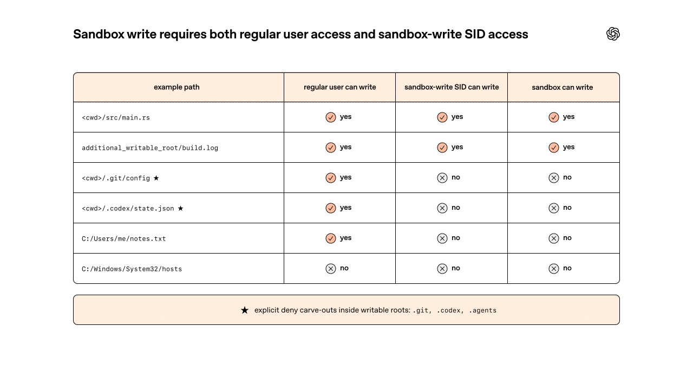
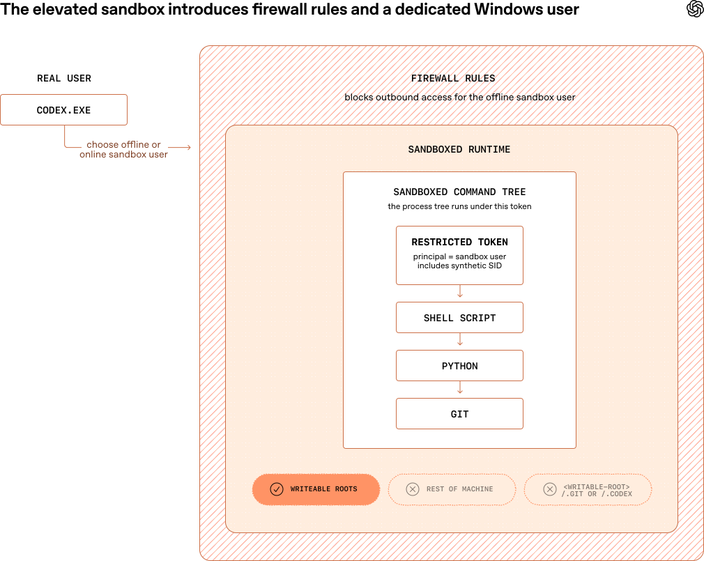
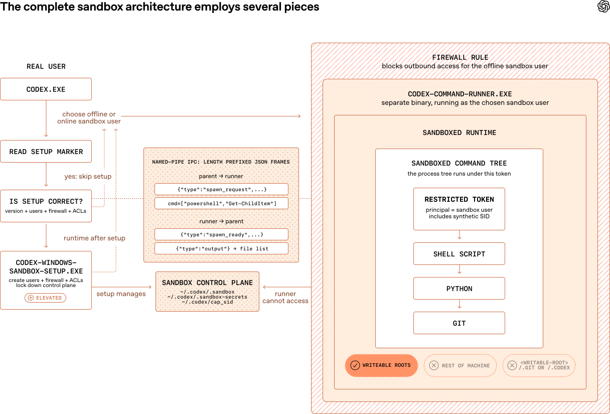

# 03_为 Windows 上的 Codex 构建沙箱_面试速记

> OpenAI · 2026-05-13 · [英文原文](https://openai.com/index/building-codex-windows-sandbox/) · [官方中文](https://openai.com/zh-Hans-CN/index/building-codex-windows-sandbox/) · [本地逐句对照](03_Building%20the%20Codex%20Windows%20sandbox_为%20Windows%20上的%20Codex%20构建安全高效的沙箱环境_逐句对照.md)

## 一句话讲明白

**macOS 有 Seatbelt、Linux 有 seccomp / bubblewrap，Windows 什么现成的都没有——所以 Codex 团队用 Windows 自带的安全标识符（SID）、访问控制列表（ACL）和写入受限令牌（write-restricted token）拼出了一个沙箱：文件写入这一层用「不提权」就能锁死，但网络那一层怎么都锁不死，最后只能放弃「不提权」这条产品红线，改成由 Codex 自建两个本地用户、用 Windows 防火墙按用户身份封掉出站流量。**

## 为什么值得读 / 能用在哪

- 这是「同一个安全目标，换个操作系统就得重做一遍」的完整案例。面试里被问「你们的沙箱怎么跨平台」，能把 Windows 这条最难的路讲清楚，比背 Docker 参数有说服力。
- 它演示了一个非常真实的工程决策链：**先定一条产品约束（不要求管理员权限）→ 发现约束下有一层做不到（网络）→ 判断这一层重要到不可妥协 → 回头推翻约束**。这个「哪条约束该被推翻」的判断力，正是面试官想看的。
- 可直接迁移的经验：**基于环境变量 / PATH 的限制永远只是建议性的**，任何自带网络栈的程序都能绕过。真正的强制力必须来自操作系统按「身份」而不是按「程序路径」下的规则。
- 反面参考：Windows 上「原生沙箱」AppContainer 明明是最正统的答案，却因为智能体（agent）工作负载太开放而完全不适用——提醒你选型时先看**工作负载形状**，再看安全强度。

## 核心要点

### 1. 起点：Windows 用户当时只有两个烂选项

2025 年 9 月作者加入 Codex 工程团队时，Codex 的 Windows 版**根本没有沙箱**。Windows 用户只能二选一：

1. **几乎每条命令都批准一次**（连读取都要点），繁琐且低效——可用 Codex 的意义本来就是不用自己干这些琐事。
2. **开「完全访问」模式（Full Access）**，不审批不限制，用监管换顺畅。

而 Codex 的默认模式想要的平衡是：**几乎哪里都能读、只能在工作空间（运行 Codex 的目录）里写、默认不能上网**。要让这个默认模式不是一句空话，就必须有一个真正能强制执行它的沙箱。

沙箱的定义也要背下来：**受限的执行环境**——操作系统以降低的权限启动一条命令，且限制**沿进程树向下传递**，每条 Codex 命令从一开始就在沙箱内，所有子进程都留在同一条边界内。

### 2. 三个现成方案，为什么全都不行

面试常考「你调研过哪些方案、为什么否掉」。这三条要能张口就来：

| 方案 | 是什么 | 为什么否掉 |
| --- | --- | --- |
| **AppContainer** | Windows 原生沙箱，基于能力（capability）的隔离模型 | 它是给「启动前就明确知道自己要访问什么」的应用设计的。Codex 要驱动 shell、Git、Python、包管理器、构建工具和智能体临时决定要用的任何二进制文件——**隔离很强，但适配的工作负载类型太窄**，形状不对 |
| **Windows Sandbox** | 微软的一次性轻量虚拟机，会话结束全部销毁 | Codex 要直接操作用户**真实的**签出代码（checkout）、工具和环境，不是另开一个需要配置和主机／虚拟机桥接的一次性桌面。还有个致命的产品问题：**Windows 家庭版根本没有这个功能** |
| **完整性标签（Mandatory Integrity Control, MIC）** | Windows 的「完整性级别」（低／中／高）：低完整性进程写不了高完整性对象，即使 ACL 允许也不行 | 纸面上很优雅（Codex 跑在低完整性、把可写根目录标成低完整性），但**标签改的是真实主机文件系统，语义外溢太广**：把工作空间标成低完整性不等于「只有 Codex 能写这里」，而是**所有**低完整性进程都能写——用户真实的代码目录变成了主机上的「低完整性汇点（sink）」 |

**三条共通的教训**：一个隔离机制好不好用，取决于它的粒度能不能对准「这一次沙箱化的调用」，而不是「这个程序」或「这台机器」。

### 3. Windows 安全原语速成（不懂这三个，后面全看不懂）

- **安全标识符（SID, security identifier）**：Windows 里和权限绑定的身份。每个用户有 SID，每个组有 SID，**连一次登录会话也有自己的 SID**。例：当前登录会话可能是 `S-1-5-5-X-Y`，本地管理员组是 `S-1-5-32-544`。
- 关键点：Windows 允许创建**合成 SID（synthetic SID）**——不对应任何真实用户，但照样能写进 ACL。这让 Codex 可以造一个**只有自己用的身份**，不干扰机器上的任何其他东西。
- **访问控制列表（ACL, access control list）**：挂在文件／目录上，规定谁能读、写、执行。
- **进程令牌（process token）**：Windows 的安全对象，定义一个运行中进程的身份和特权，决定它能干什么。
- **写入受限令牌（write-restricted token）**：一种特殊进程令牌，**让 Windows 在写操作时多做一次检查**。写入要成功必须**两项同时通过**：
  1. 常规用户身份（令牌的「所有者」）被允许写；
  2. 令牌的「**受限 SID 列表**」里**至少有一个 SID** 也被授予了写权限。

这个「两把钥匙同时对上才开门」的结构，就是整个 Codex Windows 沙箱写入控制的地基。

*图注：两道检查的实际判定效果——工作目录和额外可写根允许写入；`.git`、`.codex` 虽然真实用户可写，但被显式拒绝；`C:/Windows/System32` 两道检查都过不了。*

### 4. 第一版原型：「未提权沙箱」怎么锁住文件写入

从一开始就定了一条产品目标：**不需要提权（elevation）**——Codex 不该为了配置或运行沙箱去弹管理员授权框。在这个约束下要解决两件事：文件写入、网络访问。

文件写入这一层做得相当漂亮，四步流程要能背：

1. 配置阶段创建一个叫 `sandbox-write` 的**合成 SID**。
2. 给这个 SID 授予**写、执行、删除**权限，作用范围是：当前工作目录 + `config.toml` 里配置的其他 `writable_roots`。
3. **显式拒绝**这个 SID 写「可写目录内部的只读位置」：`<cwd>/.git`、`<cwd>/.codex`、`<cwd>/.agents`。
4. Codex 在写入受限令牌下启动命令，令牌的受限 SID 列表是 **`Everyone` + 当前登录会话 SID + `sandbox-write` 合成 SID**。

**结论：文件写入被有效解决了**，而且粒度非常细——可以精确到「工作区可写，但工作区里的 `.git` 不可写」。

### 5. 网络那一层：为什么它只是「建议性」的

因为不想提权，就用不了需要管理员权限的 Windows 防火墙。团队只能退而求其次，让子环境对开发者常用的联网工具**失败即拒绝（fail-closed）**：Git 命令、包安装器在沙箱里直接失败，逼用户对任何面向互联网的操作单独审批。

具体手法是「毒化那些明显的逃逸口」：

- 代理相关环境变量全指向死端口：`HTTPS_PROXY=http://127.0.0.1:9`、`ALL_PROXY=http://127.0.0.1:9`、`GIT_HTTPS_PROXY=http://127.0.0.1:9`、`NO_PROXY=localhost,127.0.0.1,::1`；
- 让基于 SSH 的 Git 立刻失败：`GIT_SSH_COMMAND=cmd /c exit 1`；
- 在 PATH 最前面插一个 `denybin` 目录，并调整 `PATHEXT` 顺序，让 SSH／SCP 的**存根脚本**抢在真实二进制文件前面被解析。

**但这只是建议性的（advisory）**：任何进程都能忽略环境变量、绕过 PATH，或者干脆自己开套接字（socket）。而且不止恶意代码——**大量善意的正常程序，只要不遵守代理环境变量或自带网络栈，也会顺手绕过去**。

### 6. 未提权方案的四笔账，和推翻它的那一笔

原型的优点：只用了几项标准 Windows 能力、写入控制明确且细粒度、全程不提权（用户不用当管理员、不用被提权弹窗骚扰）。缺点有四条：

1. **配置慢**：给工作空间铺 ACL 的开销取决于目录拓扑，可能很贵。
2. **留下系统痕迹（footprint）**：真的往开发者系统上写了 ACL——不过侵入性有限，因为所有 ACL 只关联那个沙箱专用的合成 SID。
3. **语义难改**：依赖 ACL 意味着改沙箱语义又贵又复杂。对比 macOS——那边只要动态改一下生成 Seatbelt 配置的 `.sbpl` 文件即可，Windows 这边可能要跑一次缓慢繁重的 ACL 调整。
4. **网络防护薄弱**：如上，建议性，且**设计之初就不是为了抵御对抗性代码**。

**前三条是「为智能体工作流保留灵活性」必然要付的代价，认了；第四条不能认。**这就是推翻整个设计的那一笔。

想用 Windows 防火墙拦出站流量，却发现**规则匹配不到我们想要的对象**：

- Windows **不允许**把防火墙规则匹配到受限令牌的**非主体身份（non-principal identity）**——也就是说没法写「凡是受限 SID 列表里含我们合成 SID 的令牌」这条规则。
- 能匹配具体二进制文件，但那只能限制 `codex.exe` 自己，**管不到智能体代表用户拉起的 Git、Python 进程**。
- 其他匹配维度形状也不对：用户维度的规则在未提权设计里匹配的是真实 Windows 用户；程序路径规则太粗——只能封掉所有 `python.exe`，而不是**这一次被沙箱化的那个 `python.exe`**；端口／地址规则则完全是错的策略——目标不是封 443 端口，而是封**这一棵受限进程树**的任意出站访问。

**推论只有一条：想让防火墙精确命中沙箱化的命令，就必须让它们以一个独立的主体（principal）运行，而不是以「真实用户」运行。**于是「不提权」这条约束被放弃。

### 7. 第二版：「提权沙箱」——换主体，换来防火墙

当前实现叫**提权沙箱（elevated sandbox）**，**只在配置（setup）时需要管理员权限**。

在「Codex 启动命令」这个边界上，它和未提权版看起来一样：仍然用写入受限令牌，受限 SID 列表仍是 `[Everyone, Logon, Synthetic]`。**唯一但决定性的差别是令牌的主体不再是真实 Windows 用户，而是 Codex 自己创建的两个本地用户之一**：

- `CodexSandboxOffline`——**被防火墙规则管辖**的那个；
- `CodexSandboxOnline`——**不被防火墙规则管辖**的那个。

「联网 / 不联网」于是变成了**换一个用户身份跑**，而不是靠环境变量劝阻。这个看似很小的改动，把沙箱的适用人群和配置复杂度全都改变了。

*图注：与未提权版的唯一结构差别——外面多包了一层按用户身份生效的防火墙，受限令牌的主体从真实用户换成了专属沙箱用户。*

**配置步骤随之膨胀**（未提权版只有「建合成 SID + 铺 ACL」两步）：

- 建合成 SID（若尚未创建）；
- 建在线 / 离线两个沙箱用户（若尚未创建）；
- 把新用户的凭据本地存起来，用 **Windows 数据保护 API（DPAPI）**加密，放在**沙箱用户自己读不到**的位置；
- 创建阻止 `CodexSandboxOffline` 全部出站访问的防火墙规则；已存在则校验其正确性。

**一个必考的副作用：读权限不再免费。**沙箱本该拥有与真实用户等同的读取能力，未提权版因为主体就是本人所以天然满足；换成 `CodexSandbox` 用户后，Windows 默认**不允许一个用户读另一个用户的个人资料目录**，连简单读文件都会失败。补救是在配置流程里再加一层——给沙箱用户补授**读取** ACL，覆盖 `C:\Users\<real-user>`、`C:\Windows\`、`C:\Program Files\`、`C:\Program Files (x86)\`、`C:\ProgramData\` 等常用目录。由于这个列表是尽力而为、且逐个铺 ACL 很贵，**这段逻辑异步执行**，好让会阻塞用户的沙箱配置步骤不必等它跑完。

配置逻辑被封装成独立二进制文件，一半是为了**只在必要时才跨越 UAC 边界**，更深层的原因是架构：配置和 `codex.exe` 职责本质不同。这样 `codex.exe` 保持为普通、未提权的框架（harness）；Windows 专属的配置机制不会让其他平台的 `codex.exe` 变胖；长耗时的配置工作与主进程生命周期解耦；各条配置路径也有了统一的落点。

### 8. 命令运行器：一堵特权墙逼出来的第三个二进制文件

想以另一个 Windows 用户身份启动命令，最直觉的流程是让 `codex.exe` 一条龙做完：`LogonUserW(...)` → `CreateRestrictedToken(...)` → `CreateProcessAsUserW(...)`。

**实际不通**——`CreateProcessAsUserW(...)` 这里有一堵**特权壁垒**。`codex.exe` 能为沙箱用户造出受限令牌，却无法从边界的**真实用户一侧**稳定地用这个令牌拉起子进程。

解法是**把流程一分为二**，让「加限制」和「最终启动」都发生在**沙箱用户一侧**：

- **第 1 步**：`codex.exe` 调 `CreateProcessWithLogonW(...)`，以沙箱用户身份启动 `codex-command-runner.exe`——此时**还不用**受限令牌。
- **第 2 步**：在运行器内部，`OpenProcessToken(GetCurrentProcess(), ...)` 打开它自己的令牌（已经属于沙箱用户）→ `GetTokenInformation(...)` 取出沙箱登录 SID → `CreateRestrictedToken(...)` 构建最终受限令牌 → `CreateProcessAsUserW(...)` 拉起真正的子进程。

**最终架构四层**（要能一口气报出来）：`codex.exe` → `codex-windows-sandbox-setup.exe`（所有提权配置工作）→ `codex-command-runner.exe`（在受限令牌下运行命令）→ 子进程。

*图注：架构总图，白板上能画出来就算过关——左侧配置链路（读标记 → 校验 → 必要时提权配置），中间是父进程与运行器之间的命名管道 IPC 和运行器无权访问的沙箱控制面，右侧是被防火墙包裹、跑在受限令牌下的整棵命令进程树。*

作者的收尾判断值得记：**Windows 没有给出任何一个能干净映射到「安全的自主编程智能体」的原语**，最终方案是把多种工具和概念组合起来的产物，早期一些想法就是死胡同，最终设计是几个各解决一部分问题的原型的混合体。而且**编程智能体的安全性和传统应用安全是两种生物**——工程重心始终是「兼容智能体工作负载」与「保证真实强制力」之间的平衡。

## 和 Anthropic 的对照

同一件事，两家的做法可以直接对照着讲，面试时是很好的加分点。

**共识（三条，几乎一模一样）：**

1. **都押注操作系统级原语，而不是应用层拦截。** Anthropic 的《用沙箱让 Claude Code 更安全、更自主》用 Linux bubblewrap + macOS seatbelt；OpenAI 在 macOS / Linux 上用的正是同一批东西（Seatbelt、seccomp / bubblewrap），只是 Windows 上得自己造。理由相同：**限制要沿进程树向下传递**，覆盖智能体派生的所有脚本和子进程。
2. **都把隔离拆成「文件系统 + 网络」两层，且认为缺一不可。** Anthropic 说得最直白：只有文件墙会被外传密钥，只有网络墙会被改写文件逃逸。OpenAI 这篇正是这条定律的活体实验——它的文件层已经很扎实，**只因为网络层是「建议性」的就推翻了整个设计**。
3. **都认为「逐个动作确认」不可持续。** Anthropic 给了数字：操作系统级沙箱让**权限提示减少 84%**；OpenAI 这篇的出发点，就是要把 Windows 用户从「几乎每条命令都要批准」里捞出来。**审批疲劳是两家共同的敌人。**

**差异（考点在这里）：**

| 维度 | Anthropic（Claude Code / Cowork） | OpenAI（Codex on Windows） |
| --- | --- | --- |
| 隔离载体 | 操作系统沙箱（seatbelt / bubblewrap）；Cowork 直接上原厂虚拟化管理程序的**完整虚拟机** | 无现成沙箱可用，靠 **SID + ACL + 写入受限令牌 + 防火墙**手工拼装 |
| 网络出口 | 出网只走 Unix 域套接字，接到**沙箱外的代理**，域名白名单和新域名确认都在代理上做 | 靠**防火墙按用户身份**封 `CodexSandboxOffline` 的全部出站流量；在线 / 离线是两个不同的本地用户 |
| 提权要求 | 不需要管理员权限 | **配置阶段必须提权**——这是被网络层逼出来的妥协 |
| 系统痕迹 | 沙箱配置不改主机文件系统的权限结构 | 真的往主机上铺了 ACL（虽只绑定沙箱专用合成 SID），且要新建两个本地用户 |
| 语义可变性 | macOS 改 `.sbpl` 文件即可动态调整 | 改语义要重铺 ACL，**又慢又重**（这一条 OpenAI 自己点名对比了 macOS） |

**再拉一条对照**：《How we contain Claude across products》把总风险写成「出事概率 × 爆炸半径」，主张用确定性硬边界给**爆炸半径封顶**，并按用户能力给了三种隔离模式（claude.ai 的临时容器 / Claude Code 的人在回路沙箱 / Cowork 的密封虚拟机）。用这个框架看 Codex 这篇：

- Codex 的最终方案对应的正是**中间那档**——面向开发者、本地文件系统可访问、边界靠操作系统强制。
- 它主动否掉的 Windows Sandbox，其实就是 Cowork 那档**密封虚拟机**；否掉的理由也和 Anthropic 的取舍表对得上：**虚拟机的隔离开销和「要在真实工作区里干活」这个需求冲突**。
- Anthropic 点名 Claude Code 那档的结构性弱点是「有个特权进程坐在沙箱外面逐条决定要不要施加约束」。Codex 的提权沙箱在这一点上**更硬**：约束不是逐次决策的，而是绑死在**运行命令的那个 Windows 用户身份**上；代价是必须提权配置、必须在主机上新建用户。**这是一次很典型的「用更重的一次性配置，换更少的运行时决策点」。**

## 面试高频问答

**Q：为什么 Windows 上做智能体沙箱比 macOS / Linux 难？**
A：因为 macOS 有 Seatbelt、Linux 有 seccomp 和 bubblewrap，都是现成的、能沿进程树强制传递的隔离工具；Windows 没有任何一个原语能干净映射到「安全的自主编程智能体」。Windows 提供的 AppContainer 太窄（只适合启动前就明确知道自己要访问什么的应用）、Windows Sandbox 是一次性虚拟机且家庭版不支持、完整性标签会污染主机真实文件系统的信任模型。最后只能用 SID、ACL、写入受限令牌和防火墙自己拼一个。

**Q：写入受限令牌到底怎么工作的？**
A：它是一种特殊的进程令牌，让 Windows 对写操作多做一次检查——写入要成功必须两项同时通过：常规用户身份被允许写，**并且**令牌的「受限 SID 列表」里至少有一个 SID 也被授权。Codex 的做法是造一个只有沙箱用的合成 SID `sandbox-write`，用 ACL 给它开工作目录和配置的可写根目录，同时显式拒绝它写 `.git`、`.codex`、`.agents`，这样就有了非常细的写入粒度。

**Q：「未提权沙箱」的文件写入做得挺好，为什么还要推翻重来？**
A：不是文件那层出了问题，是网络那层。不提权就用不了 Windows 防火墙，只能靠环境变量把代理指向死端口、往 PATH 前面插存根脚本这类手段，而这些**只是建议性的**——进程可以忽略环境变量、绕过 PATH、直接开套接字，很多善意程序自带网络栈也会顺手绕过。它从设计上就挡不住对抗性代码。团队判断这一条重要到不能妥协，于是放弃了「不提权」。

**Q：为什么防火墙规则必须换一个 Windows 用户才能生效？**
A：Windows 不允许把防火墙规则匹配到受限令牌的非主体身份，也就是写不出「凡是受限 SID 列表里含我们合成 SID 的令牌」这种规则。匹配二进制文件只能封 `codex.exe` 自己，管不到它拉起的 Git、Python；程序路径规则又区分不了「这一次沙箱化的 `python.exe`」和「所有 `python.exe`」。唯一能被防火墙精确命中的维度是**用户主体**，所以 Codex 自己建了 `CodexSandboxOffline` 和 `CodexSandboxOnline` 两个本地用户，联网与否变成了换身份跑。

**Q：为什么要多一个 `codex-command-runner.exe`？**
A：因为 `CreateProcessAsUserW(...)` 有一堵特权壁垒——`codex.exe` 能给沙箱用户造出受限令牌，却无法从真实用户那一侧稳定地用它拉起子进程。所以流程被切成两段：先用 `CreateProcessWithLogonW(...)` 以沙箱用户身份启动运行器（此时还不带受限令牌），再由运行器在**沙箱用户一侧**打开自己的令牌、取登录 SID、造受限令牌、拉起真正的子进程。

**Q：换成独立沙箱用户之后，读权限为什么会出问题？**
A：因为 Windows 默认不让一个用户读另一个用户的个人资料目录。未提权版的令牌主体就是真实用户，读权限天然等同；换成 `CodexSandbox` 用户后，连简单的文件读取都会失败。补救是在配置阶段给沙箱用户补授读取 ACL，覆盖用户目录、`C:\Windows\`、`Program Files`、`ProgramData` 等常用路径。这个列表是尽力而为的，而且铺 ACL 很贵，所以**异步执行**，不阻塞用户可见的配置步骤。

## 必须记住的 8 句话

1. 沙箱 = 受限执行环境；限制由操作系统施加，并**沿进程树向下传递**到每一个子进程。
2. Windows 不提供任何能干净对应「安全自主编程智能体」的原语——AppContainer 太窄、Windows Sandbox 是一次性虚拟机且家庭版不支持、完整性标签会改变主机的信任模型。
3. 写入受限令牌要求**两把钥匙同时对上**：令牌所有者被允许写，且受限 SID 列表里至少一个 SID 也被授权。
4. 合成 SID 是关键原语：造一个只属于沙箱的身份，写进 ACL，不干扰机器上任何别的东西。
5. 基于环境变量和 PATH 的网络限制**永远只是建议性的**——自带网络栈或直接开套接字就能绕过，善意程序也会绕。
6. 防火墙唯一能精确命中沙箱化命令的维度是**用户主体**，所以才有了 `CodexSandboxOffline` / `CodexSandboxOnline` 两个本地用户。
7. 提权沙箱**只在配置阶段需要管理员权限**；代价是要建本地用户、用 DPAPI 加密存凭据、补授读取 ACL（异步执行）。
8. 最终四层架构：`codex.exe` → `codex-windows-sandbox-setup.exe` → `codex-command-runner.exe` → 子进程。

## 30 秒口述版

> Codex 在 macOS 和 Linux 上靠 Seatbelt、seccomp、bubblewrap 做沙箱，Windows 上没有对应的东西，所以要自己造。团队先否掉了三个现成方案：AppContainer 只适合启动前就知道自己要访问什么的应用，撑不住 shell、Git、Python 这种开放式工作流；Windows Sandbox 是一次性虚拟机，Codex 要在用户真实的代码目录里干活，而且家庭版根本没有；完整性标签会把工作区变成整台机器的低完整性汇点，信任模型被改坏了。于是第一版用 Windows 原生原语拼了个「未提权沙箱」：造一个合成 SID `sandbox-write`，用 ACL 给它开工作目录、显式拒绝 `.git` 和 `.codex`，命令跑在写入受限令牌下——写入必须同时通过「令牌所有者」和「受限 SID 列表」两道检查。文件这层做得很干净，但网络这层不行：不提权就用不了 Windows 防火墙，只能把代理环境变量指向死端口、往 PATH 前面插存根脚本，这些全都是建议性的，任何自带网络栈的程序都能绕过。团队判断网络封不住就等于没有沙箱，于是放弃「不提权」，改成提权沙箱：由 Codex 自建 `CodexSandboxOnline` 和 `CodexSandboxOffline` 两个本地用户，令牌主体换成它们，防火墙就能按用户身份封掉全部出站流量。代价是配置变重——建用户、DPAPI 加密存凭据、还得异步给沙箱用户补授读取 ACL，因为 Windows 默认不让一个用户读另一个用户的目录。另外 `CreateProcessAsUserW` 有特权壁垒，所以还得多一个 `codex-command-runner.exe`，让造受限令牌和拉起子进程都发生在沙箱用户那一侧。对照 Anthropic：两家都押注操作系统原语、都坚持文件和网络两层缺一不可，区别在于 Anthropic 的出网走沙箱外的代理、不需要提权，而 Codex 在 Windows 上只能用「换用户身份 + 防火墙」，并为此接受提权配置和主机痕迹。

## 自测

- [ ] 能说出 macOS / Linux 各自的沙箱原语，以及 Windows 缺的是什么。
- [ ] 能讲清 AppContainer、Windows Sandbox、完整性标签三者各自被否掉的理由。
- [ ] 能解释写入受限令牌的**两项检查**，以及合成 SID 在其中的作用。
- [ ] 能复述未提权沙箱锁文件写入的四步流程，包括被显式拒绝的三个目录。
- [ ] 能说出至少三条网络限制手段，并解释为什么它们只是「建议性」的。
- [ ] 能说清防火墙为什么匹配不到受限令牌，以及为什么必须换用户主体。
- [ ] 能讲出 `codex-command-runner.exe` 存在的原因（`CreateProcessAsUserW` 的特权壁垒）。
- [ ] 能报出最终四层架构，以及提权沙箱多出来的四项配置工作。
- [ ] 能和 Anthropic 的沙箱方案做对照，说出三条共识和至少三条平台差异。
