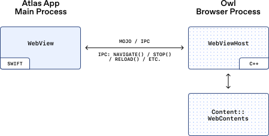
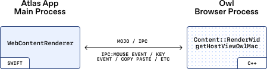

# 04_How we built OWL, the new architecture behind our ChatGPT-based browser, Atlas_我们如何构建 OWL —— 驱动基于 ChatGPT 的浏览器 Atlas 的新架构

> 英文原文：https://openai.com/index/building-chatgpt-atlas/
> 官方中文：https://openai.com/zh-Hans-CN/index/building-chatgpt-atlas/
> 作者：Ken Rockot（技术人员）、Ben Goodger（ChatGPT Atlas 工程主管）｜OpenAI Engineering｜发布日期：2025-10-30
> 版式说明：逐句中英对照——每一句（或一小段连续的）英文下面紧跟中文翻译；关键术语首次出现时在译文中保留英文原词，便于对照记忆。
> ⚠️ 官方中文版缺失说明：官方中文版丢失了 `### Input events: Cracking and forwarding`（输入事件：解析与转发）与 `### Agent mode: Special cases`（智能体模式：特殊场景处理）这两个小节的小节标题与前段正文（正文被挤进了上一段的尾部），本文已按英文原文完整补齐补译，补译句末标注「（译注：官方中文版此处缺失，本句为补译）」。

---

By _Ken Rockot, Member of the Technical Staff and Ben Goodger, Head of Engineering, ChatGPT Atlas_

作者：_Ken Rockot（技术人员）和 Ben Goodger（ChatGPT Atlas 工程主管）_

Last week, we [launched ChatGPT Atlas⁠](https://openai.com/index/introducing-chatgpt-atlas/), a new way to browse the web with ChatGPT by your side.

上周我们[正式推出 ChatGPT Atlas⁠](https://openai.com/index/introducing-chatgpt-atlas/)，一种让 ChatGPT 全程陪伴你浏览网络的全新方式。

In addition to being a full-featured web browser, Atlas offers a glimpse into the future: a world where you can bring ChatGPT with you across the internet to ask questions, make suggestions, and complete tasks for you.

Atlas 不仅是一款功能齐全的网络浏览器，更展现了未来的发展方向：你可以带着 ChatGPT 畅游互联网，它能为你解答疑问、提供建议并完成任务。

In this post, we unpack one of the most complex engineering aspects of the product: how we turned ChatGPT into a browser that gets more useful as you go.

在本文中，我们将深入剖析该产品最复杂的工程技术之一：如何将 ChatGPT 打造成一款越用越智能的浏览器。

Making ChatGPT a true co-pilot for the web meant reimagining the entire architecture of a browser: separating Atlas from the Chromium runtime.

为了让 ChatGPT 真正成为网络浏览的得力助手，我们重新构想了整个浏览器的架构：将 Atlas 与 Chromium 运行时环境分离。

This entailed developing a new way of integrating Chromium that allows us to deliver on our product goals: instant startup, responsiveness even as you open more tabs, and creating a strong foundation for agentic use cases.

这需要我们开发一种全新的 Chromium 集成方式，从而实现我们的产品目标：即时启动、多开标签页仍流畅响应，并为智能体（agentic）应用场景奠定坚实基础。

## Shaping the foundation｜构筑基础

Chromium was a natural building block.

Chromium 是理想的基础构建模块。

It provides a state-of-the-art web engine with a robust security model, established performance credentials, and peerless web compatibility.

它既提供具备稳健安全模型的尖端网络引擎，又拥有公认的性能表现和无与伦比的网络兼容性。

Furthermore, it’s developed by a global community that continuously improves it.

更重要的是，它由全球社区开发并持续改进。

It’s a common go-to for modern desktop web browsers.

这使其成为现代桌面浏览器的常用选择。

## Rethinking the browser experience｜重新构想浏览器体验

Our talented design team had ambitious goals for our user experience, including rich animations and visual effects for features like Agent mode.

我们卓越的设计团队为用户体验设定了宏伟目标，包括为智能体模式（Agent mode）等功能配备丰富的动画与视觉效果。

This required our engineering team to leverage the most modern native frameworks for our UI (SwiftUI, AppKit and Metal), instead of simply reskinning the open source Chromium UX.

这要求工程团队必须采用最前沿的原生框架（SwiftUI、AppKit 和 Metal）构建用户界面，而非简单地对开源 Chromium 用户体验进行重新设计。

As a result, Atlas’ UI is a comprehensive rebuild of the entire application UX.

正因如此，Atlas 的用户界面实现了对整个应用体验的全面重构。

We also had other product goals like fast startup times and supporting hundreds of tabs without penalizing performance.

我们同时设定了其他产品目标，例如快速启动和支持数百个标签页而不影响性能。

These goals were challenging to achieve with Chromium out-of-the-box, which is opinionated about many details from the boot sequence, threading model and tab models.

这些目标在 Chromium 的默认配置下难以实现，因其在启动序列、线程模型和标签页模型等细节上存在诸多固有设定。

We considered making substantial changes here, but we wanted to keep our set of patches against Chromium targeted so we could quickly integrate new versions.

我们曾考虑进行深度改造，但希望保持对 Chromium 的补丁集精准可控，以便快速集成新版本。

To ensure our development velocity was maximally accelerated, we needed to come up with a different way to integrate and drive the Chromium runtime.

为确保最大程度提升开发速度，我们必须找到集成与驱动 Chromium 运行时的创新方案。

A litmus test for our technical investment was not only that it would enable faster experimentation, iteration and delivery of new features – it would also enable us to maintain a core part of OpenAI’s engineering culture: shipping on day one.

我们技术投资的试金石不仅在于加速实验、迭代和新功能交付，更在于守护 OpenAI 工程文化的核心：首日交付能力。

Every new engineer makes and merges a small change in the afternoon of their first day.

每位新工程师在入职首日下午都会提交并合并一项小改动。

We needed to make sure this was possible even though Chromium can take hours to check out and build.

我们需要确保这在技术上可行，尽管 Chromium 的检出和构建过程可能需要数小时。

## Our Solution: OWL｜我们的解决方案：OWL

Our answer to these challenges was to build a new architectural layer we call **OWL: OpenAI’s Web Layer**.

为应对这些挑战，我们构建了名为 **OWL（OpenAI's Web Layer）** 的全新架构层。

OWL is our integration of Chromium, which entails running Chromium’s browser process _outside_ of the main Atlas app process.

OWL 是我们对 Chromium 的集成实现，其方式是在主 Atlas 应用进程 _之外_ 运行 Chromium 的浏览器进程。

*图注：OWL 的进程拓扑总览。Atlas App（主应用进程）与 Owl App 是两个彼此独立的进程，二者通过 IPC（进程间通信）交互；Chromium 自有的那一批进程（Chromium-owned processes，如各标签页的渲染器、GPU 进程等）全部挂在 Owl App 之下，而不再由 Atlas 主应用直接持有。这正是「把 Chromium 浏览器进程移出主应用进程」的直观体现。*

Think of it like this: Chromium revolutionized browsers by moving tabs into separate processes.

可以这样理解：Chromium 通过将标签页移至独立进程，彻底革新了浏览器。

We’re taking that idea further by moving Chromium itself out of the main application process and into an isolated service layer. This shift unlocks a cascade of benefits:

我们更进一步，将 Chromium 本身从主应用程序进程中分离出来，置于一个独立的服务层。这一转变带来了一系列优势：

*   **A simpler, modern app:** Atlas is built almost entirely in SwiftUI and AppKit. One language, one tech stack, one clean codebase.

*   **更简单、现代的应用：** Atlas 几乎完全基于 SwiftUI 与 AppKit 构建。具备统一语言、统一技术栈、统一干净的代码库。

*   **Faster startup:** Chromium boots asynchronously in the background. Atlas doesn’t wait — pixels hit the screen nearly instantly.

*   **启动速度更快：** Chromium 在后台异步启动。Atlas 无需等待，像素几乎瞬间即可呈现在屏幕上。

*   **Isolation from jank and crashes:** Chromium is a powerful and complex web engine. If its main thread hangs, Atlas doesn’t. If it crashes, Atlas stays up.

*   **避免卡顿和崩溃：** Chromium 是功能强大且复杂的网络引擎。即使其主线程阻塞，Atlas 也不会受到影响。即使 Chromium 崩溃，Atlas 也能保持运行。

*   **Fewer merge headaches:** Because we’re not building on as much of the Chromium open source UI, our diff against upstream Chromium is much smaller and easier to maintain.

*   **更轻松的代码合并：** 由于我们并未大量采用 Chromium 的开源用户界面部分，因此与上游 Chromium 的差异（diff）要小得多，也更易于维护。

*   **Faster iteration:** Most engineers never need to build Chromium locally. OWL ships internally as a prebuilt binary, so Atlas builds take minutes not hours.

*   **迭代速度更快：** 大多数工程师无需在本地构建 Chromium。OWL 已在内部以预编译二进制文件的形式发布，因此 Atlas 的构建只需几分钟，而非数小时。

Because most engineers on our team aren’t regularly building Chromium from source, development can go much faster—even new team members can merge simple changes on their first afternoon.

由于我们团队的大多数工程师并不经常从源代码构建 Chromium，因此开发速度得以大幅提升，即使是新成员，也能在入职后的首日下午合并简单的更改。

## How OWL works｜OWL 工作原理

At a high level, the Atlas browser is the **OWL Client**, and the Chromium browser process is the **OWL Host**.

从宏观层面来看，Atlas 浏览器是 **OWL 客户端（OWL Client）**，而 Chromium 浏览器进程则是 **OWL 宿主（OWL Host）**。

They communicate over IPC, specifically[Mojo⁠(opens in a new window)](https://chromium.googlesource.com/chromium/src/+/main/mojo/README.md), Chromium’s own message-passing system.

它们通过 IPC（进程间通信）进行交互，具体来说使用的是 [Mojo⁠（在新窗口中打开）](https://chromium.googlesource.com/chromium/src/+/main/mojo/README.md) —— Chromium 自有的消息传递系统。

We wrote custom Swift (and even TypeScript) bindings for Mojo, so our Swift app can call host-side interfaces directly.

我们为 Mojo 编写了自定义 Swift（甚至 TypeScript）绑定，以便我们的 Swift 应用可以直接调用宿主端的接口。

*图注：OWL 客户端／宿主的分层对应关系。Atlas App 主进程里是 Swift 写的 `WebView`，Owl 浏览器进程里是 C++ 写的 `WebViewHost`，两者通过 Mojo／IPC 通信——客户端把 `navigate()`、`stop()`、`reload()` 等调用发过去，宿主侧再落到 Chromium 真正的 `content::WebContents` 上。也就是说，Swift 侧的每个对象都只是宿主侧真实 Chromium 对象的一个远程句柄。*

The OWL client library exposes a simple public Swift API, which abstracts several key concepts exposed by the host’s service layer:

OWL 客户端库提供了一个简洁的公共 Swift API，对宿主服务层公开的若干关键概念进行了抽象。

*   **Session:** Configure and control the host globally

*   **Session（会话）：** 全局配置和控制宿主

*   **Profile:** Manage browser state for a specific user profile

*   **Profile（配置文件）：** 管理特定用户配置文件的浏览器状态

*   **WebView:** Control and embed individual web contents (e.g. render, input, navigate, zoom, etc.)

*   **WebView：** 控制和嵌入单个网页内容（例如渲染、输入、导航、缩放等）

*   **WebContentRenderer:** Forward input events into Chromium’s rendering pipeline and receive feedback from the renderer

*   **WebContentRenderer：** 将输入事件转发到 Chromium 的渲染管线，并接收来自渲染器（renderer）的反馈

*   **LayerHost/Client:** Exchange compositing information between the UI and Chromium

*   **LayerHost/Client：** 在用户界面与 Chromium 之间交换合成（compositing）信息。

There’s also a wide range of service endpoints for managing high-level features like bookmarks, downloads, extensions, and autofill.

此外，还有各种各样的服务端点（service endpoint），用于管理书签、下载、扩展程序和自动填充等高级功能。

### Rendering: Getting pixels across the process boundary｜渲染：跨越进程边界的像素传输

WebViews, which share a mutually exclusive presentation space in the client app are swapped in and out of a shared compositing container.

在客户端应用中共享互斥展示空间的 WebView 会通过共享合成容器进行动态切换。

For example, a browser window often has a single shared container visible and selecting a tab in the tab strip swaps that tab’s WebView into the container.

例如：浏览器窗口通常设有单一共享容器，选择标签栏中的标签页会将该标签页的 WebView 切换到该容器中。

On the Chromium side, this container corresponds to a `gfx::AcceleratedWidget` which is ultimately backed by a `CALayer`.

在 Chromium 端，该容器对应由 `CALayer` 最终提供支持的 `gfx::AcceleratedWidget`。

We expose that layer’s context ID to the client, where an `NSView` embeds it using the private `CALayerHost` API.

我们向客户端公开该图层的上下文 ID（context ID），由 `NSView` 通过私有的 `CALayerHost` API 将其嵌入。

*图注：像素如何跨越进程边界。Owl／Chromium 的 GPU 进程中，Viz 合成器（Viz Chromium Compositor）产出一个 `CALayer`；该图层的上下文 ID 经由 Quartz 跨进程传递到 Atlas 主进程，被 `NSView` 内的 `CALayerHost` 直接嵌入渲染。网页像素因此无需逐帧拷贝回主进程——Atlas 只是「挂载」了对方合成好的图层。*

Special cases like `<select>` dropdowns or color pickers, which Chromium renders in separate popup widgets, use the same approach.

对于特殊场景（如 Chromium 在独立弹出控件中渲染的 `<select>` 下拉菜单或取色器），同样适用此方法。

They don’t have a `content::WebContents`, but they _do_ have a `content::RenderWidgetHostView` with their own `gfx::AcceleratedWidget`, so the same delegated rendering model applies.

它们虽没有 `content::WebContents`，但确实_有_自带 `gfx::AcceleratedWidget` 的 `content::RenderWidgetHostView`，因此仍可采用相同的委托渲染（delegated rendering）模式。

OWL internally keeps view geometry in sync with the Chromium side, so the GPU compositor can be updated accordingly and can always produce layer contents of the correct size and device scale.

OWL 内部保持视图几何结构与 Chromium 端同步，确保 GPU 合成器能相应更新，持续生成尺寸与设备缩放比例精准的图层内容。

We also reuse this technique to selectively project elements of Chromium’s own native Views UI into Atlas (this is also useful for bootstrapping features like permission prompts quickly without building replacements from scratch in SwiftUI).

我们还复用该技术，将 Chromium 原生 Views UI 的元素选择性投射至 Atlas（该机制同样适用于快速启动权限提示等功能，无需在 SwiftUI 中从头构建替代方案）。

This technique borrows heavily from Chromium’s existing infrastructure for installable web apps on macOS.

这项技术大量借鉴了 Chromium 在 macOS 上用于可安装网络应用（installable web apps）的现有基础架构。

### Input events: Cracking and forwarding｜输入事件：解析与转发

Chromium UI translates platform events (like macOS NSEvents) into Blink’s WebInputEvent model before forwarding them to renderers.

Chromium 的 UI 层会先把平台事件（例如 macOS 的 `NSEvent`）转换成 Blink 的 `WebInputEvent` 模型，然后再转发给渲染器（renderer）。（译注：官方中文版此处缺失，本句为补译）

But since OWL runs Chromium in a hidden process, we do that translation ourselves within the Swift client library and forward already-translated events down to Chromium.

但由于 OWL 把 Chromium 运行在一个隐藏进程中，我们改为在 Swift 客户端库里自行完成这层转换，再把已经转换好的事件下发给 Chromium。（译注：官方中文版此处缺失，本句为补译）

*图注：输入事件的解析与转发。Atlas 主进程中 Swift 写的 `WebContentRenderer` 先把 macOS 的 `NSEvent` 自行翻译成 Blink 的 `WebInputEvent`，再通过 Mojo／IPC 把鼠标事件、键盘事件、复制粘贴等下发给 Owl 浏览器进程中 C++ 侧的 `content::RenderWidgetHostViewOwlMac`。这条通道是双向的：页面若表示未处理某事件，事件会被回传给客户端重新合成为 `NSEvent`。*

From there, they follow the same lifecycle that real input events would normally follow for web content.

从这里开始，这些事件就走与真实输入事件在网页内容中完全相同的生命周期。（译注：官方中文版此处缺失，本句为补译）

This includes having events _returned_ back to the client whenever a page indicates that it didn’t handle the event.

这其中就包括：只要页面表明自己没有处理某个事件，该事件就会被_回传_给客户端。（译注：官方中文版此处缺失，本句为补译）

When this happens, we re-synthesize an NSEvent and give the rest of the app a chance to handle the input.

出现这种情况时，我们会重新合成一个 `NSEvent`，让应用的其余部分有机会处理这次输入。（译注：官方中文版此处缺失，本句为补译）

### Agent mode: Special cases｜智能体模式：特殊场景处理

Atlas’ agentic browsing feature poses some unique challenges for our approaches to rendering, input event forwarding, and data storage.

Atlas 的智能体浏览（agentic browsing）功能，给我们在渲染、输入事件转发和数据存储上的这套做法带来了一些独特的挑战。（译注：官方中文版此处缺失，本句为补译）

Our computer use model expects a single image of the screen as input.

我们的计算机使用（computer use）模型期望的输入是一张完整的屏幕图像。（译注：官方中文版此处缺失，本句为补译）

But some UI elements, like `<select>`dropdowns, render outside the tab’s bounds in separate windows.

但有些 UI 元素——比如 `<select>` 下拉菜单——是渲染在标签页边界之外的独立窗口里的。（译注：官方中文版此处缺失，本句为补译）

In agent mode, we composite those popups back into the main page image at the correct coordinates so the model sees the full context in one frame.

在智能体模式下，我们会把这些弹出窗口按正确的坐标合成回主页面图像中，让模型在一帧画面里就能看到完整的上下文（context）。（译注：官方中文版此处缺失，本句为补译）

For input, we apply the same principle: agent-generated events are routed directly to the renderer, never through the privileged browser layer.

对于输入，我们应用相同原则：智能体生成的事件直接路由至渲染器，绝不经过特权浏览器层。

That preserves the sandbox boundary even under automated control.

这样，即使在自动化控制下，仍能保持沙盒（sandbox）边界的隔离。

For example, we don’t want this class of events to synthesize keyboard shortcuts that make the browser do things unrelated to the web content being shown.

例如，我们不希望此类事件合成出键盘快捷键，从而让浏览器执行与当前所展示网页内容无关的操作。

Agent browsing can also run in an ephemeral "logged-out" context.

智能体浏览还可以在临时的「未登录」（logged-out）上下文中运行。

Instead of sharing the user’s existing Incognito profile, which could leak state, we use Chromium’s `StoragePartition` infrastructure to spin up isolated, in-memory stores.

我们不共享用户现有的隐身模式（Incognito）配置文件（这可能会导致状态泄露），而是使用 Chromium 的 `StoragePartition` 基础架构来启动隔离的内存存储。

Each agent session starts fresh, and when it ends, all cookies and site data are discarded.

每个智能体会话都会从零开始；会话结束时，所有的 Cookie 和网站数据都会被清除。

You can run multiple "logged-out" agent sessions, each one in its own browser tab, and each fully isolated from the others.

你可以运行多个「未登录」智能体会话，每个会话都在独立的浏览器标签页中，并且彼此完全隔离。

## A new way to use the web｜使用网络的全新方式

None of this would be possible without the global Chromium community and their incredible work building a foundation for the modern web.

若无全球 Chromium 社区的卓越贡献及其为现代网络奠定的坚实基础，这一切都无从实现。

OWL builds on that foundation in a new way: decoupling the engine from the app, blending a world-class web platform with modern native frameworks, and unlocking a faster, more flexible architecture.

OWL 以创新方式在此基础上构建：将引擎与应用解耦，融合顶尖网络平台与现代原生框架，从而打造更快、更灵活的架构。

By rethinking how a browser holds Chromium, we’re creating space for new kinds of experiences: smoother startups, richer UI, tighter integration with the rest of the OS, and a development loop that moves at the speed of ideas.

通过重构浏览器与 Chromium 的集成方式，我们为新型体验创造空间：更流畅的启动、更丰富的用户界面、与操作系统其余部分实现更紧密的集成，同时拥有与创意速度匹配的开发循环。

If that sounds like your kind of challenge, check out our openings to work on Atlas as a [Software Engineer, Atlas⁠](https://openai.com/careers/software-engineer-atlas-san-francisco/), [Software Engineer, iOS⁠](https://openai.com/careers/software-engineer-ios-san-francisco/), and [more⁠](https://openai.com/careers/search/?c=e1e973fe-6f0a-475f-9361-a9b6c095d869%2Cf002fe09-4cec-46b0-8add-8bf9ff438a62%2Cab2b9da4-24a4-47df-8bed-1ed5a39c7036).

如果你愿意迎接此类挑战，欢迎申请我们目前在 Atlas 项目中招聘的 [Atlas 软件工程师⁠](https://openai.com/careers/software-engineer-atlas-san-francisco/)、[iOS 软件工程师⁠](https://openai.com/careers/software-engineer-ios-san-francisco/) 以及[更多⁠](https://openai.com/careers/search/?c=e1e973fe-6f0a-475f-9361-a9b6c095d869%2Cf002fe09-4cec-46b0-8add-8bf9ff438a62%2Cab2b9da4-24a4-47df-8bed-1ed5a39c7036)职位。
