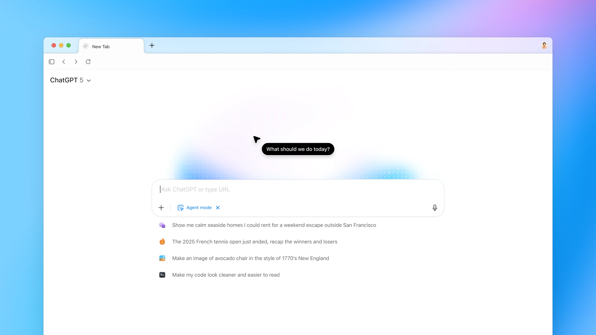
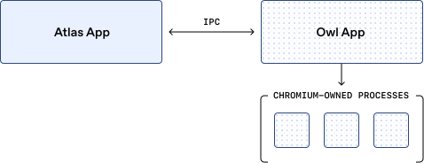
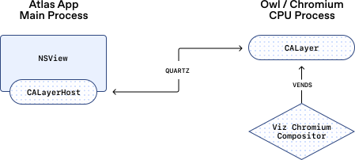

# 04_构建 ChatGPT Atlas 的 OWL 架构_面试速记

> OpenAI Engineering · 2025-10-30 · 作者 Ken Rockot、Ben Goodger（ChatGPT Atlas 工程主管）
> [英文原文](https://openai.com/index/building-chatgpt-atlas/) · [官方中文](https://openai.com/zh-Hans-CN/index/building-chatgpt-atlas/) · [本地逐句对照](04_Building%20ChatGPT%20Atlas_构建%20ChatGPT%20Atlas_逐句对照.md)
>
> ⚠️ **官方中文版漏译了「输入事件：解析与转发」和「智能体模式：特殊场景处理」两个小节**（小节标题和正文都被吞掉了），逐句对照文件里已按英文原文补齐补译。**别只看官方中文版**——被漏掉的第二节恰恰是全文对 Agent 开发最关键的部分：浏览器智能体在渲染、输入、存储三条链路上到底要额外做什么。

## 一句话讲明白

**Atlas 没有像常规做法那样「给 Chromium 换层皮」，而是把 Chromium 的浏览器进程整个搬到主应用进程之外，做成一个叫 OWL（OpenAI's Web Layer）的服务层：应用侧是纯 SwiftUI/AppKit 的原生客户端，Chromium 侧只负责网页引擎，两边用 Chromium 自己的消息传递系统 Mojo 通信。代价是要自己跨进程搬像素、自己翻译输入事件；换来的是秒开、崩溃隔离、补丁集变小，以及一个天然适合装智能体（agent）的架构。**

## 为什么值得读 / 能用在哪

- 这是少见的**把「智能体化」当成架构约束、而不是事后功能**的工程案例：智能体模式想要的东西（一整帧屏幕图像、不能碰特权层的输入通道、用完即弃的存储）全都落在架构分层上。
- 对做浏览器／桌面端 Agent 的人是直接的施工图：**截图从哪来、弹窗怎么办、模拟点击走哪条路、会话状态怎么隔离**，四个问题这篇都给了具体答案。
- 对做任何「壳 + 成熟引擎」产品的人也通用：把上游引擎推到进程边界之外，可以同时收获**构建速度**（预编译二进制，构建从小时级降到分钟级）和**故障隔离**（引擎挂了应用还活着）。
- 反向的教训同样值钱：一旦跨了进程边界，**渲染、输入、几何同步这些原本免费的东西全部变成你自己的工程债**。

## 核心要点

### 1. 为什么非要重做浏览器

Chromium 是理想的地基——尖端网页引擎、稳健的安全模型、公认的性能、无与伦比的网页兼容性，还有全球社区持续改进。**问题不在引擎，在外壳。**

- 设计团队要给智能体模式（Agent mode）这类功能配丰富动画与视觉效果，所以界面必须用**最前沿的原生框架（SwiftUI、AppKit、Metal）**从头建，而不是给开源的 Chromium 界面重新贴皮。Atlas 的界面是**整个应用体验的全面重构**。
- 产品目标还包括**快速启动**和**支持数百个标签页不掉性能**。而 Chromium 在**启动序列、线程模型、标签页模型**上有大量固有设定，默认配置下这些目标很难达成。
- 可以深度改造 Chromium，但那样对上游的**补丁集**会失控，新版本就难以快速集成。所以只能换一条路：**换一种集成和驱动 Chromium 运行时的方式。**
- 最后一条约束很「OpenAI」：技术投资的试金石是能不能守住**首日交付（shipping on day one）**——每位新工程师入职**首日下午**就要提交并合并一个小改动。而 Chromium 光是检出加构建就可能要**数小时**。这条文化约束直接推导出了架构结论。

### 2. OWL 是什么：把 Chromium 推出主进程

**OWL = OpenAI's Web Layer**，本质是一种 Chromium 集成方式：**在主 Atlas 应用进程之外运行 Chromium 的浏览器进程。**

类比很好记：**Chromium 当年把标签页移进独立进程，革新了浏览器；OWL 再往前走一步，把 Chromium 本身移出主应用进程，放进一个独立的服务层。**

*图注：OWL 的进程拓扑总览——面试时能把这张图画出来，基本就讲清楚了。Atlas App 与 Owl App 是两个独立进程，靠 IPC 通信；Chromium 自有的那一批进程（Chromium-owned processes）全部挂在 Owl App 之下，主应用不再直接持有它们。上面那五项好处（异步启动、崩溃隔离、diff 变小）都是这条进程边界的直接推论。*

带来的五项好处（面试可以按顺序背）：

1. **应用更简单更现代**：Atlas 几乎完全由 SwiftUI 与 AppKit 构建——一种语言、一套技术栈、一份干净代码库。
2. **启动更快**：Chromium 在后台**异步启动**，Atlas 不等它，像素几乎瞬间上屏。
3. **隔离卡顿与崩溃**：Chromium 主线程卡住，Atlas 不卡；Chromium 崩溃，Atlas 照样活着。
4. **合并更省心**：因为没大量沿用 Chromium 的开源界面，**与上游的差异（diff）小得多**，更好维护。
5. **迭代更快**：大多数工程师**根本不用在本地构建 Chromium**——OWL 以**预编译二进制**在内部分发，Atlas 的构建**只要几分钟而不是几小时**。首日下午合并改动就是靠这条兑现的。

分工命名要记住：**Atlas 浏览器 = OWL 客户端（OWL Client），Chromium 浏览器进程 = OWL 宿主（OWL Host）**。两者通过进程间通信（IPC）交互，用的是 Chromium 自有的消息传递系统 **Mojo**；团队为 Mojo 写了自定义的 **Swift（甚至 TypeScript）绑定**，让 Swift 应用能直接调用宿主端接口。

客户端库对外只暴露一套简洁的 Swift 公共 API，抽象了五个关键概念：

- **Session（会话）**：全局配置和控制宿主。
- **Profile（配置文件）**：管理特定用户配置文件的浏览器状态。
- **WebView**：控制并嵌入单个网页内容（渲染、输入、导航、缩放等）。
- **WebContentRenderer**：把输入事件转发进 Chromium 的渲染管线，并接收渲染器（renderer）的反馈。
- **LayerHost/Client**：在界面与 Chromium 之间交换合成（compositing）信息。

此外还有一批服务端点（service endpoint），管书签、下载、扩展程序、自动填充这类上层功能。

### 3. 渲染：像素怎么跨过进程边界

核心手法是**委托渲染（delegated rendering）**——像素在 Chromium 侧生成，客户端只嵌入那一层图层。

- 客户端里的多个 WebView **共享一块互斥的展示空间**，通过一个**共享合成容器**换进换出。一个浏览器窗口通常只有一个可见容器，**在标签栏点选标签页 = 把那个标签页的 WebView 换进容器**。
- Chromium 侧，这个容器对应一个 `gfx::AcceleratedWidget`，最终由一个 `CALayer` 提供支持。
- OWL 把该图层的**上下文 ID（context ID）**暴露给客户端，客户端用一个 `NSView` 通过**私有的 `CALayerHost` API** 把它嵌进来。

*图注：委托渲染的完整链路。Owl／Chromium 侧由 Viz 合成器产出（vends）一个 `CALayer`，其上下文 ID 经 Quartz 跨进程递给 Atlas 主进程，被 `NSView` 内的 `CALayerHost` 直接嵌入。关键点：**网页像素从不逐帧拷回主进程**，Atlas 只是挂载了对方已经合成好的图层——这也是「多开标签页仍不掉性能」的底层原因。*
- **特殊控件走同一条路**：`<select>` 下拉菜单、取色器这些 Chromium 画在独立弹出控件里的东西，虽然**没有 `content::WebContents`**，但**有自带 `gfx::AcceleratedWidget` 的 `content::RenderWidgetHostView`**，因此同一套委托渲染模型照样适用。（记住这句，第 5 节的智能体难题就是它埋的伏笔。）
- OWL 内部**持续同步视图几何结构**，让 GPU 合成器始终产出**尺寸与设备缩放比例都正确**的图层内容。
- 同一手法还被复用来**把 Chromium 原生 Views 界面的元素选择性投射进 Atlas**——比如权限提示，可以先直接投过来用，不必在 SwiftUI 里从零重建。
- 整套技术**大量借鉴 Chromium 在 macOS 上支持可安装网络应用（installable web apps）的现有基础设施**，不是凭空发明。

### 4. 输入事件：解析与转发（官方中文漏译）

正常的 Chromium 里，**是 Chromium 的界面层**把平台事件（例如 macOS 的 `NSEvent`）翻译成 **Blink 的 `WebInputEvent` 模型**，再转发给渲染器。

但 OWL 把 Chromium 跑在一个**隐藏进程**里——**界面层不在 Chromium 这边了**，于是这层翻译只能自己做：

1. **在 Swift 客户端库里完成 `NSEvent` → `WebInputEvent` 的翻译**，把**已经翻译好的事件**下发给 Chromium。
2. 之后这些事件走的是**与真实输入事件完全相同的生命周期**——这一点很关键，等于没有为跨进程另开一套语义。
3. 包括**回传**：只要页面表示自己没处理某个事件，事件就会被**退回客户端**。
4. 收到退回的事件时，客户端**重新合成一个 `NSEvent`**，交给应用的其余部分（菜单、快捷键、原生界面）再处理一次。

一句话记忆：**输入是「客户端翻译 → 下发 → 网页没接住就原路退回 → 客户端补合成」的一个闭环**，这样原生界面的快捷键和网页的事件处理才不会互相吃掉对方。

### 5. 智能体模式：特殊场景处理（全文最该记的一节，官方中文漏译）

原文明确说：**智能体浏览（agentic browsing）在渲染、输入事件转发、数据存储这三条链路上都带来了独特挑战。**逐条看：

**（1）渲染：模型只吃一整帧，弹窗必须合成回去。**

- OpenAI 的**计算机使用（computer use）模型期望的输入是一张完整的屏幕图像**。
- 但有些界面元素——典型就是 `<select>` 下拉菜单——是**渲染在标签页边界之外的独立窗口里**的（正是第 3 节那类没有 `WebContents` 的弹出控件）。
- 如果直接截标签页，**模型会看到一个「打开了却看不见选项」的下拉框**，任务当场断掉。
- 解法：**在智能体模式下，把这些弹出窗口按正确的坐标合成回主页面图像里**，让模型**在一帧画面里看到完整上下文（context）**。
- 这是浏览器 Agent 的普遍难点：**「屏幕」在操作系统眼里是多个窗口，在模型眼里必须是一张图**，中间那层坐标对齐的活儿只能架构层来做。

**（2）输入：智能体的事件直连渲染器，绕开特权层。**

- 原则一句话：**智能体生成的事件直接路由至渲染器，绝不经过特权浏览器层。**
- 目的是**即使在自动化控制下也保持沙箱（sandbox）边界**。
- 原文给的例子非常具体：**不希望这类事件合成出键盘快捷键，让浏览器去做与当前网页内容无关的事。**——想想智能体一个 `Cmd+Q`、`Cmd+Shift+Delete` 会发生什么。
- 面试可直接讲的判断：**「智能体和人共用同一条输入通道」是个安全反模式**；正确做法是**让智能体的输入权限严格是人类输入权限的子集**，且这个限制由**路由结构**保证，不是靠提示词叮嘱模型别按快捷键。

**（3）存储：每个智能体会话一份用完即弃的内存存储。**

- 智能体浏览可以跑在临时的**「未登录」（logged-out）上下文**里。
- **不复用用户已有的隐身模式（Incognito）配置文件**——那样**可能泄露状态**。
- 改用 Chromium 的 **`StoragePartition`** 基础设施，**启动隔离的内存存储**。
- **每个智能体会话从零开始；会话结束，所有 Cookie 和网站数据全部丢弃。**
- **可以同时跑多个「未登录」会话，各占一个标签页，彼此完全隔离。**
- 这条的产品含义：**并发跑多个智能体任务不会串号、串登录态**，而这是靠存储分区实现的，不是靠「记得退出登录」。

## 和 Anthropic 的对照

把这篇和 Anthropic 的《How we contain Claude across products》（本地：`Anthropic/Engineering全集_逐句对照/25_how-we-contain-claude_逐句对照.md`）并排读，会看到**同一个结论从两个动机长出来**。

- **动机不同，落点相同。** OWL 把 Chromium 推出主进程，首要动机是**工程**：启动速度、崩溃隔离、补丁集大小、构建时间；安全是顺带的。Anthropic 那篇的动机是纯安全：**封顶爆炸半径**，主张**环境层优先**——先用进程沙箱、虚拟机、文件系统边界、出网控制画死边界，再让模型层的分类器去引导行为。两边最后都落在同一句话上：**进程／内核边界是确定性的，模型行为是概率性的，确定性的那道边界才是所有概率性防线失手时接住你的东西。**
- **「绕开特权层」是同一处伤口的两种缝法。** Anthropic 复盘 Claude Code 时点名：**有个特权进程坐在沙箱外面逐条决定是否放行，一段有说服力的注入提示词或者一次疲劳点击就能让它在沙箱外跑东西。** OWL 的做法是**从结构上不给智能体通往特权层的路**——智能体事件直连渲染器。可以这么概括：**Anthropic 在特权层前面加了一道人和分类器，OpenAI 干脆把智能体的输入路由从特权层拆掉了。**后者摩擦更低，前者覆盖面更宽。
- **会话级临时隔离是共识。** OWL 的 `StoragePartition` 内存存储用完即弃 ≈ Anthropic 给 claude.ai 每次代码执行起一个 **gVisor 容器**、给 Cowork 每会话下发**收窄的令牌**。Anthropic 那条原则说得最直白：**凭据只要从不进入沙箱，就不可能被外泄。** OWL 拒绝复用用户的隐身配置文件，正是同一条原则在浏览器状态上的版本。
- **谁在自研，谁在复用。** Anthropic 的第三条原则是**警惕自研组件**——成熟的虚拟化管理程序（hypervisor）、系统调用过滤器、容器运行时都稳住了，出事的恰恰是自研的允许列表代理。对照看 OWL：大头（Mojo、`StoragePartition`、`RenderWidgetHostView`、可安装网络应用的那套渲染基础设施）全是复用 Chromium 成熟原语，自研的是**绑定和胶水**（Swift/TypeScript 的 Mojo 绑定、私有 `CALayerHost` 的用法）。按 Anthropic 的经验，**风险恰好就集中在这层胶水上**——这是面试里可以主动提的一个批判视角。
- **DOM 还是截图，这篇替你选了。** Anthropic 的评估篇（`16_demystifying-evals-for-ai-agents`）指出计算机使用智能体的独有权衡：**基于网页文档结构（DOM）的交互执行快但吃 token，基于截图的交互慢但省 token**；总结维基百科适合抽 DOM 文本，在亚马逊挑保护壳适合截图（整页 DOM 太耗 token），所以 Claude for Chrome 专门做评估来查**「每种场景有没有选对工具」**。而 Atlas 的计算机使用模型**只接受一张完整屏幕图像**，是明确的截图路线——**「把弹窗合成回主图」这个工程负担，正是选了截图路线才必须付的账**；DOM 路线根本不会遇到这个问题，但会在 token 成本和长页面上还债。**路线选择决定了你要修哪一类 bug**，这句话面试里很好用。

## 面试高频问答

**Q：为什么 Atlas 不直接改 Chromium 的界面，非要把浏览器进程移出去？**
A：三个硬约束逼出来的。一是设计要求丰富动画和视觉效果，界面必须用 SwiftUI/AppKit/Metal 原生重建，不是贴皮能做的；二是快速启动和数百标签页不掉性能，与 Chromium 在启动序列、线程模型、标签页模型上的固有设定冲突；三是深度改造会让对上游的补丁集失控、新版本难以跟进。移出进程后，对上游的差异变小，工程师还不用本地构建 Chromium，构建从数小时降到几分钟。

**Q：跨进程之后，网页像素怎么显示在原生界面里？**
A：委托渲染。Chromium 侧的合成容器是一个 `gfx::AcceleratedWidget`，底下由 `CALayer` 支持；OWL 把这层图层的上下文 ID 交给客户端，客户端用 `NSView` 通过私有的 `CALayerHost` API 嵌入。多个 WebView 共享一块互斥展示空间，切标签页就是把对应 WebView 换进共享容器。OWL 还持续同步视图几何，保证 GPU 合成器产出的尺寸和设备缩放比例始终正确。

**Q：输入事件为什么要在 Swift 侧翻译？**
A：正常 Chromium 里是它自己的界面层把 `NSEvent` 翻译成 Blink 的 `WebInputEvent`，但 OWL 把 Chromium 跑在隐藏进程里、界面层在应用侧，所以这层翻译搬到了 Swift 客户端库，下发的是已翻译好的事件。之后事件走与真实输入完全相同的生命周期，包括页面没处理时被退回客户端——客户端再重新合成一个 `NSEvent`，让应用其余部分有机会处理。

**Q：浏览器智能体在渲染上最容易踩的坑是什么？**
A：模型要的是一整帧屏幕图像，但 `<select>` 下拉菜单、取色器这类元素是渲染在标签页边界之外的独立窗口里的。直接截标签页，模型会看到一个打开了却没有选项的下拉框。Atlas 的解法是在智能体模式下按正确坐标把这些弹出窗口合成回主页面图像，让模型在一帧里拿到完整上下文。

**Q：为什么智能体的点击不能走浏览器的正常输入通道？**
A：因为那条通道会经过特权浏览器层，能合成出键盘快捷键，让浏览器做与当前网页内容无关的事——比如关窗口、清数据。Atlas 的做法是把智能体生成的事件直接路由到渲染器，绕开特权层，从结构上保证自动化控制下沙箱边界依然成立。这和 Anthropic 那套「环境层优先、别指望模型自觉」是同一个思路。

**Q：多个智能体会话并行跑，状态怎么不串？**
A：不复用用户已有的隐身模式配置文件（那样可能泄露状态），而是用 Chromium 的 `StoragePartition` 给每个会话起一份隔离的内存存储。每个会话从零开始，结束时所有 Cookie 和网站数据丢弃，多个「未登录」会话各占一个标签页、彼此完全隔离。

## 必须记住的 8 句话

1. **OWL = OpenAI's Web Layer**，做法是**在主 Atlas 应用进程之外**运行 Chromium 的浏览器进程；**Atlas 是 OWL 客户端，Chromium 浏览器进程是 OWL 宿主**，两者用 **Mojo** 通信。
2. 类比要背：**Chromium 把标签页移出主进程，OWL 把 Chromium 本身移出主进程。**
3. 五项收益：**单一技术栈、异步启动像素秒上屏、卡顿与崩溃隔离、对上游 diff 更小、预编译二进制让构建从小时降到分钟**。
4. 渲染靠**委托渲染**：`gfx::AcceleratedWidget` ← `CALayer` → 暴露上下文 ID → `NSView` + 私有 `CALayerHost`；弹出控件没有 `content::WebContents`，但有自带 widget 的 `content::RenderWidgetHostView`，走同一条路。
5. 输入靠**客户端自己翻译**：Swift 侧把 `NSEvent` 译成 Blink 的 `WebInputEvent` 下发；**页面没处理的事件会退回客户端，客户端重新合成 `NSEvent`** 交给应用其余部分。
6. 智能体模式的渲染难点：**计算机使用模型只吃一张完整屏幕图像**，所以要**把标签页边界外的弹出窗口按正确坐标合成回主图**。
7. 智能体模式的安全底线：**智能体生成的事件直接路由至渲染器，绝不经过特权浏览器层**，以免合成出与网页无关的快捷键。
8. 智能体模式的状态隔离：**不共享隐身模式配置文件**，改用 **`StoragePartition` 起隔离的内存存储**，**每会话从零开始、结束即弃、多会话互不可见**。

## 30 秒口述版

> Atlas 没有给 Chromium 换皮，而是把 Chromium 的浏览器进程整个移出主应用进程，做成一层叫 OWL 的服务层——Atlas 是 OWL 客户端，Chromium 是 OWL 宿主，中间走 Mojo，并且为 Mojo 写了 Swift 绑定。动机是设计要原生动画、要秒开和数百标签页、还要让新人首日下午就能合并代码，而 Chromium 构建要几个小时。收益是单一技术栈、异步启动、崩溃隔离、对上游 diff 更小，工程师拿预编译二进制，构建从小时降到分钟。代价是渲染和输入都得自己跨边界搬：渲染用委托渲染，把 `gfx::AcceleratedWidget` 背后的 `CALayer` 上下文 ID 交给客户端，`NSView` 用私有的 `CALayerHost` 嵌进来；输入则在 Swift 侧把 `NSEvent` 翻译成 Blink 的 `WebInputEvent` 再下发，页面没处理的事件退回来后重新合成 `NSEvent`。最值钱的是智能体模式那节：计算机使用模型只吃一张整屏图像，所以要把 `<select>` 这类画在标签页外的弹窗按坐标合成回主图；智能体的输入事件直连渲染器、绕开特权浏览器层，防止它合成快捷键去干与网页无关的事；状态上不复用隐身模式，而是用 `StoragePartition` 给每个会话起一份内存存储，结束即弃、多会话互相隔离。对照 Anthropic 的围堵那篇，两边动机不同——一个为工程，一个为安全——但结论一致：**边界要画在环境层，别指望模型自觉。**

## 自测

- [ ] 能说清 OWL 的全称、客户端／宿主分别是谁、用什么做进程间通信。
- [ ] 能背出移出主进程的五项收益，并说出「构建从小时降到分钟」这条对研发文化的意义。
- [ ] 能画出渲染链路：`gfx::AcceleratedWidget` → `CALayer` → 上下文 ID → `NSView` + `CALayerHost`。
- [ ] 能解释为什么 `<select>` 下拉菜单没有 `content::WebContents` 也能走同一套委托渲染。
- [ ] 能讲清输入事件的四步闭环，尤其是「页面没处理就退回、客户端重新合成 `NSEvent`」。
- [ ] 能说出智能体模式在渲染／输入／存储三条链路上各自的特殊处理。
- [ ] 能用一句话说明「智能体事件绕开特权浏览器层」防的是什么具体风险。
- [ ] 能对照 Anthropic 的「环境层优先」「凭据不进沙箱」「警惕自研组件」三条原则，各举出 OWL 里的一个对应点。
- [ ] 能讲出 DOM 路线与截图路线的权衡，并指出 Atlas 选了哪条、因此多背了什么工程债。
