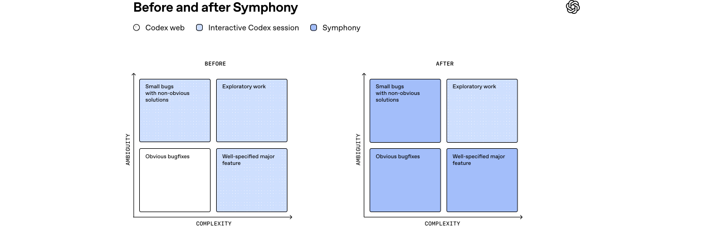

# 05_Codex 编排开源规范 Symphony_面试速记

> Alex Kotliarskyi、Victor Zhu、Zach Brock · OpenAI Engineering · 2026-04-27 · [英文原文](https://openai.com/index/open-source-codex-orchestration-symphony/) · [官方中文](https://openai.com/zh-Hans-CN/index/open-source-codex-orchestration-symphony/) · [本地逐句对照](<05_An open-source spec for Codex orchestration Symphony_Codex 编排的开源规范：Symphony_逐句对照.md>)

## 一句话讲明白

**交互式编程智能体的天花板不是模型能力，而是人类注意力——一个人最多同时盯 3 到 5 个会话；Symphony 的做法是把 Linear 这类工单（issue）跟踪器变成智能体的控制平面（control plane），让「每个未关闭的任务都有一个智能体在自己的工作空间里跑着」，人只负责审查结果；部分团队三周内已合并 PR 数增长 500%，而整个系统本体只是一份开源的 `SPEC.md`。**

## 为什么值得读 / 能用在哪

- 它给出了「多智能体协调」的第三种载体：不是编排者智能体，也不是共享文件系统抢锁，而是**已有的项目管理看板**。这个载体的好处是——协调机制是你团队本来就在用的东西，零新增概念。
- 它把「工作」从「会话」和「PR」里解耦出来：一个工单可以产出跨多个仓库的多个 PR，也可以是一次完全不碰代码的调研。这个抽象值得直接抄。
- 它诚实地讲了代价：**放弃了中途纠偏的能力**。以及正确的应对姿势——不手工修补结果，而是补防护措施和技能，让下次能自己做对。
- 交付物形态本身就是一个观点：**规范即产品**。Codex 用 Elixir 一次成型实现了它，又用 TypeScript、Go、Rust、Java、Python 各实现一遍来找规范里的歧义。

## 核心要点

### 1. 交互式编程智能体的上限：瓶颈是人类注意力

- 背景：这个团队六个月前定下一条规矩——**仓库里每一行代码都必须由 Codex 生成**，为此重做了整个工程工作流（前作是那篇「运行框架（harness）工程」）。
- 这一招奏效之后撞上了下一个瓶颈：**上下文切换**。
- 具体形态：每个工程师开几个 Codex 会话 → 分配任务 → 审查输出 → 引导智能体 → 循环往复。
- 关键数字：**大多数人同时管 3 到 5 个会话就到头了**，再多生产力反而下降。会忘记哪个会话在干什么，在终端间来回跳把智能体拉回正轨，还要调试半路停住的长任务。
- 一句最狠的自评：**「我们造出了一支能力极强的初级工程师团队，却把人类工程师派去做细粒度管理。」** 这不可扩展。

### 2. 视角转变：不再监督智能体，让智能体自己来取活

- 反思：**我们优化错了对象**。系统一直围绕「编程会话」和「已合并的 PR」组织，但这两者只是手段，不是目的。
- 真正的组织单位是**交付物**：issue、任务、工单、里程碑。
- 于是提出那个关键问题：**如果不再直接监督智能体，而是让它们从任务跟踪系统里主动拉活，会怎样？**
- 答案就是 Symphony——**一份书面规范（spec），扮演「监督者」的角色来编排智能体工作**。
- 注意这个转变的性质：**它不是把人从回路里拿掉，而是把人放到回路的不同位置**。原来人在「执行中」（引导、纠偏、催进度），现在人在「入口」（写工单、定优先级）和「出口」（审查结果）。中间那段交给系统保证「总有智能体在跑」。
- 这也是为什么控制平面必须选一个**人和智能体都天然会去看的地方**——看板既是人排期的工具，也是智能体取活的队列，两边共用一份真相，不需要额外同步。

### 3. 把 issue 跟踪器变成智能体编排器


- 核心理念一句话：**任何未关闭的任务都应该被某个智能体接手并完成**。
- 落地方式：**每个未关闭的 Linear issue 映射到一个专属的智能体工作空间**；Symphony 持续监控看板，保证每个活跃任务在完成之前始终有智能体在循环里跑。崩了就重启，来新活就接手。
- **Linear 被当作状态机使用**，整个工作流建立在工单状态之上。
- 解耦带来的红利：工作 ↔ 会话 ↔ PR 三者脱钩。**有些 issue 跨多个仓库产出多个 PR；有些纯粹是调研分析，完全不碰代码库。**
- 原文那句值得背下来：**「一旦以这种方式抽象工作，工单就可以代表更大粒度的工作单元。」**
- 复杂任务的玩法：先建一个任务让智能体分析代码库 / Slack / Notion 产出实现方案 → 人确认方案 → 智能体**生成一棵任务树**，拆阶段、定依赖 → 智能体只处理未被阻塞的任务，于是执行沿着这张**有向无环图（DAG）**自然并行展开。
- 真实例子：把「React 升级」标记为依赖「Vite 迁移」，智能体就真的等 Vite 迁移完成后才动 React。
- **智能体还能自己创建工作**：实现或审查时发现越界的改进点（性能问题、重构机会、更优架构），直接开新 issue，其中许多后续也被智能体接走。

### 4. 探索能力的提升：当变更的感知成本趋近于零



- 最直观的变化是产出：**OpenAI 部分团队前三周已合并到主分支的 PR 数增长 500%**（官方中文版把这句译作「增长了 6 倍」，面试时按英文原文说 500% 更稳）。
- 外部信号：Symphony 发布后，Linear 创始人 Karri Saarinen 提到工作空间创建量出现明显增长。
- 但更深的变化是**成本结构**：不再投入人力推动具体实现，每次变更的**感知成本**大幅下降。
- 行为随之改变：**启动探索性任务变得极其轻量**——试个想法、探索一次重构、验证一个假设，只保留看起来有价值的结果。**做错了也是有用信息，而代价几乎为零。**
- 发起工作的角色范围扩大：**产品经理和设计师可以直接提功能请求**，不用检出仓库、不用管理 Codex 会话，描述完需求就能拿回一个**评审包**，里面含该功能在真实产品里跑起来的视频演示。
- 编排器跑在开发机（devbox）上且永不休眠，所以在哪都能加任务。原文的招牌轶事：**一位工程师在网络很差的小木屋里，只用手机上的 Linear 应用就完成了三项重要变更。**
- 在大型单体仓库（monorepo）里尤其见效——PR 落地的「最后一公里」慢且脆弱，系统会**盯 CI、按需变基（rebase）、解冲突、重试不稳定的检查**，一路把变更推过流水线。**工单走到「合并」阶段时，基本可以确信它能无人值守地进主干。**

### 5. 进步带来的新问题（面试时一定要主动讲）

- **最大的代价：从交互式引导退到工单级分配，就失去了执行中途持续干预、随时纠偏的能力。** 有时智能体产出的东西完全跑偏。
- 正确姿势不是手工修补结果，而是**把失败当成系统缺口的信号，补上防护措施（guardrail）和技能（skill），让下一次能自己做对**。
- 这条路径逼出了运行框架（harness）的新能力：**跑端到端测试、通过 Chrome DevTools 驱动应用、管理 QA 冒烟测试**；同时大幅改进文档、**明确「什么才算好结果」**。
- **不是所有任务都适合这种模式**：高度不确定、需要强判断力和专业经验的问题，仍然要工程师用交互式 Codex 会话直接处理——而这些恰恰是工程师最想投入精力的部分。Symphony 接掉的是大量常规实现工作，让人**一次只专注一个难题**。
- 另一条重要教训：**把智能体当成状态机里的刚性节点行不通**。模型越来越聪明，能解决的问题远超你给它划的框。
  - 早期版本只让 Codex 做「实现这个任务」，把提交变更、跑测试这些流程写死在外层运行框架里——太受限。
  - 后来给它工具（`gh` CLI、读 CI 日志的技能等），Codex 就能创建多个 PR、读评审反馈并修改、关闭旧 PR、生成「已完成与已放弃任务」的报告——这些早就超出了「功能实现」的范围。
  - 最终结论：**给智能体设定「目标（objective）」，而不是严格的状态转换**，像好的管理者给下属定目标那样。**模型的力量在于推理，所以给它工具和上下文，然后放手让它干。**

### 6. `SPEC.md`：规范即产品

打开 Symphony 仓库，第一件让人意外的事是：**Symphony 技术上就只是一个 `SPEC.md` 文件**——定义问题和预期解法，而不是构建一套复杂的监督系统。这份规范有 13 章，值得记住的是它的结构和几个设计决策，而不是细节：

- **最重要的一条是职责边界**（这几行是全篇最该引用的）：

  ```markdown
  Important boundary:
  - Symphony is a scheduler/runner and tracker reader.
  - Ticket writes (state transitions, comments, PR links) are typically performed by the coding agent
    using tools available in the workflow/runtime environment.
  - A successful run may end at a workflow-defined handoff state (for example `Human Review`), not
    necessarily `Done`.
  ```

  即：**编排器只负责调度、运行和读取工单；改工单状态、写评论、贴 PR 链接这些事由编程智能体自己用工具完成。** 业务逻辑全部下沉到智能体，编排器保持愚蠢。
- **非目标写得比目标还清楚**：不做网页界面和多租户控制平面、不做通用工作流引擎或分布式作业调度器、不内置「怎么改工单」的业务逻辑、不强制统一的沙箱与审批策略。
- **六层抽象**（照着这个分层最容易移植）：策略层（`WORKFLOW.md` 提示词）→ 配置层 → 协调层（编排器）→ 执行层（工作空间 + 智能体子进程）→ 集成层（Linear 适配器）→ 可观测层。
- **八个主组件**（可以当落地清单来背）：工作流加载器、配置层、issue 跟踪器客户端、编排器、工作空间管理器、智能体运行器、状态展示面（可选）、日志。真正有状态的只有编排器一个——**规范明确写了「编排器是唯一会改动调度状态的组件」**，所有工作进程（worker）的结果都汇报回它、再转成显式的状态迁移。
- **两套状态互不混淆**：跟踪器状态（`Todo` / `In Progress` / `Done`…）之外，编排器另有一套内部认领状态：`Unclaimed` / `Claimed` / `Running` / `RetryQueued` / `Released`。单次运行尝试又细分 11 个阶段，直到 `Stalled`、`CanceledByReconciliation` 这种终态——**规范特意说明「区分不同终态原因很重要，因为重试逻辑和日志各不相同」**。
- **调度与容错的具体数字**：默认轮询间隔 30 秒；排序按优先级升序 → 创建时间最老优先 → 标识符字典序兜底；并发槽位 `max(max_concurrent_agents - running_count, 0)`，还可按状态和按 SSH 主机分别限流；`Todo` 状态下只要还有非终态的阻塞项就不派发。退避策略只有两行：

  ```markdown
  - Normal continuation retries after a clean worker exit use a short fixed delay of `1000` ms.
  - Failure-driven retries use `delay = min(10000 * 2^(attempt - 1), agent.max_retry_backoff_ms)`.
  ```

  失败退避默认封顶 5 分钟。**每个轮询周期（tick）都先做状态对账、再派发新活**；事件静默超过停滞超时就杀掉工作进程、排一次重试。
- **不需要持久化数据库**：重启恢复完全由跟踪器状态 + 文件系统驱动。
- **三条安全不变量**（规范称之为最重要的可移植性约束）：启动子进程前校验 `cwd == workspace_path`；工作空间路径归一化后必须以工作空间根目录为前缀，越界一律拒绝；目录名只允许 `[A-Za-z0-9._-]`，其余字符替换为 `_`。
- **`WORKFLOW.md` 是仓库自己的契约**：YAML 前置元数据 + Markdown 提示词模板，跟代码一起版本化。模板引擎必须严格——**未知变量、未知过滤器都要让渲染失败**；模板里能拿到 `attempt`，好让首跑、续跑、重试用不同的措辞。
- **工作空间跨运行复用，成功不自动删除**（下次重试能接着上次的现场）；只有工单进入终态后由启动清理和对账去回收。四个生命周期钩子 `after_create` / `before_run` / `after_run` / `before_remove`，失败语义特意做了区分：**前两个失败是致命的（中止创建 / 中止本次尝试），后两个失败只记日志然后照常继续**，默认超时 60 秒。
- **默认状态集合**：活跃状态 `Todo`、`In Progress`；终态 `Closed`、`Cancelled`、`Canceled`、`Duplicate`、`Done`。前置元数据里的未知字段一律忽略，为向前兼容留口子。
- **无人值守的两条防挂死规则**：智能体请求人工输入 → 直接判本次运行失败；请求了不支持的动态工具调用 → 返回工具失败并继续会话，绝不让会话卡在那儿等。
- 审批与沙箱策略**故意不统一规定**——规范只要求每个实现把自己的策略写清楚，并且**绝不能让审批请求把一次运行无限期挂起**（要么自动批准、要么抛给操作员、要么直接判失败）。

### 7. 用 Symphony 构建 Symphony（自举过程）

- **v1**：`tmux` 里跑一个 Codex 会话，轮询 Linear，为新任务派生子智能体。能用，但不可靠。
- **v2**：搬进主项目仓库——那个仓库本来就是围绕智能体设计的，已经有运行框架给智能体提供技能和上下文，**Symphony 只是把这些零件连起来**。
- **基础功能一到位，就开始用 Symphony 构建 Symphony 自己。**
- 内部演示时展示「系统管理任务 + 附上工作证明视频」，反响极好，项目频道迅速壮大，各团队自发使用。**在 OpenAI，对外发布的前提是先达到内部的产品市场契合。**
- 开源那一步的做法很关键：**把想法提炼成一个独立的 `SPEC.md`，让 Codex 去实现它**。参考实现选了 Elixir——一门相对小众但并发编排原语极好的语言，**Codex 一次成型（one shot）就写了出来**。原文的点评很有名：**「当代码的生成成本接近于零时，你终于可以纯粹按语言的长处来选型。」**
- **打磨规范的手法值得抄**：让 Codex 再用 TypeScript、Go、Rust、Java、Python 各实现一遍，**用多语言实现之间的分歧来定位规范里的歧义并做简化**。每种语言都实现成功了。
- 过程中砍掉大量非本质复杂度（incidental complexity），例如对特定代码仓库、对 Linear MCP 的依赖。核心方法被压缩成一句：**「对于每一个未关闭的任务，都确保有一个智能体在它自己的工作空间里运行。」**
- 副产品：那套原本只存在于人脑里、从未被写下来的开发流程（处理 issue → 检出仓库 → 标记为进行中让产品经理知道 → 建 PR → 移到审核状态 → 附视频），现在被显式写进 `WORKFLOW.md`，由 Symphony 保证智能体照做。要加新步骤（比如让智能体给完成的工作附一段自我反思），改这个文件即可。
- 技术底座是 **Codex 的 app server 模式**——内置的无头（headless）模式，通过文档完善的 JSON-RPC API 编程式地起线程、响应对话轮次，比驱动 CLI 或实时 `tmux` 会话可扩展得多。
- 一个漂亮的安全细节：为了**不把 Linear 访问令牌暴露给子智能体和容器**，用**动态工具调用**暴露一个 `linear_graphql` 函数，由编排器持有凭据代为执行任意 GraphQL 请求——**既不依赖 MCP，也不让令牌落到容器里**。
- 定位声明：Symphony 是**刻意保持最小的编排层**，OpenAI 不打算把它当独立产品维护，**它是一个参考实现**，希望你让自己的编程智能体照着规范实现适配自身环境的版本。发布后几周在 GitHub 上获得超过 1.5 万颗星。
- 终局判断：**随着编程智能体越来越强，瓶颈会从「写代码」转向「管理智能体工作」。**

## 和 Anthropic 的对照

三篇文章都在回答同一个问题——**多个智能体如何分工与协调**——但选择的协调载体完全不同，这组对比在面试里很好用：

|         | Symphony（OpenAI）                  | 并行 Claude 团队写 C 编译器（Anthropic）         | 多智能体研究系统（Anthropic）            |
| ------- | --------------------------------- | -------------------------------------- | ------------------------------ |
| 协调载体    | **issue 跟踪器（Linear）当状态机**         | **git 锁文件**（往 `current_tasks/` 写文件抢任务） | **编排者智能体**（主智能体派生子智能体）         |
| 有没有中心调度 | 有，但是个「愚蠢」的调度器：只轮询、派发、重试、对账        | **没有**，无编排者、无消息总线                      | 有，主智能体负责拆解与协调                  |
| 任务从哪来   | 人和智能体共同写进看板，含依赖关系构成 DAG           | 智能体自己挑「下一个最显而易见的失败测试」                  | 主智能体在运行时拆解用户查询                 |
| 工作单元的边界 | 一个工单（可跨多仓库、可不产出代码）                | 一个失败的测试 / 一个待编译的文件                     | 一次子检索任务                        |
| 隔离方式    | 每个 issue 一个工作空间（三条路径安全不变量）        | 每个智能体一个 Docker 容器 + 各自的克隆              | 各子智能体独立上下文窗口                   |
| 关键代价    | 失去中途纠偏能力                          | 任务不可拆时（编译内核）并行完全失效                     | token 消耗约为普通对话的 **15 倍**       |
| 招牌数字    | 部分团队已合并 PR **+500%**，`SPEC.md` 一份 | 16 个智能体、两周、近 2 万美元、10 万行代码             | 内部研究评估比单智能体 Opus 4 高 **90.2%** |

可以直接讲出来的三点判断：

1. **载体的选择取决于「工作单元的天然边界在哪」。** 编译器项目的天然单元是失败的测试，用文件锁就够；研究任务的单元要在运行时才拆得出来，所以必须有个编排者智能体；而软件工程的天然单元本来就是工单——那就别再造一个调度系统，直接用看板。
2. **共同点比差异更重要：三者都把协调逻辑推到系统外部（文件系统、看板、主智能体的提示词），都不写复杂的调度算法。** Symphony 的非目标里明确写着「不做通用工作流引擎或分布式作业调度器」，和 C 编译器那篇「全部智能都在提示词和环境里」是同一种克制。
3. **它们对「智能体该被约束到什么程度」的结论也一致。** Symphony 说「把智能体当状态机里的刚性节点行不通，要给目标而不是给状态转换」；C 编译器那篇让每个智能体自己决定做什么；研究系统强调给子智能体清晰目标而非机械指令。**约束应该落在验证和交接上，不该落在执行路径上。**

## 面试高频问答

**Q：交互式编程智能体的上限在哪？为什么必须换一种组织方式？**
A：上限不在模型，在人。原文给的数字是**一个人舒适管理 3 到 5 个 Codex 会话，超过就因上下文切换而掉产能**。症状是忘了哪个会话在干什么、在终端间跳来跳去纠偏、调试半路停住的长任务。本质上是造了一支很强的初级工程师团队却让人去做细粒度管理。所以要把人从「监督执行」挪到「审查结果」，让智能体自己从任务系统里拉活。

**Q：把 issue 跟踪器当控制平面，具体好在哪？**
A：三点。一是**协调机制是团队本来就在用的东西**，不用新造调度系统；二是**工作跟会话和 PR 解耦**——一个工单可以跨多仓库产出多个 PR，也可以是完全不碰代码的调研，工单因此能代表更大粒度的工作单元；三是**依赖关系天然形成 DAG**，智能体只做未被阻塞的任务，并行是自然展开的，比如把 React 升级标为依赖 Vite 迁移，它就真的会等。附带好处是产品经理和设计师也能直接发起工作。

**Q：这种模式的代价是什么？他们怎么应对？**
A：代价很明确——**从交互式引导退到工单级分配，就失去了中途纠偏的能力**，有时产出会完全跑偏。他们的应对是**不手工修补结果，而是补防护措施和技能**，让下一次能自己做对；这条路径反过来逼出了运行框架的新能力（端到端测试、Chrome DevTools 驱动应用、QA 冒烟测试），也逼他们把「什么算好结果」写清楚。另外他们坦承并非所有任务都适合：模糊的、需要强判断的问题仍然要人用交互式会话做——而那正是工程师最想做的部分。

**Q：为什么最终产物是一份 `SPEC.md` 而不是一个框架？**
A：因为**当实现成本趋近于零时，规范才是稀缺品**。他们把想法提炼成独立的 `SPEC.md` 让 Codex 实现，参考实现用 Elixir 一次成型；为了打磨规范，还让 Codex 用 TypeScript、Go、Rust、Java、Python 各实现一遍，**用多语言实现之间的分歧去定位规范里的歧义**。OpenAI 明说不会把 Symphony 当产品维护，它是参考实现——你该做的是让自己的智能体照着规范实现一个适配自己环境的版本。

**Q：这个编排器在设计上最克制的地方是什么？**
A：**职责边界**。规范里写死了：Symphony 只是调度器 / 运行器 + 工单读取方，**工单的写入（状态流转、评论、PR 链接）由编程智能体自己用工具完成**；而且一次成功的运行可以停在 `Human Review` 这种交接状态，不一定要到 `Done`。非目标也很硬：不做网页界面、不做通用工作流引擎、不内置改工单的业务逻辑。**编排器保持愚蠢，智能才留在智能体里**——它甚至不需要持久化数据库，重启恢复靠跟踪器状态加文件系统。

**Q：无人值守的编排系统，最容易挂死在哪？规范怎么防？**
A：挂死在「等人」和「等一个永远不会到来的工具结果」。规范的两条硬规则是：**智能体请求人工输入就直接判本次运行失败**；**请求了不支持的动态工具调用就返回工具失败并继续会话**。此外每个轮询周期先做状态对账再派发，事件静默超过停滞超时就杀掉工作进程排重试；重试用指数退避 `min(10000 × 2^(attempt-1), 上限)`，默认封顶 5 分钟，而正常续跑只等 1 秒。

**Q：如果让你在自己团队落地一个最小版本，你会先做什么？**
A：按规范的分层从下往上砍。**先把工作流写下来**——那套原本只在人脑里的流程（建分支、标记进行中、开 PR、移到审核、附证据）写成一个版本化在仓库里的 `WORKFLOW.md`，这一步不写代码也有价值。**再做最笨的编排器**：定时轮询看板 → 取活跃工单 → 按优先级和创建时间排序 → 有并发槽就为它建一个隔离工作空间起一个智能体会话 → 崩了退避重试。**坚决不做的是**：不写工单的业务逻辑（交给智能体的工具）、不上持久化数据库（重启恢复靠看板 + 文件系统）、不做网页界面。剩下的投入应该花在**验证与交接**上——端到端测试、CI 守门、明确「什么算好结果」。

## 必须记住的 9 句话

1. **瓶颈不是智能体的速度，是人类注意力**——一个人只管得住 3 到 5 个会话。
2. **不要围绕会话和 PR 组织系统，要围绕交付物**；工单才是天然的工作单元。
3. 核心一句话规范：**「对于每一个未关闭的任务，都确保有一个智能体在它自己的工作空间里运行。」**
4. **编排器必须保持愚蠢**：只调度、运行、读工单；写工单和跑流程的业务逻辑交给智能体自己用工具做。
5. **给智能体目标，而不是状态转换**——把它当状态机里的刚性节点，就是在用模型能力的下限。
6. 变更的感知成本降到接近零之后，**行为会变**：探索性任务变得可以随手启动，做错了也只是有用信息。
7. **代价是失去中途纠偏**；对失败的正确回应是补防护措施和技能，而不是手工修补结果。
8. **规范即产品**：让智能体用多种语言各实现一遍规范，用实现之间的分歧来找规范的歧义。
9. **协调载体没有标准答案**——工单跟踪器、git 锁文件、编排者智能体，取决于你的工作单元天然长什么样。

## 30 秒口述版

> 这是 OpenAI 一个内部工具团队的复盘。他们早先定过一条规矩：仓库里每一行代码都由 Codex 生成。这招奏效后撞上了新瓶颈——上下文切换：一个人最多同时盯 3 到 5 个 Codex 会话，再多就掉产能。他们的反思是「优化错了对象」——系统一直围绕会话和 PR 组织，可软件工作流本来就是围绕交付物组织的。于是有了 Symphony：把 Linear 当状态机，每个未关闭的 issue 映射一个专属工作空间，编排器持续轮询看板，保证每个活跃任务始终有智能体在跑，崩了就重启。结果是部分团队三周内已合并 PR 增长 500%，但更深的变化是变更的感知成本趋近于零，探索性任务变得可以随手开，产品经理和设计师也能直接发起工作。代价也很明确：失去了中途纠偏的能力，他们的应对是补防护措施和技能而不是手工修结果。最有意思的是它的形态——Symphony 本体就是一个 `SPEC.md`，把编排器限死为「调度器加工单读取方」，写工单和跑流程全交给智能体；他们用 Symphony 构建了 Symphony，再让 Codex 用 Elixir 一次成型实现规范，又用另外五种语言各实现一遍，靠实现间的分歧找出规范里的歧义。和 Anthropic 那两篇对照着看很有意思：C 编译器那篇用 git 锁文件协调 16 个智能体，多智能体研究系统用编排者-工作者，Symphony 用 issue 跟踪器——三者都把协调逻辑推到系统外部，谁都没写复杂的调度算法。

## 自测

- [ ] 能说出交互式模式的上限数字（3 到 5 个会话）和它的根因（人类注意力，不是模型能力）。
- [ ] 能讲清「工作 ↔ 会话 ↔ PR 解耦」的含义，并各举一个例子（多仓库多 PR / 纯调研不碰代码）。
- [ ] 能报出关键数字：已合并 PR +500%、前三周、默认轮询 30 秒、退避上限 5 分钟、超过 1.5 万 GitHub star。
- [ ] 能复述 `SPEC.md` 的职责边界那三条，并解释为什么「成功可以停在 `Human Review` 而不是 `Done`」很重要。
- [ ] 能说出编排器内部认领状态（`Unclaimed`/`Claimed`/`Running`/`RetryQueued`/`Released`）与跟踪器状态的区别。
- [ ] 能说出三条工作空间安全不变量，以及两条防止无人值守挂死的规则。
- [ ] 能完整讲一遍自举过程：`tmux` 版 → 进主仓库复用运行框架 → 用 Symphony 建 Symphony → 提炼 `SPEC.md` → Elixir 一次成型 → 多语言实现找歧义。
- [ ] 能把 Symphony、C 编译器的 git 锁文件、多智能体研究系统的编排者-工作者三者摆在一起，说清协调载体为什么不同。
