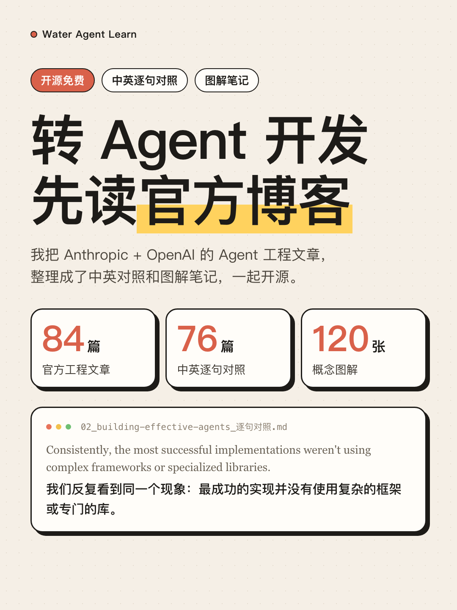
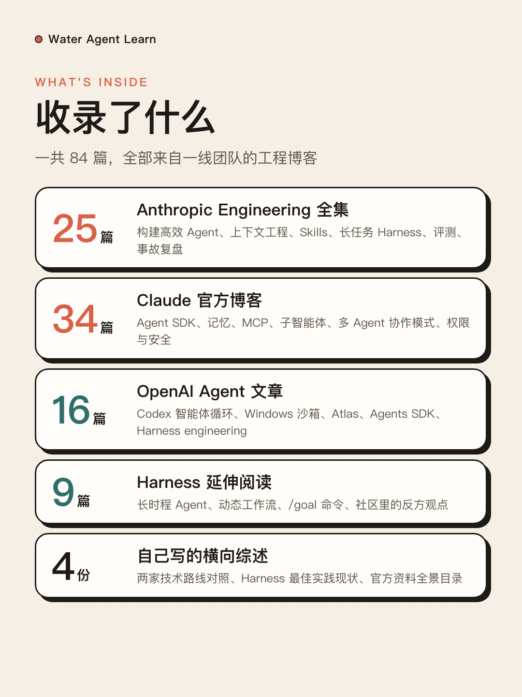
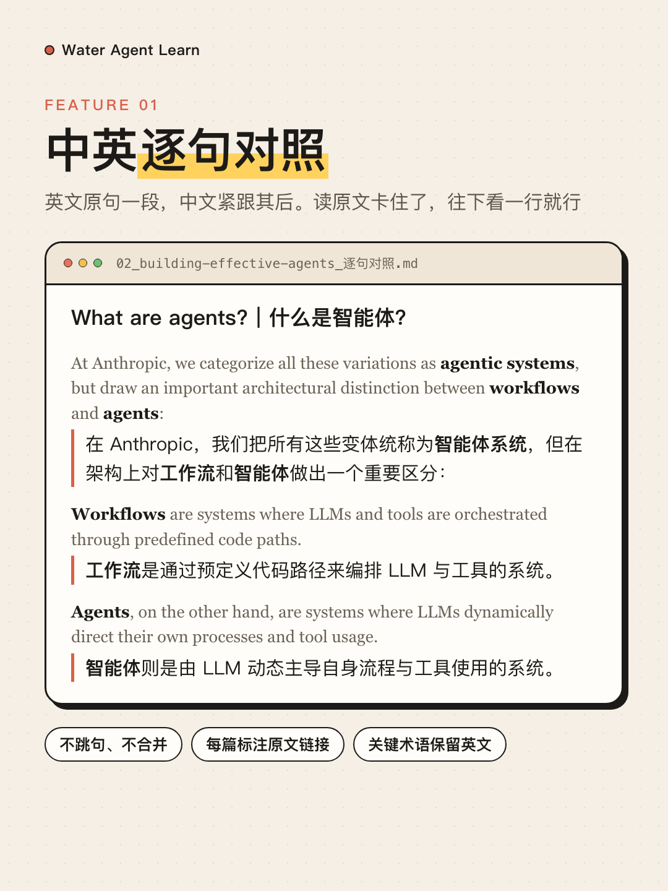
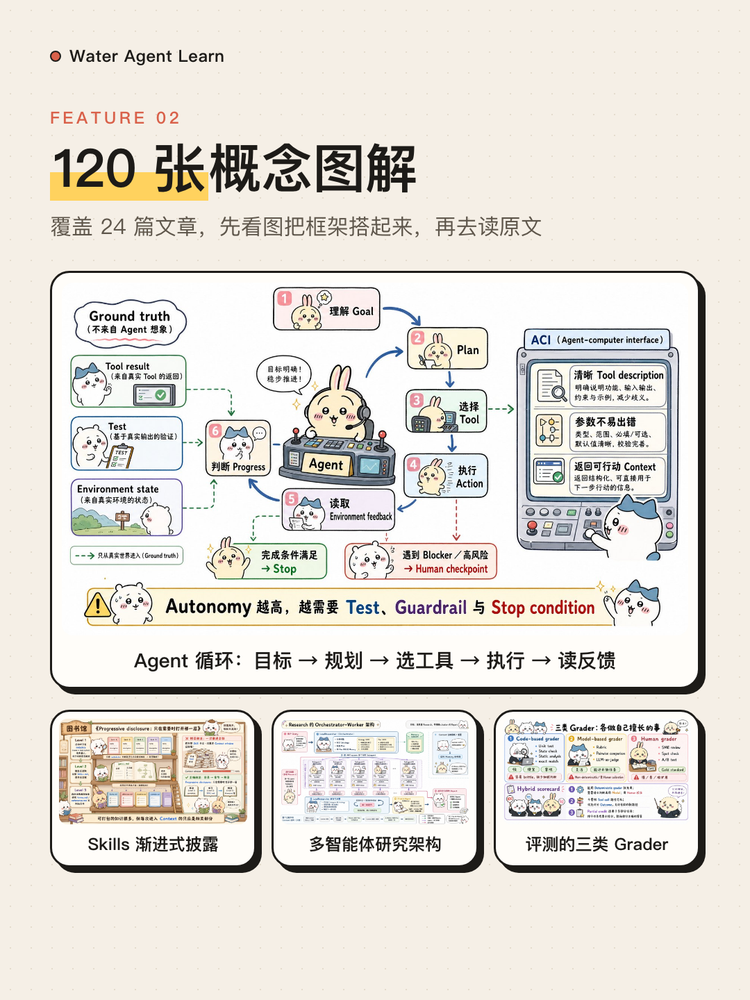
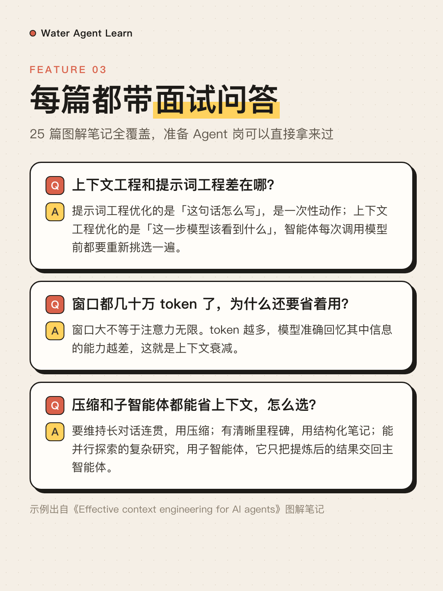
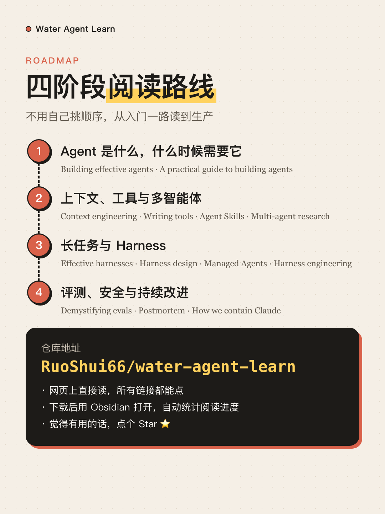

# Water Agent Learn

> 从传统开发转 Agent 开发，最快建立认知的方式，是读一线团队自己写的工程博客。
> 这里收录了 Anthropic 与 OpenAI 的 Agent 工程文章，提供中英逐句对照、图解学习笔记和速记版，可以直接在 GitHub 上读，也可以下载后用 Obsidian 打开。

<p align="center">
  
  
</p>

## 为什么从官方博客学起

框架文档告诉你 API 怎么调，官方工程博客告诉你**为什么这样设计**：什么时候不该上 Agent、工具描述怎么写、上下文满了怎么办、长任务怎么交接、评测怎么做、线上事故怎么复盘。这些取舍正是 Agent 开发和传统开发差别最大的地方，也是面试里最常被追问的部分。

## 收录内容

| 板块 | 内容 | 形式 |
| --- | --- | --- |
| [Anthropic Engineering](Anthropic/Engineering全集_逐句对照/00_目录与阅读进度.md) | anthropic.com/engineering 全部 25 篇 | 逐句对照 + 图解学习笔记（含面试高频问答） |
| [Claude Blog](Anthropic/ClaudeBlog全集_学习笔记/00_目录与阅读进度.md) | claude.com/blog 与官方报告 34 篇 | 逐句对照，其中 8 篇另有学习笔记；附原文存档 |
| [OpenAI Agent 精选](OpenAI/Agent精选_逐句对照/) | Codex 智能体循环、沙箱、Atlas、Symphony、评估等 8 篇 | 逐句对照 + 面试速记 |
| [OpenAI 经典](OpenAI/经典/) / [最新](OpenAI/最新/) | 2025 奠基指南 3 篇、2026 工程实践 5 篇 | 中文精读 |
| [Harness 延伸阅读](Harness延伸阅读_双语精读/00_目录.md) | 长时程 Agent、动态工作流、`/goal` 等 9 篇 | 逐句对照 + 双语精读 |
| 综述与目录 | [两家技术路线对照](00_两家公司Agent技术路线对照.md) · [原文链接清单](01_原文链接与元数据清单.md) · [Harness 最佳实践综述](02_Agent-Harness最佳实践现状综述_2026-08.md) · [Anthropic 资料全景目录](03_Anthropic官方Agent资料全景目录_2026-08.md) | 自己整理的横向总结 |

### 每篇文章的几种读法

- **逐句对照**（`_逐句对照.md`）：英文原句单独成段，中文翻译紧随其后，不跳句、不合并；Claude Blog 与 OpenAI 的篇目文末附术语中英对照表。适合精读和核对原话。
- **直观图解与学习笔记**（`_直观图解与学习笔记.md`）：每篇配约 5 张图解，加上结构化要点和面试高频问答。适合先快速建立框架。
- **速记 / 精读**（`_面试速记.md`、`_中文精读.md`、`_双语精读.md`）：几分钟过一遍核心结论。

建议先看图解笔记搭框架，遇到想深挖的段落再翻逐句对照。

<p align="center">
  
  
</p>
<p align="center">
  
  
</p>

## 建议阅读路线

### 第一阶段：Agent 是什么，什么时候需要它

1. Anthropic：Building effective agents（[图解](Anthropic/Engineering全集_逐句对照/02_building-effective-agents_直观图解与学习笔记.md) · [逐句](Anthropic/Engineering全集_逐句对照/02_building-effective-agents_逐句对照.md)）
2. OpenAI：[A practical guide to building agents](OpenAI/经典/01_Practical-guide-to-building-agents_中文精读.md)
3. OpenAI：[New tools for building agents](OpenAI/经典/02_New-tools-for-building-agents_中文精读.md)

读完应该能回答：Agent 和固定工作流的边界在哪里，模型、工具、指令、循环各自负责什么。

### 第二阶段：上下文、工具与多智能体

4. Anthropic：How we built our multi-agent research system（[图解](Anthropic/Engineering全集_逐句对照/06_multi-agent-research-system_直观图解与学习笔记.md) · [逐句](Anthropic/Engineering全集_逐句对照/06_multi-agent-research-system_逐句对照.md)）
5. Anthropic：Writing effective tools for agents（[图解](Anthropic/Engineering全集_逐句对照/08_writing-tools-for-agents_直观图解与学习笔记.md) · [逐句](Anthropic/Engineering全集_逐句对照/08_writing-tools-for-agents_逐句对照.md)）
6. Anthropic：Effective context engineering for AI agents（[图解](Anthropic/Engineering全集_逐句对照/10_effective-context-engineering-for-ai-agents_直观图解与学习笔记.md) · [逐句](Anthropic/Engineering全集_逐句对照/10_effective-context-engineering-for-ai-agents_逐句对照.md)）
7. Anthropic：Equipping agents for the real world with Agent Skills（[图解](Anthropic/Engineering全集_逐句对照/11_equipping-agents-for-the-real-world-with-agent-skills_直观图解与学习笔记.md) · [逐句](Anthropic/Engineering全集_逐句对照/11_equipping-agents-for-the-real-world-with-agent-skills_逐句对照.md)）
8. OpenAI：[Unrolling the Codex agent loop](OpenAI/Agent精选_逐句对照/01_深入解析%20Codex%20智能体循环_面试速记.md)

### 第三阶段：长任务与生产架构（Harness）

9. Anthropic：Effective harnesses for long-running agents（[图解](Anthropic/Engineering全集_逐句对照/15_effective-harnesses-for-long-running-agents_直观图解与学习笔记.md) · [逐句](Anthropic/Engineering全集_逐句对照/15_effective-harnesses-for-long-running-agents_逐句对照.md)）
10. Anthropic：Harness design for long-running application development（[图解](Anthropic/Engineering全集_逐句对照/21_harness-design-long-running-apps_直观图解与学习笔记.md) · [逐句](Anthropic/Engineering全集_逐句对照/21_harness-design-long-running-apps_逐句对照.md)）
11. Anthropic：Scaling Managed Agents（[图解](Anthropic/Engineering全集_逐句对照/23_managed-agents_直观图解与学习笔记.md) · [逐句](Anthropic/Engineering全集_逐句对照/23_managed-agents_逐句对照.md)）
12. OpenAI：[From model to agent](OpenAI/最新/03_From-model-to-agent_中文精读.md) · [Harness engineering](OpenAI/最新/04_Harness-engineering_中文精读.md)

读完这一阶段，接着看 [Agent Harness 最佳实践现状综述](02_Agent-Harness最佳实践现状综述_2026-08.md) 和 [Harness 延伸阅读](Harness延伸阅读_双语精读/00_目录.md)。

### 第四阶段：评测、安全与持续改进

13. Anthropic：Demystifying evals for AI agents（[图解](Anthropic/Engineering全集_逐句对照/16_demystifying-evals-for-ai-agents_直观图解与学习笔记.md) · [逐句](Anthropic/Engineering全集_逐句对照/16_demystifying-evals-for-ai-agents_逐句对照.md)）
14. Anthropic：A postmortem of three recent issues（[图解](Anthropic/Engineering全集_逐句对照/09_a-postmortem-of-three-recent-issues_直观图解与学习笔记.md) · [逐句](Anthropic/Engineering全集_逐句对照/09_a-postmortem-of-three-recent-issues_逐句对照.md)）
15. Anthropic：How we contain Claude across products（[图解](Anthropic/Engineering全集_逐句对照/25_how-we-contain-claude_直观图解与学习笔记.md) · [逐句](Anthropic/Engineering全集_逐句对照/25_how-we-contain-claude_逐句对照.md)）
16. OpenAI：[Inside OpenAI's in-house data agent](OpenAI/最新/05_Inside-OpenAI-data-agent_中文精读.md) · [Self-improving tax agents](OpenAI/最新/01_Self-improving-tax-agents_中文精读.md)

## 目录结构

```text
water-agent-learn/
├── 00_两家公司Agent技术路线对照.md
├── 01_原文链接与元数据清单.md
├── 02_Agent-Harness最佳实践现状综述_2026-08.md
├── 03_Anthropic官方Agent资料全景目录_2026-08.md
├── Anthropic/
│   ├── Engineering全集_逐句对照/   # Engineering 25 篇：逐句对照 + 图解学习笔记
│   ├── ClaudeBlog全集_学习笔记/    # Claude Blog 34 篇逐句对照 + 学习笔记 + 原文存档
│   └── _scripts/                  # 博客正文抽取、阅读进度刷新脚本
├── OpenAI/
│   ├── Agent精选_逐句对照/         # 8 篇逐句对照 + 面试速记
│   ├── 经典/                       # 2025 奠基文章中文精读
│   └── 最新/                       # 2026 工程实践中文精读
├── Harness延伸阅读_双语精读/        # 9 篇 Harness 延伸材料
└── assets/readme/                  # README 配图
```

## 怎么读

- **直接在 GitHub 上读**：所有链接都是相对路径，点开就能跳转。
- **下载到本地**：`git clone` 或点 Code → Download ZIP。推荐用 [Obsidian](https://obsidian.md) 打开整个文件夹，装上 Dataview 插件后，两个 `00_目录与阅读进度.md` 里的勾选框会自动统计阅读进度。不用 Obsidian 的话，可以运行 `python3 Anthropic/_scripts/refresh_progress.py`，把 Engineering 目录里的进度数字刷新成静态文本。

## 版权与免责声明

- 本仓库收录的文章原文（英文原句、原文存档、文中配图与视频）版权归 **Anthropic、OpenAI 及各原作者**所有。每篇开头都标注了原文链接，内容请以原文为准。
- 中文翻译、图解与学习笔记是个人学习整理，**不是官方翻译**，与 Anthropic、OpenAI 没有任何关联，也没有得到其认可。翻译和理解难免有误，欢迎提 Issue 指正。
- 本仓库仅供个人学习与交流，请勿用于商业用途。
- 如果你是相关权利人，认为某些内容不应在此公开，请提交 Issue，我会尽快删除。
- 图解插图是 AI 生成的学习示意图，其中的卡通形象仅作趣味化呈现，与任何角色形象的权利方没有关联，也未获其授权。

## 许可

本仓库的原创部分（学习笔记、图解、综述与目录）采用 [CC BY-NC-SA 4.0](https://creativecommons.org/licenses/by-nc-sa/4.0/deed.zh-hans) 许可：可以转载和改编，但需署名、不得商用、并以相同方式共享。文章原文及翻译所依据的原作内容不在此许可范围内，版权仍归原作者。详见 [LICENSE](LICENSE)。
